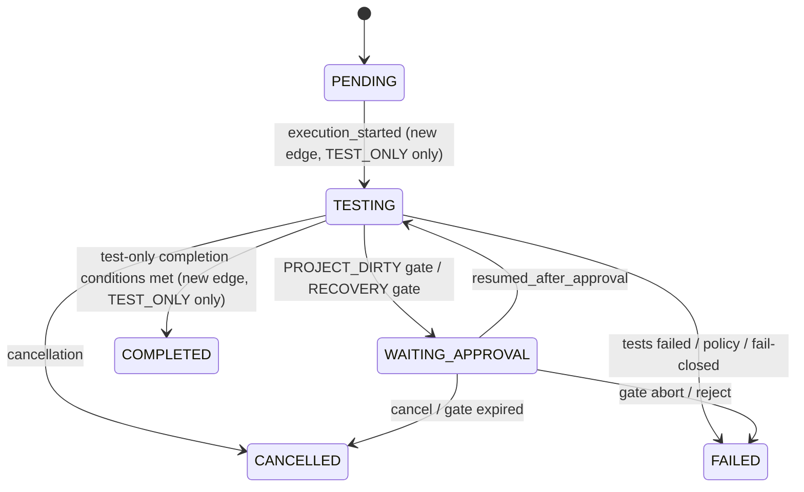

# D4 v3 — Project Test Run as a test-only Task (design)

Korean translation: [D4-test-only-task_ko.md](D4-test-only-task_ko.md)

> **Status: design proposal, not approved, not implemented.** No production code, test, migration or configuration was changed for this document.
> **Supersedes** the earlier D4 designs [D4-test-run-lock-domain_ko.md](D4-test-run-lock-domain_ko.md) (v1 and v2, including their review appendices), which are kept unchanged as history. The `owner NONE | TASK | TEST_RUN` model of v2 option (a) is **abandoned** and recorded only as a possible later extension (§14).
> **Prerequisite:** [process-lifecycle-hardening.md](process-lifecycle-hardening.md) (B2). **E must not be implemented before B2 is implemented, verified and re-reviewed, and before this document is approved.**
> D5 (`sys.executable` stays), D6 (fail-fast stays) and F (not started) are unchanged. Facts were read from the working tree; anything not verified is marked **(unverified)**.
> **Revision 3.1.** Re-verified against the working tree after B2 landed (HEAD `2f7da7f`). The corrections and the one addition are listed in §16. Still a proposal: not approved, not implemented.

## 1. Decision and why (d)

A *Project Test Run* is an ordinary `Task` with `mode = TEST_ONLY`. The project write owner stays a Task (`projects.write_owner_task_id`), so nothing in the lock domain, Human Gate, Lease, Runner claim or recovery has to learn a second kind of owner.

Reasons, from the code review of v1/v2:

- `HumanGateService` is Task-centric throughout (`_decide_once` locks the Task, computes `current_basis`, creates a Task `ExecutionRequest`; `Approval.task_id` is `NOT NULL`; `ApprovalOut.task_id` is required). Generalising it was the largest v2 risk. A Task-based run needs **no** gate change.
- The `PROJECT_DIRTY` effect (`ProjectDirtyRecoveryEffect`) is keyed by `reason_code` only and uses `approval.task_id`; a separate Run reason code would have been needed. A test-only Task uses the existing effect unchanged.
- v2 had to build lease/heartbeat/fencing, startup recovery, stop/drain, cancellation delivery and a Run state machine in parallel to `TaskRun`/`Runner`. A Task already has all of it.
- Ten of the v2 findings (owner API, AST rule, `read_state` tri-state, epoch semantics, `_recover_rest` placement, …) exist only because of the second owner kind.

Cost accepted: a mode on the Task model, one new workflow branch, a mode-aware terminal rule, and list/report noise handling (§9). The mode column overlaps in spirit with the deferred "plan / review / full mode" design (§14).

## 2. Reused mechanisms (verified)

| Mechanism | Where | Reuse |
|---|---|---|
| Task row, states, `TASK_TRANSITIONS` | `app/models/states.py`, `app/models/tables.py` | new mode-aware edges (§4) |
| `ExecutionRequest` (START/RESUME, claim token, `defer_count`, `not_before`) | `app/models/tables.py`, `approval_repository.py` | unchanged |
| `TaskRun` + `LeaseService` (heartbeat, takeover, `unterminated_executions`) | `lease_service.py`, `task_repository.py` | unchanged |
| `Runner` claim/dispatch/stop/drain/recover | `runner.py` | unchanged |
| `ProjectLockService.ensure_for_step`, baselines, `reconcile` | `project_lock_service.py` | called with the new step key |
| `PROJECT_DIRTY` Human Gate and `ProjectDirtyRecoveryEffect` | `project_lock_service._open_dirty_gate`, `project_recovery_effect.py` | unchanged |
| Cancellation | `TaskService.request_cancellation`, `_cancel_idle_tasks`, `_finalize_cancel` | unchanged API (`/tasks/{id}/cancellation-requests`) |
| Terminal finalize with project proof | `TaskFinalizer`, `release_on_terminal` | branch on mode (§6) |
| Tracked process execution and tree proof | **B2 (implemented, `8907d60`)**: `TestPolicyService.run(..., tracked=port)`, `StepRunner.watch_cancel(task_id, cancel, key)` | reused as is |

Not reused / not touched: Planner, Design Reviewer, Developer, Code Reviewer, `completion_checker.check_definition_of_done`, profiles' completion criteria, `HumanGateService` internals.

**Not reusable as is:** `StepRunner.execute` is agent-only (it selects `providers[ROLE_PROVIDER[role]]`, records and resumes a native session). A TEST_ONLY step needs a small non-agent execution primitive in `StepRunner` (§4.1); this is new code, not a reuse.

## 3. Model

- `tasks.mode varchar(16) NOT NULL DEFAULT 'WORKFLOW'`, `CHECK (mode IN ('WORKFLOW','TEST_ONLY'))`. Name check: `mode` does not collide with existing identifiers (`RequestKind` is `ExecutionRequest.kind`; `kind` is also used for `StateTransition.kind`, so `kind` would be ambiguous). Alternative names (`task_kind`, `execution_mode`) are acceptable; **no separate owner kind is introduced.**
- `tasks.idempotency_key varchar(128) NULL`, `tasks.request_fingerprint varchar(64) NULL`, partial unique index `(project_id, idempotency_key) WHERE idempotency_key IS NOT NULL`.
- Checks: `mode='TEST_ONLY'` requires `project_id IS NOT NULL`; `idempotency_key IS NULL` unless `mode='TEST_ONLY'` (a general Task can never carry one). All checks are NULL-safe (`IS TRUE`), as in migrations 0003/0004.
- The Task's `test_policy` / `test_policy_hash` come from `resolve_test_policy(project.test_policy, project_root)` exactly as in `TaskService.create_task`. `requirements` is a fixed text (e.g. `"Run the project's tests"`) so existing `validate_requirements` hashes still apply.
- `create_test_run` copies the project's active profile (`profile_version`, `profile_hash`, `profile_snapshot`) onto the Task exactly as `create_task` does (`task_service.py:143-158`, under the same project row lock). The `ck_tasks_profile_all_or_none` check requires the three fields to agree, and a project without an active profile keeps them `NULL`. The shared part of `create_task` (project lock, policy resolution, profile copy, Task insert) is factored into one helper used by both, not duplicated.

## 4. State flow (verified against `states.py` and `workflow_service.py`)

There is no `RUNNING` Task state; the Task states are `PENDING, PLANNING, DESIGN_REVIEWING, DEVELOPING, TESTING, REVIEWING, RETRYING, WAITING_APPROVAL, COMPLETED, FAILED, CANCELLED`. A test-only Task uses only `PENDING, TESTING, WAITING_APPROVAL, COMPLETED, FAILED, CANCELLED`:

- New edges `PENDING → TESTING` and `TESTING → COMPLETED` are valid **only for `mode = TEST_ONLY`**. `check_task_transition` gains a mode-aware variant; the existing table and its tests stay true for `WORKFLOW` (no edge is added to `TASK_TRANSITIONS`).
- The gate happens **after** `PENDING → TESTING`, because `open_recovery` moves the Task to `WAITING_APPROVAL`, which `PENDING` does not allow (`TASK_TRANSITIONS[PENDING]` = `PLANNING, FAILED, CANCELLED`).
- Handler dispatch: `WorkflowService._handlers` is keyed by state. TEST_ONLY needs its own two handlers (`PENDING`, `TESTING`); the dispatch line in `run_task` (`self._handlers[state]`) selects by `(mode, state)`. All other `run_task` behaviour (lease loss, `ProjectBusy`, `TaskCancelled`, `TerminationUnconfirmed`, `FailClosed`) is reused as is.
- **Step key (G10).** **Decided:** the test-only step uses the **existing key `TEST`**; `Task.mode` tells the two flows apart. `STEP_TASK_STATE[TEST] = TESTING` and `STEP_ROLE[TEST] = TESTER` already exist, so the gate resume (`_proceed_resume`), `_finalize_cancel`, `_recovery_unsafe`, `ReportService.KINDS` and the report's `tests` section need no new key. The workflow reuse logic (`_do_test`, `_reusable`, `_previous_test_ids`) is unreachable because TEST_ONLY has its own handlers, and its `input_hash = stable_hash("test_only", task.id, task.test_policy_hash)` carries a domain separator. Alternative: a new key `TEST_ONLY` (≤ 32 chars) in `STEP_TASK_STATE`/`STEP_ROLE`/`KINDS`. It is easier to grep and cannot be confused with a workflow test, but every consumer below must then learn it.
- Consumers of the step keys, read in the code: `workflow_service.py` uses `STEP_ROLE.values()` as a role filter (`_finalize_cancel`, `_recovery_unsafe`), `STEP_TASK_STATE[approval.checkpoint_step_key]` for the resume state, `STEP_ROLE[step_key]` in `_agent_step`; `report_service.py` has `KINDS` (the artifact list drops a key outside it and `validity.of` returns `NOT_APPLICABLE`) and reads `STEP_TEST` for `tests` and for `orchestrator_test_run`. With the existing key all of them already work for the test-only step; the report's `validity.of(TEST)` depends only on the requirements and policy hashes and the workflow iteration (read), not on a plan or a developer step.

### 4.1 `_do_test_only` outline

`StepRunner.execute` cannot be used: it is agent-only. The TESTING handler is built from the same parts as `_agent_step` plus one new primitive.

1. `PENDING` handler: `PENDING → TESTING` (`execution_started`), mode-aware.
2. `TESTING` handler:
   1. `_interrupted_needs_human(ctx, task, STEP_TEST, mutating=True)` (reused; it takes no agent, it compares the latest step's `snapshot_before` with the workspace and scans execution tails — read in the code). For a TEST_ONLY retry the snapshot-diff rule is relaxed as in §7.3.
   2. `ProjectLockService.ensure_for_step(...)` exactly as `_agent_step` calls it, including the `GateLineage` branch when `ctx.resumed_from_approval_id` is set: `READY` → continue (then `_reset_defer_once`), `GATE_OPENED` → `ctx.parked`, `BLOCKED` → `ProjectBusy` (existing defer path, with the bounded-wait rule of §7.4).
   3. `steps.begin(..., on_begin=locks.on_mutating_begin)`: test execution mutates the workspace, so the epoch bump and the owner assertion apply as for a normal TEST step.
   4. **New `StepRunner` primitive for a non-agent step** (e.g. `execute_local`): verifies the lease, runs `TestPolicyService.run(..., tracked=port)` outside any transaction with a `TrackedCommandSession` (as `_tracked(ctx, task, "test_run", step_id)` does today), starts `watch_cancel(task_id, cancel, key)` with the run key so a cancel request reaches `CommandExecutor.cancel`, and takes `snapshot_after`. No provider, session or prompt is used. The recorded `Execution` rows are the B2 tracked rows (`STARTING` before spawn, `pid`/identity through `on_started`, finish with the B2 termination status) plus the `orchestrator_test_run` row that `ReportService` reads.
   5. `TerminationUnconfirmed` (existing) → `_park_for_recovery` (RECOVERY gate, lease **not** released). A cancel → `TaskCancelled` → `_finalize_cancel`. No automatic re-run.
   6. Complete through the same proof-retry loop as `_complete_succeeded` (`FingerprintProofStale`, `PROOF_MAX_ATTEMPTS`, then `UNMEASURED`): step output, completion evaluation (§5), task transition, `release_on_terminal` with the terminal proof (§6) in one transaction.

No agent CLI, session, prompt or provider is used in this flow.

## 5. Completion conditions

`completion_checker.check_definition_of_done` / `evaluate_definition_of_done` (workflow DoD: design review, tests, code review, profile criteria) is **not** applied. A new pure function `evaluate_test_only_completion(...)` returns a list of `Condition`s (same shape as the existing one, so reports can show them):

| Condition | Source |
|---|---|
| `TEST_POLICY_UNCHANGED` | step output `test_policy_hash == task.test_policy_hash` |
| `TESTS_PASSED` | `test_result.passed` (exit codes and fresh JUnit, from `TestPolicyService.run`) |
| `JUNIT_OK` | `test_result.junit_ok` |
| `MIN_TESTS_EXECUTED` | `executed - skipped >= policy.min_tests_executed` |
| `LEASE_VALID` | `LeaseService.verify` inside the completing transaction (already done by `steps.complete`) |
| `CLAIM_FENCE_VALID` | existing `ExecutionRequest` token fence at `finish` |
| `NO_CANCEL_REQUESTED` | `task.cancel_requested_at IS NULL` read under the Task row lock in the same transaction |
| `PROCESS_TREE_TERMINATION_CONFIRMED` | B2: command `lifecycle ∈ {EXITED, TERMINATED}` and `tree = EMPTY` |

All met → `COMPLETED`. Any condition unmet → `FAILED` with `failure_reason` = the first unmet condition code (`TESTS_FAILED`, `NO_JUNIT`, `TOO_FEW_TESTS`, `CANCEL_REQUESTED`, …). A cancellation request wins over completion. `TERMINATION_UNCONFIRMED` never reaches this function: it parks the Task for recovery (§7).

Not applicable (explicit, not "missing"): `PLAN`, `DESIGN_REVIEW`, `CODE_REVIEW`, `profile_criteria`. `ReportService` and the artifact API render them as `NOT_APPLICABLE` for `mode=TEST_ONLY`, never as absent/failed; today a missing step yields `None` in the report, so this is a small `ReportService` change. A Task without a plan is already tolerated by `current_plan_hash` (`""`, `fingerprints.py:26-33`), `current_basis` (`fingerprints.py:36-43`) and the report's `plan_hash` (`""`); the report and the artifact list for a TEST_ONLY Task are **not tested yet** and tests must cover them.

## 6. Project lock release rule (mode-aware)

`release_on_terminal(session, task, to_state, proof)` (`app/services/project_terminal.py`) today: valid proof + `COMPLETED` → `CLEAN` and the **final fingerprint becomes the accepted baseline**; valid proof + `FAILED`/`CANCELLED` → `CLEAN` only if the fingerprint equals `write_baseline_fingerprint`, else `DIRTY_UNRESOLVED`; no proof → `DIRTY_UNRESOLVED`.

New rule, selected by `task.mode`:

| `mode` | terminal | result |
|---|---|---|
| `WORKFLOW` | any | unchanged |
| `TEST_ONLY` | `COMPLETED`, `FAILED`, `CANCELLED` alike | **never** accept the final fingerprint as the new baseline. Fingerprint == `write_baseline_fingerprint` (and current version) → `CLEAN` (accepted baseline untouched); different → `DIRTY_UNRESOLVED`; measurement failed / stale / missing proof → `DIRTY_UNRESOLVED` |

- A test-only `COMPLETED` therefore does not silently adopt build by-products or modified tracked files. `DIRTY_UNRESOLVED` is resolved by the existing `PROJECT_DIRTY` gate on the next Task/test-run; `continue` is the only path that calls `accept_baseline`.
- Ignored/volatile build outputs (`build/`, `target/` when git-ignored) are outside `WORKSPACE_FINGERPRINT_V1` in GIT mode, so a normal run can end `CLEAN`. Untracked non-ignored outputs make it `DIRTY_UNRESOLVED`. A diagnostics item reporting whether the JUnit/build output paths are ignored is proposed as a P1 follow-up, not part of E.
- Process tree: a run whose tree termination is unconfirmed does not reach `release_on_terminal` normally (the Task is parked, owner kept, lease not released). Existing contract, stated as it is: a Task **abort** at the gate already releases the lock as `DIRTY_UNRESOLVED` without proving CLI death (`HumanGateService._apply` → `change_task_state(FAILED, project_proof)`); `declare-gone`-style semantics are therefore not weaker than today. The new part is that a TEST_ONLY Task's own commands are B2-tracked, so a *successful* end always carries the stronger tree proof.

## 7. Gate, cancellation, timeout, recovery

### 7.1 PROJECT_DIRTY gate

- Uses the existing gate unchanged. `ensure_for_step` opens it when `workspace_state != CLEAN` (`_open_dirty_gate`, reason code `PROJECT_DIRTY`, options `("continue","abort")`, `P.PROJECT_DIRTY_OPTIONS`). **No new reason code, no Run-specific approval owner.**
- `ProjectDirtyRecoveryEffect` is mode-agnostic: `prepare` measures outside any transaction, `apply` locks the Project, `continue` → `accept_baseline` + RESUME request (the TEST_ONLY Task resumes in `TESTING`, because `STEP_TASK_STATE[TEST] = TESTING`), `abort/reject` → `FAILED` through the common terminal path. No option needs restricting for TEST_ONLY. `current_basis` tolerates a Task without a plan (read: `fingerprints.py:36-43`, `plan_hash` is `""`), but deciding a gate end to end for a TEST_ONLY Task is **not tested yet** — a test must do it.
- The gate effect does no OS process work (it only measures and writes DB rows); it runs on the API request path as it does today.

### 7.2 Gate expiry and the exit

An approval is valid for a bounded time; a new decision after `valid_until` raises `Gone("approval expired")` (`HumanGateService._decide_once`). Nothing re-opens it today, so a parked Task would wait forever. For TEST_ONLY only, the Runner's recovery pass (`_recover_rest`) cancels a `WAITING_APPROVAL` TEST_ONLY Task whose pending approval is expired, through the **existing** idle-cancel path (`_cancel_one_idle` → `finalize_task_with_proof` → `CANCELLED` with `reason = gate_expired`). The user re-requests with a new `POST /projects/{id}/test-runs` (a new Task; a parked Task does not own the lock because the gate opens **before** acquisition, so it never blocks the new one). The explicit exit for any user is `POST /tasks/{id}/cancellation-requests` → `_cancel_idle_tasks`. WORKFLOW Tasks are unchanged.

### 7.3 Cancellation, timeout, Runner stop

- Cancel: the existing request path writes `cancel_requested_at` under the Task row lock; the Runner terminates the command via the `run_key`, B2 proves the tree, then `_finalize_cancel` finishes. If `unterminated_executions` is non-empty (tracked executions have a row from `STARTING`), it opens a RECOVERY gate instead of cancelling — now also true for test commands.
- Timeout: `policy.timeout_seconds` → `CliOutcome.TIMEOUT`, B2 settlement; the step fails `FAILED(TESTS_TIMEOUT)` when the tree is proven empty, else parked.
- Runner stop vs task cancel: both converge on the B2 idempotent settlement; stop uses the existing `_drain`/`RunnerStopIncomplete` budget. No new interaction between them is introduced by TEST_ONLY.
- Process termination uncertain: **never auto-rerun.** Existing `_park_for_recovery`/`Runner._park_uncertain` gates (RECOVERY, reason `EXECUTION_UNCERTAIN`). Option handling for TEST_ONLY recovery gates (decision G5): `abort` always; `retry` re-runs only after `_recovery_unsafe` confirms no unterminated execution; the snapshot-diff check in `_recovery_unsafe` (a retry is refused when the workspace differs from the step's `snapshot_before`) must be relaxed for TEST_ONLY because a partially run build legitimately changes files — the project fingerprint at terminal remains the safety net.

### 7.4 Crash and duplicate execution

- Claimed but crashed: existing `stale_claimed` recovery requeues the request; `LeaseService.acquire` takeover terminates the previous run's **tracked** executions by identity (B2 makes test executions visible there) and returns `UNCERTAIN` if not proven → RECOVERY gate, never a silent re-run.
- Duplicate test run prevention: claim token + `fence_ok` + `TaskRun` lease + the `STARTING` execution row written before spawn + project write owner exclusivity (a second Task cannot enter `ensure_for_step` as owner). The idempotency key (§8) prevents duplicate *requests*.
- Bounded wait for a busy project: today a Task blocked by another owner is re-queued indefinitely with backoff (`defer_delay`, capped at `DEFER_MAX_SECONDS=60`). A test run should not queue silently for hours. Proposal (decision G3): for `mode=TEST_ONLY`, when the request's `defer_count` reaches `TEST_RUN_MAX_DEFERS` (`policies.py`), the Task ends `FAILED(PROJECT_BUSY)` instead of deferring again (`defer_count` and `ctx.request_id` already exist). Rejecting at creation time is not done: the authoritative check is acquisition, and creation stays DB-only.

## 8. Creation API and idempotency

`POST /projects/{id}/test-runs` → **202** with `ProjectTestRunOut` (the run id is the Task id; `TestRunOut` already exists in `app/schemas/reports.py` for the report's tests section, so the new schema needs another name).

- Body: `{"idempotency_key": str|null}` only. No command, args, env, path, interpreter or policy override: the Task's `test_policy` is the project's (or its preset resolved at creation, as `create_task` does).
- Transaction (one, short, DB-only): `ProjectRepository.lock(project_id)` (`FOR UPDATE`, the same lock `create_task` and archive use) → `status == ACTIVE` else 409 → idempotency lookup → active-run check → insert `Task(mode=TEST_ONLY, …)` + `StateTransition(created)` + `ExecutionRequest(START, PENDING)` (the two inserts that `create_task` and `request_execution` do separately today are done together). **No fingerprint, no file access, no process, no lock held across anything slow** (the test-policy resolution reads the project root as `create_task` does today; this is the existing behaviour).
- Idempotency (the key is looked up **first**, before the active-run check):

| Request | Response |
|---|---|
| same key, same `request_fingerprint` (hash of project id + `test_policy_hash`), Task in progress | 200, that run, `replayed: true` |
| same key, same fingerprint, Task finished | 200, its final result, `replayed: true` |
| same key, different fingerprint | 409 `IDEMPOTENCY_KEY_REUSED` |
| new key or no key, a non-terminal TEST_ONLY Task of this project exists | 409 `TEST_RUN_ACTIVE` (with the active id) |
| new key or no key, none active | 202, new run |

The active-run check and the insert are serialised by the project row lock, so two concurrent POSTs cannot both create a run; the partial unique index `(project_id, idempotency_key)` is the back-stop. A concurrent duplicate key that loses the race re-reads and answers per the table (no raw `IntegrityError` to the client).
- Project `ARCHIVED` → 409 (same message as `create_task`). Archive is serialised by the same project lock, and `count_open_tasks` counts TEST_ONLY Tasks like any other non-terminal Task, so a project with an open test run cannot be archived.
- `POST /tasks` does **not** gain a `mode` field. `TaskService.create_task` keeps its signature for general Tasks; a separate `create_test_run` (service) is the only code path that can write `mode='TEST_ONLY'`; the DB check (§3) is the back-stop. An architecture test pins that the Task create schema has no `mode`.
- Other endpoints: `GET /projects/{id}/test-runs` (paginated, TEST_ONLY Tasks of the project), `GET /test-runs/{id}` (the Task if `mode=TEST_ONLY`, else 404; includes completion conditions and the B2 process summary without pid/identity), cancellation through the existing `POST /tasks/{id}/cancellation-requests`. Routers stay thin; validation lives in `validators.py`; limits in `policies.py`; response size and sanitizer contracts apply.

## 9. Visibility and noise

| Option | Compatibility | Noise |
|---|---|---|
| 1. TEST_ONLY included in `GET /tasks` | existing clients start seeing a new kind | high |
| **2. excluded from `GET /tasks` by default, `?mode=` filter to include/select (proposed)** | no change for existing data (all rows are `WORKFLOW`); additive query parameter | none by default |
| 3. only the project test-run list | zero impact on `GET /tasks` | none; two places to look |

Proposal: option 2 plus the dedicated endpoints of §8. `TaskOut` gains an additive `mode` field (existing clients ignore it; no test references `TaskOut` or pins its key set (a search of `tests/` found none); the full API suite still runs, and a test that does pin it would be updated, not weakened). `GET /tasks/{id}`, `/tasks/{id}/changes`, `/tasks/{id}/report`, `/tasks/{id}/artifacts` work for TEST_ONLY Tasks: the Changes endpoint shows what the test run changed relative to the Task baseline (a useful by-product of reusing baselines).

## 10. Row-lock order (verified by reading the code)

Locks: `T` = `tasks` row (`TaskRepository.lock`), `TR` = `task_runs` row (UPDATE-lock via `LeaseService.verify`/`release`), `P` = `projects` row, `A` = `approvals` row, `ER` = `execution_requests` row. Isolation is READ COMMITTED (`app/db.py`, no override). Only `lock_registration` and the Runner session lock use advisory locks.

| Flow | Sequence | Evidence |
|---|---|---|
| create Task / archive | `P` only (create inserts new rows afterwards; archive does a plain count) | `task_service.py:88`; `project_service.py:154,166,172` |
| `POST /projects/{id}/test-runs` (new) | `P`, then inserts (Task, transition, ER). No `T` lock, no `TR` | same pattern as `create_task` |
| Runner claim | `ER` only (`SKIP LOCKED`, UPDATE) | `approval_repository.py:97-120`; `runner.py:900-906` |
| `LeaseService.acquire` | `T`, (takeover: Execution UPDATE), `TR`, insert new `TR` | `lease_service.py:90-135` |
| `ensure_for_step` → `_acquire_once` / `_recover_once` | `T`, `TR` (`verify`), `P`, then baseline insert | `project_lock_service.py:241-244, 314-316` |
| `StepRunner.begin` (+ `on_mutating_begin`) | `T`, `TR`, `P` (epoch bump), insert step | `step_runner.py:109-113`; `project_lock_service.py:200-203` |
| `StepRunner.complete` with terminal mutate | `T`, `TR`, step UPDATE, `P` (`release_on_terminal`) | `step_runner.py:265-277`; `state_service.py` |
| `TaskFinalizer._attempt` (`_fail`, `_finalize_cancel`, `_cancel_one_idle`, `_after_test`) | `T`, `P`, then `work` (`TR` via `verify`) | `task_finalizer.py:51,55` |
| Human Gate decide | `A`, `T`, (effect) `P`, then `ER` insert (RESUME) | `human_gate_service.py:144,159`; `project_recovery_effect.py:40` |
| open gate / recovery | inside the caller's transaction, under `T` (and `TR`/`P` when called from `_acquire_once`) | `human_gate_service.py:62-102` |
| cancel request | `T` only | `task_service.py:181-191` |
| reconcile | `P` only | `project_lock_service.py:377` |

Consistent global order for every verified flow: **`A` → `T` → (`TR`, `P`) → `ER` → leaf rows**. Two inversions exist **today** and are unchanged by this design: (A) `TR` vs `P` (`_acquire_once`/`begin`/`complete` take `T, TR, P`; `TaskFinalizer` takes `T, P, TR`), (B) `A` vs `T` (`_decide_once` takes `A, T`; `_record_start`'s `before_spawn` takes `T, A`). Neither can form a cycle: every `TR` holder already holds `T` (exclusive, all 13 `verify` call sites), heartbeat/`release` without `T` take only `TR`, and `before_spawn` is reached only after the decision exists, so an idempotent replay returns before locking `T`. **TEST_ONLY adds no new lock edge:** its creation is `P`-then-inserts, execution and gate use the existing sequences above, expiry-cancel is `T, P, ER` (as `_cancel_one_idle`). Unverified: implicit PostgreSQL `KEY SHARE` locks from child-row INSERT/FK checks; the multi-row `UPDATE execution_requests` in `_cancel_one_idle` against `_recovery_body`'s unordered per-row updates. If a hard global order is wanted, the cheapest fix is to verify the lease before locking `P` in `_attempt` — out of scope here.

## 11. Staging, migrations, deployable states

| Stage | Content | Deployable alone? |
|---|---|---|
| **E0** | **Done.** B2 is implemented and committed (`8907d60`, docs `e483c82`): tracked test commands, tree proof, cancellation-safe settlement, `executions` columns (migration `0005`). The generalised cancel watcher and `TestPolicyService.run(tracked=…)` already exist. | The stricter outcome for commands that leave surviving processes (B2 H4) is already in force for ordinary Tasks. Remaining E0 work: none; the new non-agent `StepRunner` primitive belongs to E1. |
| **E1** | migration (provisional `0006`): `tasks.mode`, `idempotency_key`, `request_fingerprint`, index, checks; mode-aware transitions; `_do_test_only`; mode-aware `release_on_terminal`; `evaluate_test_only_completion`; `TaskService.create_test_run` (internal); no public endpoint | Yes: every existing row is `WORKFLOW`, the new code path is unreachable from the API. Behaviour of existing Tasks unchanged; existing tests that fix the transition table, `TaskOut` keys or the architecture endpoint list are re-checked, and any that must change (new transition function, new column in schema tests) are updated openly. |
| **E2** | `POST/GET /projects/{id}/test-runs`, `GET /test-runs/{id}`, `GET /tasks` mode filter, `TaskOut.mode`, report/artifact `NOT_APPLICABLE`, diagnostics/Changes wording, gate-expiry cancel, bilingual workflow docs (07, 09, 11, 05, README, ARCHITECTURE) | Yes |

Migration numbers are provisional (HEAD is `0005`, B2's migration; E1 would be `0006` if nothing else lands first). **E1 upgrade:** add columns with defaults, backfill is implicit (`WORKFLOW`), add checks and the partial unique index. **E1 downgrade:** refuse if any `TEST_ONLY` task exists (no silent history loss), else drop index, checks, columns. Each migration is verified by up/down/up and `alembic check`.

## 12. Test plan

Unchanged-behaviour guarantees first, then the new behaviour. None of this has been run.

- **Existing behaviour unchanged:** full Lease, Recovery, Project Lock, Completion, Human Gate, Runner, report and API suites; `TASK_TRANSITIONS` for `WORKFLOW` identical; a workflow Task still cannot go `TESTING → COMPLETED` or `PENDING → TESTING`.
- **No agent is called:** a TEST_ONLY Task never invokes Planner/Reviewer/Developer providers (spy on every provider; `cli_invocations == 0`).
- **Project lock exclusion:** TEST_ONLY vs WORKFLOW Task start race — exactly one owner; the other defers; TEST_ONLY vs TEST_ONLY.
- **Create vs archive race:** concurrent `POST test-runs` and archive → either the run exists and archive is 409, or archive wins and the POST is 409; never a run on an ARCHIVED project.
- **Idempotency:** all five rows of the §8 table; concurrent same-key POSTs create one Task; concurrent different keys with an active run → one 202 and one 409.
- **Gate:** DIRTY workspace → `PROJECT_DIRTY` gate on a TEST_ONLY Task; `continue` accepts the baseline and resumes in `TESTING`; `abort` → `FAILED`; decide after expiry → `Gone`; expiry sweep cancels the parked TEST_ONLY Task; a new POST then works; a WORKFLOW Task in the same state is untouched.
- **Completion/release:** `COMPLETED` with an unchanged workspace → `CLEAN` and the accepted baseline untouched; `COMPLETED` after a tracked-file change → `DIRTY_UNRESOLVED` and the baseline **not** replaced; `FAILED`/`CANCELLED` likewise; measurement failure → `DIRTY_UNRESOLVED`; a WORKFLOW `COMPLETED` still accepts the baseline (regression).
- **Cancel / timeout / stop:** cancel during the command (tree proven gone → `CANCELLED`); timeout; Runner stop racing a cancel; tree unconfirmed → parked, owner kept, no rerun; crash with a `STARTING`-only tracked execution → UNCERTAIN gate; duplicate execution impossible after takeover.
- **Bounded wait:** defer count reaches the limit → `FAILED(PROJECT_BUSY)`; WORKFLOW Tasks still defer without limit.
- **Reports/API:** report and artifacts show `NOT_APPLICABLE`, not missing; `GET /tasks` default excludes TEST_ONLY and the filter works; `TaskOut.mode`; `POST /tasks` has no `mode`; the DB rejects `mode='TEST_ONLY'` without a project and an idempotency key on a WORKFLOW Task.
- **Changes:** `/tasks/{id}/changes` of a finished TEST_ONLY Task reports the by-products relative to its baseline.
- **Migration:** up/down/up, `alembic check`, downgrade refusal with an existing TEST_ONLY task.
- **Real environment:** not run without a JDK/Maven/Gradle and the real CLIs; B2's Windows/POSIX process tests are reported per platform, never as passed when not executed.

## 13. Mapping of the v2 review findings

| v2 finding | v3 resolution |
|---|---|
| B1 gate generalisation, lock-order inversion with `Run` | Not needed: the existing Task gate is used; no Run approval owner (§1, §7.1). Lock order verified in §10, no new edge |
| B2 tree termination not enforceable | Moved to the prerequisite B2 document (tracked commands, Job Object / process group, proof, persistence) |
| B3 `PROJECT_DIRTY` reason code shared by Task and Run | Not needed: same Task effect, no Run reason code (§7.1) |
| M1 `LAUNCHING` without pid mis-classified as unconfirmed | B2 §4/§7: `SPAWN_FAILED` vs `TERMINATION_UNCONFIRMED`, suspended-until-identity protocol |
| M2 OS work from the API process | B2 §8: only Runner/recovery workers; gate effects do no OS work (§7.1) |
| M3 RECOVERY_REQUIRED without exit / gate expiry | §7.2: expiry-cancel for TEST_ONLY, user cancel, re-request |
| M4 owner AST rule too weak | N/A: no new owner API |
| M5 epoch semantics for read-only steps | N/A: owner stays a Task; existing `read_state`/`_project_changed` apply unchanged |
| M6 POST vs archive race, duplicate active run | §8: project row lock + partial unique index |
| M7 recovery placement, `_test_inflight` | N/A: the Task path is the Runner's existing path |
| M8 cancel delivery | §4.1 and B2 §9: `run_key`, the cancel watcher (already generalised), existing cancel request |
| M9 "existing tests unchanged" claim | §11: tests that must change are listed and changed openly |
| (round 1) read-only Task step ignores a Test Run | N/A: a TEST_ONLY Task is a Task owner; foreign-owner defer applies |
| (round 1) Test-Run-only users stuck in DIRTY | §7.1: the Task `PROJECT_DIRTY` gate works because the run is a Task |

## 14. Human Gate decisions needed

| ID | Decision | Proposal |
|---|---|---|
| G1 | Column name and values: `tasks.mode` (`WORKFLOW`/`TEST_ONLY`) vs `task_kind` / `execution_mode`; overlap with the deferred plan/review/full "mode" design | **Decided:** `tasks.mode`; later scope modes extend the same value set |
| G2 | Task list policy (§9) | **Decided:** option 2: excluded by default, `?mode=` filter |
| G3 | Bounded wait for a busy project (`TEST_RUN_MAX_DEFERS`, `FAILED(PROJECT_BUSY)`) vs unlimited defer like Tasks | **Decided:** bounded |
| G4 | A failed test run ends the Task `FAILED` (proposed) vs `COMPLETED` with `passed=false` | **Decided:** `FAILED` with a reason code |
| G5 | RECOVERY options for TEST_ONLY: `abort`/`retry`; relax the snapshot-diff check for `retry` | **Decided:** as §7.3 |
| G6 | Gate-expiry sweep for TEST_ONLY only (WORKFLOW unchanged) | **Decided:** yes |
| G7 | Role of the test execution row: `TESTER`/`LOCAL` (reuses the `STEP_ROLE` filters) vs a new role | **Decided:** `TESTER`/`LOCAL` |
| G8 | CONTENT-mode (non-git) workspaces: allowed? Fingerprint-based CLEAN/DIRTY is weaker because build outputs cannot be told from user changes | **Decided:** allow, document it and warn in diagnostics (creation stays DB-only, so it cannot be refused there); refusing at acquisition (stricter) is not adopted |
| G9 | Possible later extension: the abandoned `NONE/TASK/TEST_RUN` owner model, only if TEST_ONLY Tasks prove unable to serve (e.g. test runs that must not appear as Tasks at all) | **Decided:** not pursued |
| G10 | Step key of the test-only step: reuse `TEST` (§4) vs a new key `TEST_ONLY` | **Decided:** reuse `TEST`; `Task.mode` distinguishes the flows |
| B2-H1…H6 | see the B2 document | see B2 §12 |

> **Decisions recorded (G1–G10).** On the instruction to proceed, the recommended option of every open decision was adopted. Earlier: G4 a failed test run ends the Task `FAILED` with a reason code; G8 CONTENT-mode workspaces are allowed, documented, and flagged by a diagnostics warning (a diagnostics item for E2; creation stays DB-only); G10 the test-only step reuses the key `TEST`. Now: G1 `tasks.mode` with `WORKFLOW`/`TEST_ONLY`; G2 `GET /tasks` excludes TEST_ONLY by default with a `?mode=` filter; G3 a bounded wait for a busy project (`TEST_RUN_MAX_DEFERS`, `FAILED(PROJECT_BUSY)`); G5 RECOVERY options `abort`/`retry` with the snapshot-diff check relaxed for `retry` (§7.3); G6 a gate-expiry sweep for TEST_ONLY only; G7 the execution row stays `TESTER`/`LOCAL`; G9 the `NONE/TASK/TEST_RUN` owner model is not pursued. These are design decisions only: the document is still **not approved** as a whole and nothing is implemented; the B2 decisions (B2-H1…H6) are recorded in the B2 document.

## 15. Known limitations

- Single Runner (advisory lock); multi-Runner is out of scope.
- Process-tree proof depends on B2: Windows Job Object (probed on one host only), POSIX process group (not probed); a descendant that escapes its group/session on POSIX is undetectable; Windows crash recovery cannot prove descendants from the database alone.
- `WORKSPACE_FINGERPRINT_V1` is not a backup; a test run that rewrites tracked files is detected as dirty, never reverted.
- Test-only Tasks add rows to `tasks`; retention/cleanup is not part of this design.

## 16. Revision 3.1 — what changed and why

Re-verified by reading the working tree (HEAD `2f7da7f`). Nothing was run.

| # | v3 said | Found | Change |
|---|---|---|---|
| 1 | E0 (B2) is a prerequisite still to build | B2 is implemented and committed (`8907d60`); tracked test commands and a generalised `watch_cancel` exist | §2, §4.1, §11 |
| 2 | HEAD is `0004` | `0005_process_lifecycle_hardening` exists; E1 is `0006` | §11 |
| 3 | response schema `TestRunOut` | the name exists in `app/schemas/reports.py` | `ProjectTestRunOut` (§8) |
| 4 | `TestPolicyService.run(..., run_key=…)`, reuse of `steps.execute` implied | tracked execution takes a `tracked` port; `StepRunner.execute` is agent-only | new non-agent `StepRunner` primitive (§2, §4.1) |
| 5 | (not mentioned) profile fields | `create_task` copies `profile_version/hash/snapshot`; the all-or-none check applies to project Tasks | shared helper, §3 |
| 6 | new step key `TEST_ONLY` | `KINDS`, report `tests` and `orchestrator_test_run` all key on `TEST` | G10: reuse `TEST` (alternative kept) |
| 7 | `_agent_step` flow summarised | it also has the `GateLineage` resume branch, `_reset_defer_once` and the proof-retry completion | §4.1 lists them |
| 8 | several items marked unverified | `current_basis`/`current_plan_hash` tolerate no plan (read); no test references `TaskOut` | §5, §7.1, §9; end-to-end gate decision and report/artifact behaviour stay untested |

Still unverified: a gate decided end to end for a TEST_ONLY Task; the report and artifact list for a Task without plan/design/review steps; lock behaviour under PostgreSQL implicit `KEY SHARE` locks (§10); every real-environment item in §12.
