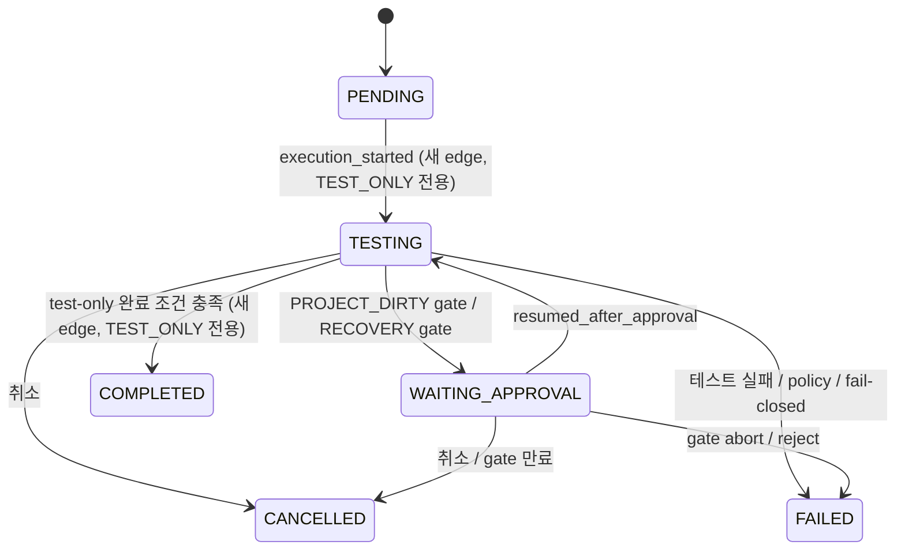

# D4 v3 — test-only Task 기반 Project Test Run (설계)

영문 원본: [D4-test-only-task.md](D4-test-only-task.md)

> **상태: 설계안. 미승인, 미구현.** 이 문서를 위해 production 코드, 테스트, migration, 설정을 변경하지 않았다.
> 이전 D4 설계 [D4-test-run-lock-domain_ko.md](D4-test-run-lock-domain_ko.md)(v1, v2와 리뷰 부록 포함)를 **대체**한다. 이전 문서는 이력으로 그대로 둔다. v2 선택지 (a)의 `owner NONE | TASK | TEST_RUN` 모델은 **폐기**하며 후속 확장 후보로만 기록한다(§14).
> **선행 조건:** [process-lifecycle-hardening_ko.md](process-lifecycle-hardening_ko.md)(B2). **B2의 구현·검증·재검토와 이 문서의 승인 전에는 E를 구현하지 않는다.**
> D5(`sys.executable` 유지), D6(fail-fast 유지), F(미착수)는 변하지 않는다. 사실은 작업 트리에서 읽었으며 확인하지 못한 항목은 **(미확인)** 으로 표시한다.
> **개정 3.1.** B2 반영 후 작업 트리(HEAD `2f7da7f`)를 다시 읽어 확인했다. 정정 사항과 추가 한 가지는 §16에 있다. 여전히 설계안이며 미승인, 미구현이다.

## 1. 결정과 (d)를 택한 이유

*Project Test Run*은 `mode = TEST_ONLY`인 일반 `Task`다. project write owner는 계속 Task(`projects.write_owner_task_id`)이므로 lock 도메인, Human Gate, Lease, Runner claim, recovery가 두 번째 owner 종류를 알 필요가 없다.

v1/v2 코드 리뷰에서 얻은 이유:

- `HumanGateService`는 전 구간이 Task 중심이다(`_decide_once`가 Task를 잠그고 `current_basis`를 계산하고 Task `ExecutionRequest`를 만든다. `Approval.task_id`는 `NOT NULL`, `ApprovalOut.task_id`는 필수). v2의 가장 큰 위험이 이 일반화였다. Task 기반 run은 gate 변경이 **전혀 필요 없다**.
- `PROJECT_DIRTY` effect(`ProjectDirtyRecoveryEffect`)는 `reason_code`만으로 선택되고 `approval.task_id`를 쓴다. Run용 reason code가 따로 필요했다. test-only Task는 기존 effect를 그대로 쓴다.
- v2는 lease/heartbeat/fencing, startup recovery, stop/drain, 취소 전달, Run 상태 기계를 `TaskRun`/`Runner`와 병렬로 만들어야 했다. Task에는 이미 전부 있다.
- v2 지적 중 열 건(owner API, AST 규칙, `read_state` 3상태, epoch 의미, `_recover_rest` 배치 등)은 두 번째 owner 종류 때문에만 존재한다.

감수하는 비용: Task 모델의 mode, 새 workflow 분기 하나, mode별 terminal 규칙, 목록/리포트 노이즈 처리(§9). mode 컬럼은 후속으로 미뤄 둔 "계획/검토/전체 모드" 설계와 취지가 겹친다(§14).

## 2. 재사용하는 메커니즘 (확인됨)

| 메커니즘 | 위치 | 재사용 방식 |
|---|---|---|
| Task 행, 상태, `TASK_TRANSITIONS` | `app/models/states.py`, `app/models/tables.py` | mode별 새 edge(§4) |
| `ExecutionRequest`(START/RESUME, claim token, `defer_count`, `not_before`) | `app/models/tables.py`, `approval_repository.py` | 불변 |
| `TaskRun` + `LeaseService`(heartbeat, takeover, `unterminated_executions`) | `lease_service.py`, `task_repository.py` | 불변 |
| `Runner` claim/dispatch/stop/drain/recover | `runner.py` | 불변 |
| `ProjectLockService.ensure_for_step`, baseline, `reconcile` | `project_lock_service.py` | 새 step key로 호출 |
| `PROJECT_DIRTY` Human Gate와 `ProjectDirtyRecoveryEffect` | `project_lock_service._open_dirty_gate`, `project_recovery_effect.py` | 불변 |
| 취소 | `TaskService.request_cancellation`, `_cancel_idle_tasks`, `_finalize_cancel` | API 불변(`/tasks/{id}/cancellation-requests`) |
| proof를 가진 terminal finalize | `TaskFinalizer`, `release_on_terminal` | mode별 분기(§6) |
| 추적 프로세스 실행과 트리 증명 | **B2 (구현됨, `8907d60`)**: `TestPolicyService.run(..., tracked=port)`, `StepRunner.watch_cancel(task_id, cancel, key)` | 그대로 재사용 |

재사용하지 않거나 건드리지 않는 것: Planner, Design Reviewer, Developer, Code Reviewer, `completion_checker.check_definition_of_done`, profile의 completion criteria, `HumanGateService` 내부.

**그대로 재사용할 수 없는 것:** `StepRunner.execute`는 에이전트 전용이다(`providers[ROLE_PROVIDER[role]]`를 고르고 native session을 기록·재개한다). TEST_ONLY step에는 `StepRunner`에 에이전트 없는 작은 실행 primitive가 필요하다(§4.1). 재사용이 아니라 새 코드다.

## 3. 모델

- `tasks.mode varchar(16) NOT NULL DEFAULT 'WORKFLOW'`, `CHECK (mode IN ('WORKFLOW','TEST_ONLY'))`. 이름 점검: `mode`는 기존 식별자와 충돌하지 않는다(`RequestKind`는 `ExecutionRequest.kind`이고 `StateTransition.kind`도 있어 `kind`는 모호). `task_kind`, `execution_mode`도 허용되며 **별도 owner kind는 도입하지 않는다.**
- `tasks.idempotency_key varchar(128) NULL`, `tasks.request_fingerprint varchar(64) NULL`, 부분 unique index `(project_id, idempotency_key) WHERE idempotency_key IS NOT NULL`.
- 제약: `mode='TEST_ONLY'`이면 `project_id IS NOT NULL`, `mode='TEST_ONLY'`가 아니면 `idempotency_key IS NULL`(일반 Task는 키를 가질 수 없음). 모든 제약은 migration 0003/0004처럼 NULL-safe(`IS TRUE`).
- Task의 `test_policy`/`test_policy_hash`는 `TaskService.create_task`와 똑같이 `resolve_test_policy(project.test_policy, project_root)`에서 온다. `requirements`는 고정 문구(예: `"Run the project's tests"`)이므로 기존 `validate_requirements` 해시가 그대로 적용된다.
- `create_test_run`은 `create_task`와 똑같이 project의 활성 profile(`profile_version`, `profile_hash`, `profile_snapshot`)을 Task에 복사한다(`task_service.py:143-158`, 같은 project row lock 아래). `ck_tasks_profile_all_or_none` 제약은 세 필드가 함께 있어야 하며, 활성 profile이 없는 project는 `NULL`로 둔다. `create_task`의 공통 부분(project lock, policy 해석, profile 복사, Task INSERT)은 하나의 헬퍼로 빼서 둘이 함께 쓰며 복제하지 않는다.

## 4. 상태 흐름 (`states.py`, `workflow_service.py`로 확인)

`RUNNING`이라는 Task 상태는 없다. Task 상태는 `PENDING, PLANNING, DESIGN_REVIEWING, DEVELOPING, TESTING, REVIEWING, RETRYING, WAITING_APPROVAL, COMPLETED, FAILED, CANCELLED`다. test-only Task는 `PENDING, TESTING, WAITING_APPROVAL, COMPLETED, FAILED, CANCELLED`만 쓴다.

- 새 edge `PENDING → TESTING`, `TESTING → COMPLETED`는 **`mode = TEST_ONLY`에서만** 유효하다. `check_task_transition`에 mode 인지 변형을 두며, 기존 `TASK_TRANSITIONS` 표와 그 테스트는 `WORKFLOW`에 대해 그대로 참이다(표에 edge를 추가하지 않는다).
- gate는 `PENDING → TESTING` **이후**에 열린다. `open_recovery`가 Task를 `WAITING_APPROVAL`로 옮기는데 `PENDING`에서는 허용되지 않기 때문이다(`TASK_TRANSITIONS[PENDING]` = `PLANNING, FAILED, CANCELLED`).
- handler dispatch: `WorkflowService._handlers`는 상태 키다. TEST_ONLY는 자체 handler 둘(`PENDING`, `TESTING`)이 필요하고 `run_task`의 dispatch 줄(`self._handlers[state]`)이 `(mode, state)`로 고른다. `run_task`의 나머지 동작(lease 상실, `ProjectBusy`, `TaskCancelled`, `TerminationUnconfirmed`, `FailClosed`)은 그대로 재사용한다.
- **Step key (G10).** 제안: test-only step은 **기존 key `TEST`**를 쓰고 두 흐름은 `Task.mode`로 구분한다. `STEP_TASK_STATE[TEST] = TESTING`, `STEP_ROLE[TEST] = TESTER`가 이미 있으므로 gate 재개(`_proceed_resume`), `_finalize_cancel`, `_recovery_unsafe`, `ReportService.KINDS`, 리포트의 `tests` 섹션에 새 key가 필요 없다. workflow 재사용 로직(`_do_test`, `_reusable`, `_previous_test_ids`)은 TEST_ONLY가 자체 handler를 쓰므로 닿지 않으며, `input_hash = stable_hash("test_only", task.id, task.test_policy_hash)`에 구분자가 들어 있다. 대안: `STEP_TASK_STATE`/`STEP_ROLE`/`KINDS`에 새 key `TEST_ONLY`(32자 이하)를 추가. grep이 쉽고 workflow 테스트와 혼동되지 않지만 아래 소비자 모두가 새 key를 알아야 한다.
- step key 소비자(코드에서 읽음): `workflow_service.py`는 `STEP_ROLE.values()`를 role 필터로(`_finalize_cancel`, `_recovery_unsafe`), `STEP_TASK_STATE[approval.checkpoint_step_key]`를 재개 상태로, `_agent_step`에서 `STEP_ROLE[step_key]`를 쓴다. `report_service.py`에는 `KINDS`(그 밖의 key는 artifact 목록에서 빠지고 `validity.of`가 `NOT_APPLICABLE`을 반환)가 있고 `tests`와 `orchestrator_test_run`에 `STEP_TEST`를 읽는다. 기존 key를 쓰면 모두 test-only step에 대해 이미 동작한다. 리포트의 `validity.of(TEST)`는 요구사항·policy hash와 workflow iteration에만 의존하며(읽음) plan이나 developer step에는 의존하지 않는다.

### 4.1 `_do_test_only` 개요

`StepRunner.execute`는 에이전트 전용이라 쓸 수 없다. TESTING handler는 `_agent_step`과 같은 부품에 새 primitive 하나를 더해 만든다.

1. `PENDING` handler: `PENDING → TESTING`(`execution_started`), mode 인지 전이.
2. `TESTING` handler:
   1. `_interrupted_needs_human(ctx, task, STEP_TEST, mutating=True)` 재사용(에이전트를 받지 않으며 최신 step의 `snapshot_before`를 workspace와 비교하고 execution tail을 검사한다 — 코드에서 읽음). TEST_ONLY의 retry에서는 snapshot-diff 규칙을 §7.3처럼 완화한다.
   2. `ProjectLockService.ensure_for_step(...)`를 `_agent_step`이 부르는 그대로 호출한다. `ctx.resumed_from_approval_id`가 있을 때의 `GateLineage` 분기를 포함한다. `READY` → 계속(이후 `_reset_defer_once`), `GATE_OPENED` → `ctx.parked`, `BLOCKED` → `ProjectBusy`(기존 defer 경로, §7.4의 대기 상한 규칙 포함).
   3. `steps.begin(..., on_begin=locks.on_mutating_begin)`: 테스트 실행은 workspace를 바꾸므로 일반 TEST step과 똑같이 epoch bump와 owner 단언이 적용된다.
   4. **에이전트 없는 step을 위한 새 `StepRunner` primitive**(예: `execute_local`): lease를 검증하고, transaction 밖에서 `TrackedCommandSession`으로 `TestPolicyService.run(..., tracked=port)`를 실행하며(현재 `_tracked(ctx, task, "test_run", step_id)`가 하는 것과 같다), run key로 `watch_cancel(task_id, cancel, key)`를 시작해 취소 요청이 `CommandExecutor.cancel`에 닿게 하고, `snapshot_after`를 찍는다. provider, session, prompt는 쓰지 않는다. 기록되는 `Execution` 행은 B2 추적 행(spawn 전 `STARTING`, `on_started`로 `pid`/identity, B2 종료 상태로 finish)과 `ReportService`가 읽는 `orchestrator_test_run` 행이다.
   5. `TerminationUnconfirmed`(기존) → `_park_for_recovery`(RECOVERY gate, lease **미해제**). 취소 → `TaskCancelled` → `_finalize_cancel`. 자동 재실행 없음.
   6. `_complete_succeeded`와 같은 proof 재시도 루프(`FingerprintProofStale`, `PROOF_MAX_ATTEMPTS`, 이후 `UNMEASURED`)로 완료한다. step 출력, 완료 판정(§5), task 전이, terminal proof와 함께 `release_on_terminal`(§6)을 한 transaction에서 처리한다.

이 흐름에서는 에이전트 CLI, session, prompt, provider를 쓰지 않는다.

## 5. 완료 조건

`completion_checker.check_definition_of_done`/`evaluate_definition_of_done`(workflow DoD: 설계 리뷰, 테스트, 코드 리뷰, profile criteria)은 **적용하지 않는다**. 새 순수 함수 `evaluate_test_only_completion(...)`이 `Condition` 목록(기존과 같은 모양이라 리포트가 그대로 표시)을 반환한다.

| 조건 | 출처 |
|---|---|
| `TEST_POLICY_UNCHANGED` | step 출력 `test_policy_hash == task.test_policy_hash` |
| `TESTS_PASSED` | `test_result.passed`(`TestPolicyService.run`의 exit code와 신선한 JUnit) |
| `JUNIT_OK` | `test_result.junit_ok` |
| `MIN_TESTS_EXECUTED` | `executed - skipped >= policy.min_tests_executed` |
| `LEASE_VALID` | 완료 transaction 안의 `LeaseService.verify`(`steps.complete`가 이미 수행) |
| `CLAIM_FENCE_VALID` | `finish` 시 기존 `ExecutionRequest` token fence |
| `NO_CANCEL_REQUESTED` | 같은 transaction의 Task 행 lock 아래에서 `task.cancel_requested_at IS NULL` |
| `PROCESS_TREE_TERMINATION_CONFIRMED` | B2: command `lifecycle ∈ {EXITED, TERMINATED}` 그리고 `tree = EMPTY` |

전부 충족 → `COMPLETED`. 하나라도 미충족 → 첫 미충족 조건 코드를 `failure_reason`으로 가진 `FAILED`(`TESTS_FAILED`, `NO_JUNIT`, `TOO_FEW_TESTS`, `CANCEL_REQUESTED` …). 취소 요청이 완료보다 우선한다. `TERMINATION_UNCONFIRMED`는 이 함수에 도달하지 않고 Task를 recovery로 parking한다(§7).

해당 없음(누락이 아니라 명시): `PLAN`, `DESIGN_REVIEW`, `CODE_REVIEW`, `profile_criteria`. `ReportService`와 artifact API는 `mode=TEST_ONLY`에서 이를 absent/failed가 아니라 `NOT_APPLICABLE`로 표현한다. 현재는 없는 step이 리포트에서 `None`이 되므로 `ReportService`의 작은 변경이다. plan 없는 Task는 `current_plan_hash`(`""`, `fingerprints.py:26-33`), `current_basis`(`fingerprints.py:36-43`), 리포트의 `plan_hash`(`""`)가 이미 견딘다. TEST_ONLY Task의 리포트와 artifact 목록은 **아직 테스트하지 않았으며** 테스트로 덮어야 한다.

## 6. Project lock 해제 규칙 (mode 인지)

현재 `release_on_terminal(session, task, to_state, proof)`(`app/services/project_terminal.py`): 유효 proof + `COMPLETED` → `CLEAN`이며 **최종 fingerprint가 accepted baseline이 된다**. 유효 proof + `FAILED`/`CANCELLED` → fingerprint가 `write_baseline_fingerprint`와 같을 때만 `CLEAN`, 아니면 `DIRTY_UNRESOLVED`. proof 없음 → `DIRTY_UNRESOLVED`.

`task.mode`로 고르는 새 규칙:

| `mode` | terminal | 결과 |
|---|---|---|
| `WORKFLOW` | 전부 | 불변 |
| `TEST_ONLY` | `COMPLETED`, `FAILED`, `CANCELLED` 모두 | 최종 fingerprint를 새 baseline으로 **절대** 채택하지 않는다. fingerprint == `write_baseline_fingerprint`(현재 버전) → `CLEAN`(accepted baseline 불변), 다름 → `DIRTY_UNRESOLVED`, 측정 실패/stale/proof 없음 → `DIRTY_UNRESOLVED` |

- 따라서 test-only `COMPLETED`는 빌드 부산물이나 변경된 tracked 파일을 조용히 채택하지 않는다. `DIRTY_UNRESOLVED`는 다음 Task/test-run에서 기존 `PROJECT_DIRTY` gate로 해소하며 `continue`만 `accept_baseline`을 호출한다.
- 무시되거나 volatile인 빌드 산출물(git-ignore된 `build/`, `target/`)은 GIT mode의 `WORKSPACE_FINGERPRINT_V1` 밖이므로 정상 실행은 `CLEAN`으로 끝날 수 있다. 추적되지 않고 무시되지도 않는 산출물은 `DIRTY_UNRESOLVED`가 된다. JUnit/build 출력 경로의 ignore 여부를 알리는 diagnostics 항목은 E의 범위가 아니라 P1 후속으로 제안한다.
- 프로세스 트리: 트리 종료가 확인되지 않은 run은 정상적으로 `release_on_terminal`에 도달하지 않는다(Task는 parking, owner 유지, lease 미해제). 현재 계약을 사실대로: Task **abort**는 gate에서 이미 CLI 사망을 증명하지 않고 lock을 `DIRTY_UNRESOLVED`로 해제한다(`HumanGateService._apply` → `change_task_state(FAILED, project_proof)`). 따라서 `declare-gone` 류의 의미는 현재보다 약하지 않다. 새로운 점은 TEST_ONLY Task 자신의 명령이 B2로 추적되므로 *성공적인* 종료는 항상 더 강한 트리 증명을 동반한다는 것이다.

## 7. Gate, 취소, timeout, recovery

### 7.1 PROJECT_DIRTY gate

- 기존 gate를 그대로 쓴다. `ensure_for_step`이 `workspace_state != CLEAN`일 때 연다(`_open_dirty_gate`, reason code `PROJECT_DIRTY`, 옵션 `("continue","abort")`, `P.PROJECT_DIRTY_OPTIONS`). **새 reason code도, Run 전용 approval owner도 없다.**
- `ProjectDirtyRecoveryEffect`는 mode와 무관하다: `prepare`는 transaction 밖에서 측정하고, `apply`는 Project를 잠그며, `continue` → `accept_baseline` + RESUME 요청(`STEP_TASK_STATE[TEST] = TESTING`이므로 TEST_ONLY Task는 `TESTING`에서 재개), `abort/reject` → 공통 terminal 경로로 `FAILED`. TEST_ONLY에 대해 제한해야 할 옵션은 없다. plan 없는 Task의 `current_basis`는 견디지만(읽음: `fingerprints.py:36-43`, `plan_hash`는 `""`) TEST_ONLY Task의 gate를 끝까지 결정하는 것은 **아직 테스트하지 않았다** — 테스트가 필요하다.
- gate effect는 OS 프로세스 작업을 하지 않는다(측정과 DB 쓰기만). 현재처럼 API 요청 경로에서 실행된다.

### 7.2 gate 만료와 출구

approval에는 유효 기간이 있고 `valid_until` 이후의 새 결정은 `Gone("approval expired")`을 낸다(`HumanGateService._decide_once`). 현재는 아무것도 다시 열지 않아 parking된 Task가 영원히 기다린다. TEST_ONLY에 한해 Runner의 recovery pass(`_recover_rest`)가, pending approval이 만료된 `WAITING_APPROVAL` TEST_ONLY Task를 **기존** idle-cancel 경로(`_cancel_one_idle` → `finalize_task_with_proof` → `reason = gate_expired`로 `CANCELLED`)로 취소한다. 사용자는 새 `POST /projects/{id}/test-runs`(새 Task)로 다시 요청한다. gate가 acquisition **이전**에 열리므로 parking된 Task는 lock을 갖지 않아 새 Task를 막지 않는다. 모든 사용자의 명시적 출구는 `POST /tasks/{id}/cancellation-requests` → `_cancel_idle_tasks`다. WORKFLOW Task는 변하지 않는다.

### 7.3 취소, timeout, Runner stop

- 취소: 기존 요청 경로가 Task 행 lock 아래 `cancel_requested_at`을 기록하고, Runner가 `run_key`로 명령을 종료하며, B2가 트리를 증명한 뒤 `_finalize_cancel`이 마무리한다. `unterminated_executions`가 비어 있지 않으면(추적 execution은 `STARTING`부터 행이 있다) 취소 대신 RECOVERY gate를 연다. 이제 테스트 명령에도 해당한다.
- timeout: `policy.timeout_seconds` → `CliOutcome.TIMEOUT`, B2 settlement. 트리가 비어 있음이 증명되면 step은 `FAILED(TESTS_TIMEOUT)`, 아니면 parking.
- Runner stop과 task cancel 경합: 둘 다 B2의 멱등 settlement로 수렴하고 stop은 기존 `_drain`/`RunnerStopIncomplete` 예산을 쓴다. TEST_ONLY가 새로 도입하는 상호작용은 없다.
- 프로세스 종료 불확실: **자동 재실행 없음.** 기존 `_park_for_recovery`/`Runner._park_uncertain` gate(RECOVERY, reason `EXECUTION_UNCERTAIN`). TEST_ONLY recovery gate의 옵션 처리(결정 G5): `abort`는 항상, `retry`는 `_recovery_unsafe`가 미종료 execution이 없음을 확인한 뒤에만 재실행한다. `_recovery_unsafe`의 snapshot-diff 검사(workspace가 step의 `snapshot_before`와 다르면 retry 거부)는 부분 실행된 빌드가 정당하게 파일을 바꾸므로 TEST_ONLY에서는 완화해야 한다. terminal 시점의 project fingerprint가 안전망으로 남는다.

### 7.4 crash와 중복 실행

- claim 후 crash: 기존 `stale_claimed` recovery가 요청을 다시 큐에 넣고, `LeaseService.acquire` takeover가 이전 run의 **추적** execution을 identity로 종료한다(B2가 테스트 execution을 여기서 보이게 한다). 증명되지 않으면 `UNCERTAIN`을 반환하고 RECOVERY gate로 간다. 조용한 재실행은 없다.
- 중복 테스트 실행 방지: claim token + `fence_ok` + `TaskRun` lease + spawn 전에 쓴 `STARTING` execution 행 + project write owner 배타성(두 번째 Task는 owner로 `ensure_for_step`에 진입할 수 없다). idempotency key(§8)는 중복 *요청*을 막는다.
- 바쁜 project에 대한 대기 상한: 현재 다른 owner에게 막힌 Task는 backoff(`defer_delay`, `DEFER_MAX_SECONDS=60`로 상한)로 무기한 다시 큐에 들어간다. 테스트 실행이 몇 시간씩 조용히 대기하면 안 된다. 제안(결정 G3): `mode=TEST_ONLY`이면 요청의 `defer_count`가 `TEST_RUN_MAX_DEFERS`(`policies.py`)에 이르면 다시 defer하지 않고 Task를 `FAILED(PROJECT_BUSY)`로 끝낸다(`defer_count`와 `ctx.request_id`는 이미 존재). 생성 시점 거절은 하지 않는다: 권위 있는 검사는 acquisition이고 생성은 DB 전용으로 유지한다.

## 8. 생성 API와 멱등성

`POST /projects/{id}/test-runs` → **202**, `ProjectTestRunOut`(run id는 Task id. `TestRunOut`은 리포트의 tests 섹션용으로 `app/schemas/reports.py`에 이미 있어 새 schema는 다른 이름이 필요하다).

- body: `{"idempotency_key": str|null}`뿐. 명령, 인자, 환경, 경로, interpreter, policy override 없음. Task의 `test_policy`는 project의 것(또는 `create_task`처럼 생성 시 해석한 preset)이다.
- transaction(하나, 짧고, DB 전용): `ProjectRepository.lock(project_id)`(`FOR UPDATE`, `create_task`와 archive가 쓰는 같은 lock) → `status == ACTIVE` 아니면 409 → 멱등 조회 → 활성 run 검사 → `Task(mode=TEST_ONLY, …)` + `StateTransition(created)` + `ExecutionRequest(START, PENDING)` INSERT(현재 `create_task`와 `request_execution`이 따로 하는 두 INSERT를 함께 수행). **fingerprint 없음, 파일 접근 없음, 프로세스 없음, 느린 작업 동안 lock을 쥐지 않음**(test-policy 해석이 `create_task`처럼 project root를 읽는 것은 현재 동작 그대로).
- 멱등성(키 조회가 활성 run 검사보다 **먼저**):

| 요청 | 응답 |
|---|---|
| 같은 키, 같은 `request_fingerprint`(project id + `test_policy_hash`의 해시), Task 진행 중 | 200, 그 run, `replayed: true` |
| 같은 키, 같은 fingerprint, Task 종료 | 200, 최종 결과, `replayed: true` |
| 같은 키, 다른 fingerprint | 409 `IDEMPOTENCY_KEY_REUSED` |
| 새 키 또는 키 없음, 이 project에 비종결 TEST_ONLY Task 존재 | 409 `TEST_RUN_ACTIVE`(활성 id 포함) |
| 새 키 또는 키 없음, 활성 없음 | 202, 새 run |

활성 run 검사와 INSERT는 project 행 lock으로 직렬화되므로 동시 POST 둘이 모두 run을 만들 수 없다. 부분 unique index `(project_id, idempotency_key)`는 안전망이다. 경쟁에서 진 동일 키 요청은 다시 읽어 위 표대로 응답한다(client에 `IntegrityError`를 그대로 노출하지 않는다).
- Project `ARCHIVED` → 409(`create_task`와 같은 메시지). archive는 같은 project lock으로 직렬화되고 `count_open_tasks`가 TEST_ONLY Task도 다른 비종결 Task처럼 세므로 열린 test run이 있는 project는 archive할 수 없다.
- `POST /tasks`에는 `mode` 필드를 **추가하지 않는다.** `TaskService.create_task`는 일반 Task용 시그니처를 유지하고, 별도의 `create_test_run`(service)이 `mode='TEST_ONLY'`를 쓸 수 있는 유일한 코드 경로다. DB 제약(§3)이 안전망이다. Task 생성 스키마에 `mode`가 없음을 아키텍처 테스트로 고정한다.
- 그 외 endpoint: `GET /projects/{id}/test-runs`(페이지네이션, project의 TEST_ONLY Task), `GET /test-runs/{id}`(`mode=TEST_ONLY`이면 그 Task, 아니면 404. 완료 조건과 pid/identity 없는 B2 프로세스 요약 포함), 취소는 기존 `POST /tasks/{id}/cancellation-requests`. 라우터는 얇게, 검증은 `validators.py`, 한도는 `policies.py`, 응답 크기·sanitizer 계약을 적용한다.

## 9. 조회와 노이즈

| 옵션 | 호환성 | 노이즈 |
|---|---|---|
| 1. `GET /tasks`에 TEST_ONLY 포함 | 기존 client가 새 종류를 보게 됨 | 높음 |
| **2. `GET /tasks`에서 기본 제외, `?mode=` 필터로 포함/선택 (제안)** | 기존 데이터(전부 `WORKFLOW`)는 변화 없음, query parameter 추가만 | 기본값에서는 없음 |
| 3. project test-run 목록만 | `GET /tasks`에 영향 없음 | 없음, 볼 곳이 두 군데 |

제안: 옵션 2에 §8의 전용 endpoint를 더한다. `TaskOut`에 additive `mode` 필드를 추가한다(기존 client는 무시. `tests/`에서 `TaskOut`을 참조하거나 key 집합을 고정하는 테스트는 찾지 못했다(검색). 전체 API 스위트는 그대로 돌리며 고정하는 테스트가 있다면 약화가 아니라 갱신한다). `GET /tasks/{id}`, `/tasks/{id}/changes`, `/tasks/{id}/report`, `/tasks/{id}/artifacts`는 TEST_ONLY Task에서도 동작한다. Changes endpoint는 Task baseline 대비 테스트 실행이 바꾼 것을 보여 준다(baseline 재사용의 유용한 부산물).

## 10. Row-lock 순서 (코드를 읽어 확인)

Lock: `T` = `tasks` 행(`TaskRepository.lock`), `TR` = `task_runs` 행(`LeaseService.verify`/`release`의 UPDATE lock), `P` = `projects` 행, `A` = `approvals` 행, `ER` = `execution_requests` 행. 격리 수준은 READ COMMITTED(`app/db.py`, override 없음). advisory lock은 `lock_registration`과 Runner session lock뿐이다.

| 흐름 | 순서 | 근거 |
|---|---|---|
| Task 생성 / archive | `P`만(생성은 이후 새 행 INSERT, archive는 일반 count) | `task_service.py:88`; `project_service.py:154,166,172` |
| `POST /projects/{id}/test-runs` (신규) | `P`, 이후 INSERT(Task, transition, ER). `T` lock 없음, `TR` 없음 | `create_task`와 같은 패턴 |
| Runner claim | `ER`만(`SKIP LOCKED`, UPDATE) | `approval_repository.py:97-120`; `runner.py:900-906` |
| `LeaseService.acquire` | `T`, (takeover: Execution UPDATE), `TR`, 새 `TR` INSERT | `lease_service.py:90-135` |
| `ensure_for_step` → `_acquire_once` / `_recover_once` | `T`, `TR`(`verify`), `P`, 이후 baseline INSERT | `project_lock_service.py:241-244, 314-316` |
| `StepRunner.begin` (+ `on_mutating_begin`) | `T`, `TR`, `P`(epoch bump), step INSERT | `step_runner.py:109-113`; `project_lock_service.py:200-203` |
| terminal mutate를 가진 `StepRunner.complete` | `T`, `TR`, step UPDATE, `P`(`release_on_terminal`) | `step_runner.py:265-277`; `state_service.py` |
| `TaskFinalizer._attempt` (`_fail`, `_finalize_cancel`, `_cancel_one_idle`, `_after_test`) | `T`, `P`, 이후 `work`(`verify`로 `TR`) | `task_finalizer.py:51,55` |
| Human Gate decide | `A`, `T`, (effect) `P`, 이후 `ER` INSERT(RESUME) | `human_gate_service.py:144,159`; `project_recovery_effect.py:40` |
| gate/recovery open | 호출자의 transaction 안, `T` 아래(`_acquire_once`에서 호출되면 `TR`/`P`도) | `human_gate_service.py:62-102` |
| 취소 요청 | `T`만 | `task_service.py:181-191` |
| reconcile | `P`만 | `project_lock_service.py:377` |

확인된 모든 흐름과 일관된 전역 순서: **`A` → `T` → (`TR`, `P`) → `ER` → leaf 행**. **현재에도** 두 역전이 있으며 이 설계로 바뀌지 않는다: (A) `TR` 대 `P`(`_acquire_once`/`begin`/`complete`는 `T, TR, P`, `TaskFinalizer`는 `T, P, TR`), (B) `A` 대 `T`(`_decide_once`는 `A, T`, `_record_start`의 `before_spawn`은 `T, A`). 어느 쪽도 cycle을 만들 수 없다: 모든 `TR` 보유자는 이미 `T`(배타적, `verify` 호출 13곳 전부)를 갖고 있고, `T` 없이 `TR`만 잡는 heartbeat/`release`는 다른 lock을 갖지 않으며, `before_spawn`은 결정이 존재한 뒤에만 도달하므로 멱등 재생은 `T`를 잠그기 전에 반환한다. **TEST_ONLY는 새 lock edge를 추가하지 않는다:** 생성은 `P` 후 INSERT, 실행과 gate는 위의 기존 순서, 만료 취소는 `T, P, ER`(`_cancel_one_idle`과 같음). 미확인: 자식 행 INSERT/FK 검사가 만드는 PostgreSQL 암묵적 `KEY SHARE` lock, `_cancel_one_idle`의 다중 행 `UPDATE execution_requests`와 `_recovery_body`의 정렬 없는 행별 update의 관계. 엄격한 전역 순서를 원하면 가장 값싼 수정은 `_attempt`에서 `P`를 잠그기 전에 lease를 verify하는 것이며 이 설계의 범위 밖이다.

## 11. 단계, migration, 배포 가능 상태

| 단계 | 내용 | 단독 배포 가능? |
|---|---|---|
| **E0** | **완료.** B2는 구현·커밋되었다(`8907d60`, 문서 `e483c82`): 추적 테스트 명령, 트리 증명, 취소 안전 settlement, `executions` 컬럼(migration `0005`). 일반화된 cancel watcher와 `TestPolicyService.run(tracked=…)`은 이미 있다. | 생존 프로세스를 남기는 명령의 더 엄격한 결과(B2 H4)는 일반 Task에 이미 적용 중이다. 남은 E0 작업 없음. 에이전트 없는 `StepRunner` primitive는 E1에 속한다. |
| **E1** | migration(잠정 `0006`): `tasks.mode`, `idempotency_key`, `request_fingerprint`, index, 제약; mode 인지 전이; `_do_test_only`; mode 인지 `release_on_terminal`; `evaluate_test_only_completion`; `TaskService.create_test_run`(내부); 공개 endpoint 없음 | 가능: 기존 행은 모두 `WORKFLOW`이고 새 코드 경로는 API에서 도달 불가. 기존 Task 동작 불변. 전이 표, `TaskOut` key, 아키텍처 endpoint 목록을 고정한 기존 테스트는 다시 확인하고, 바뀌어야 하는 것(새 전이 함수, schema 테스트의 새 컬럼)은 공개적으로 갱신한다 |
| **E2** | `POST/GET /projects/{id}/test-runs`, `GET /test-runs/{id}`, `GET /tasks` mode 필터, `TaskOut.mode`, 리포트/artifact `NOT_APPLICABLE`, diagnostics/Changes 문구, gate 만료 취소, 영·한 workflow 문서(07, 09, 11, 05, README, ARCHITECTURE) | 가능 |

migration 번호는 잠정이다(HEAD는 B2의 `0005`이며 E1은 다른 변경이 먼저 들어가지 않으면 `0006`). **E1 upgrade:** 기본값이 있는 컬럼 추가(backfill은 암묵적으로 `WORKFLOW`), 제약과 부분 unique index 추가. **E1 downgrade:** `TEST_ONLY` task가 있으면 거부(이력의 조용한 유실 없음), 없으면 index, 제약, 컬럼 삭제. 각 migration은 up/down/up과 `alembic check`로 검증한다.

## 12. 테스트 계획

불변 동작 보장을 먼저, 그다음 새 동작. 아직 아무것도 실행하지 않았다.

- **기존 동작 불변:** Lease, Recovery, Project Lock, Completion, Human Gate, Runner, report, API 전체 스위트. `WORKFLOW`의 `TASK_TRANSITIONS`는 동일하다. workflow Task는 여전히 `TESTING → COMPLETED`, `PENDING → TESTING`을 할 수 없다.
- **에이전트 호출 없음:** TEST_ONLY Task는 Planner/Reviewer/Developer provider를 호출하지 않는다(모든 provider spy, `cli_invocations == 0`).
- **Project lock 상호 배제:** TEST_ONLY 대 WORKFLOW Task 시작 경합 — owner는 정확히 하나, 다른 쪽은 defer. TEST_ONLY 대 TEST_ONLY.
- **생성 대 archive 경합:** 동시 `POST test-runs`와 archive → run이 존재하고 archive가 409이거나, archive가 이기고 POST가 409. ARCHIVED project 위의 run은 없다.
- **멱등성:** §8 표의 다섯 행 전부. 동시 동일 키 POST는 Task 하나만 생성. 활성 run이 있을 때 서로 다른 키의 동시 요청 → 202 하나와 409 하나.
- **Gate:** DIRTY workspace → TEST_ONLY Task에 `PROJECT_DIRTY` gate. `continue`는 baseline을 수락하고 `TESTING`에서 재개. `abort` → `FAILED`. 만료 후 결정 → `Gone`. 만료 sweep이 parking된 TEST_ONLY Task를 취소. 이후 새 POST 동작. 같은 상태의 WORKFLOW Task는 영향 없음.
- **완료/해제:** 변경 없는 workspace로 `COMPLETED` → `CLEAN`, accepted baseline 불변. tracked 파일 변경 후 `COMPLETED` → `DIRTY_UNRESOLVED`, baseline **교체되지 않음**. `FAILED`/`CANCELLED`도 동일. 측정 실패 → `DIRTY_UNRESOLVED`. WORKFLOW `COMPLETED`는 여전히 baseline 수락(회귀).
- **취소 / timeout / stop:** 명령 중 취소(트리 소멸 증명 → `CANCELLED`), timeout, Runner stop과 cancel 경합, 트리 미확인 → parking·owner 유지·재실행 없음, `STARTING`만 있는 추적 execution에서 crash → UNCERTAIN gate, takeover 후 중복 실행 불가.
- **대기 상한:** defer 횟수가 한도에 이르면 `FAILED(PROJECT_BUSY)`. WORKFLOW Task는 여전히 무제한 defer.
- **리포트/API:** 리포트와 artifact가 누락이 아니라 `NOT_APPLICABLE`을 표시. `GET /tasks`는 기본적으로 TEST_ONLY를 제외하고 필터가 동작. `TaskOut.mode`. `POST /tasks`에 `mode` 없음. DB가 project 없는 `mode='TEST_ONLY'`와 WORKFLOW Task의 idempotency key를 거부.
- **Changes:** 종료된 TEST_ONLY Task의 `/tasks/{id}/changes`가 baseline 대비 부산물을 보고.
- **Migration:** up/down/up, `alembic check`, TEST_ONLY task가 있을 때 downgrade 거부.
- **실환경:** JDK/Maven/Gradle과 실제 CLI가 없으면 실행하지 않는다. B2의 Windows/POSIX 프로세스 테스트는 플랫폼별로 보고하며 실행하지 않았으면 통과로 쓰지 않는다.

## 13. v2 리뷰 지적 반영 위치

| v2 지적 | v3 해소 |
|---|---|
| B1 gate 일반화, `Run`과의 lock 순서 역전 | 불필요: 기존 Task gate를 사용하며 Run approval owner가 없다(§1, §7.1). lock 순서는 §10에서 확인, 새 edge 없음 |
| B2 트리 종료 강제 불가 | 선행 B2 문서로 이동(추적 명령, Job Object/process group, 증명, 영속화) |
| B3 Task와 Run이 공유하는 `PROJECT_DIRTY` reason code | 불필요: 같은 Task effect, Run reason code 없음(§7.1) |
| M1 pid 없는 `LAUNCHING`이 unconfirmed로 오분류 | B2 §4/§7: `SPAWN_FAILED` 대 `TERMINATION_UNCONFIRMED`, identity 저장까지 suspended 프로토콜 |
| M2 API 프로세스에서 OS 작업 | B2 §8: Runner/recovery worker만, gate effect는 OS 작업 없음(§7.1) |
| M3 gate 만료/출구 없는 RECOVERY_REQUIRED | §7.2: TEST_ONLY 만료 취소, 사용자 취소, 재요청 |
| M4 owner AST 규칙 약함 | 해당 없음: 새 owner API 없음 |
| M5 read-only step의 epoch 의미 | 해당 없음: owner는 Task, 기존 `read_state`/`_project_changed`가 그대로 적용 |
| M6 POST 대 archive 경합, 중복 활성 run | §8: project 행 lock + 부분 unique index |
| M7 recovery 배치, `_test_inflight` | 해당 없음: Runner의 기존 Task 경로 |
| M8 취소 전달 | §4.1과 B2 §9: `run_key`, cancel watcher(이미 일반화됨), 기존 취소 요청 |
| M9 "기존 테스트 불변" 주장 | §11: 바뀌어야 하는 테스트를 열거하고 공개적으로 변경 |
| (1차) read-only Task step이 Test Run을 모름 | 해당 없음: TEST_ONLY Task는 Task owner이므로 foreign-owner defer가 적용 |
| (1차) Test Run만 쓰는 사용자의 DIRTY 막다른 길 | §7.1: run이 Task이므로 Task `PROJECT_DIRTY` gate가 동작 |

## 14. 필요한 Human Gate 결정

| ID | 결정 | 제안 |
|---|---|---|
| G1 | 컬럼 이름과 값: `tasks.mode`(`WORKFLOW`/`TEST_ONLY`) 대 `task_kind`/`execution_mode`; 후속 계획/검토/전체 "모드" 설계와의 겹침 | `tasks.mode`, 이후 scope mode는 같은 값 집합을 확장 |
| G2 | Task 목록 정책(§9) | 옵션 2: 기본 제외, `?mode=` 필터 |
| G3 | 바쁜 project에 대한 대기 상한(`TEST_RUN_MAX_DEFERS`, `FAILED(PROJECT_BUSY)`) 대 Task처럼 무제한 defer | 상한 |
| G4 | 실패한 test run이 Task를 `FAILED`로 끝냄(제안) 대 `passed=false`인 `COMPLETED` | 이유 코드를 가진 `FAILED` |
| G5 | TEST_ONLY recovery 옵션: `abort`/`retry`, `retry`의 snapshot-diff 검사 완화 | §7.3대로 |
| G6 | TEST_ONLY에 한정한 gate 만료 sweep(WORKFLOW 불변) | 예 |
| G7 | 테스트 execution 행의 role: `TESTER`/`LOCAL`(`STEP_ROLE` 필터 재사용) 대 새 role | `TESTER`/`LOCAL` |
| G8 | CONTENT mode(비 git) workspace 허용 여부. fingerprint 기반 CLEAN/DIRTY는 빌드 산출물과 사용자 변경을 구분할 수 없어 더 약함 | 권장: 허용하고 문서화하며 diagnostics에서 경고(생성은 DB만 쓰므로 거기서는 거부할 수 없음). 또는 acquisition에서 거부(더 엄격) — 결정 필요 |
| G10 | test-only step의 step key: `TEST` 재사용(§4) 대 새 key `TEST_ONLY` | `TEST` 재사용, 흐름 구분은 `Task.mode` |
| G9 | 후속 확장 가능성: 폐기한 `NONE/TASK/TEST_RUN` owner 모델. TEST_ONLY Task로 감당할 수 없을 때만(예: Task로 보이면 안 되는 test run) | 추진하지 않음 |
| B2-H1…H6 | B2 문서 참조 | B2 §12 참조 |

## 15. 알려진 한계

- 단일 Runner(advisory lock). 다중 Runner는 범위 밖이다.
- 프로세스 트리 증명은 B2에 의존한다: Windows Job Object(한 호스트에서만 probe), POSIX process group(probe하지 않음). POSIX에서 group/session을 벗어나는 자손은 탐지할 수 없고, Windows crash 복구는 DB만으로 자손을 증명할 수 없다.
- `WORKSPACE_FINGERPRINT_V1`은 백업이 아니다. tracked 파일을 다시 쓰는 test run은 dirty로 탐지될 뿐 되돌려지지 않는다.
- test-only Task는 `tasks`에 행을 추가한다. 보존/정리는 이 설계에 포함되지 않는다.

## 16. 개정 3.1 — 바뀐 것과 이유

작업 트리(HEAD `2f7da7f`)를 읽어 확인했다. 아무것도 실행하지 않았다.

| # | v3의 서술 | 확인 결과 | 변경 |
|---|---|---|---|
| 1 | E0(B2)가 아직 만들어야 할 선행 조건 | B2는 구현·커밋됨(`8907d60`). 추적 테스트 명령과 일반화된 `watch_cancel`이 있음 | §2, §4.1, §11 |
| 2 | HEAD는 `0004` | `0005_process_lifecycle_hardening`이 있고 E1은 `0006` | §11 |
| 3 | 응답 schema `TestRunOut` | 이 이름이 `app/schemas/reports.py`에 이미 있음 | `ProjectTestRunOut`(§8) |
| 4 | `TestPolicyService.run(..., run_key=…)`, `steps.execute` 재사용을 암시 | 추적 실행은 `tracked` 포트를 받고 `StepRunner.execute`는 에이전트 전용 | 에이전트 없는 `StepRunner` primitive 신설(§2, §4.1) |
| 5 | (언급 없음) profile 필드 | `create_task`가 `profile_version/hash/snapshot`을 복사하며 all-or-none 제약이 project Task에 적용됨 | 공통 헬퍼, §3 |
| 6 | 새 step key `TEST_ONLY` | `KINDS`, 리포트 `tests`, `orchestrator_test_run`이 모두 `TEST`를 기준으로 함 | G10: `TEST` 재사용(대안 유지) |
| 7 | `_agent_step` 흐름을 요약 | `GateLineage` 재개 분기, `_reset_defer_once`, proof 재시도 완료도 있음 | §4.1에 반영 |
| 8 | 여러 항목이 미확인 | `current_basis`/`current_plan_hash`는 plan 없음을 견딤(읽음). `TaskOut`을 참조하는 테스트 없음 | §5, §7.1, §9. gate 결정의 end-to-end와 리포트/artifact 동작은 여전히 미테스트 |

여전히 미확인: TEST_ONLY Task의 gate를 끝까지 결정하는 흐름, plan/design/review step이 없는 Task의 리포트와 artifact 목록, PostgreSQL 암묵적 `KEY SHARE` lock에서의 lock 동작(§10), §12의 실제 환경 항목 전부.
