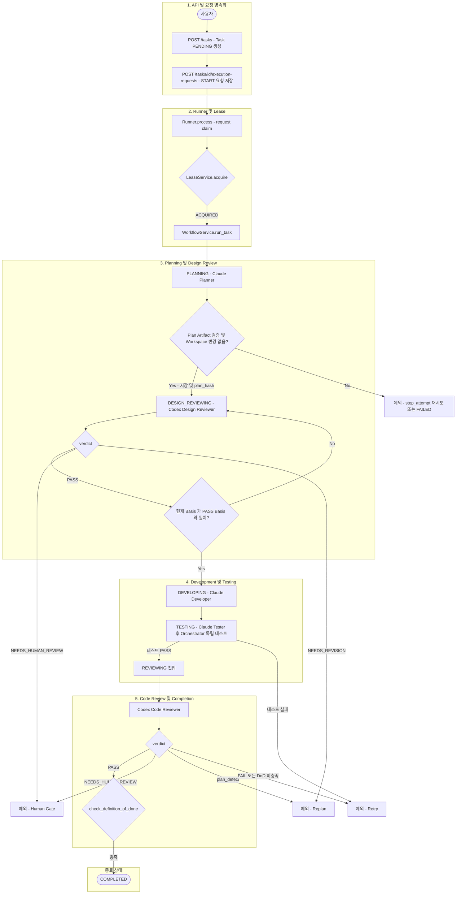
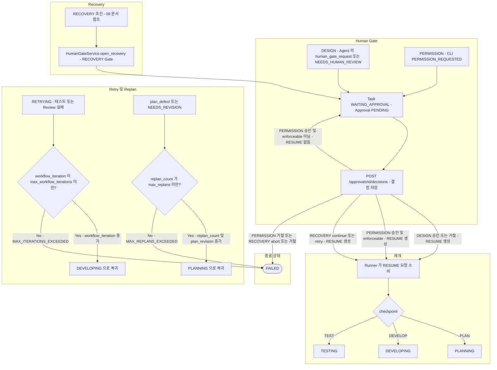

# 전체 Workflow

> 현재 구현 코드를 기준으로 정리한 흐름입니다. 코드로 확인되지 않았거나 검증되지 않은 동작은 현재 구현 제한으로 구분합니다.

## 최초 실행과 개선 반복

- 최초 실행은 `workflow_iteration = 0`입니다.
- 테스트 실패 또는 Code Review 실패는 `RETRYING`을 거쳐 `workflow_iteration`을 1씩 증가시키며, 최대 `max_workflow_iterations`(기본 3)회의 개선만 수행합니다. 초과하면 `MAX_ITERATIONS_EXCEEDED`로 FAILED 처리합니다.
- Code Reviewer가 `plan_defect`를 반환하면 개선이 아니라 재계획 경로(`replan_count`, `plan_revision` 증가 후 PLANNING)로 이동하며 `max_replans`를 따릅니다.

## 1. 정상 Workflow

Task 생성부터 COMPLETED까지의 정상 흐름입니다. 중심 클래스는 `Runner`와 `WorkflowService`이며, Human Gate·Retry·Replan은 `HG`, `RETRY`, `REPLAN` 노드로만 표시하고 상세는 아래 예외 흐름 다이어그램에서 다룹니다.

- Design Review PASS 뒤에는 일반적인 "Human Gate 필요 여부" 판정 단계가 없습니다. PASS이면 `Development 직전 Basis 재비교` 후 곧바로 DEVELOPING입니다.
- 다이어그램의 `Runner`는 `Runner.process`를 의미하며 `LeaseService.acquire` 성공 후 `WorkflowService.run_task`를 호출합니다 ([03](03-task-runner.md)). `HELD`/`UNCERTAIN` 결과는 [03](03-task-runner.md), 만료 Lease 인계는 [07](07-lease.md)을 참고하십시오.
- Planning 상세는 [04](04-planning-review.md), Development·Testing·Code Review 상세는 [05](05-development-testing.md)에 있습니다.

## 2. 예외 흐름: Human Gate, Recovery, Retry, Replan

정상 흐름에서 벗어나는 경로만 모은 다이어그램입니다. 중심 클래스는 `HumanGateService`, `Runner`, `WorkflowService`이며 별도 `RecoveryService`는 없습니다. 정상 흐름의 `HG`, `RETRY`, `REPLAN` 노드가 이 다이어그램의 진입점이며, Planner·Developer·Tester의 `human_gate_request`와 CLI 권한 요청도 같은 Human Gate로 이어집니다.

- Human Gate는 다음 조건에서만 열립니다.
  - Planner, Design Reviewer, Developer, Tester, Code Reviewer가 `human_gate_request` 또는 `NEEDS_HUMAN_REVIEW`를 반환한 경우 (DESIGN Gate)
  - CLI가 명시적으로 권한을 요청(`PERMISSION_REQUESTED`)한 경우 (PERMISSION Gate)
  - 종료·변경 안전성이 불확실한 Recovery 조건 (RECOVERY Gate, [09](09-recovery.md))
- DESIGN Gate의 checkpoint가 `PLAN`이면 승인·거절 모두 설계 결정으로 저장되고 재개 시 `plan_revision`이 증가하며 PLANNING부터 다시 수행합니다. "Human Gate 승인 → 즉시 DEVELOPING"은 아닙니다 ([08](08-human-gate.md)).
- PERMISSION을 `enforceable=false`로 승인하면 RESUME이 만들어지지 않고 Task는 `WAITING_APPROVAL`에 남습니다 (다이어그램의 `W`로 돌아가는 간선, [08](08-human-gate.md)).
- `RETRYING`은 `workflow_iteration` 한도(`MAX_ITERATIONS_EXCEEDED`), Replan은 `max_replans` 한도(`MAX_REPLANS_EXCEEDED`)가 각각 FAILED 조건입니다.
- Recovery 책임은 별도 서비스가 아니라 `Runner`, `WorkflowService`, `HumanGateService`, `LeaseService`, `StepRunner`에 분산되어 있습니다 ([02](02-architecture.md), [09](09-recovery.md)).
