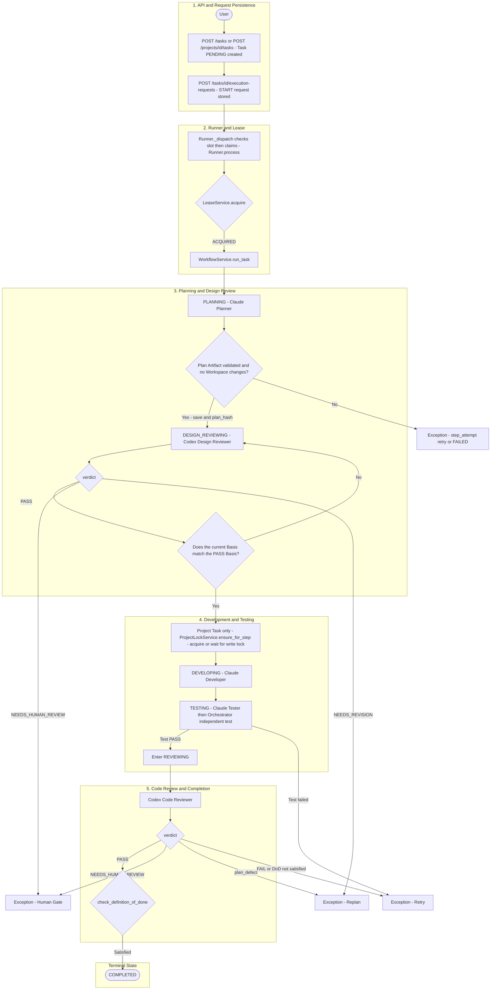
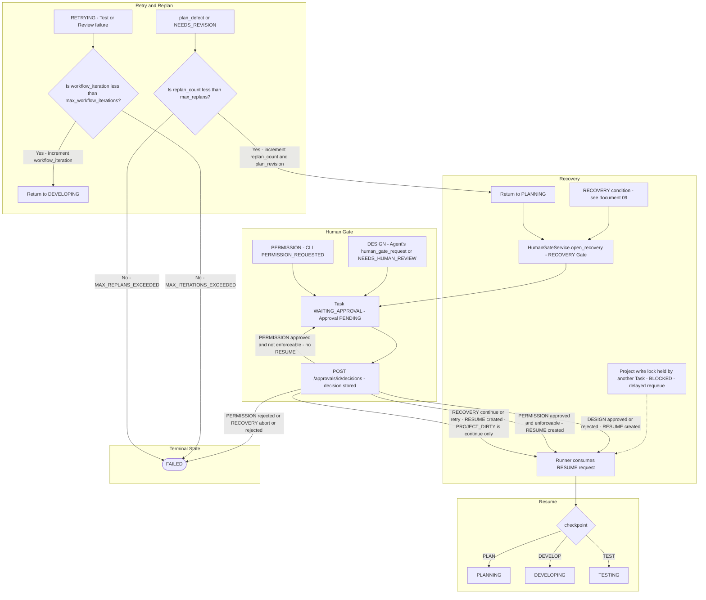

# Overall Workflow

> 한국어: [01-overview_ko.md](01-overview_ko.md).

> This is a flow organized based on the current implementation code. Behavior that is not confirmed or verified in the code is classified as a current implementation limitation.

## Initial Execution and Improvement Iterations

- The initial execution is `workflow_iteration = 0`.
- Test failure or Code Review failure goes through `RETRYING` and increments `workflow_iteration` by 1, performing improvements only up to a maximum of `max_workflow_iterations` (default 3) times. If exceeded, it is processed as FAILED with `MAX_ITERATIONS_EXCEEDED`.
- If the Code Reviewer returns `plan_defect`, it moves not to improvement but to the replan path (incrementing `replan_count`, `plan_revision`, then PLANNING), following `max_replans`.

## 1. Normal Workflow

The normal flow from Task creation to COMPLETED. The central classes are `Runner` and `WorkflowService`; Human Gate, Retry, and Replan are shown only as `HG`, `RETRY`, `REPLAN` nodes, with details covered in the exception flow diagram below.

- After Design Review PASS, there is no general "is Human Gate needed" determination step. If PASS, it goes directly to DEVELOPING after a `Basis re-comparison right before Development`.
- `Runner` in the diagram refers to `Runner.process`, which calls `WorkflowService.run_task` after `LeaseService.acquire` succeeds ([03](03-task-runner.md)). For `HELD`/`UNCERTAIN` results, see [03](03-task-runner.md); for expired Lease handover, see [07](07-lease.md).
- Planning details are in [04](04-planning-review.md), and Development·Testing·Code Review details are in [05](05-development-testing.md).
- **Project Task**: A Workspace (an existing local path or a clone) registered via `POST /projects` is shared by multiple Tasks. Read-only Steps (Plan, Design Review) can run in parallel, but change Steps (Developer, Tester) and Code Review are executed by only the single Task holding the Project write lock. The lock is acquired before the first change Step and released when the Task becomes terminal (within the same transaction), and is retained even during `WAITING_APPROVAL`. Tasks of different Projects and existing Tasks without `project_id` run in parallel ([03](03-task-runner.md), [07](07-lease.md)).

## 2. Exception Flow: Human Gate, Recovery, Retry, Replan

A diagram collecting only the paths that deviate from the normal flow. The central classes are `HumanGateService`, `Runner`, `WorkflowService`; there is no separate `RecoveryService`. The `HG`, `RETRY`, `REPLAN` nodes of the normal flow are the entry points of this diagram, and the `human_gate_request` from Planner·Developer·Tester and CLI permission requests also lead to the same Human Gate.

- Human Gate opens only under the following conditions.
  - When Planner, Design Reviewer, Developer, Tester, or Code Reviewer returns `human_gate_request` or `NEEDS_HUMAN_REVIEW` (DESIGN Gate)
  - When the CLI explicitly requests permission (`PERMISSION_REQUESTED`) (PERMISSION Gate)
  - Recovery conditions where termination/change safety is uncertain (RECOVERY Gate, [09](09-recovery.md))
- If the DESIGN Gate's checkpoint is `PLAN`, both approval and rejection are stored as design decisions, and upon resumption `plan_revision` is incremented and execution restarts from PLANNING. It is not the case that "Human Gate approval → immediately DEVELOPING" ([08](08-human-gate.md)).
- If PERMISSION is approved with `enforceable=false`, no RESUME is created and the Task remains in `WAITING_APPROVAL` (the edge in the diagram returning to `W`, [08](08-human-gate.md)).
- `RETRYING` has the `workflow_iteration` limit (`MAX_ITERATIONS_EXCEEDED`) as its FAILED condition, and Replan has the `max_replans` limit (`MAX_REPLANS_EXCEEDED`) as its FAILED condition.
- Recovery responsibility is distributed not to a separate service but across `Runner`, `WorkflowService`, `HumanGateService`, `LeaseService`, and `StepRunner` ([02](02-architecture.md), [09](09-recovery.md)).
