# 전체 아키텍처 및 모듈 관계

> 현재 구현 코드를 기준으로 정리한 흐름입니다. 코드로 확인되지 않았거나 검증되지 않은 동작은 현재 구현 제한으로 구분합니다.

호출 방향은 `Router → Service → 구체 Repository / Provider`입니다. Workflow 실행은 API가 아니라 `Runner`가 시작합니다.

아래 다이어그램은 모듈 간 호출 관계를 Layer별로 보여주는 구조도이며 실행 순서가 아닙니다. 중심 클래스는 `Runner`와 `WorkflowService`입니다. 별도 `RecoveryService`는 없으며 Recovery 관련 호출은 `open_recovery` 간선으로 표시했습니다.

```mermaid
flowchart TB
    subgraph CLIENT["Client / API Layer"]
        direction TB
        USER["Client"]
        API["FastAPI Routers"]
    end

    subgraph RUNNERZ["Runner"]
        direction TB
        RUNNER["Runner"]
    end

    subgraph SERVICE["Service Layer"]
        direction TB
        TASK["TaskService"]
        GATE["HumanGateService"]
        LEASE["LeaseService"]
        WF["WorkflowService"]
        STEP["StepRunner"]
        SESSION["SessionService"]
        TEST["TestPolicyService"]
        COMPLETE["completion_checker.check_definition_of_done - 함수"]
        PROJ["ProjectService"]
        LOCK["ProjectLockService"]
        FIN["TaskFinalizer"]
        EFFECTS["RecoveryEffects 와 ProjectDirtyRecoveryEffect"]
        PTERM["project_terminal.release_on_terminal - 함수"]
        STATE["state_service.change_task_state - 함수"]
    end

    subgraph PROVIDERS["Provider Layer"]
        direction TB
        CLAUDE["ClaudeCliProvider"]
        CODEX["CodexCliProvider"]
        MOCK["Mock Provider - 테스트용"]
    end

    subgraph INFRA["Infrastructure Layer"]
        direction TB
        EXEC["Command Executor"]
        PROC["process_control 모듈"]
        GUARD["Workspace Guard"]
        SNAP["Workspace Snapshot"]
        FPRINT["workspace_fingerprint 모듈"]
    end

    subgraph DATA["Persistence Layer"]
        direction TB
        REPO["Concrete Repositories"]
        STORE["SessionStore Protocol"]
        PG[("PostgreSQL")]
    end

    subgraph STREAM["Streaming"]
        direction TB
        EVENT["In-memory Event Bus"]
    end

    USER --> API
    API -->|"Task 생성 및 Execution Request 저장"| TASK
    API -->|"Approval 결정"| GATE
    API -->|"Project 등록 및 조회"| PROJ
    PROJ -->|"git clone"| EXEC
    PROJ --> FPRINT
    PROJ --> REPO
    WF -->|"ensure_for_step"| LOCK
    WF -->|"finalize_task_with_proof"| FIN
    FIN -->|"measure_for_task"| LOCK
    LOCK --> FPRINT
    LOCK --> REPO
    GATE -->|"reason_code 로 효과 조회"| EFFECTS
    EFFECTS --> LOCK
    EFFECTS --> STATE
    FIN --> STATE
    WF --> STATE
    STATE -->|"terminal 전이"| PTERM
    PTERM --> REPO
    RUNNER -->|"acquire / heartbeat / release"| LEASE
    RUNNER -->|"run_task"| WF
    RUNNER -->|"open_recovery"| GATE
    RUNNER -->|"close_all_for_task"| SESSION
    WF --> STEP
    WF --> LEASE
    WF --> GATE
    WF --> TEST
    WF --> COMPLETE
    WF -->|"close_all_for_task"| SESSION
    STEP --> LEASE
    STEP -->|"prepare / record_result"| SESSION
    STEP --> CLAUDE
    STEP --> CODEX
    STEP --> MOCK
    CLAUDE --> EXEC
    CODEX --> EXEC
    EXEC --> PROC
    LEASE --> PROC
    WF --> SNAP
    STEP --> SNAP
    WF --> GUARD
    TASK --> REPO
    RUNNER --> REPO
    WF --> REPO
    STEP --> REPO
    LEASE --> REPO
    GATE --> REPO
    SESSION --> STORE
    STEP -.->|"PostgresSessionStore"| STORE
    REPO --> PG
    STORE --> PG
    STEP --> EVENT
    WF --> EVENT
    API -->|"WS event-stream"| EVENT
    EVENT --> USER
```

- `Runner`는 Service Layer와 분리된 구역으로 표시했지만 `LeaseService`와 `WorkflowService`를 호출하는 Service 계층의 소비자입니다.
- Router는 `TaskService`, `ProjectService`, `HumanGateService`만 호출하며 `Runner`를 직접 실행하지 않습니다(결정·요청 저장 뒤 `Runner.notify`로 깨우기만 합니다).

## Project 관련 책임과 의존 방향

| 모듈 | 책임 |
|---|---|
| `ProjectService` | 기존 로컬 Workspace 등록 또는 `git clone` 후 등록, 이름·상태 변경(`ARCHIVED`는 미종료 Task가 있으면 409). 경로 검증, 중복·중첩 차단, clone 보상(이번 요청이 만든 디렉터리만 정리) |
| `ProjectLockService` | proof 측정(`measure_for_task`, `measure_project`), Step 시작 전 write lock 획득·검증·PROJECT_DIRTY Gate(`ensure_for_step`), `reconcile`. **terminal 정리 없음, Task 상태 변경 없음** |
| `project_terminal` | `release_on_terminal` - terminal 전이 때 lock 해제·write baseline 정리·`workspace_state` 기록의 **단독 소유자**. 트랜잭션을 열지 않고 측정하지 않으며 `FingerprintProofStale`을 던짐 |
| `TaskFinalizer` | `finalize_task_with_proof` - 측정(트랜잭션 밖) → 짧은 트랜잭션 → 재시도/`UNMEASURED` 종료 |
| `RecoveryEffects`, `ProjectDirtyRecoveryEffect` | Recovery 종류(`reason_code`)별 효과. `HumanGateService`는 이 레지스트리만 알고 Project 모듈을 import하지 않음 |
| `workspace_fingerprint` | `WORKSPACE_FINGERPRINT_V1` 측정 ([10](10-invalidation.md)) |

의존은 한 방향입니다: `state_service → project_terminal → ProjectRepository`. `project_terminal`과 `ProjectLockService`는 `state_service`를 import하지 않고, `state_service`는 `ProjectLockService`를 import하지 않습니다. 상태 전이와 Project 효과의 조합은 상위 계층(`TaskFinalizer`, `WorkflowService`, `Runner`, `ProjectDirtyRecoveryEffect`)이 합니다(구조 테스트 `tests/architecture/test_project_rules.py`).

## Recovery 책임 분산

별도의 `RecoveryService`는 존재하지 않습니다. Recovery 관련 책임은 다음 모듈에 분산되어 있습니다.

| 모듈 | 담당 |
|---|---|
| `Runner` | 시작 시와 loop마다 `recover()`(Lease 없는 stale CLAIMED 요청 requeue, 대기 중 취소 처리, 종료 Task가 남긴 Project lock reconcile), `_park_uncertain`(Lease 인계 UNCERTAIN 시 RECOVERY Gate와 요청 `NEEDS_REVIEW`) |
| `WorkflowService` | `_park_for_recovery`, `_interrupted_needs_human`, `_recovery_unsafe`(승인 후 재검증), `_finalize_cancel` |
| `HumanGateService` | `open_recovery`(Task/Approval/Step을 한 트랜잭션에서 전환, `reason_code` 기록), RECOVERY 결정 처리(`RecoveryEffects`에 위임) |
| `ProjectLockService` | PROJECT_DIRTY Gate 진입(`ensure_for_step`), 남은 Project lock `reconcile` |
| `LeaseService` | `acquire`의 만료 Lease 인계 및 `UNCERTAIN` 판정 |
| `StepRunner` | 종료 미확인 결과를 `TerminationUnconfirmed`로 올림, Lease 상실 결과를 `discarded_result`로 격리 |

## 읽는 방법

- Router는 `TaskService`(요청 저장·조회)와 `HumanGateService`(결정)만 호출합니다. API가 `SessionService`를 직접 호출하지 않습니다.
- `SessionService`는 `StepRunner`(`prepare`, `record_result`)와 `WorkflowService`·`Runner`(`close_all_for_task`)가 호출합니다. 실제 저장은 `StepRunner`가 만든 `PostgresSessionStore`를 통해서만 일어납니다.
- `TaskService`는 Workflow를 시작하지 않습니다. `execution_requests`에 저장하면 `Runner`가 PostgreSQL에서 claim합니다 ([03](03-task-runner.md)).
- Completion Checker는 별도의 Agent나 Service가 아니라 `WorkflowService`가 Code Review PASS를 처리하는 중에 호출하는 `check_definition_of_done` 함수입니다 ([11](11-task-lifecycle.md)).
- `process_control`은 클래스가 아니라 `app.infra.process_control` 모듈입니다(`ProcessIdentity`, `TerminationResult`, `capture_identity`, `check_alive`, `terminate_tree`).
- Event Bus는 in-memory이며 best-effort입니다. 진실 원천은 PostgreSQL입니다.
