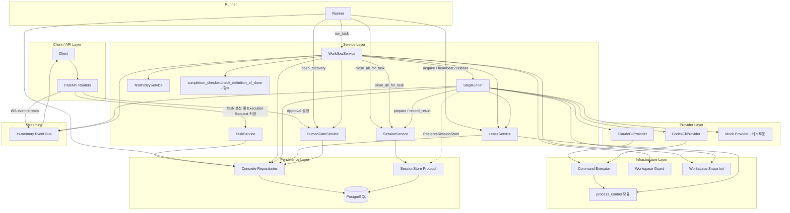

# 전체 아키텍처 및 모듈 관계

> 현재 구현 코드를 기준으로 정리한 흐름입니다. 코드로 확인되지 않았거나 검증되지 않은 동작은 현재 구현 제한으로 구분합니다.

호출 방향은 `Router → Service → 구체 Repository / Provider`입니다. Workflow 실행은 API가 아니라 `Runner`가 시작합니다.

아래 다이어그램은 모듈 간 호출 관계를 Layer별로 보여주는 구조도이며 실행 순서가 아닙니다. 중심 클래스는 `Runner`와 `WorkflowService`입니다. 별도 `RecoveryService`는 없으며 Recovery 관련 호출은 `open_recovery` 간선으로 표시했습니다.

- `Runner`는 Service Layer와 분리된 구역으로 표시했지만 `LeaseService`와 `WorkflowService`를 호출하는 Service 계층의 소비자입니다.
- Router는 `TaskService`와 `HumanGateService`만 호출하며 `Runner`를 직접 실행하지 않습니다(결정·요청 저장 뒤 `Runner.notify`로 깨우기만 합니다).

## Recovery 책임 분산

별도의 `RecoveryService`는 존재하지 않습니다. Recovery 관련 책임은 다음 모듈에 분산되어 있습니다.

| 모듈 | 담당 |
|---|---|
| `Runner` | 시작 시 `recover()`(stale CLAIMED 요청 requeue, 대기 중 취소 처리), `_park_uncertain`(Lease 인계 UNCERTAIN 시 RECOVERY Gate와 요청 `NEEDS_REVIEW`) |
| `WorkflowService` | `_park_for_recovery`, `_interrupted_needs_human`, `_recovery_unsafe`(승인 후 재검증), `_finalize_cancel` |
| `HumanGateService` | `open_recovery`(Task/Approval/Step을 한 트랜잭션에서 전환), RECOVERY 결정 처리 |
| `LeaseService` | `acquire`의 만료 Lease 인계 및 `UNCERTAIN` 판정 |
| `StepRunner` | 종료 미확인 결과를 `TerminationUnconfirmed`로 올림, Lease 상실 결과를 `discarded_result`로 격리 |

## 읽는 방법

- Router는 `TaskService`(요청 저장·조회)와 `HumanGateService`(결정)만 호출합니다. API가 `SessionService`를 직접 호출하지 않습니다.
- `SessionService`는 `StepRunner`(`prepare`, `record_result`)와 `WorkflowService`·`Runner`(`close_all_for_task`)가 호출합니다. 실제 저장은 `StepRunner`가 만든 `PostgresSessionStore`를 통해서만 일어납니다.
- `TaskService`는 Workflow를 시작하지 않습니다. `execution_requests`에 저장하면 `Runner`가 PostgreSQL에서 claim합니다 ([03](03-task-runner.md)).
- Completion Checker는 별도의 Agent나 Service가 아니라 `WorkflowService`가 Code Review PASS를 처리하는 중에 호출하는 `check_definition_of_done` 함수입니다 ([11](11-task-lifecycle.md)).
- `process_control`은 클래스가 아니라 `app.infra.process_control` 모듈입니다(`ProcessIdentity`, `TerminationResult`, `capture_identity`, `check_alive`, `terminate_tree`).
- Event Bus는 in-memory이며 best-effort입니다. 진실 원천은 PostgreSQL입니다.
