# Overall Architecture and Module Relationships

> 한국어: [02-architecture_ko.md](02-architecture_ko.md)

> This is the flow organized based on the current implementation code. Behavior that is not confirmed or verified by code is classified as a current implementation limitation.

The call direction is `Router → Service → Concrete Repository / Provider`. Workflow execution is started by `Runner`, not by the API.

The diagram below is a structural diagram showing call relationships between modules by Layer, not an execution order. The central classes are `Runner` and `WorkflowService`. There is no separate `RecoveryService`; Recovery-related calls are shown as the `open_recovery` edge.

```mermaid
flowchart TB
    subgraph CLIENT["Client / API Layer"]
        direction TB
        USER["Client"]
        API["FastAPI Routers"]
    end

    subgraph RUNNERZ["Runner"]
        direction TB
        RUNNER["Runner"]
    end

    subgraph SERVICE["Service Layer"]
        direction TB
        TASK["TaskService"]
        GATE["HumanGateService"]
        LEASE["LeaseService"]
        WF["WorkflowService"]
        STEP["StepRunner"]
        SESSION["SessionService"]
        TEST["TestPolicyService"]
        COMPLETE["completion_checker.check_definition_of_done - function"]
        PROJ["ProjectService"]
        LOCK["ProjectLockService"]
        FIN["TaskFinalizer"]
        EFFECTS["RecoveryEffects and ProjectDirtyRecoveryEffect"]
        PTERM["project_terminal.release_on_terminal - function"]
        STATE["state_service.change_task_state - function"]
    end

    subgraph PROVIDERS["Provider Layer"]
        direction TB
        CLAUDE["ClaudeCliProvider"]
        CODEX["CodexCliProvider"]
        MOCK["Mock Provider - for testing"]
    end

    subgraph INFRA["Infrastructure Layer"]
        direction TB
        EXEC["Command Executor"]
        PROC["process_control module"]
        GUARD["Workspace Guard"]
        SNAP["Workspace Snapshot"]
        FPRINT["workspace_fingerprint module"]
    end

    subgraph DATA["Persistence Layer"]
        direction TB
        REPO["Concrete Repositories"]
        STORE["SessionStore Protocol"]
        PG[("PostgreSQL")]
    end

    subgraph STREAM["Streaming"]
        direction TB
        EVENT["In-memory Event Bus"]
    end

    USER --> API
    API -->|"Create Task and store Execution Request"| TASK
    API -->|"Approval decision"| GATE
    API -->|"Register and look up Project"| PROJ
    PROJ -->|"git clone"| EXEC
    PROJ --> FPRINT
    PROJ --> REPO
    WF -->|"ensure_for_step"| LOCK
    WF -->|"finalize_task_with_proof"| FIN
    FIN -->|"measure_for_task"| LOCK
    LOCK --> FPRINT
    LOCK --> REPO
    GATE -->|"Look up effect by reason_code"| EFFECTS
    EFFECTS --> LOCK
    EFFECTS --> STATE
    FIN --> STATE
    WF --> STATE
    STATE -->|"terminal transition"| PTERM
    PTERM --> REPO
    RUNNER -->|"acquire / heartbeat / release"| LEASE
    RUNNER -->|"run_task"| WF
    RUNNER -->|"open_recovery"| GATE
    RUNNER -->|"close_all_for_task"| SESSION
    WF --> STEP
    WF --> LEASE
    WF --> GATE
    WF --> TEST
    WF --> COMPLETE
    WF -->|"close_all_for_task"| SESSION
    STEP --> LEASE
    STEP -->|"prepare / record_result"| SESSION
    STEP --> CLAUDE
    STEP --> CODEX
    STEP --> MOCK
    CLAUDE --> EXEC
    CODEX --> EXEC
    EXEC --> PROC
    LEASE --> PROC
    WF --> SNAP
    STEP --> SNAP
    WF --> GUARD
    TASK --> REPO
    RUNNER --> REPO
    WF --> REPO
    STEP --> REPO
    LEASE --> REPO
    GATE --> REPO
    SESSION --> STORE
    STEP -.->|"PostgresSessionStore"| STORE
    REPO --> PG
    STORE --> PG
    STEP --> EVENT
    WF --> EVENT
    API -->|"WS event-stream"| EVENT
    EVENT --> USER
```

- `Runner` is shown as an area separate from the Service Layer, but it is a consumer of the Service layer that calls `LeaseService` and `WorkflowService`.
- The Router only calls `TaskService`, `ProjectService`, and `HumanGateService`, and does not execute `Runner` directly (after storing a decision/request, it only wakes it via `Runner.notify`).

## Project-related responsibilities and dependency direction

| Module | Responsibility |
|---|---|
| `ProjectService` | Register an existing local Workspace or register after `git clone`, change name/status (`ARCHIVED` returns 409 if there are non-terminal Tasks). Path validation, blocking duplicates/nesting, clone compensation (cleans up only the directory this request created) |
| `ProjectLockService` | proof measurement (`measure_for_task`, `measure_project`), acquiring/validating write lock before Step start, PROJECT_DIRTY Gate (`ensure_for_step`), `reconcile`. **No terminal cleanup, no Task state changes** |
| `project_terminal` | `release_on_terminal` - the **sole owner** of lock release, write baseline cleanup, and `workspace_state` recording on terminal transition. Does not open a transaction, does not measure, and throws `FingerprintProofStale` |
| `TaskFinalizer` | `finalize_task_with_proof` - measure (outside the transaction) → short transaction → retry/terminate as `UNMEASURED` |
| `RecoveryEffects`, `ProjectDirtyRecoveryEffect` | Effects per Recovery kind (`reason_code`). `HumanGateService` only knows this registry and does not import the Project module |
| `workspace_fingerprint` | `WORKSPACE_FINGERPRINT_V1` measurement ([10](10-invalidation.md)) |

The dependency is one-directional: `state_service → project_terminal → ProjectRepository`. `project_terminal` and `ProjectLockService` do not import `state_service`, and `state_service` does not import `ProjectLockService`. The combination of state transitions and Project effects is handled by the upper layers (`TaskFinalizer`, `WorkflowService`, `Runner`, `ProjectDirtyRecoveryEffect`) (structural test `tests/architecture/test_project_rules.py`).

## Recovery responsibility distribution

There is no separate `RecoveryService`. Recovery-related responsibilities are distributed across the following modules.

| Module | Responsibility |
|---|---|
| `Runner` | `recover()` at startup and on every loop (requeueing stale CLAIMED requests with no Lease, handling pending cancellations, reconciling Project locks left by terminated Tasks), `_park_uncertain` (RECOVERY Gate and request `NEEDS_REVIEW` when Lease handover is UNCERTAIN) |
| `WorkflowService` | `_park_for_recovery`, `_interrupted_needs_human`, `_recovery_unsafe` (re-validation after approval), `_finalize_cancel` |
| `HumanGateService` | `open_recovery` (transitions Task/Approval/Step within a single transaction, records `reason_code`), handling RECOVERY decisions (delegated to `RecoveryEffects`) |
| `ProjectLockService` | Entering PROJECT_DIRTY Gate (`ensure_for_step`), `reconcile` of remaining Project locks |
| `LeaseService` | Expired Lease handover and `UNCERTAIN` determination in `acquire` |
| `StepRunner` | Raises unconfirmed-termination results as `TerminationUnconfirmed`, isolates results that lost their Lease as `discarded_result` |

## How to read this

- The Router only calls `TaskService` (storing/looking up requests) and `HumanGateService` (decisions). The API does not call `SessionService` directly.
- `SessionService` is called by `StepRunner` (`prepare`, `record_result`) and by `WorkflowService`/`Runner` (`close_all_for_task`). Actual storage only happens through the `PostgresSessionStore` created by `StepRunner`.
- `TaskService` does not start a Workflow. Once stored in `execution_requests`, `Runner` claims it from PostgreSQL ([03](03-task-runner.md)).
- The Completion Checker is not a separate Agent or Service; it is the `check_definition_of_done` function that `WorkflowService` calls while processing a Code Review PASS ([11](11-task-lifecycle.md)).
- `process_control` is not a class but the `app.infra.process_control` module (`ProcessIdentity`, `TerminationResult`, `capture_identity`, `check_alive`, `terminate_tree`).
- The Event Bus is in-memory and best-effort. The source of truth is PostgreSQL.
