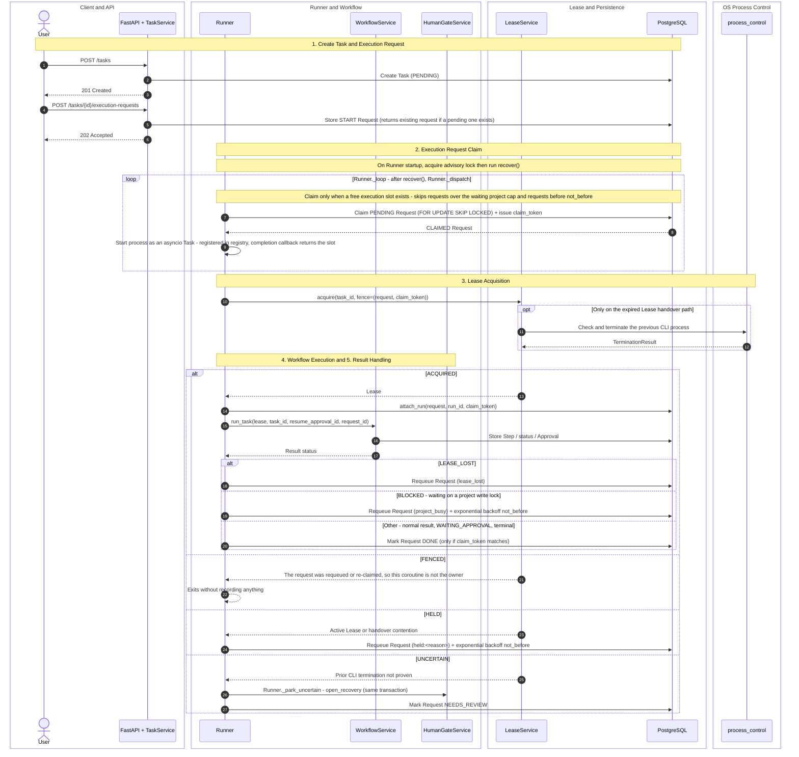

# Task Creation and Runner Execution

> 한국어: [03-task-runner_ko.md](03-task-runner_ko.md).

> This flow is organized based on the current implementation code. Behavior that is not confirmed by code or has not been verified is distinguished as a current implementation limitation.

Task creation and Execution Request creation are separate API calls. Workflow execution is started by `Runner`.

The diagram below shows the normal flow and the handling of the three outcomes of `LeaseService.acquire` (`ACQUIRED`, `HELD`, `UNCERTAIN`) all at once. The central class is `Runner.process`, and phase boundaries are marked with Notes.

## How to read this

- `POST /tasks` only creates a PENDING Task and executes nothing.
- `POST /tasks/{id}/execution-requests` returns 202 from the current Router regardless of whether the request is new, only stores the request, and does not directly execute the CLI. A Task in a terminal state returns 409, and a Task in `WAITING_APPROVAL` also returns 409 (it resumes automatically after approval).
- RESUME requests created by approval decisions are also stored in the same `execution_requests` table and consumed through the same path ([08](08-human-gate.md)).
- `LeaseService.acquire` returns `ACQUIRED`, `HELD`, `UNCERTAIN`, or `FENCED`. `HELD` means an active (unexpired) Lease exists or the state changed during handover; the request is not terminated and is requeued as `PENDING` with `held:<reason>`. `FENCED` means that after this coroutine claimed the request, the request was requeued or re-claimed, so the `claim_token` no longer matches.
- If `UNCERTAIN`, nothing is executed. Creating a RECOVERY Approval and setting the request to `NEEDS_REVIEW` are performed not by `LeaseService` but by `Runner._park_uncertain` in a single transaction ([09](09-recovery.md)).
- `LEASE_LOST` requeues the request, and `BLOCKED` (another Task holds the project write lock) requeues it with a delay. Normal results, `WAITING_APPROVAL`, and terminal-state results mark the request as `DONE`.
- **Claim fencing**: a new `claim_token` is issued for every claim, and subsequently `process` start, `acquire` (Txn A·B), `attach_run`, `finish`, and `requeue` all check the condition `status=CLAIMED AND claim_token=<token>`. A previous coroutine that belatedly proceeds on an already-requeued request cannot leave any change behind.
- **Backoff**: `HELD`/`project_busy` requeues increment `execution_requests.defer_count` by 1 and store `not_before` as `min(60s, 5s·2^previous_defer_count)` multiplied by jitter (0.8–1.2) (excluding jitter: 5s, 10s, 20s ...). `claim_next` only claims requests whose `not_before` has passed, and since the value lives in PostgreSQL it persists across Runner restarts. A simple requeue from startup recovery does not increment the counter.
- `Runner.recover` runs on every loop iteration (regardless of slot availability). It only treats a request as stale and requeues it if it is `CLAIMED`, its `claimed_at` has exceeded the grace period (`claim_timeout_seconds`), **and no live (unexpired RUNNING) Lease exists**. It does not touch the normal window between claim and Lease acquisition, nor a long-running CLI execution that holds a Lease. It then processes idle cancellation requests (`_cancel_idle_tasks`), and cleans up (`ProjectLockService.reconcile`) any Project write lock left behind by a finished Task. It does not directly create a Recovery Gate.

## Parallel dispatch

Within a single application process, `Runner._dispatch` executes multiple Tasks concurrently (it does not spawn an OS process per project).

- Slots are checked **before claiming** (`len(registry) < MAX_CONCURRENT_TASKS`). There is no structure where a claimed request waits for a slot.
- In-flight requests live in the registry (`request id → asyncio.Task`), and the completion callback catches exceptions into the log, returns the slot, and wakes the loop. An exception in one Task does not propagate to other Tasks (the request remains `CLAIMED` and is recovered after the grace period).
- Concurrent execution for the same project is limited by `MAX_TASKS_PER_PROJECT` (default 1). Requests for a project that has reached the cap are skipped by `claim_next` (if `busy_project_ids` is empty, the condition itself is not added; if not empty, it is bound as a UUID array, and legacy Tasks with `project_id IS NULL` are not excluded).
- Existing Tasks without a `project_id` each use `WORKSPACE_ROOT/<task_id>`, so they are not part of any project cap group. Only the global limit and the Task Lease apply.
- The number of CLI/test child processes is limited by `CommandExecutor`'s semaphore (`MAX_CONCURRENT_CLI_PROCESSES`); if a cancellation request arrives while waiting for a slot, it ends as `CANCELLED` without spawning.
- Shutdown (`Runner.stop`): stop accepting new claims → drain in-flight Tasks (`RUNNER_SHUTDOWN_GRACE_SECONDS`) → locally revoke the Lease of remaining Tasks and cancel the CLI → if still not finished, cancel the coroutine (leaving the Lease as-is so the next startup's `acquire` makes the determination) → release the advisory lock.
- Runner lifecycle state is an in-process value (`STOPPED → STARTING → RUNNING → STOPPING → STOPPED`, or `STOP_INCOMPLETE` on failure) and is not stored in the DB. `start` only works from `STOPPED`, and `stop` only works from `RUNNING`/`STOP_INCOMPLETE` (`STOPPED` is a no-op, `STARTING`/`STOPPING` raise `RuntimeError`); if startup fails, it confirms the unlock/close of the connection it was holding before reverting to `STOPPED` (if close cannot be confirmed, it becomes `STOP_INCOMPLETE` as described below). The final transition for shutdown/startup failure (`STOPPED` or `STOP_INCOMPLETE`) is performed by a settlement task protected from cancellation that inspects the actual resources, so it does not remain stuck in `STARTING`/`STOPPING`. The `_lifecycle_lock` is an in-process mutex used only for state transitions, recovery permission checks, and registering/reclaiming recovery tasks. It is not held during CLI execution or draining, nor **during recovery's DB I/O**, so `stop` can transition immediately to `STOPPING` even if the DB is delayed.
- `recover(startup=True)` (reprocessing all CLAIMED requests) is allowed only while in `STARTING` and holding the advisory lock; periodic recovery is allowed only in `RUNNING`; in any other state it raises `RuntimeError` without changing the DB.
- **Recovery work**: the permission check and registration happen together under `_lifecycle_lock` (only one recovery task is registered per Runner; if a periodic call encounters an already-running task, it returns `SKIPPED`, and if a startup call does, it errors), while DB work runs outside the lock in a separate task. Request changes happen in a single transaction, and each UPDATE conditions on the `claim_token` as read at query time (if the condition doesn't match, it leaves the row untouched), so a request taken over by another owner after the query is not overwritten. A recovery where nothing applies ends safely with no DB changes.
- **Recovery waiting and post-cancellation settlement are bounded**. It waits for `RUNNER_RECOVERY_TIMEOUT_SECONDS` (default 20), and if exceeded, requests cancellation once and then waits for settlement for `RUNNER_RECOVERY_SHUTDOWN_WAIT_SECONDS` (default 5). Even if a rollback etc. is confirmed within this time, it is still a `RecoveryTimeout`, and work that hasn't finished is not treated as cancelled but is left as-is. The server-side statement is limited by `RECOVERY_STATEMENT_TIMEOUT_SECONDS` (default 15, transaction-local), but this is not an upper bound on commit, network, or connection close. If the caller is cancelled, the original `CancelledError` is re-raised as-is. During stop settlement, cleanup and reconciliation may each run as a separate bounded operation, so the recovery timeout cannot be assumed to apply only once.
- **DB result and connection cleanup are judged separately**. If commit returns normally, the result is COMMITTED even if the subsequent close fails, and the connection attempts disposal via `invalidate`. If cleanup cannot be confirmed, ownership is retained, and during that time subsequent work (such as `_cancel_idle_tasks`) and releasing the advisory lock do not happen. If the result is unknown after the commit request, it is recorded as UNCERTAIN, and without changing any new requests, a single read-only query checks whether all target requests are either entirely in their original state or entirely in the intended state (if mixed or the query fails, the evidence is preserved and it proceeds to `STOP_INCOMPLETE` or a subsequent attempt). Having a timeout does not mean every commit result is confirmed as a rollback.
- `STOP_INCOMPLETE` is a state where **live in-flight Tasks, recovery that hasn't finished or whose result isn't confirmed, or a runtime connection whose cleanup isn't confirmed** (the advisory lock connection, or a connection whose close wasn't confirmed after a startup failure) remain. Shutdown settlement attempts each stage fully in order — loop exit → recovery settlement → drain → advisory connection cleanup — collecting and reporting errors. If a live or unconfirmed recovery remains, the advisory lock connection is not closed, in order to block other Runners from starting and preserve singleton ownership (the recovery DB connection and the advisory lock connection are separate). Sections this document does not bound, such as advisory connection close, may have no upper bound under the current contract, so **the entirety of Runner stop is not guaranteed to be bounded**. If live Tasks remain, `RunnerStopIncomplete` is raised, and if connection close fails, that error propagates as-is. In this case the Runner **retains** the in-flight list and connections, rejects `start`/recovery, and only allows re-calling `stop` (retrying the drain of remaining Tasks and connection unlock/close). Once the process ends, the OS closes the connection and releases the lock, but as long as the same process stays alive, it keeps holding that connection until a subsequent `stop` succeeds. The application lifespan only `dispose`s the DB after `stop` succeeds, and only if the DB was created internally.
- A command cancelled while waiting for a process slot returns the permit exactly once, and a command whose cancellation is already set is not spawned (`CommandExecutor`).
- DB connection pool settings (`DB_POOL_SIZE`, `DB_MAX_OVERFLOW`) follow the [README](../../README.md).
- The global advisory lock is retained at this stage as well, and is used to guarantee a multi-process singleton (switching to an OS lock or similar is a separate decision to be made after confirming the deployment topology). As-is, it protects the invariant that "there is only one Runner (Coordinator) process." Task-level exclusion is via Lease, and Project-level exclusion is via `projects.write_owner_task_id` ([07](07-lease.md)).
- The `app.infra.process_control` module is only invoked on the path where checking the previous process is needed during an expired Lease handover. The procedure (Txn A → process check/termination outside the transaction → Txn B) is in [07](07-lease.md).

## Current implementation limitations

- Only one Runner (Coordinator) process is supported. A second process, if it fails to acquire the advisory lock, does not start a Runner and only stores requests. Parallelism is via asyncio Tasks within one process.
- Exactly-once execution is not guaranteed (at-least-once + change detection). Uncertain executions are not automatically re-run and instead go to the RECOVERY Gate.
- The concurrency limits (`MAX_CONCURRENT_TASKS`, `MAX_TASKS_PER_PROJECT`, `MAX_CONCURRENT_CLI_PROCESSES`) are configuration values, and the DB pool remains at its default (10+10). When raising the limits significantly, pool size should be reviewed together.
