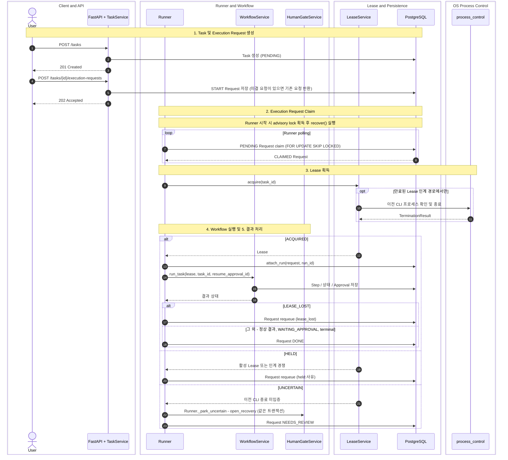

# Task 생성 및 Runner 실행

> 현재 구현 코드를 기준으로 정리한 흐름입니다. 코드로 확인되지 않았거나 검증되지 않은 동작은 현재 구현 제한으로 구분합니다.

Task 생성과 Execution Request 생성은 별도 API 호출입니다. Workflow 실행은 `Runner`가 시작합니다.

아래 다이어그램은 정상 흐름과 `LeaseService.acquire`의 세 가지 결과(`ACQUIRED`, `HELD`, `UNCERTAIN`) 처리를 한 번에 보여줍니다. 중심 클래스는 `Runner.process`이며, 단계 구분은 Note로 표시했습니다.

## 읽는 방법

- `POST /tasks`는 PENDING Task를 만들 뿐 아무것도 실행하지 않습니다.
- `POST /tasks/{id}/execution-requests`는 신규 요청 여부와 관계없이 현재 Router에서 202를 반환하며, 요청만 저장하고 CLI를 직접 실행하지 않습니다. 종료 상태 Task는 409, `WAITING_APPROVAL` Task도 409(승인 후 자동 재개)입니다.
- 승인 결정으로 생성되는 RESUME 요청도 같은 `execution_requests` 테이블에 저장되어 같은 경로로 소비됩니다 ([08](08-human-gate.md)).
- `LeaseService.acquire`는 `ACQUIRED`, `HELD`, `UNCERTAIN`만 반환합니다. `HELD`는 활성(미만료) Lease가 있거나 인계 중 상태가 바뀐 경우이며, 요청은 종료되지 않고 `held:<reason>`과 함께 `PENDING`으로 requeue됩니다.
- `UNCERTAIN`이면 아무 것도 실행하지 않습니다. RECOVERY Approval 생성과 요청 `NEEDS_REVIEW` 처리는 `LeaseService`가 아니라 `Runner._park_uncertain`이 한 트랜잭션에서 수행합니다 ([09](09-recovery.md)).
- `LEASE_LOST`는 요청을 requeue하고, 정상 결과·`WAITING_APPROVAL`·terminal 상태 결과는 요청을 `DONE`으로 처리합니다.
- `Runner.recover`는 stale `CLAIMED` 요청을 requeue하고 idle 상태 취소 요청을 처리합니다. Recovery Gate를 직접 만들지 않습니다.
- `app.infra.process_control` 모듈은 만료된 Lease 인계 중 이전 프로세스 확인이 필요한 경로에서만 호출됩니다. 절차(Txn A → 트랜잭션 밖 프로세스 확인·종료 → Txn B)는 [07](07-lease.md)에 있습니다.

## 현재 구현 제한

- 단일 Runner만 지원합니다. 두 번째 프로세스는 advisory lock 획득에 실패하면 Runner를 시작하지 않고 요청 저장만 수행합니다.
