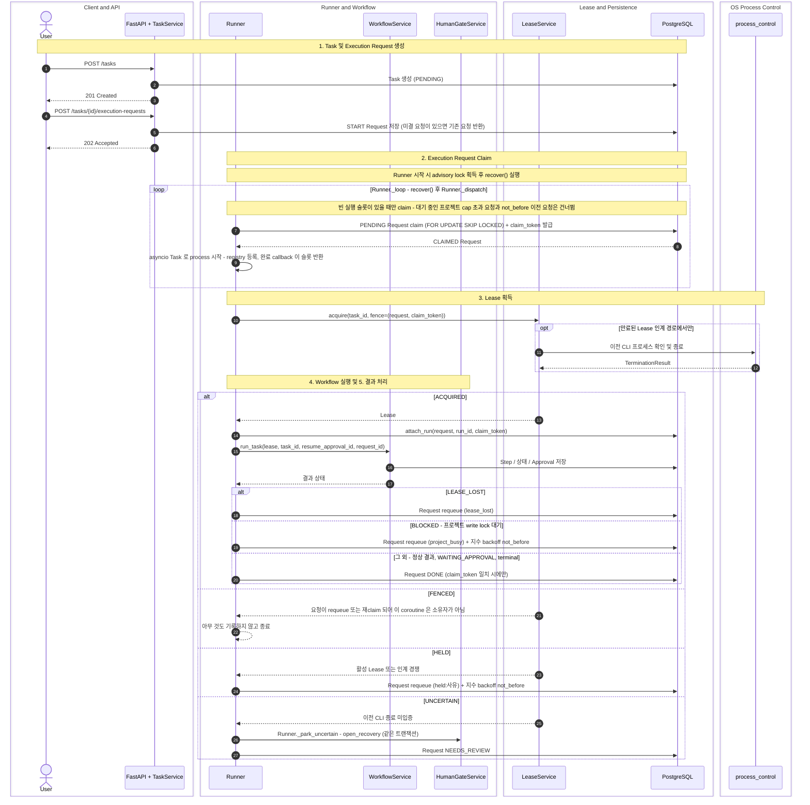

# Task 생성 및 Runner 실행

> English: [03-task-runner.md](03-task-runner_ko.md)

> 현재 구현 코드를 기준으로 정리한 흐름입니다. 코드로 확인되지 않았거나 검증되지 않은 동작은 현재 구현 제한으로 구분합니다.

Task 생성과 Execution Request 생성은 별도 API 호출입니다. Workflow 실행은 `Runner`가 시작합니다.

아래 다이어그램은 정상 흐름과 `LeaseService.acquire`의 세 가지 결과(`ACQUIRED`, `HELD`, `UNCERTAIN`) 처리를 한 번에 보여줍니다. 중심 클래스는 `Runner.process`이며, 단계 구분은 Note로 표시했습니다.

## 읽는 방법

- `POST /tasks`는 PENDING Task를 만들 뿐 아무것도 실행하지 않습니다.
- `POST /tasks/{id}/execution-requests`는 신규 요청 여부와 관계없이 현재 Router에서 202를 반환하며, 요청만 저장하고 CLI를 직접 실행하지 않습니다. 종료 상태 Task는 409, `WAITING_APPROVAL` Task도 409(승인 후 자동 재개)입니다.
- 승인 결정으로 생성되는 RESUME 요청도 같은 `execution_requests` 테이블에 저장되어 같은 경로로 소비됩니다 ([08](08-human-gate_ko.md)).
- `LeaseService.acquire`는 `ACQUIRED`, `HELD`, `UNCERTAIN`, `FENCED`를 반환합니다. `HELD`는 활성(미만료) Lease가 있거나 인계 중 상태가 바뀐 경우이며, 요청은 종료되지 않고 `held:<reason>`과 함께 `PENDING`으로 requeue됩니다. `FENCED`는 이 coroutine이 claim한 뒤 요청이 requeue되거나 다시 claim되어 `claim_token`이 달라진 경우입니다.
- `UNCERTAIN`이면 아무 것도 실행하지 않습니다. RECOVERY Approval 생성과 요청 `NEEDS_REVIEW` 처리는 `LeaseService`가 아니라 `Runner._park_uncertain`이 한 트랜잭션에서 수행합니다 ([09](09-recovery_ko.md)).
- `LEASE_LOST`는 요청을 requeue하고, `BLOCKED`(프로젝트 write lock을 다른 Task가 보유)는 지연 requeue합니다. 정상 결과·`WAITING_APPROVAL`·terminal 상태 결과는 요청을 `DONE`으로 처리합니다.
- **claim fencing**: claim마다 새 `claim_token`이 발급되고, 이후 `process` 시작, `acquire`(Txn A·B), `attach_run`, `finish`, `requeue`가 모두 `status=CLAIMED AND claim_token=<token>` 조건을 확인합니다. 이미 requeue된 요청을 뒤늦게 진행하는 이전 coroutine은 어떤 변경도 남기지 못합니다.
- **지연(backoff)**: `HELD`·`project_busy` requeue는 `execution_requests.defer_count`를 1 증가시키고 `not_before`를 `min(60s, 5s·2^이전_defer_count)`에 jitter(0.8~1.2)를 곱한 시각으로 저장합니다(jitter 제외 5s, 10s, 20s ...). `claim_next`는 `not_before`가 지난 요청만 claim하며, 값은 PostgreSQL에 있으므로 Runner 재시작 뒤에도 유지됩니다. 재시작 recover의 단순 requeue는 카운터를 올리지 않습니다.
- `Runner.recover`는 매 loop 반복마다(슬롯 여부와 무관하게) 실행됩니다. `CLAIMED`이고 `claimed_at`이 유예 시간(`claim_timeout_seconds`)을 넘겼으며 **살아 있는(미만료 RUNNING) Lease가 없는** 요청만 stale로 보고 requeue합니다. claim과 Lease 획득 사이의 정상 구간과, Lease를 가진 긴 CLI 실행은 건드리지 않습니다. 이어서 idle 취소 요청(`_cancel_idle_tasks`)을 처리하고, 종료된 Task가 남긴 Project write lock을 정리(`ProjectLockService.reconcile`)합니다. Recovery Gate를 직접 만들지 않습니다.

## 병렬 dispatch

한 애플리케이션 프로세스 안에서 `Runner._dispatch`가 여러 Task를 동시에 실행합니다(프로젝트마다 OS 프로세스를 만들지 않습니다).

- 슬롯은 **claim 전에** 확인합니다(`len(registry) < MAX_CONCURRENT_TASKS`). claim한 요청이 슬롯을 기다리며 대기하는 구조가 아닙니다.
- 실행 중 요청은 registry(`request id → asyncio.Task`)에 있고, 완료 callback이 예외를 로그로 회수하고 슬롯을 반환하며 loop를 깨웁니다. 한 Task의 예외는 다른 Task에 전파되지 않습니다(요청은 `CLAIMED`로 남아 유예 시간 뒤 recover됩니다).
- 같은 프로젝트의 동시 실행은 `MAX_TASKS_PER_PROJECT`(기본 1)로 제한합니다. 상한에 도달한 프로젝트의 요청은 `claim_next`가 건너뜁니다(`busy_project_ids`가 비어 있으면 조건 자체를 추가하지 않고, 있으면 UUID 배열로 bind하며 `project_id IS NULL`인 legacy Task는 제외하지 않습니다).
- `project_id`가 없는 기존 Task는 각자 `WORKSPACE_ROOT/<task_id>`를 쓰므로 프로젝트 cap의 그룹이 아닙니다. 전역 한도와 Task Lease만 적용됩니다.
- CLI·테스트 자식 프로세스 수는 `CommandExecutor`의 세마포어(`MAX_CONCURRENT_CLI_PROCESSES`)가 제한하며, 슬롯을 기다리는 중에 취소 요청이 오면 spawn 없이 `CANCELLED`로 끝납니다.
- 종료(`Runner.stop`): 신규 claim 중단 → 진행 중 Task drain(`RUNNER_SHUTDOWN_GRACE_SECONDS`) → 남은 Task의 Lease를 로컬에서 revoke하고 CLI cancel → 그래도 끝나지 않으면 coroutine 취소(Lease는 그대로 두어 다음 시작의 `acquire`가 판정) → advisory lock 해제.
- Runner 수명 상태는 프로세스 내부 값(`STOPPED → STARTING → RUNNING → STOPPING → STOPPED`, 실패 시 `STOP_INCOMPLETE`)이며 DB에 저장하지 않습니다. `start`는 `STOPPED`에서만, `stop`은 `RUNNING`/`STOP_INCOMPLETE`에서만 동작하고(`STOPPED`는 no-op, `STARTING`/`STOPPING`은 `RuntimeError`), 시작 도중 실패하면 쥐고 있던 connection의 unlock·close를 확인한 뒤 `STOPPED`로 돌아갑니다(close를 확인하지 못하면 아래 `STOP_INCOMPLETE`). 종료/시작 실패의 최종 전환(`STOPPED` 또는 `STOP_INCOMPLETE`)은 취소로부터 보호된 정산 task가 실제 resource를 보고 수행하므로 `STARTING`/`STOPPING`에 남지 않습니다. `_lifecycle_lock`은 프로세스 내부 mutex이며 상태 전이, recovery 허용 검사, recovery 작업의 등록·회수에만 사용합니다. CLI 실행·drain은 물론 **recovery의 DB I/O 동안에도 보유하지 않으므로** DB가 지연되어도 `stop`은 곧바로 `STOPPING`으로 전환할 수 있습니다.
- `recover(startup=True)`(모든 CLAIMED 요청 재처리)는 `STARTING`이면서 advisory lock을 쥔 때만, 주기 recovery는 `RUNNING`에서만 허용되고 그 밖의 상태에서는 DB를 바꾸지 않고 `RuntimeError`입니다.
- **Recovery 작업**: 허용 검사와 등록은 `_lifecycle_lock` 아래에서 한 번에 이루어지고(Runner당 recovery 작업은 하나만 등록되며, 주기 호출이 이미 실행 중인 작업을 만나면 `SKIPPED`, startup 호출이면 오류), DB 작업은 별도 작업(task)에서 lock 밖으로 실행됩니다. 요청 변경은 한 트랜잭션이며 각 UPDATE는 조회 당시 `claim_token`을 조건으로 하므로(조건이 맞지 않으면 건드리지 않음) 조회 뒤 다른 소유자가 가져간 요청은 덮어쓰지 않습니다. 하나도 적용되지 않은 recovery는 DB 변경 없음으로 안전하게 끝납니다.
- **Recovery 대기와 취소 후 정산은 bounded**입니다. `RUNNER_RECOVERY_TIMEOUT_SECONDS`(기본 20) 동안 기다리고, 넘으면 취소를 한 번 요청한 뒤 `RUNNER_RECOVERY_SHUTDOWN_WAIT_SECONDS`(기본 5) 동안 정산을 기다립니다. 이 시간 안에 롤백 등이 확인되어도 `RecoveryTimeout`이며, 끝나지 않은 작업은 취소 상태로 간주하지 않고 그대로 유지합니다. 서버 쪽 statement는 `RECOVERY_STATEMENT_TIMEOUT_SECONDS`(기본 15, transaction-local)로 제한되지만 commit·네트워크·connection close의 상한은 아닙니다. 호출자가 취소되면 원래의 `CancelledError`를 그대로 다시 발생시킵니다.
- **DB 결과와 connection 정리는 따로 판정**합니다. commit이 정상 반환되면 이후 close가 실패해도 결과는 COMMITTED이고, connection은 `invalidate`로 폐기를 시도합니다. 정리가 확인되지 않으면 소유권을 유지하며, 그동안은 후속 작업(`_cancel_idle_tasks` 등)과 advisory lock 해제를 하지 않습니다. commit 요청 이후 결과를 알 수 없으면 UNCERTAIN으로 기록하고, 새 요청 변경 없이 한 번의 read-only 조회로 적용 대상 요청이 모두 원래 상태인지 모두 의도한 상태인지 확인합니다(혼합이거나 조회가 실패하면 증거를 보존하고 `STOP_INCOMPLETE` 또는 다음 시도로 이어집니다). timeout이 있다고 해서 모든 commit 결과가 rollback으로 확정되는 것은 아닙니다.
- `STOP_INCOMPLETE`는 **살아 있는 in-flight Task, 끝나지 않았거나 결과가 확정되지 않은 recovery, 또는 정리가 확인되지 않은 runtime connection**(advisory lock connection, 또는 시작 실패 뒤 close가 확인되지 않은 connection)이 남은 상태입니다. 종료 정산은 loop 종료 → recovery 정산 → drain → advisory connection 정리 순서로 각 단계를 끝까지 시도하고 오류를 모아 보고합니다. live 또는 미확정 recovery가 남아 있으면 다른 Runner의 시작을 막고 singleton 소유권을 보존하기 위해 advisory lock connection을 닫지 않습니다(recovery의 DB connection과 advisory lock connection은 별개입니다). advisory connection close 등 이 문서가 bound를 두지 않은 구간은 현재 계약에 따라 상한이 없을 수 있으므로 **Runner stop 전체가 bounded라고 보장하지 않습니다**. 살아 있는 Task가 남으면 `RunnerStopIncomplete`가 발생하며, connection close가 실패하면 그 오류가 그대로 전파됩니다. 이때 Runner는 in-flight 목록과 connection을 **유지**하고 `start`·recovery를 거부하며 `stop` 재호출(남은 Task drain과 connection unlock·close 재시도)만 허용합니다. 프로세스가 끝나면 OS가 연결을 닫아 lock이 풀리지만, 같은 프로세스가 계속 살아 있으면 이후 `stop`이 성공할 때까지 해당 connection을 보유합니다. 애플리케이션 lifespan은 stop이 성공한 뒤에만, 그리고 내부에서 만든 DB일 때만 `dispose`합니다.
- 프로세스 슬롯 대기 중 취소된 명령은 permit을 정확히 한 번만 반환하며, 취소가 이미 설정된 명령은 spawn되지 않습니다(`CommandExecutor`).
- DB 연결 pool 설정(`DB_POOL_SIZE`, `DB_MAX_OVERFLOW`)은 [README](../../README_ko.md)를 따릅니다.
- 전역 advisory lock은 이번 단계에서도 유지되며 다중 프로세스 singleton 보장용입니다(OS lock 등으로의 전환은 배포 토폴로지를 확인한 뒤 별도로 결정). 그대로 "Runner(Coordinator) 프로세스는 하나"라는 보호입니다. Task 단위 배제는 Lease, Project 단위 배제는 `projects.write_owner_task_id`입니다 ([07](07-lease_ko.md)).
- `app.infra.process_control` 모듈은 만료된 Lease 인계 중 이전 프로세스 확인이 필요한 경로에서만 호출됩니다. 절차(Txn A → 트랜잭션 밖 프로세스 확인·종료 → Txn B)는 [07](07-lease_ko.md)에 있습니다.

## 현재 구현 제한

- Runner(Coordinator) 프로세스는 하나만 지원합니다. 두 번째 프로세스는 advisory lock 획득에 실패하면 Runner를 시작하지 않고 요청 저장만 수행합니다. 병렬성은 한 프로세스 안의 asyncio Task입니다.
- 정확히 한 번 실행은 보장하지 않습니다(at-least-once + 변경 감지). 불확실한 실행은 자동 재실행하지 않고 RECOVERY Gate로 갑니다.
- 병렬 실행 한도(`MAX_CONCURRENT_TASKS`, `MAX_TASKS_PER_PROJECT`, `MAX_CONCURRENT_CLI_PROCESSES`)는 설정값이며, DB pool은 기본값(10+10) 그대로입니다. 한도를 크게 올릴 때는 pool 크기를 함께 검토해야 합니다.
