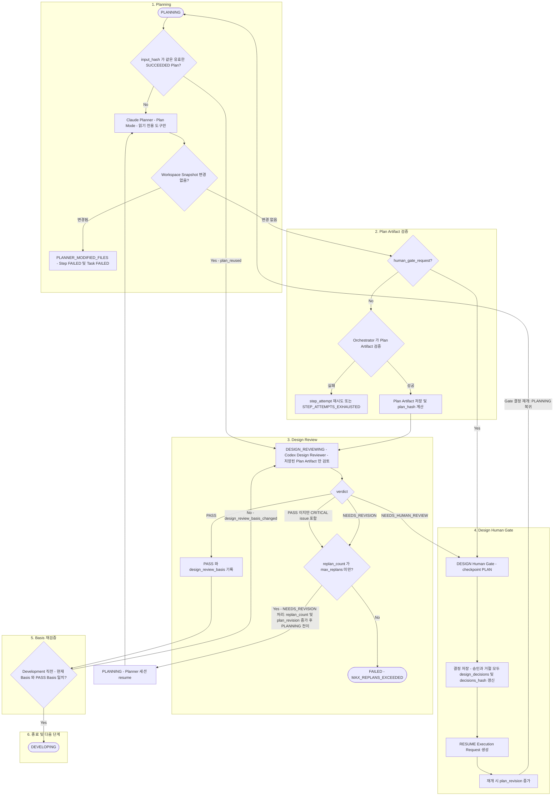

# Planning 및 Design Review

> 현재 구현 코드를 기준으로 정리한 흐름입니다. 코드로 확인되지 않았거나 검증되지 않은 동작은 현재 구현 제한으로 구분합니다.

아래 다이어그램은 PLANNING 진입부터 DEVELOPING 진입까지의 정상 흐름과 `NEEDS_REVISION`·Design Human Gate 재개 경로를 보여줍니다. 중심 클래스는 `WorkflowService`(`_do_plan`, `_do_design_review`, `_verdict_transition`)이며 Human Gate 결정 처리는 `HumanGateService`가 맡습니다.

## design_review_basis

`design_review_basis = hash(requirements_hash, plan_hash, decisions_hash, review_policy_hash)`입니다 (`app/services/fingerprints.py`의 `design_review_basis`).

- Design Review 결과(`task_steps.output`)에 검토 시점의 basis가 저장됩니다.
- `WorkflowService._do_develop`는 저장된 PASS의 `basis_hash`가 현재 basis와 다르면 Development를 시작하지 않고 DEVELOPING → DESIGN_REVIEWING으로 되돌립니다 (`design_review_basis_changed`).
- Human Gate가 요청 시점에 저장하는 `approvals.basis`(`current_basis`)는 `requirements_hash`, `plan_hash`, `decisions_hash` 3개로 구성되며 `review_policy_hash`를 포함하지 않습니다. 이 값은 결정이 stale한지 판단하는 데만 사용됩니다.

## 읽는 방법

- Planner는 Plan Mode와 읽기 도구만 사용합니다. Plan Artifact는 Planner가 파일로 쓰지 않고 Orchestrator가 CLI 출력에서 검증·저장합니다. 실행 전후 Snapshot 비교에서 변경이 감지되면 Step은 성공할 수 없습니다.
- Design Reviewer는 저장된 Plan Artifact만 검토합니다. verdict가 `PASS`여도 CRITICAL issue가 있으면 `NEEDS_REVISION`으로 처리됩니다.
- PLANNING으로 돌아오는 경로는 두 가지이며 원인과 처리 메서드가 다릅니다.
  - `NEEDS_REVISION`: `WorkflowService._verdict_transition`이 `replan_count`와 `plan_revision`을 증가시키고 PLANNING으로 전이합니다. `max_replans`를 따르며 Planner는 자신의 Native Session을 resume합니다 (Session이 유효한 경우, [06](06-session.md)).
  - DESIGN Human Gate 결정: 승인이든 거절이든 `design_decisions`가 저장되고 `decisions_hash`가 갱신됩니다. 결정과 RESUME 요청은 같은 트랜잭션에 저장되며, Runner가 요청을 소비해 `WorkflowService._resume_from_approval`이 재개할 때 `plan_revision`이 증가하고 PLANNING부터 다시 수행합니다. `replan_count`는 증가하지 않습니다. 즉시 DEVELOPING으로 가지 않습니다 ([08](08-human-gate.md)).
- Design Review PASS 뒤에는 별도의 일반적인 Human Gate 판정이 없습니다.
- `PLAN` Step 자체가 `human_gate_request`를 반환하는 경우에도 같은 DESIGN Gate 경로입니다.
- 다음 단계(`DEVELOPING`)는 [05](05-development-testing.md)에서 이어집니다.
