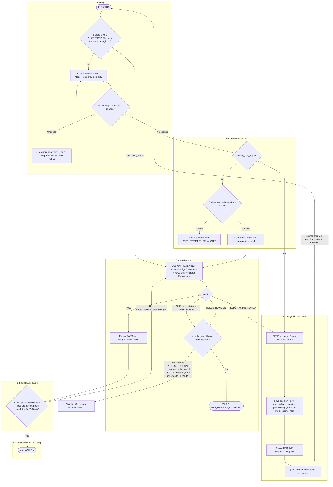

# Planning and Design Review

> 한국어: [04-planning-review_ko.md](04-planning-review_ko.md)

> This flow is organized based on the current implementation code. Behavior that is not confirmed by code or not verified is distinguished as a current implementation limitation.

The diagram below shows the normal flow from PLANNING entry to DEVELOPING entry, and the `NEEDS_REVISION`/Design Human Gate resume paths. The central class is `WorkflowService` (`_do_plan`, `_do_design_review`, `_verdict_transition`), and Human Gate decision handling is the responsibility of `HumanGateService`.

## design_review_basis

`design_review_basis = hash(requirements_hash, plan_hash, decisions_hash, review_policy_hash)` (the `design_review_basis` function in `app/services/fingerprints.py`).

- The Design Review result (`task_steps.output`) stores the basis as of the time of review.
- If the stored PASS's `basis_hash` differs from the current basis, `WorkflowService._do_develop` does not start Development and reverts DEVELOPING → DESIGN_REVIEWING (`design_review_basis_changed`).
- The `approvals.basis` (`current_basis`) that the Human Gate stores at request time consists of the three values `requirements_hash`, `plan_hash`, and `decisions_hash`, and does not include `review_policy_hash`. This value is used only to determine whether a decision is stale.

## How to read this

- The Planner uses only Plan Mode and read-only tools. The Plan Artifact is not written to a file by the Planner — the Orchestrator validates and stores it from the CLI output. If a change is detected when comparing Snapshots before and after execution, the Step cannot succeed.
- The Design Reviewer reviews only the stored Plan Artifact. Even if the verdict is `PASS`, if there is a CRITICAL issue it is treated as `NEEDS_REVISION`.
- There are two paths back to PLANNING, and their causes and handling methods differ.
  - `NEEDS_REVISION`: `WorkflowService._verdict_transition` increments `replan_count` and `plan_revision` and transitions to PLANNING. It follows `max_replans`, and the Planner resumes its own Native Session (if the Session is valid, [06](06-session.md)).
  - DESIGN Human Gate decision: Whether approved or rejected, `design_decisions` is stored and `decisions_hash` is updated. The decision and the RESUME request are stored in the same transaction, and when the Runner consumes the request and `WorkflowService._resume_from_approval` resumes, `plan_revision` increments and execution resumes from PLANNING. `replan_count` does not increment. It does not go directly to DEVELOPING ([08](08-human-gate.md)).
- After Design Review PASS, there is no separate general Human Gate judgment.
- Even when the `PLAN` Step itself returns `human_gate_request`, it is the same DESIGN Gate path.
- The next step (`DEVELOPING`) continues in [05](05-development-testing.md).
