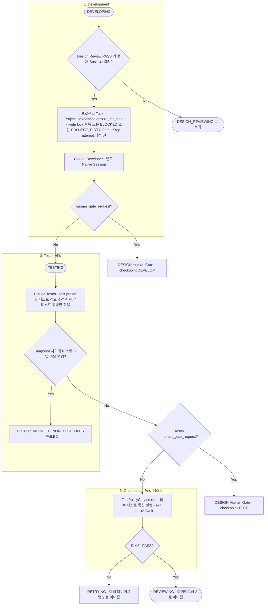
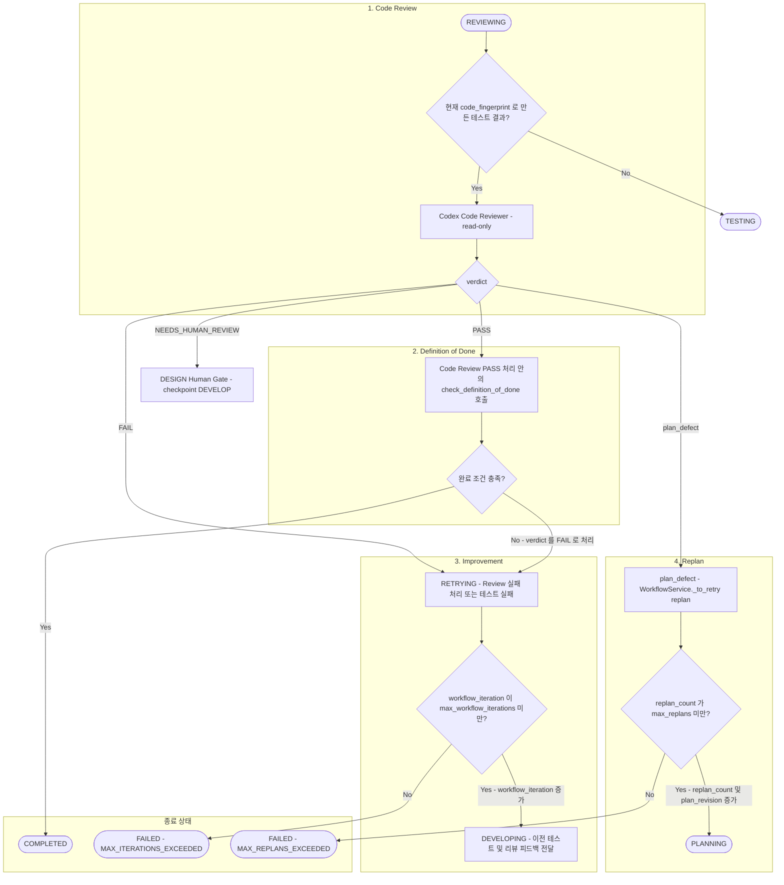

# Development, Testing 및 Code Review

> 현재 구현 코드를 기준으로 정리한 흐름입니다. 코드로 확인되지 않았거나 검증되지 않은 동작은 현재 구현 제한으로 구분합니다.

이 문서는 두 개의 다이어그램으로 나뉩니다. 첫 번째는 DEVELOPING부터 테스트 결과 판정까지, 두 번째는 REVIEWING부터 종료·재시도·재계획까지입니다. 중심 클래스는 `WorkflowService`(`_do_develop`, `_do_test`, `_do_code_review`, `_review_transition`, `_to_retry`)입니다.

## 1. Development 및 Testing

정상 흐름과 Tester 위반·테스트 실패 분기를 보여줍니다. Tester Agent 실행과 Orchestrator의 독립 테스트 실행은 같은 `TESTING` Step 안에서 순서대로 수행되지만 서로 다른 구역으로 구분합니다.

- Developer는 유효한 Design Review PASS(현재 Basis와 일치)가 있을 때만 실행합니다. 일치하지 않으면 Development로 가지 않고 DESIGN_REVIEWING으로 되돌아갑니다.
- Tester는 테스트 파일만 수정할 수 있고 `WorkflowService._do_test`가 Snapshot 차이로 이를 검증합니다. 위반하면 `TESTER_MODIFIED_NON_TEST_FILES`로 중단됩니다. 이 검사가 Tester의 Gate 요청보다 먼저 수행됩니다.
- 필수 테스트는 Tester Agent가 아니라 Orchestrator(`TestPolicyService.run`)가 독립적으로 실행합니다. exit code가 0이 아니거나, 실행된 테스트가 0건이거나, 전부 skip이거나, **이번 실행이 만든(신규 또는 변경된) JUnit 결과가 없거나** 해석할 수 없으면 PASS가 아닙니다.
- 프로젝트 Task의 변경 Step(Developer, Tester)과 Code Review는 Project write lock을 가진 Task만 실행합니다. 다른 Task가 보유 중이면 Step attempt를 만들지 않고 요청이 지연 requeue되며(`BLOCKED`), 이전 Task가 미해결 변경을 남겼으면 PROJECT_DIRTY Gate가 먼저 열립니다([08](08-human-gate.md)). Orchestrator 테스트 실행 직전에도 소유 여부를 다시 확인합니다(`assert_owner`).

### Test Policy와 preset

Test Policy는 Orchestrator가 소유하며 Agent가 바꿀 수 없습니다(해시가 모든 Tester 입력에 포함). 우선순위는 Task > Project > 기본값이고, **Task 생성 시 하나의 실행 가능한 명령으로 해석해 Task에 복사**합니다(`test_policy_resolver.resolve_test_policy`, `test_policy_hash`는 해석된 값 기준).

| preset | 명령(정적 인자) | JUnit 결과 | Tester 쓰기 경로 |
|---|---|---|---|
| `pytest`(기본) | `python -m pytest -q --junitxml=reports/junit.xml` | `reports/junit.xml` | `tests/**` |
| `maven` | 프로젝트의 `mvnw`/`mvnw.cmd`, 없으면 시스템 `mvn` + `-B -q test` | `**/target/surefire-reports/TEST-*.xml` | `src/test/**` |
| `gradle` | 프로젝트의 `gradlew`/`gradlew.bat`, 없으면 시스템 `gradle` + `test --console=plain` | `**/build/test-results/test/TEST-*.xml` | `src/test/**` |

- wrapper가 우선이고, 없으면 `PATH`의 도구를 씁니다. 둘 다 없으면 Task 생성이 422로 거부됩니다(워크플로 중간에 실패하지 않음). argv에는 "mvn 또는 mvnw" 같은 대안이 남지 않습니다. wrapper는 Workspace 직속의 일반 파일이어야 하며(링크 거부) POSIX에서는 실행 권한이 필요합니다. `.cmd`/`.bat`은 preset이 해석한 wrapper에만 허용되고 직접 지정한 명령으로는 거부됩니다. 어떤 경우에도 shell 문자열로 실행하지 않습니다.
- 결과 파일은 **삭제하지 않습니다**(`target/`, `build/`, `reports/`는 사용자 영역). 실행 전 `(경로, size, mtime_ns, sha256)`을 기록하고, 실행 뒤 새로 생기거나 바뀐 파일만 이번 실행의 결과로 합산합니다. 이전 실행의 XML만 있으면 실패합니다.
- 테스트 프로세스에는 CLI 인증 변수(`ANTHROPIC_API_KEY` 등)가 전달되지 않으며, preset이 이름으로 명시한 툴체인 변수(`JAVA_HOME`, `MAVEN_HOME`, `M2_HOME`, `GRADLE_HOME`, `GRADLE_USER_HOME` 중 일부)만 추가됩니다. wildcard는 허용되지 않습니다.
- Tester의 변경 허용 범위(`is_test_path`)와 CLI 도구 권한(`permissions_for`)이 preset에 따라 달라집니다. 빌드 파일과 wrapper(`pom.xml`, `mvnw`, `build.gradle`, `gradlew` ...)는 Tester가 바꿀 수 없습니다(`TESTER_MODIFIED_NON_TEST_FILES`).
- 이전 SUCCEEDED 테스트 결과의 `requirements_hash`, `test_policy_hash`, `code_fingerprint`가 현재와 모두 같으면 Tester를 다시 실행하지 않고 결과를 재사용합니다 ([10](10-invalidation.md)).
- 테스트 약화 신호(필수 테스트 ID 감소 등)는 `test_signals`로 Code Reviewer에게 전달됩니다.
- Gate에서 재개되는 경로는 [08](08-human-gate.md)을 참고하십시오.

## 2. Code Review, Definition of Done 및 개선·재계획

테스트가 통과한 뒤의 Code Review 판정과 그 결과에 따른 COMPLETED / 개선 / 재계획 / FAILED 경로입니다. 최초 실행은 iteration 0이며, 개선은 최대 `max_workflow_iterations`(기본 3)회입니다.

- 테스트 실패와 Code Review 실패(`FAIL` 또는 DoD 미충족)는 모두 `workflow_iteration`을 증가시키는 개선 반복입니다.
- Code Reviewer가 `plan_defect`를 반환하면 개선 반복이 아니라 재계획 경로로 이동합니다 (`replan_count`와 `plan_revision` 증가, `resume_step_key=PLAN`, `RETRYING`을 거쳐 PLANNING). 한도는 `max_replans`이며 초과하면 `MAX_REPLANS_EXCEEDED`로 FAILED 됩니다.
- Code Review `PASS`라도 CRITICAL issue 또는 `test_policy_concern`이 있으면 `FAIL`로 처리됩니다.
- Completion Checker는 별도의 Agent가 아닙니다. `WorkflowService._review_transition`이 Code Review PASS를 처리하면서 호출하는 `check_definition_of_done` 함수이며, 검사 조건은 [11](11-task-lifecycle.md)에 있습니다.
- Reviewer에게는 현재 코드(`code_fingerprint`)로 만든 테스트 결과만 전달됩니다. 불일치하면 TESTING부터 다시 수행합니다.
- 다이어그램 1의 `RETRYING`·`REVIEWING` 노드가 이 다이어그램의 진입점입니다.

## 현재 구현 제한

- Maven·Gradle preset은 JUnit 파싱, wrapper 해석(Windows `mvnw.cmd` 포함), 권한·환경 규칙을 단위 테스트로만 검증했습니다. 이 환경에는 JDK/Maven/Gradle이 없어 **실제 Maven·Gradle 빌드는 실행하지 못했습니다.**
- pytest가 아닌 preset에서는 테스트 ID 수집(`collect_ids`)을 하지 않으므로 "테스트 개수 감소" 신호(`removed_test_ids`)가 없습니다. 테스트 파일 변경은 Snapshot 차이로만 보고됩니다.
- 기본 pytest preset의 JUnit 파일(`reports/junit.xml`)은 외부 Workspace에도 남습니다(삭제하지 않는 정책의 결과).
