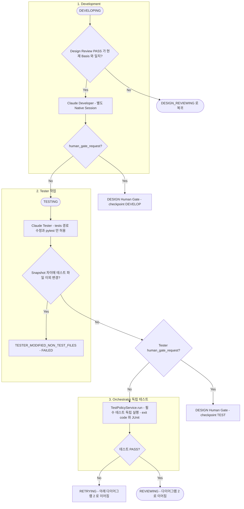
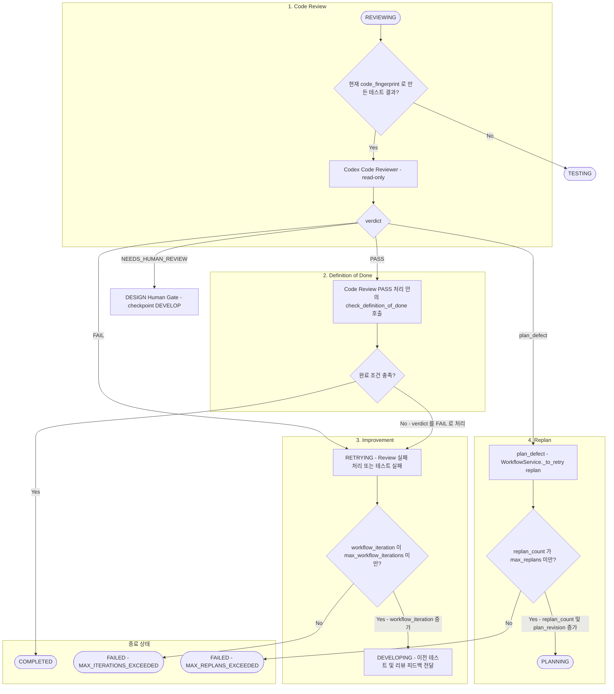

# Development, Testing 및 Code Review

> 현재 구현 코드를 기준으로 정리한 흐름입니다. 코드로 확인되지 않았거나 검증되지 않은 동작은 현재 구현 제한으로 구분합니다.

이 문서는 두 개의 다이어그램으로 나뉩니다. 첫 번째는 DEVELOPING부터 테스트 결과 판정까지, 두 번째는 REVIEWING부터 종료·재시도·재계획까지입니다. 중심 클래스는 `WorkflowService`(`_do_develop`, `_do_test`, `_do_code_review`, `_review_transition`, `_to_retry`)입니다.

## 1. Development 및 Testing

정상 흐름과 Tester 위반·테스트 실패 분기를 보여줍니다. Tester Agent 실행과 Orchestrator의 독립 테스트 실행은 같은 `TESTING` Step 안에서 순서대로 수행되지만 서로 다른 구역으로 구분합니다.

- Developer는 유효한 Design Review PASS(현재 Basis와 일치)가 있을 때만 실행합니다. 일치하지 않으면 Development로 가지 않고 DESIGN_REVIEWING으로 되돌아갑니다.
- Tester는 테스트 파일만 수정할 수 있고 `WorkflowService._do_test`가 Snapshot 차이로 이를 검증합니다. 위반하면 `TESTER_MODIFIED_NON_TEST_FILES`로 중단됩니다. 이 검사가 Tester의 Gate 요청보다 먼저 수행됩니다.
- 필수 테스트는 Tester Agent가 아니라 Orchestrator(`TestPolicyService.run`)가 독립적으로 실행합니다. exit code가 0이 아니거나, 실행된 테스트가 0건이거나, 전부 skip이거나, JUnit이 없거나 해석할 수 없으면 PASS가 아닙니다.
- 이전 SUCCEEDED 테스트 결과의 `requirements_hash`, `test_policy_hash`, `code_fingerprint`가 현재와 모두 같으면 Tester를 다시 실행하지 않고 결과를 재사용합니다 ([10](10-invalidation.md)).
- 테스트 약화 신호(필수 테스트 ID 감소 등)는 `test_signals`로 Code Reviewer에게 전달됩니다.
- Gate에서 재개되는 경로는 [08](08-human-gate.md)을 참고하십시오.

## 2. Code Review, Definition of Done 및 개선·재계획

테스트가 통과한 뒤의 Code Review 판정과 그 결과에 따른 COMPLETED / 개선 / 재계획 / FAILED 경로입니다. 최초 실행은 iteration 0이며, 개선은 최대 `max_workflow_iterations`(기본 3)회입니다.

- 테스트 실패와 Code Review 실패(`FAIL` 또는 DoD 미충족)는 모두 `workflow_iteration`을 증가시키는 개선 반복입니다.
- Code Reviewer가 `plan_defect`를 반환하면 개선 반복이 아니라 재계획 경로로 이동합니다 (`replan_count`와 `plan_revision` 증가, `resume_step_key=PLAN`, `RETRYING`을 거쳐 PLANNING). 한도는 `max_replans`이며 초과하면 `MAX_REPLANS_EXCEEDED`로 FAILED 됩니다.
- Code Review `PASS`라도 CRITICAL issue 또는 `test_policy_concern`이 있으면 `FAIL`로 처리됩니다.
- Completion Checker는 별도의 Agent가 아닙니다. `WorkflowService._review_transition`이 Code Review PASS를 처리하면서 호출하는 `check_definition_of_done` 함수이며, 검사 조건은 [11](11-task-lifecycle.md)에 있습니다.
- Reviewer에게는 현재 코드(`code_fingerprint`)로 만든 테스트 결과만 전달됩니다. 불일치하면 TESTING부터 다시 수행합니다.
- 다이어그램 1의 `RETRYING`·`REVIEWING` 노드가 이 다이어그램의 진입점입니다.
