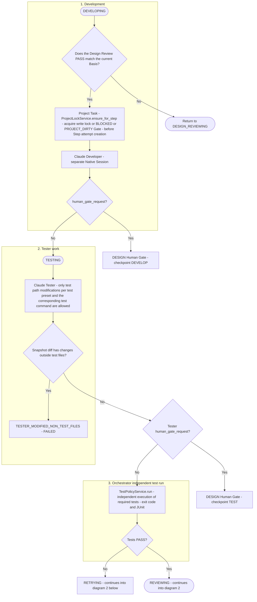
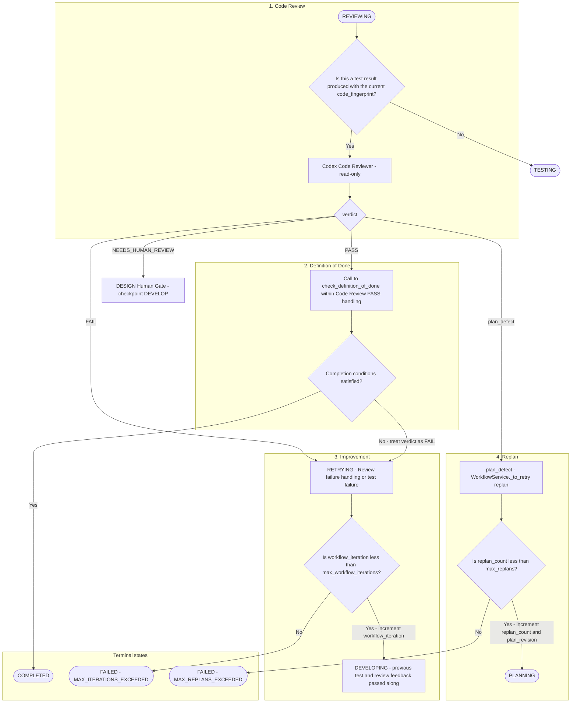

# Development, Testing and Code Review

> 한국어: [05-development-testing_ko.md](05-development-testing_ko.md)

> This flow is organized based on the current implementation code. Behavior that is not confirmed by code or has not been verified is categorized as a current implementation limitation.

This document is divided into two diagrams. The first covers from DEVELOPING through the test result verdict, and the second covers from REVIEWING through termination/retry/replanning. The central class is `WorkflowService` (`_do_develop`, `_do_test`, `_do_code_review`, `_review_transition`, `_to_retry`).

## 1. Development and Testing

Shows the normal flow and the Tester-violation/test-failure branches. The Tester Agent execution and the Orchestrator's independent test execution are performed sequentially within the same `TESTING` Step, but are shown as separate regions.

- The Developer runs only when there is a valid Design Review PASS (matching the current Basis). If it does not match, the flow does not go to Development but returns to DESIGN_REVIEWING.
- The Tester may modify only test files, and `WorkflowService._do_test` verifies this via the Snapshot diff. A violation halts the task with `TESTER_MODIFIED_NON_TEST_FILES`. This check is performed before the Tester's Gate request.
- Required tests are run independently by the Orchestrator (`TestPolicyService.run`), not by the Tester Agent. It is not a PASS if the exit code is non-zero, if zero tests were executed, if all were skipped, if **this run produced no (new or changed) JUnit results**, or if the results cannot be parsed.
- The change Steps (Developer, Tester) of a Project Task and the Code Review are executed only by the Task that holds the Project write lock. If another Task holds it, the Step attempt is not created and the request is requeued with a delay (`BLOCKED`); if a prior Task left unresolved changes, the PROJECT_DIRTY Gate opens first ([08](08-human-gate.md)). Ownership is re-verified (`assert_owner`) immediately before the Orchestrator's test execution as well.

### Test Policy and presets

The Test Policy is owned by the Orchestrator and cannot be changed by the Agent (the hash is included in all Tester inputs). Priority is Task > Project > default, and **at Task creation it is resolved into a single executable command and copied onto the Task** (`test_policy_resolver.resolve_test_policy`; `test_policy_hash` is based on the resolved value).

| preset | command (static args) | JUnit result | Tester write path |
|---|---|---|---|
| `pytest` (default) | `python -m pytest -q --junitxml=reports/junit.xml` | `reports/junit.xml` | `tests/**` |
| `maven` | the project's `mvnw`/`mvnw.cmd`, or the system `mvn` if absent + `-B -q test` | `**/target/surefire-reports/TEST-*.xml` | `src/test/**` |
| `gradle` | the project's `gradlew`/`gradlew.bat`, or the system `gradle` if absent + `test --console=plain` | `**/build/test-results/test/TEST-*.xml` | `src/test/**` |

- The wrapper takes priority; if absent, the tool on `PATH` is used. If neither exists, Task creation is rejected with 422 (it does not fail mid-workflow). The argv does not retain alternatives such as "mvn or mvnw." The wrapper must be a regular file directly under the Workspace (symlinks are rejected), and on POSIX it must have execute permission. `.cmd`/`.bat` is allowed only for the wrapper resolved by the preset, and is rejected for a directly specified command. In no case is it executed as a shell string.
- Result files are **not deleted** (`target/`, `build/`, `reports/` are user-owned areas). Before execution, `(path, size, mtime_ns, sha256)` is recorded, and after execution only files that are newly created or changed are counted as this run's results. If only XML from a previous run exists, it fails.
- CLI authentication variables (such as `ANTHROPIC_API_KEY`) are not passed to the test process; only the toolchain variables explicitly named by the preset (some subset of `JAVA_HOME`, `MAVEN_HOME`, `M2_HOME`, `GRADLE_HOME`, `GRADLE_USER_HOME`) are added. Wildcards are not allowed.
- The Tester's allowed change scope (`is_test_path`) and CLI tool permissions (`permissions_for`) vary by preset. Build files and wrappers (`pom.xml`, `mvnw`, `build.gradle`, `gradlew`, ...) cannot be changed by the Tester (`TESTER_MODIFIED_NON_TEST_FILES`).
- If the `requirements_hash`, `test_policy_hash`, and `code_fingerprint` of a previous SUCCEEDED test result all match the current ones, the Tester is not re-run and the result is reused ([10](10-invalidation.md)).
- Test-weakening signals (such as a decrease in required test IDs) are passed to the Code Reviewer via `test_signals`.
- For paths resumed from a Gate, see [08](08-human-gate.md).

## 2. Code Review, Definition of Done, and Improvement/Replanning

Covers the Code Review verdict after tests pass, and the resulting COMPLETED / improvement / replan / FAILED paths. The initial run is iteration 0, and improvement iterations run up to `max_workflow_iterations` (default 3) times.

- Both test failure and Code Review failure (`FAIL` or DoD not satisfied) are improvement iterations that increment `workflow_iteration`.
- If the Code Reviewer returns `plan_defect`, the flow moves not to an improvement iteration but to the replan path (`replan_count` and `plan_revision` incremented, `resume_step_key=PLAN`, through `RETRYING` to PLANNING). The limit is `max_replans`; exceeding it results in FAILED with `MAX_REPLANS_EXCEEDED`.
- Even a Code Review `PASS` is treated as `FAIL` if there is a CRITICAL issue or a `test_policy_concern`.
- The Completion Checker is not a separate Agent. It is the `check_definition_of_done` function called by `WorkflowService._review_transition` while handling a Code Review PASS; the check conditions are in [11](11-task-lifecycle.md).
- Only test results produced with the current code (`code_fingerprint`) are passed to the Reviewer. On a mismatch, execution resumes from TESTING.
- The `RETRYING`/`REVIEWING` nodes in diagram 1 are the entry points into this diagram.

## Current Implementation Limitations

- The Maven/Gradle presets' JUnit parsing, wrapper resolution (including Windows `mvnw.cmd`), and permission/environment rules have been verified only by unit tests. This environment has no JDK/Maven/Gradle, so **actual Maven/Gradle builds could not be run.**
- Presets other than pytest do not perform test ID collection (`collect_ids`), so there is no "decrease in test count" signal (`removed_test_ids`). Test file changes are reported only via the Snapshot diff.
- The default pytest preset's JUnit file (`reports/junit.xml`) also remains in the external Workspace (a consequence of the no-delete policy).
