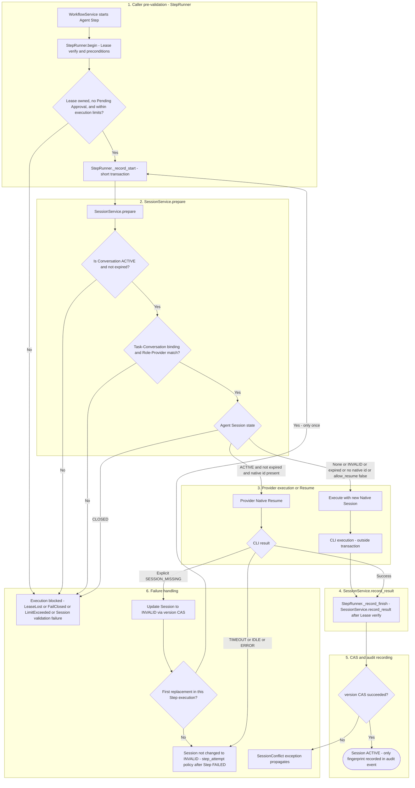

# Session Management

> 한국어: [06-session_ko.md](06-session_ko.md).

> This flow is organized based on the current implementation code. Behaviors not confirmed in code or not verified are distinguished as current implementation limitations.

Session handling consists of `SessionService` (validation·recording), which `StepRunner` calls, and `PostgresSessionStore` (storage). The API does not call `SessionService` directly.

The diagram below shows the normal flow from the start of a single Agent Step to the recording of the Session, and the Session-related failure paths. The central classes are `StepRunner` (caller) and `SessionService`; Lease, Pending Approval, and execution-limit validation reside in the caller's zone, not in `SessionService`.

- Zone 1 is the caller's responsibility, outside `SessionService`. Zones 2–5 are the responsibility of `SessionService` and the store, and Zone 6 is the result of failures occurring in each zone.
- When a new Native Session replacement happens due to `SESSION_MISSING`, it restarts from `_record_start` (edge `ONCE → D`).

## Scope directly validated by SessionService

`SessionService.prepare` / `record_result` validate directly.

- Conversation existence, `ACTIVE` state, expiration
- Task-Conversation binding (match between `task.conversation_id` and the Session's `conversation_id`)
- Agent Role-Provider binding (`validate_session_binding`)
- Agent Session state (`CLOSED` is blocked) and expiration — resume only when `ACTIVE`, not expired, native id is present, and `allow_resume`

## Scope validated by the caller

- Lease ownership (`LeaseService.verify`), Pending Approval existence, execution limits (`task_max_wall_seconds`, `max_cli_invocations`), and cancellation requests are validated by `_preconditions` in `StepRunner.begin` / `_record_start`.
- Whether resume is allowed (`allow_resume`) is decided by `WorkflowService`. For example, Developer resumes only when the `plan_hash` of the immediately preceding Develop matches the current Plan.

## Native Session failure handling

- Session is set to `INVALID` and retried once with a new Native Session only when the CLI explicitly returns `SESSION_MISSING` and it was during resume (`replaced_once` in `StepRunner.execute`).
- Timeout or transient errors (`TIMEOUT`, `IDLE`, `ERROR`) alone do not invalidate the Session. The Step is recorded as FAILED and follows the existing `step_attempt` policy.
- Native Session ID is not exposed in API responses or audit events. The `SESSION_EVENT` in `state_transitions` records only an irreversible fingerprint.
- When a task terminates (COMPLETED/FAILED/CANCELLED), `close_all_for_task` changes ACTIVE Sessions to `CLOSED`.

## Current implementation limitations

- CAS conflicts are treated as fail-closed failures rather than going through the Recovery Gate. Since `SessionConflict` is not in the exception handling list of `WorkflowService.run_task`, the result-recording transaction is rolled back and the exception propagates to the `Runner` loop, leaving only a log entry. The corresponding request remains `CLAIMED` and becomes a target for stale-claim recovery.
- The recovery path following the above situation (an Execution left unterminated may become `UNCERTAIN` at the next Lease handover) is a code-based inference and has not been verified by tests. Do not treat this as a confirmed behavior.
- Session recording failure does not directly change the Task state to FAILED.
