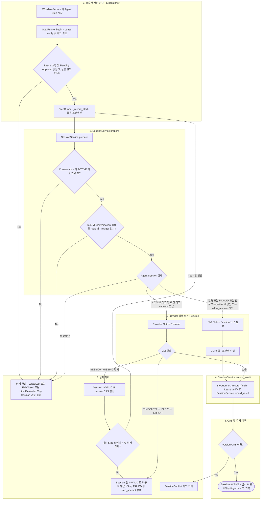

# Session Management

> 현재 구현 코드를 기준으로 정리한 흐름입니다. 코드로 확인되지 않았거나 검증되지 않은 동작은 현재 구현 제한으로 구분합니다.

Session 처리는 `StepRunner`가 호출하는 `SessionService`(검증·기록)와 `PostgresSessionStore`(저장)로 이루어집니다. API가 `SessionService`를 직접 호출하지 않습니다.

아래 다이어그램은 Agent Step 하나가 시작되어 Session이 기록되기까지의 정상 흐름과 Session 관련 실패 경로를 보여줍니다. 중심 클래스는 `StepRunner`(호출자)와 `SessionService`이며, Lease·Pending Approval·실행 한도 검증은 `SessionService`가 아니라 호출자 구역에 둡니다.

- 구역 1은 `SessionService` 밖의 호출자 책임입니다. 구역 2~5가 `SessionService`와 저장소 책임이며, 구역 6은 각 구역에서 발생하는 실패의 결과입니다.
- `SESSION_MISSING`으로 신규 Native Session 교체가 일어나면 `_record_start`부터 다시 시작합니다(간선 `ONCE → D`).

## SessionService가 직접 검증하는 범위

`SessionService.prepare` / `record_result`가 직접 검증합니다.

- Conversation 존재, `ACTIVE` 상태, 만료
- Task와 Conversation 결속(`task.conversation_id`와 Session의 `conversation_id` 일치)
- Agent Role과 Provider 결속 (`validate_session_binding`)
- Agent Session 상태(`CLOSED`는 차단) 및 만료 — `ACTIVE`이고 만료 전이며 native id가 있고 `allow_resume`일 때만 resume
- `version` CAS (`record_result`)

## 호출자가 검증하는 범위

- Lease 소유권(`LeaseService.verify`), Pending Approval 존재, 실행 한도(`task_max_wall_seconds`, `max_cli_invocations`), 취소 요청은 `StepRunner.begin` / `_record_start`의 `_preconditions`가 검증합니다.
- Resume 허용 여부(`allow_resume`)는 `WorkflowService`가 결정합니다. 예를 들어 Developer는 직전 Develop의 `plan_hash`가 현재 Plan과 같을 때만 resume합니다.

## Native Session 실패 처리

- CLI가 명시적으로 `SESSION_MISSING`을 반환하고 resume 중이었던 경우에만 Session을 `INVALID` 처리하고, 한 번만 신규 Native Session으로 재시도합니다 (`StepRunner.execute`의 `replaced_once`).
- Timeout이나 일시적 오류(`TIMEOUT`, `IDLE`, `ERROR`)만으로 Session을 무효화하지 않습니다. Step은 FAILED로 기록되고 기존 `step_attempt` 정책을 따릅니다.
- Native Session ID는 API 응답과 감사 이벤트에 노출되지 않습니다. `state_transitions`의 `SESSION_EVENT`에는 비가역 fingerprint만 기록됩니다.
- 작업이 종료(COMPLETED/FAILED/CANCELLED)되면 `close_all_for_task`가 ACTIVE Session을 `CLOSED`로 바꿉니다.

## 현재 구현 제한

- CAS 충돌은 Recovery Gate가 아니라 fail-closed 실패로 처리됩니다. `SessionConflict`는 `WorkflowService.run_task`의 예외 처리 목록에 없으므로 결과 기록 트랜잭션이 롤백되고 예외가 `Runner` 루프로 전파되어 로그만 남습니다. 해당 요청은 `CLAIMED`로 남아 stale-claim 복구 대상이 됩니다.
- 위 상황 이후의 복구 경로(미종료로 남은 Execution이 다음 Lease 인계에서 `UNCERTAIN`이 될 수 있음)는 코드 추정이며 테스트로 검증하지 않았습니다. 이 사실을 확인된 동작으로 간주하지 마십시오.
- Session 기록 실패가 Task 상태를 직접 FAILED로 바꾸지 않습니다.
