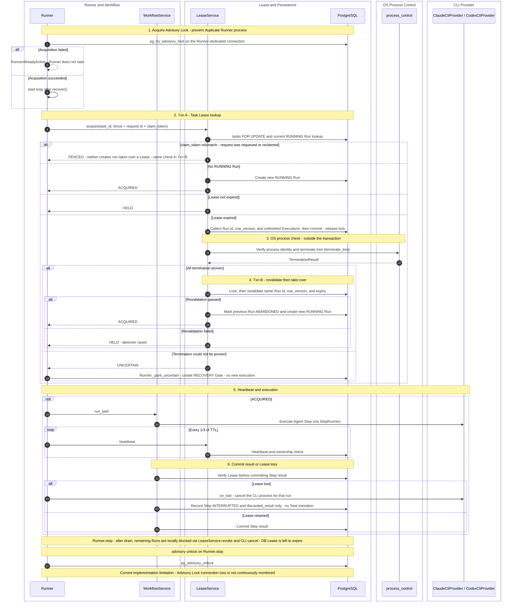
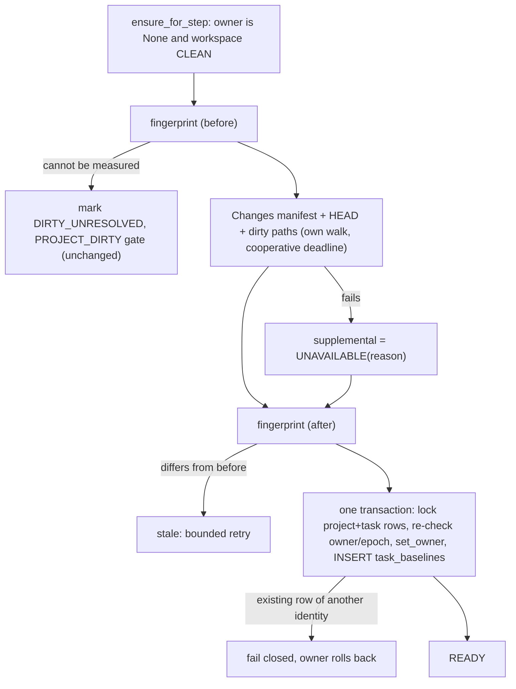

# Lease and Runner Ownership

> 한국어: [07-lease_ko.md](07-lease_ko.md)

> This flow is organized based on the current implementation code. Behavior that is not confirmed by code or not verified is marked as a current implementation limitation.

Three protective mechanisms prevent different problems.

- Advisory Lock (process level): A PostgreSQL session advisory lock (`pg_try_advisory_lock`) prevents duplicate execution of the Runner (Coordinator) process. A second Runner process cannot start. Within one process, multiple Tasks run in parallel ([03](03-task-runner.md)).
- Task Lease (Task level): A Lease in `task_runs` (a partial unique index limiting one RUNNING Run per Task) and row locking on `tasks` guarantee ownership of the RUNNING Run per Task. The execution request's `claim_token` is also checked at this stage (`FENCED`).
- Project write lock (Project level): Among Tasks sharing the same Workspace, limits the Task executing change Steps to only one (see "Ordering with the Project write lock" below).

The diagram below shows the flow from Runner startup, through Lease acquisition (including takeover of an expired Lease), Heartbeat, and result commit or Lease loss. The normal flow and the takeover/loss exception flows are shown together, and the central class is `LeaseService`. OS process verification and termination are performed by the `app.infra.process_control` module.

## How to read this

- Lease acquisition has 3 stages. Txn A checks and commits the existing Run. Afterward, outside the transaction, the process is checked and terminated. Txn B only takes over after revalidating the same Run id, `row_version`, and expiry status. No row lock is held during the OS operation.
- If termination cannot be proven (including a `STARTING` Execution whose `pid` or creation time was not recorded), it returns `UNCERTAIN` and starts nothing. The RECOVERY Gate is opened by `Runner._park_uncertain`, not by `LeaseService` ([09](09-recovery.md)).
- If the Heartbeat's `rowcount` is 0 or the update fails, it is treated as Lease loss and the CLI process for that Run is canceled. A result arriving afterward is not recorded as a normal completion; `StepRunner._discard_result` records it only as `discarded_result`. `run_task` returns `LEASE_LOST` and `Runner.process` requeues the request ([09](09-recovery.md)).
- When normally entering a Human Gate, Approval creation and Lease return (`FINISHED`) happen in the same transaction after the CLI returns ([08](08-human-gate.md)).
- `process_control` is not a class but the `app.infra.process_control` module, composed of `ProcessIdentity`, `TerminationResult`, `capture_identity`, `check_alive`, and `terminate_tree`.
- `LeaseService.revoke(run_id)` only marks that Run as "lost" in this process's memory. Afterward, `verify` throws `LeaseLost`, preventing the in-progress Run from recording anything, and leaves the DB's Lease to expire. `Runner.stop` uses this for Tasks that have not finished even after the grace period; the next startup's `acquire` either proves process termination or opens a RECOVERY Gate with `UNCERTAIN`.

## Ordering with the Project write lock

A Task belonging to a project additionally carries a Project write lock (`projects.write_owner_task_id`) on top of the Task Lease. The order is always as follows.

`claim(claim_token)` → `Task Lease` → `[Project gate before Step start]` → `Step attempt` → `CLI / Workspace command`

- The Project gate (`ProjectLockService.ensure_for_step`) runs before change Steps (`DEVELOPER`, `TESTER`) and Code Review. If there is no owner, it acquires the lock; if this Task is already the owner, it re-enters (keeping the existing write baseline); if another Task is the owner, it is `BLOCKED` (Lease returned, then delayed requeue). Waiting does not consume `step_attempt`, `cli_invocations`, or `workflow_iteration`.
- The release order is the reverse. The Project lock is released in the **same transaction as the Task's terminal transition** (`project_terminal.release_on_terminal`), and the Lease is returned by the existing path. The Lease logic itself is unchanged.
- Upon entering `WAITING_APPROVAL`, the CLI and Task Lease are returned, but the Project write lock is retained, because there may be Workspace changes that have not yet been cleaned up ([08](08-human-gate.md), [11](11-task-lifecycle.md)).
- Even if the owning Task's Lease expires, the Project lock is not automatically released. Uncertain executions are judged through the existing `UNCERTAIN` → RECOVERY path.

## Task Baseline Written with the Lock

`ProjectLockService._acquire_once` takes the project row lock, re-validates the proof's `project_id`, owner and `write_epoch`, then calls `set_owner(..., expected_epoch=proof.write_epoch)` (it returns the epoch it produced, `acquired_epoch = proof_epoch + 1`) and inserts the `task_baselines` row **in the same transaction**. The measurement before it is: fingerprint, Changes manifest (HEAD, dirty paths), fingerprint again; two different fingerprints are a stale measurement (`FingerprintProofStale`, existing bounded retry). A fingerprint that cannot be measured keeps the fail-closed path; a manifest failure only makes the row `UNAVAILABLE` with a reason. On re-entry by the same owner the lock is never READY without a baseline row (see 09-recovery).

## Takeover of Tracked Executions

An unfinished `executions` row of the abandoned Run is judged per row in `LeaseService.acquire` (the rows are read in Txn A together with their `detail`, the OS work runs outside any transaction). A row is **tracked** only when `detail.tracked` is exactly the JSON boolean `true` ([05](05-development-testing.md)); every other row keeps the earlier rule (`terminate_tree` by `(pid, create_time)`; a row without a recorded identity is not proven).

For a tracked row the verdict is, in order (`default_tracked_verdict`, run in a thread):

1. **Same Runner process** (`retained_job_verdict`, shared with the orphan sweeper and the risk worker, [08](08-human-gate.md), [09](09-recovery.md)): if the executor still retains the Job of this execution (`CommandExecutor.resettle_retained`), it is terminated again; proven empty means proof `JOB_EMPTY`. If the row has **no `pid`** and the executor still holds a Job of this execution that is not proven empty (`CommandExecutor.has_retained`), the verdict is not confirmed (`SPAWNED_PROCESS_UNPROVEN`, result `UNCERTAIN`), whatever the row's `detail` says; the row never falls through to `NEVER_RAN`. Both callbacks are wired in `container.py`.
2. **`pid IS NULL`**: no identity was ever persisted, so user code never ran (the order is Job assignment, identity capture, fenced identity write, and only then the resume of the suspended process). The row is closed with proof `NEVER_RAN` (reason `SUSPENDED_ORPHAN_POSSIBLE`) **only when no retained Job is present (step 1) and `detail` does not record an unproven spawned process** (`lifecycle=TERMINATION_UNCONFIRMED`, `tree` `NOT_EMPTY` or `UNKNOWN`, or reason `RESULT_MISSING` or `LIFECYCLE_MISSING`). With such evidence the verdict is not confirmed (`SPAWNED_PROCESS_UNPROVEN`) and the result is `UNCERTAIN`.
3. **A recorded `pid`** (the kill-on-close assumption, `JOB_KILL_ON_CLOSE_ASSUMED`): confirmed only if all hold: the identity record is complete; the assumption is enabled (`JOB_KILL_ON_CLOSE_ASSUMPTION_ENABLED`); the owning Runner process (`detail.runner_process`) was on this host; that Runner process is proven gone or its pid reused; the recorded root process is gone or its pid reused; and no direct child of the root survives after a short settle window (`JOB_CLOSE_SETTLE_SECONDS`). Otherwise it is not confirmed (`IDENTITY_RECORD_MISSING`, `H3_DISABLED`, `OTHER_HOST`, `RUNNER_NOT_PROVEN_DEAD`, `ROOT_NOT_GONE`, `SURVIVORS_AFTER_SETTLE`), which gives `UNCERTAIN`. "The Job dies with its owner" is a conditional OS guarantee, which is why the assumption is a switch.

Txn B closes the rows only if nothing changed since Txn A: the target execution rows are locked with one statement in ascending id order (`lock_executions_ordered`), their `(pid, process_create_time)` is re-read, and a changed identity (or a `NEVER_RAN` row that got a `pid`) rolls the whole Txn B back as `HELD` ("takeover raced"). The `NEVER_RAN` close carries the same evidence guard in its `UPDATE`, so a row that records an unproven spawn is never closed by it. The proof is written by a JSONB merge (`detail || merge`: `proof`, `lifecycle`, `tree`, ...), never by replacing `detail`. A row with a wrong tracked marker, or tracked-only keys without a marker, is closed by the earlier rule and only `abandoned_by_takeover` is merged into its `detail`.

## Current implementation limitations

- Verification scope of the takeover verdict: **verified** on Windows with real Job Objects (`tests/integration_pg/test_never_ran_crash_points.py`) and, for the verdict and the closing write, with real short-lived processes on the embedded PostgreSQL (`tests/integration_pg/test_tracked_takeover.py`; that file does not drive a Job Object). The POSIX policy exists in code only (no tracked rows are written there, and `UNSUPPORTED_PLATFORM` degrades to untracked) and POSIX runtime behaviour is **not verified**. **Not verified**: POSIX runtime, real Gradle/Maven builds, real CLI E2E, random race stress, EXPLAIN/generic plan, real deadlock tests (the ordered row locks are a design rule, not a deadlock test).
- The Advisory Lock is acquired once in `Runner.start` and released in `Runner.stop`, but there is no code that continuously monitors whether the connection has dropped. Logic to block new CLI execution upon connection loss is not implemented. (Task-level duplicate execution continues to be blocked by the Lease and the partial unique index.)
- An untracked process (an Agent CLI call) is identified only by `(pid, create_time)` (psutil). A tracked row is judged by the Job (`JOB_EMPTY`) or by the kill-on-close assumption above, which also reads the identity record of the owning Runner process. `runner_id` and the execution command hash are not used in the actual termination decision.
- The earlier residual of the `NEVER_RAN` rule (a row without a `pid`, with a retained Job not proven empty and a lost executor write recording the unproven spawn, could be closed `NEVER_RAN`) is **closed for Jobs retained in the same Runner process**: `retained_job_verdict` judges such a row `SPAWNED_PROCESS_UNPROVEN`.
- CP2 residual: a Job-less suspended process (spawned, not yet assigned to the Job, no identity written) may survive a `NEVER_RAN` close, because such a row is indistinguishable from "nothing was spawned". User code cannot have run (the process is suspended). This is accepted by design (`SUSPENDED_ORPHAN_POSSIBLE`) and the acceptance is **not** extended to the retained-Job case above.
- After a Runner restart the in-process registry of retained Jobs is empty, so the retained-Job rule no longer applies. The Job is created with `JOB_OBJECT_LIMIT_KILL_ON_JOB_CLOSE`, so the OS ends its processes when the owning Runner process ends (`WindowsJob`; on Windows `tests/unit/test_windows_job.py::test_the_death_of_the_owner_process_ends_the_whole_tree` kills a real owner process and checks that the tree ends). The takeover verdict treats this as a conditional OS guarantee (the switch `JOB_KILL_ON_CLOSE_ASSUMPTION_ENABLED`), not as proof.

## Future improvements

- Monitor Advisory Lock connection loss and block new CLI execution upon loss.
- Include `runner_id` and execution command hash verification in process identity.
