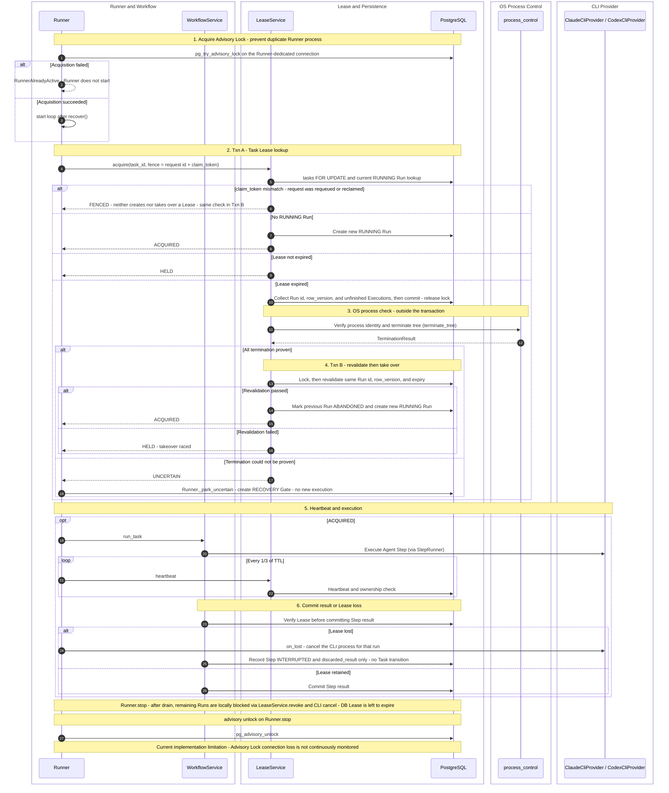

# Lease and Runner Ownership

> 한국어: [07-lease_ko.md](07-lease_ko.md)

> This flow is organized based on the current implementation code. Behavior that is not confirmed by code or not verified is marked as a current implementation limitation.

Three protective mechanisms prevent different problems.

- Advisory Lock (process level): A PostgreSQL session advisory lock (`pg_try_advisory_lock`) prevents duplicate execution of the Runner (Coordinator) process. A second Runner process cannot start. Within one process, multiple Tasks run in parallel ([03](03-task-runner.md)).
- Task Lease (Task level): A Lease in `task_runs` (a partial unique index limiting one RUNNING Run per Task) and row locking on `tasks` guarantee ownership of the RUNNING Run per Task. The execution request's `claim_token` is also checked at this stage (`FENCED`).
- Project write lock (Project level): Among Tasks sharing the same Workspace, limits the Task executing change Steps to only one (see "Ordering with the Project write lock" below).

The diagram below shows the flow from Runner startup, through Lease acquisition (including takeover of an expired Lease), Heartbeat, and result commit or Lease loss. The normal flow and the takeover/loss exception flows are shown together, and the central class is `LeaseService`. OS process verification and termination are performed by the `app.infra.process_control` module.

## How to read this

- Lease acquisition has 3 stages. Txn A checks and commits the existing Run. Afterward, outside the transaction, the process is checked and terminated. Txn B only takes over after revalidating the same Run id, `row_version`, and expiry status. No row lock is held during the OS operation.
- If termination cannot be proven (including a `STARTING` Execution whose `pid` or creation time was not recorded), it returns `UNCERTAIN` and starts nothing. The RECOVERY Gate is opened by `Runner._park_uncertain`, not by `LeaseService` ([09](09-recovery.md)).
- If the Heartbeat's `rowcount` is 0 or the update fails, it is treated as Lease loss and the CLI process for that Run is canceled. A result arriving afterward is not recorded as a normal completion; `StepRunner._discard_result` records it only as `discarded_result`. `run_task` returns `LEASE_LOST` and `Runner.process` requeues the request ([09](09-recovery.md)).
- When normally entering a Human Gate, Approval creation and Lease return (`FINISHED`) happen in the same transaction after the CLI returns ([08](08-human-gate.md)).
- `process_control` is not a class but the `app.infra.process_control` module, composed of `ProcessIdentity`, `TerminationResult`, `capture_identity`, `check_alive`, and `terminate_tree`.
- `LeaseService.revoke(run_id)` only marks that Run as "lost" in this process's memory. Afterward, `verify` throws `LeaseLost`, preventing the in-progress Run from recording anything, and leaves the DB's Lease to expire. `Runner.stop` uses this for Tasks that have not finished even after the grace period; the next startup's `acquire` either proves process termination or opens a RECOVERY Gate with `UNCERTAIN`.

## Ordering with the Project write lock

A Task belonging to a project additionally carries a Project write lock (`projects.write_owner_task_id`) on top of the Task Lease. The order is always as follows.

`claim(claim_token)` → `Task Lease` → `[Project gate before Step start]` → `Step attempt` → `CLI / Workspace command`

- The Project gate (`ProjectLockService.ensure_for_step`) runs before change Steps (`DEVELOPER`, `TESTER`) and Code Review. If there is no owner, it acquires the lock; if this Task is already the owner, it re-enters (keeping the existing write baseline); if another Task is the owner, it is `BLOCKED` (Lease returned, then delayed requeue). Waiting does not consume `step_attempt`, `cli_invocations`, or `workflow_iteration`.
- The release order is the reverse. The Project lock is released in the **same transaction as the Task's terminal transition** (`project_terminal.release_on_terminal`), and the Lease is returned by the existing path. The Lease logic itself is unchanged.
- Upon entering `WAITING_APPROVAL`, the CLI and Task Lease are returned, but the Project write lock is retained, because there may be Workspace changes that have not yet been cleaned up ([08](08-human-gate.md), [11](11-task-lifecycle.md)).
- Even if the owning Task's Lease expires, the Project lock is not automatically released. Uncertain executions are judged through the existing `UNCERTAIN` → RECOVERY path.

## Current implementation limitations

- The Advisory Lock is acquired once in `Runner.start` and released in `Runner.stop`, but there is no code that continuously monitors whether the connection has dropped. Logic to block new CLI execution upon connection loss is not implemented. (Task-level duplicate execution continues to be blocked by the Lease and the partial unique index.)
- The process termination target is identified only by `(pid, create_time)` (psutil). `runner_id` and the execution command hash are not used in the actual termination decision.

## Future improvements

- Monitor Advisory Lock connection loss and block new CLI execution upon loss.
- Include `runner_id` and execution command hash verification in process identity.
