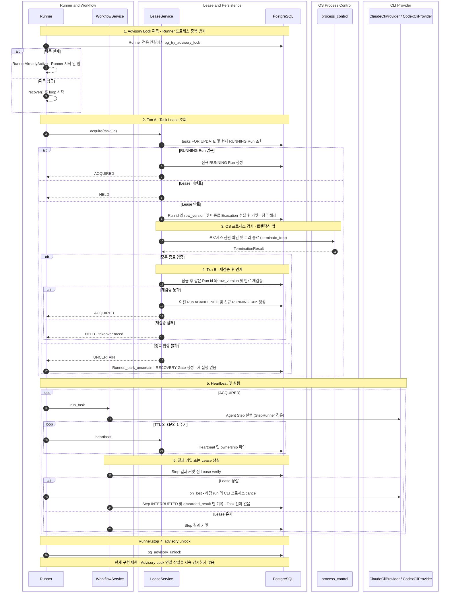

# Lease 및 Runner Ownership

> 현재 구현 코드를 기준으로 정리한 흐름입니다. 코드로 확인되지 않았거나 검증되지 않은 동작은 현재 구현 제한으로 구분합니다.

두 가지 보호 장치가 서로 다른 문제를 막습니다.

- Advisory Lock(프로세스 수준): PostgreSQL session advisory lock (`pg_try_advisory_lock`)으로 Runner 프로세스의 중복 실행을 막습니다. 두 번째 Runner 프로세스는 시작하지 못합니다.
- Task Lease(Task 수준): `task_runs`의 Lease(부분 unique index로 Task당 RUNNING Run 1개)와 `tasks` 행 잠금으로 Task별 RUNNING Run 소유권을 보장합니다.

아래 다이어그램은 Runner 시작부터 Lease 획득(만료 Lease 인계 포함), Heartbeat, 결과 커밋 또는 Lease 상실까지를 보여줍니다. 정상 흐름과 인계·상실 예외 흐름이 함께 있으며 중심 클래스는 `LeaseService`입니다. OS 프로세스 확인·종료는 `app.infra.process_control` 모듈이 수행합니다.

## 읽는 방법

- Lease 획득은 3단계입니다. Txn A는 기존 Run을 확인하고 커밋합니다. 이후 트랜잭션 밖에서 프로세스를 확인·종료합니다. Txn B는 같은 Run id와 `row_version`, 만료 상태를 다시 검증한 뒤에만 인계합니다. OS 작업 중에는 행 잠금을 잡지 않습니다.
- 종료를 입증할 수 없으면(`pid` 또는 생성 시각이 기록되지 않은 `STARTING` Execution 포함) `UNCERTAIN`을 반환하고 아무 것도 시작하지 않습니다. RECOVERY Gate는 `LeaseService`가 아니라 `Runner._park_uncertain`이 엽니다 ([09](09-recovery.md)).
- Heartbeat의 `rowcount`가 0이거나 갱신이 실패하면 Lease 상실로 보고 해당 Run의 CLI 프로세스를 취소합니다. 이후 도착한 결과는 정상 완료로 기록되지 않고 `StepRunner._discard_result`가 `discarded_result`로만 남깁니다. `run_task`는 `LEASE_LOST`를 반환하고 `Runner.process`가 요청을 requeue합니다 ([09](09-recovery.md)).
- Human Gate에 정상 진입하면 CLI 반환 후 Approval 생성과 Lease 반환(`FINISHED`)이 같은 트랜잭션에서 일어납니다 ([08](08-human-gate.md)).
- `process_control`은 클래스가 아니라 `app.infra.process_control` 모듈이며 `ProcessIdentity`, `TerminationResult`, `capture_identity`, `check_alive`, `terminate_tree`로 구성됩니다.

## 현재 구현 제한

- Advisory Lock은 `Runner.start`에서 한 번 획득하고 `Runner.stop`에서 해제하지만, 연결이 끊어졌는지 지속적으로 감시하는 코드가 없습니다. 연결 상실 시 신규 CLI 실행을 막는 로직은 구현되어 있지 않습니다. (Task 수준 중복 실행은 Lease와 부분 unique index가 계속 차단합니다.)
- 프로세스 종료 대상은 `(pid, create_time)`(psutil)으로만 식별합니다. `runner_id`와 실행 명령 hash는 실제 종료 판단에 사용하지 않습니다.

## 향후 보완

- Advisory Lock 연결 상실 감시와 상실 시 신규 CLI 실행 차단.
- 프로세스 신원에 `runner_id`와 실행 명령 hash 검증을 포함.
