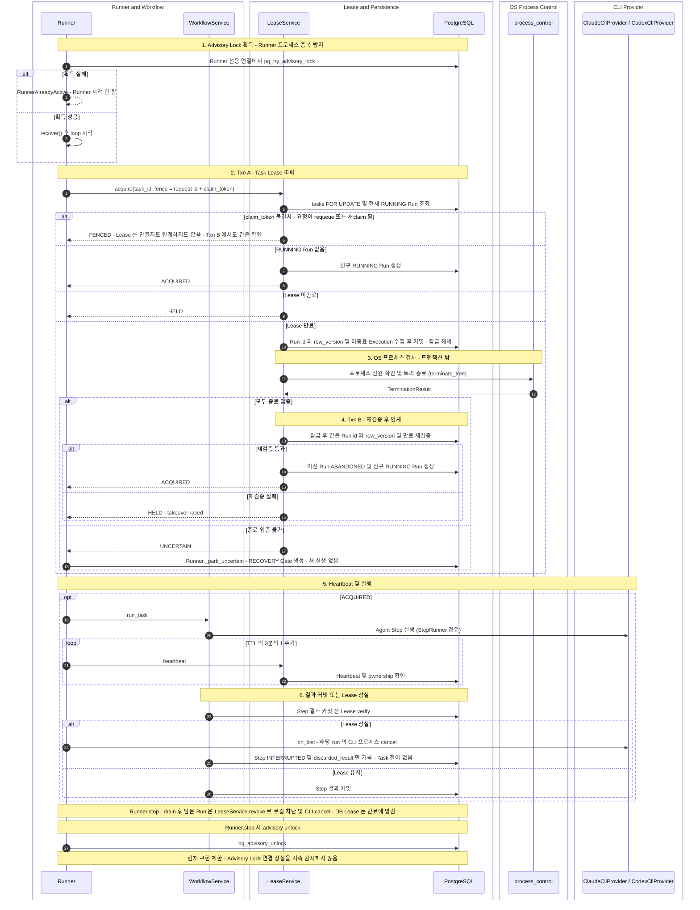
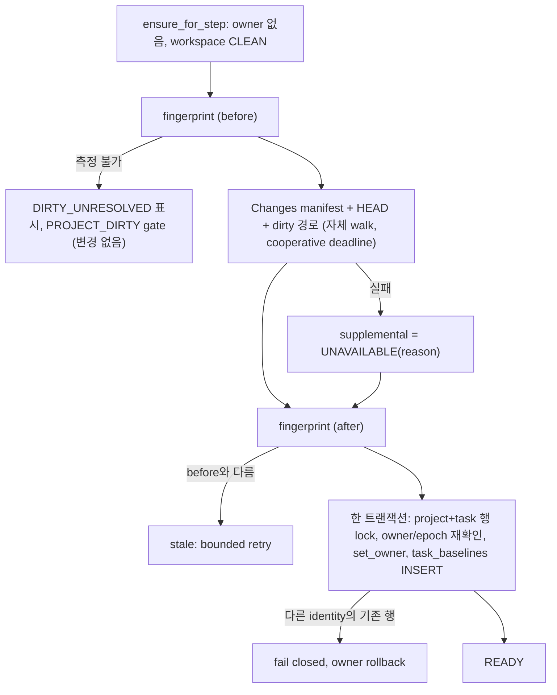

# Lease 및 Runner Ownership

> English: [07-lease.md](07-lease.md)

> 현재 구현 코드를 기준으로 정리한 흐름입니다. 코드로 확인되지 않았거나 검증되지 않은 동작은 현재 구현 제한으로 구분합니다.

세 가지 보호 장치가 서로 다른 문제를 막습니다.

- Advisory Lock(프로세스 수준): PostgreSQL session advisory lock (`pg_try_advisory_lock`)으로 Runner(Coordinator) 프로세스의 중복 실행을 막습니다. 두 번째 Runner 프로세스는 시작하지 못합니다. 한 프로세스 안에서는 여러 Task가 병렬로 실행됩니다 ([03](03-task-runner_ko.md)).
- Task Lease(Task 수준): `task_runs`의 Lease(부분 unique index로 Task당 RUNNING Run 1개)와 `tasks` 행 잠금으로 Task별 RUNNING Run 소유권을 보장합니다. execution request의 `claim_token`이 이 단계에서도 확인됩니다(`FENCED`).
- Project write lock(Project 수준): 같은 Workspace를 공유하는 Task 중 변경 Step을 실행하는 Task를 하나로 제한합니다(아래 "Project write lock과의 순서").

아래 다이어그램은 Runner 시작부터 Lease 획득(만료 Lease 인계 포함), Heartbeat, 결과 커밋 또는 Lease 상실까지를 보여줍니다. 정상 흐름과 인계·상실 예외 흐름이 함께 있으며 중심 클래스는 `LeaseService`입니다. OS 프로세스 확인·종료는 `app.infra.process_control` 모듈이 수행합니다.

## 읽는 방법

- Lease 획득은 3단계입니다. Txn A는 기존 Run을 확인하고 커밋합니다. 이후 트랜잭션 밖에서 프로세스를 확인·종료합니다. Txn B는 같은 Run id와 `row_version`, 만료 상태를 다시 검증한 뒤에만 인계합니다. OS 작업 중에는 행 잠금을 잡지 않습니다.
- 종료를 입증할 수 없으면(`pid` 또는 생성 시각이 기록되지 않은 `STARTING` Execution 포함) `UNCERTAIN`을 반환하고 아무 것도 시작하지 않습니다. RECOVERY Gate는 `LeaseService`가 아니라 `Runner._park_uncertain`이 엽니다 ([09](09-recovery_ko.md)).
- Heartbeat의 `rowcount`가 0이거나 갱신이 실패하면 Lease 상실로 보고 해당 Run의 CLI 프로세스를 취소합니다. 이후 도착한 결과는 정상 완료로 기록되지 않고 `StepRunner._discard_result`가 `discarded_result`로만 남깁니다. `run_task`는 `LEASE_LOST`를 반환하고 `Runner.process`가 요청을 requeue합니다 ([09](09-recovery_ko.md)).
- Human Gate에 정상 진입하면 CLI 반환 후 Approval 생성과 Lease 반환(`FINISHED`)이 같은 트랜잭션에서 일어납니다 ([08](08-human-gate_ko.md)).
- `process_control`은 클래스가 아니라 `app.infra.process_control` 모듈이며 `ProcessIdentity`, `TerminationResult`, `capture_identity`, `check_alive`, `terminate_tree`로 구성됩니다.
- `LeaseService.revoke(run_id)`는 이 프로세스의 메모리에서만 해당 Run을 "상실"로 표시합니다. 이후 `verify`는 `LeaseLost`를 던져 진행 중 Run이 아무 것도 기록하지 못하게 하고, DB의 Lease는 만료되도록 둡니다. `Runner.stop`이 grace 시간 뒤에도 끝나지 않는 Task에 사용하며, 다음 시작의 `acquire`가 프로세스 종료를 입증하거나 `UNCERTAIN`으로 RECOVERY Gate를 엽니다.

## Project write lock과의 순서

프로젝트에 속한 Task는 Task Lease 위에 Project write lock(`projects.write_owner_task_id`)을 더 가집니다. 순서는 항상 다음과 같습니다.

`claim(claim_token)` → `Task Lease` → `[Step 시작 전 Project gate]` → `Step attempt` → `CLI / Workspace 명령`

- Project gate(`ProjectLockService.ensure_for_step`)는 변경 Step(`DEVELOPER`, `TESTER`)과 Code Review 앞에서 실행됩니다. 소유자가 없으면 획득하고, 이미 이 Task가 소유자이면 재진입(기존 write baseline 유지), 다른 Task가 소유자이면 `BLOCKED`(Lease 반납 후 지연 requeue)입니다. 대기는 `step_attempt`, `cli_invocations`, `workflow_iteration`을 소모하지 않습니다.
- 해제 순서는 반대입니다. Project lock은 Task의 **terminal 전이와 같은 트랜잭션**에서 해제되고(`project_terminal.release_on_terminal`), Lease는 기존 경로가 반환합니다. Lease 로직 자체는 바뀌지 않았습니다.
- `WAITING_APPROVAL`에 들어가면 CLI와 Task Lease는 반환하지만 Project write lock은 유지합니다. 아직 정리되지 않은 Workspace 변경이 있을 수 있기 때문입니다 ([08](08-human-gate_ko.md), [11](11-task-lifecycle_ko.md)).
- 소유자 Task의 Lease가 만료되어도 Project lock을 자동으로 풀지 않습니다. 불확실한 실행은 기존 `UNCERTAIN` → RECOVERY 경로가 판단합니다.

## Lock과 함께 기록하는 Task baseline

`ProjectLockService._acquire_once`는 project 행 lock을 잡고 proof의 `project_id`, owner, `write_epoch`를 다시 검증한 뒤
`set_owner(..., expected_epoch=proof.write_epoch)`를 호출하고(자신이 만든 epoch인 `acquired_epoch = proof_epoch + 1`을 반환) `task_baselines`
행을 **같은 트랜잭션**에서 INSERT합니다. 그 앞의 측정은 fingerprint, Changes manifest(HEAD, dirty 경로), fingerprint 재측정이며 두
fingerprint가 다르면 stale 측정입니다(`FingerprintProofStale`, 기존 bounded retry). fingerprint를 측정할 수 없으면 fail-closed 경로를
유지하고, manifest 실패는 행을 이유와 함께 `UNAVAILABLE`로 만들 뿐입니다. 같은 owner의 재진입에서는 baseline 행 없이 READY가
되지 않습니다(09-recovery 참고).

## Tracked Execution 인계

이전 Run의 끝나지 않은 `executions` 행은 `LeaseService.acquire`에서 행 단위로 판정합니다(행은 Txn A에서 `detail`과 함께 읽고, OS 작업은 트랜잭션 밖에서 실행). 행이 **tracked**인 것은 `detail.tracked`가 정확히 JSON boolean `true`일 때뿐입니다([05](05-development-testing_ko.md)). 그 밖의 행은 기존 규칙(`(pid, create_time)`에 의한 `terminate_tree`, 식별이 기록되지 않은 행은 입증 불가)을 유지합니다.

tracked 행의 판정은 다음 순서입니다(`default_tracked_verdict`, 스레드에서 실행).

1. **같은 Runner 프로세스**(`retained_job_verdict`, orphan sweeper와 risk worker가 함께 사용, [08](08-human-gate_ko.md), [09](09-recovery_ko.md)): executor가 이 execution의 Job을 아직 보유하고 있으면(`CommandExecutor.resettle_retained`) 다시 종료합니다. 비어 있음이 입증되면 proof는 `JOB_EMPTY`입니다. 행에 **`pid`가 없고** executor가 이 execution의 Job을 아직 보유하며 그 Job이 비어 있다고 입증되지 않았으면(`CommandExecutor.has_retained`), 행의 `detail`과 관계없이 판정은 확정되지 않고(`SPAWNED_PROCESS_UNPROVEN`, 결과 `UNCERTAIN`) 행은 `NEVER_RAN`으로 넘어가지 않습니다. 두 콜백은 `container.py`에서 연결됩니다.
2. **`pid IS NULL`**: 식별이 한 번도 저장되지 않았으므로 사용자 코드는 실행되지 않았습니다(순서는 Job 할당, 식별 캡처, fence된 식별 쓰기, 그 다음에야 suspended 프로세스의 resume입니다). 행은 보유 중인 Job이 없고(1단계) `detail`에 입증되지 않은 spawn 프로세스 기록(`lifecycle=TERMINATION_UNCONFIRMED`, `tree`가 `NOT_EMPTY` 또는 `UNKNOWN`, 또는 reason이 `RESULT_MISSING` 또는 `LIFECYCLE_MISSING`)이 **없을 때에만** proof `NEVER_RAN`(reason `SUSPENDED_ORPHAN_POSSIBLE`)으로 닫힙니다. 그런 증거가 있으면 판정은 확정되지 않고(`SPAWNED_PROCESS_UNPROVEN`) 결과는 `UNCERTAIN`입니다.
3. **`pid`가 기록된 경우**(kill-on-close 가정, `JOB_KILL_ON_CLOSE_ASSUMED`): 다음이 모두 성립할 때만 확정됩니다. 식별 기록이 완전하고, 가정이 켜져 있고(`JOB_KILL_ON_CLOSE_ASSUMPTION_ENABLED`), 소유 Runner 프로세스(`detail.runner_process`)가 이 호스트의 것이며, 그 Runner 프로세스가 사라졌거나 pid가 재사용되었음이 입증되고, 기록된 root 프로세스가 사라졌거나 pid가 재사용되었고, 짧은 settle 시간(`JOB_CLOSE_SETTLE_SECONDS`) 뒤에도 root의 직접 자식이 살아 있지 않을 때입니다. 아니면 확정되지 않으며(`IDENTITY_RECORD_MISSING`, `H3_DISABLED`, `OTHER_HOST`, `RUNNER_NOT_PROVEN_DEAD`, `ROOT_NOT_GONE`, `SURVIVORS_AFTER_SETTLE`) 결과는 `UNCERTAIN`입니다. "Job은 소유자와 함께 사라진다"는 조건부 OS 보장이므로 이 가정은 스위치로 되어 있습니다.

Txn B는 Txn A 이후 변한 것이 없을 때에만 행을 닫습니다. 대상 execution 행을 id 오름차순으로 한 문장에서 잠그고(`lock_executions_ordered`) `(pid, process_create_time)`을 다시 읽으며, 식별이 바뀌었거나(또는 `NEVER_RAN` 행에 `pid`가 생겼으면) Txn B 전체를 롤백하고 `HELD`("takeover raced")로 처리합니다. `NEVER_RAN` 종료의 `UPDATE`에도 같은 증거 guard가 있어, 입증되지 않은 spawn을 기록한 행은 이 경로로 닫히지 않습니다. proof는 `detail`을 교체하지 않고 JSONB merge(`detail || merge`: `proof`, `lifecycle`, `tree` 등)로 기록합니다. 잘못된 tracked marker가 있거나 marker 없이 tracked 전용 키만 있는 행은 기존 규칙으로 닫히며 `detail`에는 `abandoned_by_takeover`만 merge됩니다.

## 현재 구현 제한

- takeover 판정의 검증 범위: Windows에서 실제 Job Object(`tests/integration_pg/test_never_ran_crash_points.py`)와, 판정과 닫는 쓰기에 대해서는 내장 PostgreSQL에서 실제 단명 프로세스(`tests/integration_pg/test_tracked_takeover.py`, 이 파일은 Job Object를 구동하지 않음)로 **검증됨**. POSIX 정책은 코드에만 존재하며(POSIX에서는 tracked 행이 기록되지 않고 `UNSUPPORTED_PLATFORM`은 untracked로 degrade) POSIX 런타임 동작은 **검증하지 않았습니다**. **검증하지 않은 것**: POSIX 런타임, 실제 Gradle/Maven 빌드, 실제 CLI E2E, 무작위 race stress, EXPLAIN/generic plan, 실제 deadlock 테스트(순서가 있는 행 잠금은 설계 규칙이며 deadlock 테스트가 아닙니다).
- Advisory Lock은 `Runner.start`에서 한 번 획득하고 `Runner.stop`에서 해제하지만, 연결이 끊어졌는지 지속적으로 감시하는 코드가 없습니다. 연결 상실 시 신규 CLI 실행을 막는 로직은 구현되어 있지 않습니다. (Task 수준 중복 실행은 Lease와 부분 unique index가 계속 차단합니다.)
- untracked 프로세스(Agent CLI 호출)는 `(pid, create_time)`(psutil)으로만 식별합니다. tracked 행은 Job(`JOB_EMPTY`) 또는 위의 kill-on-close 가정으로 판정하며, 이 가정은 소유 Runner 프로세스의 식별 기록도 읽습니다. `runner_id`와 실행 명령 hash는 실제 종료 판단에 사용하지 않습니다.
- `NEVER_RAN` 규칙의 이전 잔여 위험(`pid`가 없고, 보유 중인 Job이 비어 있다고 입증되지 않았으며, 입증되지 않은 spawn을 기록하는 executor 쓰기가 유실된 행이 `NEVER_RAN`으로 닫힐 수 있던 문제)은 **같은 Runner 프로세스에 보유된 Job에 대해서는 해소되었습니다**. `retained_job_verdict`가 그런 행을 `SPAWNED_PROCESS_UNPROVEN`으로 판정합니다.
- CP2 잔여 위험: Job에 할당되지 않은 suspended 프로세스(spawn됨, 아직 Job 미할당, 식별 미기록)는 그 행이 "아무것도 spawn되지 않음"과 구별되지 않으므로 `NEVER_RAN` 종료 뒤에도 살아남을 수 있습니다. 프로세스가 suspended 상태이므로 사용자 코드는 실행될 수 없었습니다. 설계상 수용된 한계이며(`SUSPENDED_ORPHAN_POSSIBLE`), 이 수용은 위의 보유 Job 경우로 **확장되지 않습니다**.
- Runner 재시작 뒤에는 프로세스 내부의 보유 Job 레지스트리가 비어 있으므로 보유 Job 규칙은 더 이상 적용되지 않습니다. Job은 `JOB_OBJECT_LIMIT_KILL_ON_JOB_CLOSE`로 만들어지므로 소유 Runner 프로세스가 끝나면 OS가 그 프로세스들을 종료합니다(`WindowsJob`. Windows에서 `tests/unit/test_windows_job.py::test_the_death_of_the_owner_process_ends_the_whole_tree`가 실제 소유 프로세스를 죽여 트리가 끝나는지 확인합니다). takeover 판정은 이를 증명이 아니라 조건부 OS 보장으로 취급합니다(스위치 `JOB_KILL_ON_CLOSE_ASSUMPTION_ENABLED`).

## 향후 보완

- Advisory Lock 연결 상실 감시와 상실 시 신규 CLI 실행 차단.
- 프로세스 신원에 `runner_id`와 실행 명령 hash 검증을 포함.
