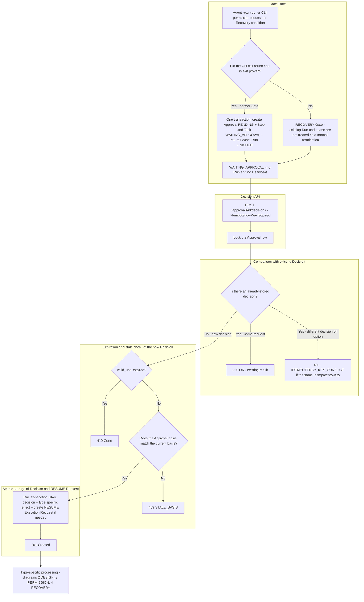
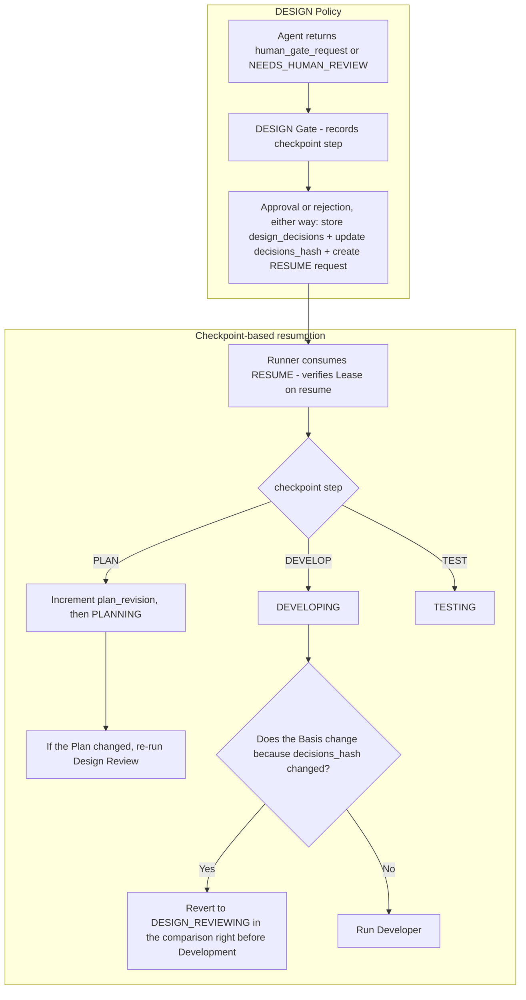
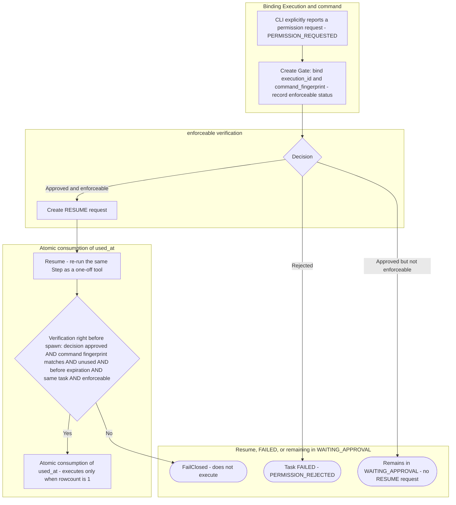
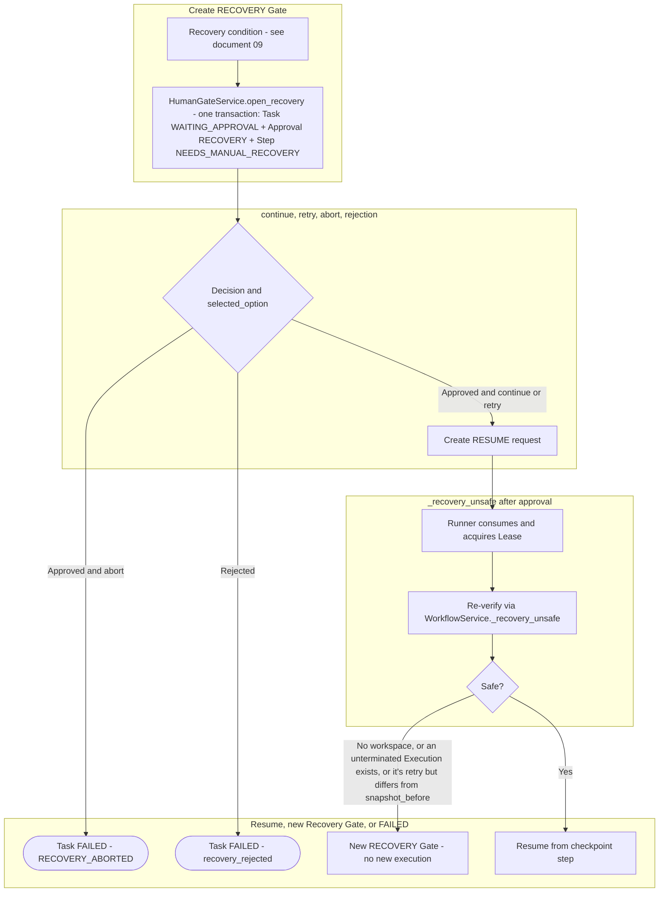
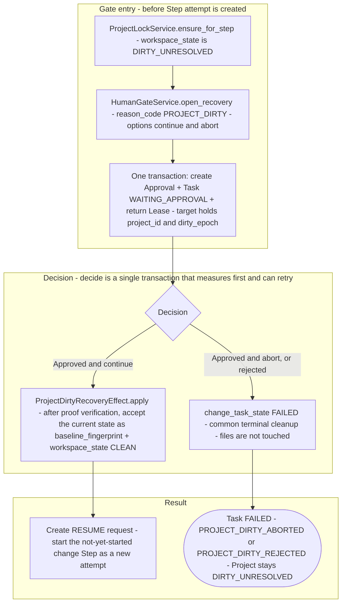

# Human Gate and Approval

> 한국어: [08-human-gate_ko.md](08-human-gate_ko.md)

> This flow is organized based on the current implementation code. Behaviors not confirmed in code or not verified are marked as current implementation limitations.

`approvals.type` has three values, `DESIGN`, `PERMISSION`, and `RECOVERY`, and they have no effect on one another. In particular, DESIGN approval does not expand CLI permissions.

RECOVERY distinguishes its kind by a stable `reason_code` (stored in both `request_payload` and `target`). It is not determined by message string.

- `EXECUTION_UNCERTAIN` (default, including existing Approvals without a `reason_code`): CLI exit / Workspace change safety is uncertain. Options are `continue`/`retry`/`abort`.
- `PROJECT_DIRTY`: a new Task requests a write lock on a Project that has unresolved changes left by a previous Task. Options are `continue`/`abort` (no `retry`). See section 5 below.

This document consists of five diagrams. #1 is the Gate entry and Decision API processing shared by all three types, and #2–5 are the type-specific processing performed after passing the common Decision API. The central class is `HumanGateService` (`open_gate`, `open_recovery`, `decide`, `_apply`). The effect per Recovery kind is handled not by `HumanGateService` but by the injected `RecoveryEffects` (`reason_code → effect`), and `HumanGateService` does not import the Project module.

## 1. Common: Gate Entry and Decision Storage

Shows the entry of a normal Gate and a RECOVERY Gate, the idempotency/expiration/stale checks of `POST /approvals/{approval_id}/decisions`, and the atomic storage of the decision and the RESUME request.

For a normal Gate, after the CLI call returns, Approval creation, Step/Task state change, and Lease return are all processed in one transaction (the mutate of `WorkflowService._enter_gate` and `StepRunner.complete`). The decision and the RESUME Execution Request (`approval_id` UNIQUE) are also stored in a single PostgreSQL transaction. Even if the process terminates right after approval, the request remains and is consumed by the next Runner.

The response codes are as follows.

| Situation | Response |
|---|---|
| New Decision stored | 201 Created |
| Idempotent re-request of the same Decision | 200 OK |
| Different Decision or conflict | 409 |
| Expired new Decision | 410 |
| Stale basis | 409 (`STALE_BASIS`) |

Because comparison with an existing decision is performed before the expiration/stale checks, a re-request for an already-stored decision responds with 200 even after expiration.

For decisions that require a Workspace measurement (`PROJECT_DIRTY` `continue`, and rejections/`abort` that can terminate the Task), `HumanGateService.decide` **first measures the fingerprint proof outside the transaction** and verifies it in a short decision transaction. If the proof has gone stale (`EffectRetry`), the entire decision transaction is rolled back — none of `ApprovalDecision`, Approval `DECIDED`, or the RESUME request is committed — and it re-measures and retries (up to 3 times, as a single logical decision under the same Idempotency-Key). If all 3 attempts fail, it returns 409 `PROJECT_FINGERPRINT_UNSTABLE` and records nothing.

## 2. DESIGN Gate

The DESIGN-specific processing performed after passing the common Decision API. Approval and rejection have the same effect — both are stored as a design decision and resumed from the checkpoint step.

- A DESIGN rejection does not immediately result in FAILED in the current implementation. The rejection is also recorded as a design decision, a RESUME request is created, and it is resumed from the checkpoint step.
- If the Design Reviewer returns `NEEDS_HUMAN_REVIEW`, the checkpoint is `PLAN`, and it resumes to PLANNING. Gates requested by the Developer, Tester, and Code Reviewer have `DEVELOP`/`TEST`/`DEVELOP` checkpoints respectively.
- If the Code Reviewer returns `NEEDS_HUMAN_REVIEW` without a `human_gate_request`, the Orchestrator constructs the request from the reviewer's summary and issues (`accept` / `revise` options).
- Since the decision changes `decisions_hash`, an existing PASS may become invalid in the Basis comparison right before Development ([04](04-planning-review.md)).

## 3. PERMISSION Gate

The PERMISSION-specific processing performed after passing the common Decision API. Approval is bound only to the specific Execution and command, and depending on `enforceable`, it either resumes or remains in `WAITING_APPROVAL`.

- TIMEOUT, IDLE, and ERROR are not assumed to be permission requests. This Gate is only created when `PERMISSION_REQUESTED`.
- Approval is bound only to the specific Execution and command, and is consumed only once. After consumption, even if the CLI fails, it is not reused — a new Gate is required.
- If the installed CLI cannot enforce that one command (`enforceable` is false, e.g., for the Codex role), approval does not expand permissions. In that case, the actual state is as follows.
  - The Decision is stored.
  - The Approval becomes `DECIDED`.
  - No RESUME Execution Request is created.
  - The Task remains in `WAITING_APPROVAL`.
  - There is currently no automatic recovery path out of this state (current implementation limitation).

## 4. RECOVERY Gate

The RECOVERY-specific processing performed after passing the common Decision API. `abort` approval and rejection both terminate as FAILED, and only `continue`/`retry` re-verify safety after RESUME. The Recovery entry conditions are in [09](09-recovery.md).

- RECOVERY approval alone does not mean the existing Run and Lease are treated as normally terminated.
- Safety is re-verified upon resumption. If an unterminated Execution remains, new execution is blocked even after approval, and a new RECOVERY Gate is created.
- Run/Lease handling differs by Recovery entry path ([09](09-recovery.md)).

## 5. RECOVERY Gate - PROJECT_DIRTY

Opens when a Project Task is about to start a change Step while `projects.workspace_state` is `DIRTY_UNRESOLVED`. It opens **before** a Step attempt is created (`ProjectLockService.ensure_for_step`), so there is no `step_id`, and `checkpoint_step_key`/`resume_step_key` retain the Step that was about to start (e.g., `DEVELOP`). Waiting at the Gate does not consume `step_attempt`, `cli_invocations`, or `workflow_iteration`.

- Only one PENDING `PROJECT_DIRTY` Approval can exist for the same Task (a pre-check under a Task row lock, plus the partial unique index `uq_approvals_project_dirty_pending`).
- `continue` simply accepts the current Workspace as the new baseline. If the Project has already become `CLEAN` via a different decision, the baseline is left untouched and it only resumes. If `dirty_epoch` has changed since the gate was opened, it returns 409 `STALE_PROJECT_GATE`.
- `abort` and rejection do not `reset`/`clean`/`checkout`/delete Project files. This Task becomes `FAILED` and the Project remains `DIRTY_UNRESOLVED`, so the only resolution path is `continue` on this Gate (it cannot be cleared via `PATCH /projects/{id}`).
- The effect differs from `EXECUTION_UNCERTAIN`. The latter's `retry` re-verifies the Workspace change via `_recovery_unsafe`, but `PROJECT_DIRTY` has no `retry` option, and `continue` only performs baseline acceptance.

## Comparison of Decision Outcomes by Type

| Type | Approval | Rejection | Notes |
|---|---|---|---|
| DESIGN | Decision stored + RESUME | Decision stored + RESUME (not FAILED) | Resumes from checkpoint step |
| PERMISSION | RESUME if `enforceable`, otherwise only the decision is stored and it remains in `WAITING_APPROVAL` | Task FAILED (`PERMISSION_REJECTED`) | Approval is consumed once |
| RECOVERY (`EXECUTION_UNCERTAIN`) | `continue`/`retry` → RESUME then `_recovery_unsafe`; `abort` → FAILED (`RECOVERY_ABORTED`) | Task FAILED (`recovery_rejected`) | Safety re-verified before resuming |
| RECOVERY (`PROJECT_DIRTY`) | `continue` → baseline acceptance + RESUME; `abort` → FAILED (`PROJECT_DIRTY_ABORTED`) | Task FAILED (`PROJECT_DIRTY_REJECTED`) | No `retry` option, files unchanged |

## Current Implementation Limitations

- The one-time permission of PERMISSION is enforced only by the exact `--allowedTools` pattern for the Claude role. The Codex role has no enforcement means, so it is recorded as `enforceable=false`; even if approved, no RESUME is created and the Task remains in `WAITING_APPROVAL`. There is no path to automatically recover from this state.
- The actual shape of the Codex approval event has not been empirically measured. This is an estimated implementation that treats events whose names contain `approval` as permission requests.
