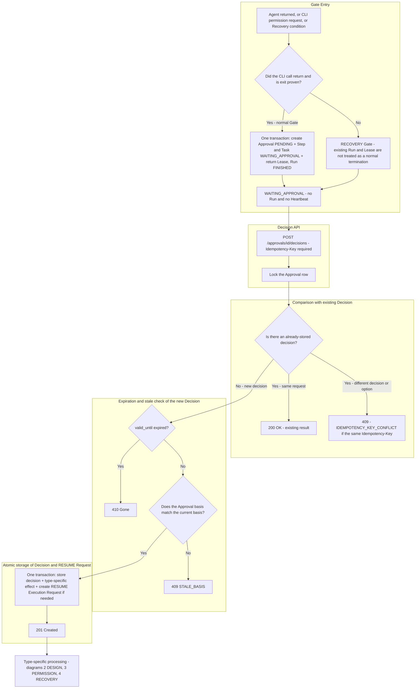
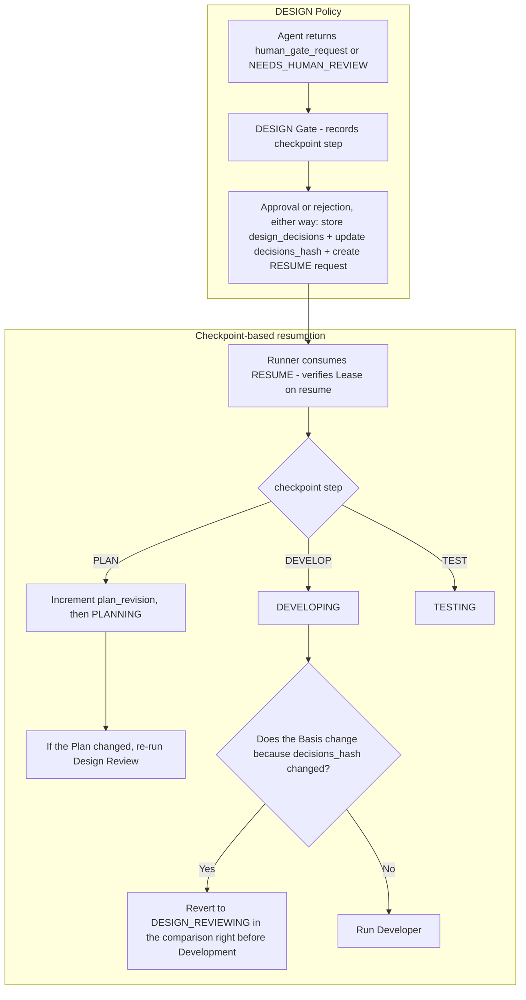
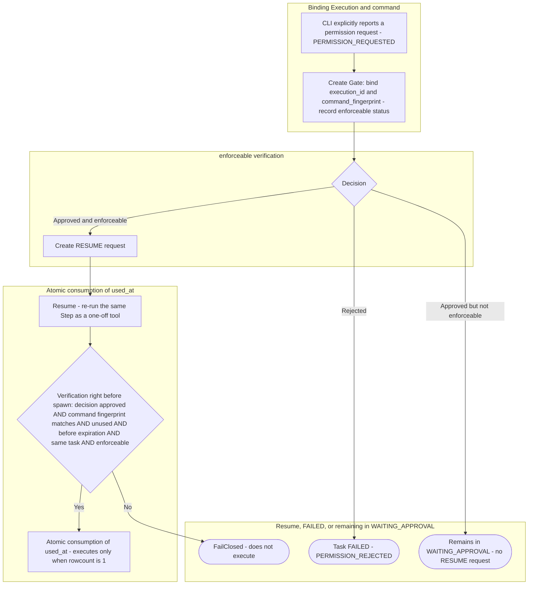
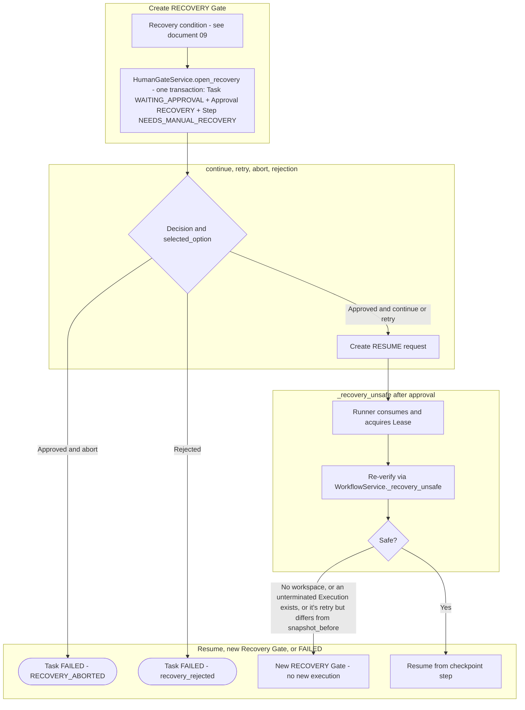
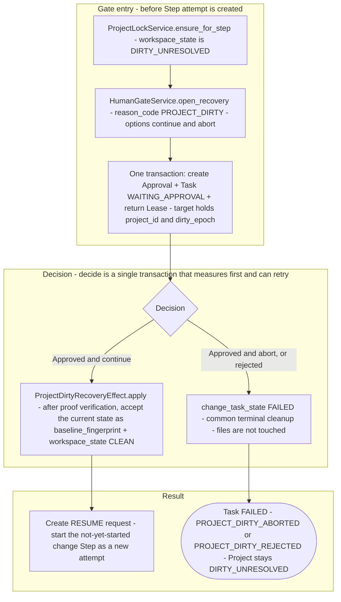

# Human Gate and Approval

> 한국어: [08-human-gate_ko.md](08-human-gate_ko.md)

> This flow is organized based on the current implementation code. Behaviors not confirmed in code or not verified are marked as current implementation limitations.

`approvals.type` has three values, `DESIGN`, `PERMISSION`, and `RECOVERY`, and they have no effect on one another. In particular, DESIGN approval does not expand CLI permissions.

RECOVERY distinguishes its kind by a stable `reason_code` (stored in both `request_payload` and `target`). It is not determined by message string.

- `EXECUTION_UNCERTAIN` (default, including existing Approvals without a `reason_code`): CLI exit / Workspace change safety is uncertain. Options are `continue`/`retry`/`abort`.
- `PROJECT_DIRTY`: a new Task requests a write lock on a Project that has unresolved changes left by a previous Task. The stored options are `continue`/`abort` (no `retry`); the offered options are computed dynamically (section 5 and "Dynamic Options of the PROJECT_DIRTY Gate" below).

This document consists of five diagrams. #1 is the Gate entry and Decision API processing shared by all three types, and #2–5 are the type-specific processing performed after passing the common Decision API. The central class is `HumanGateService` (`open_gate`, `open_recovery`, `decide`, `_apply`). The effect per Recovery kind is handled not by `HumanGateService` but by the injected `RecoveryEffects` (`reason_code → effect`), and `HumanGateService` does not import the Project module.

## 1. Common: Gate Entry and Decision Storage

Shows the entry of a normal Gate and a RECOVERY Gate, the idempotency/expiration/stale checks of `POST /approvals/{approval_id}/decisions`, and the atomic storage of the decision and the RESUME request.

For a normal Gate, after the CLI call returns, Approval creation, Step/Task state change, and Lease return are all processed in one transaction (the mutate of `WorkflowService._enter_gate` and `StepRunner.complete`). The decision and the RESUME Execution Request (`approval_id` UNIQUE) are also stored in a single PostgreSQL transaction. Even if the process terminates right after approval, the request remains and is consumed by the next Runner.

The response codes are as follows.

| Situation | Response |
|---|---|
| New Decision stored | 201 Created |
| Idempotent re-request of the same Decision | 200 OK |
| Different Decision or conflict | 409 |
| Expired new Decision | 410 |
| Stale basis | 409 (`STALE_BASIS`) |

Because comparison with an existing decision is performed before the expiration/stale checks, a re-request for an already-stored decision responds with 200 even after expiration.

For decisions that require a Workspace measurement (`PROJECT_DIRTY` `continue`, and rejections/`abort` that can terminate the Task), `HumanGateService.decide` **first measures the fingerprint proof outside the transaction** and verifies it in a short decision transaction. If the proof has gone stale (`EffectRetry`), the entire decision transaction is rolled back — none of `ApprovalDecision`, Approval `DECIDED`, or the RESUME request is committed — and it re-measures and retries (up to 3 times, as a single logical decision under the same Idempotency-Key). If all 3 attempts fail, it returns 409 `PROJECT_FINGERPRINT_UNSTABLE` and records nothing.

## 2. DESIGN Gate

The DESIGN-specific processing performed after passing the common Decision API. Approval and rejection have the same effect — both are stored as a design decision and resumed from the checkpoint step.

- A DESIGN rejection does not immediately result in FAILED in the current implementation. The rejection is also recorded as a design decision, a RESUME request is created, and it is resumed from the checkpoint step.
- If the Design Reviewer returns `NEEDS_HUMAN_REVIEW`, the checkpoint is `PLAN`, and it resumes to PLANNING. Gates requested by the Developer, Tester, and Code Reviewer have `DEVELOP`/`TEST`/`DEVELOP` checkpoints respectively.
- If the Code Reviewer returns `NEEDS_HUMAN_REVIEW` without a `human_gate_request`, the Orchestrator constructs the request from the reviewer's summary and issues (`accept` / `revise` options).
- Since the decision changes `decisions_hash`, an existing PASS may become invalid in the Basis comparison right before Development ([04](04-planning-review.md)).

## 3. PERMISSION Gate

The PERMISSION-specific processing performed after passing the common Decision API. Approval is bound only to the specific Execution and command, and depending on `enforceable`, it either resumes or remains in `WAITING_APPROVAL`.

- TIMEOUT, IDLE, and ERROR are not assumed to be permission requests. This Gate is only created when `PERMISSION_REQUESTED`.
- Approval is bound only to the specific Execution and command, and is consumed only once. After consumption, even if the CLI fails, it is not reused — a new Gate is required.
- If the installed CLI cannot enforce that one command (`enforceable` is false, e.g., for the Codex role), approval does not expand permissions. In that case, the actual state is as follows.
  - The Decision is stored.
  - The Approval becomes `DECIDED`.
  - No RESUME Execution Request is created.
  - The Task remains in `WAITING_APPROVAL`.
  - There is currently no automatic recovery path out of this state (current implementation limitation).

## 4. RECOVERY Gate

The RECOVERY-specific processing performed after passing the common Decision API. `abort` approval and rejection both terminate as FAILED, and only `continue`/`retry` re-verify safety after RESUME. The Recovery entry conditions are in [09](09-recovery.md).

- RECOVERY approval alone does not mean the existing Run and Lease are treated as normally terminated.
- Safety is re-verified upon resumption. If an unterminated Execution remains, new execution is blocked even after approval, and a new RECOVERY Gate is created.
- Run/Lease handling differs by Recovery entry path ([09](09-recovery.md)).

## 5. RECOVERY Gate - PROJECT_DIRTY

Opens when a Project Task is about to start a change Step while `projects.workspace_state` is `DIRTY_UNRESOLVED`. It opens **before** a Step attempt is created (`ProjectLockService.ensure_for_step`), so there is no `step_id`, and `checkpoint_step_key`/`resume_step_key` retain the Step that was about to start (e.g., `DEVELOP`). Waiting at the Gate does not consume `step_attempt`, `cli_invocations`, or `workflow_iteration`.

- Only one PENDING `PROJECT_DIRTY` Approval can exist for the same Task (a pre-check under a Task row lock, plus the partial unique index `uq_approvals_project_dirty_pending`).
- `continue` simply accepts the current Workspace as the new baseline, and it is offered only while the Project has no unresolved or anomalous tracked execution (otherwise 409 `PROJECT_UNRESOLVED_TRACKED_EXECUTION` or `PROJECT_TRACKED_EXECUTION_ANOMALY` at the baseline guard). If the Project has already become `CLEAN` via a different decision, the baseline is left untouched and it only resumes. If `dirty_epoch` has changed since the gate was opened, `continue` is no longer offered (`refresh_gate` and `abort` are); a decision that still reaches the epoch check returns 409 `STALE_PROJECT_GATE`.
- `abort` and rejection do not `reset`/`clean`/`checkout`/delete Project files. This Task becomes `FAILED` and the Project remains `DIRTY_UNRESOLVED`, so the only way back to `CLEAN` is `continue` on this Gate, once no unresolved or anomalous tracked execution remains (it cannot be cleared via `PATCH /projects/{id}`).
- The effect differs from `EXECUTION_UNCERTAIN`. The latter's `retry` re-verifies the Workspace change via `_recovery_unsafe`, but `PROJECT_DIRTY` has no `retry` option, and `continue` only performs baseline acceptance.

## Dynamic Options of the PROJECT_DIRTY Gate

The offered options of a PROJECT_DIRTY gate are computed, not fixed. `dirty_gate_options.compute_gate_options` is the one computation behind both the decision (validating the submitted option) and the reads (`GET` of the approval returns `options` and `options_hidden`, one reason code per hidden option), so they cannot disagree. Offered risk options carry `risk: HIGH`.

| Situation | Offered | Hidden option reasons (examples) |
|---|---|---|
| Task and Project link broken | none | `TASK_PROJECT_LINK_BROKEN` |
| Project `CLEAN` | `continue`, `abort` | |
| Project `DIRTY_UNRESOLVED`, gate `dirty_epoch` is stale | `refresh_gate`, `abort` | |
| `DIRTY_UNRESOLVED`, current epoch | `abort` always; `continue` only with no unresolved (U) and no anomalous (A) tracked execution; `accept_unproven_risk` when U is not empty, no live process was observed and a bounded scan finds target rows, none of which lacks a `pid`; `recheck_processes` only while alive-blocked | `TRACKED_ANOMALY_PRESENT`, `UNRESOLVED_ROWS_PRESENT`, `NO_UNRESOLVED_ROWS`, `ALIVE_BLOCKED`, `NO_ELIGIBLE_TARGETS`, `TARGET_WITHOUT_PID`, `ACTIVE_RECHECK`, `COOLDOWN`, `RATE_LIMIT_WINDOW`, `TARGET_SCAN_ROW_LIMIT_REACHED`, `TARGET_SCAN_TIME_LIMIT_REACHED`, `TARGET_PAGE_TIMEOUT`, `TARGET_QUERY_FAILED`, `TARGET_CLASSIFICATION_ERROR` |

- **Alive-blocked**: the latest process-risk observation that overlaps the unresolved rows ended `REFUSED_ALIVE` (a live process was found). `accept_unproven_risk` is then hidden (`ALIVE_BLOCKED`) and `recheck_processes` becomes available subject to its limits. After a finished recheck the next one waits `min(900, 60*2^(streak-1))` seconds (`COOLDOWN`, `next_available_at` is returned), where `streak` counts the consecutive `REFUSED_ALIVE` rechecks of the current epoch; at most 4 rechecks fit in 3600 seconds (`RATE_LIMIT_WINDOW`); only one recheck per project and epoch may be active (`ACTIVE_RECHECK`).
- **Decision**: an option that is not currently offered returns 409 `OPTION_NOT_AVAILABLE` (with `reason_code` and `retryable`). The two risk options require a `rationale` (non-blank, at most 2000 characters after trimming and NFC normalization, no control character except newline and tab; 422 otherwise) and accept an optional `requested_by` (a claimed identity, 1 to 128 characters of `[A-Za-z0-9._@:+-]`, only with a risk option; it is part of the idempotency fingerprint). For `accept_unproven_risk` the decision transaction re-reads the current targets and re-evaluates the same eligibility as the options read: a target without a valid `pid` is 409 `OPTION_NOT_AVAILABLE` (`TARGET_WITHOUT_PID`) and nothing is written. The decision transaction inserts ONE `process_risk_requests` row (request id = approval id, kind `ACCEPT` or `RECHECK`, a locked snapshot of the target rows, the current dirty epoch). It creates no RESUME request and makes no OS call; the Task stays `WAITING_APPROVAL`. `refresh_gate` opens a new gate at the current epoch (no RESUME).
- **Verification** (`ProcessRiskWorker`, background unit `risk-worker`, [03](03-task-runner.md)): it claims a request (`REQUESTED` to `VERIFYING`), verifies the targets outside any transaction, then writes one fenced result. Rows proven gone get their true proof even when another row is alive. A live process gives `REFUSED_ALIVE` (`LIVE_PROCESS_PRESENT`) and accepts nothing. For `ACCEPT` with no live process, the rows that stay unprovable get the disposition `OPERATOR_RISK_ACCEPTED` with a `risk_acceptance` record (approval id, execution id, `pid`, `create_time`, rationale, `reverify_result`, times, `requested_by` if given). For `RECHECK`, rows that stay unprovable give `NEEDS_REDECISION` (`NO_LIVE_PROCESS_UNPROVEN`). A verification error gives `RETRYABLE` with a capped backoff and, after the maximum attempts, `NEEDS_REDECISION` (`PROCESS_RECHECK_INCONCLUSIVE`). An anomalous row is never a risk target. Applying a request does not make the Project `CLEAN`; only `continue` does.
- **RESUME creation rule**: only a request that ends `APPLIED` creates the RESUME request (`add_resume_if_absent`, unique per approval). `REFUSED_ALIVE` and `NEEDS_REDECISION` open a follow-up gate instead (a new PROJECT_DIRTY gate at the current epoch, or an `EXECUTION_UNCERTAIN` gate for the inconsistent-link codes `APPROVAL_NOT_APPLICABLE` and `TASK_PROJECT_MISMATCH`), and only while the Task is still `WAITING_APPROVAL`, has no PENDING approval of any type and the approval has no lineage successor.
- **Consuming the RESUME** (`WorkflowService._resume_from_approval`, one transaction; `ResumeOutcome` action `RESUME`, `PARKED`, `IDEMPOTENT_DONE` or `FAIL_CLOSED`, acted on by `run_task` after the commit): a missing approval or decision, a Task and Project mismatch of a risk approval, a RESUME that is not this approval's (`RESUME_REQUEST_MISMATCH`) or a missing matching request (`RISK_REQUEST_NOT_APPLICABLE`) are `FAIL_CLOSED`: `run_task` raises `FailClosed` and the Task ends `FAILED` (`FAIL_CLOSED`). A Task that is no longer waiting is `IDEMPOTENT_DONE`. A PENDING gate that already exists, a failed `_recovery_unsafe` re-check, a request that is not `APPLIED` (`RISK_REQUEST_NOT_APPLIED`), a changed dirty epoch (`DIRTY_EPOCH_CHANGED`), a changed execution identity (`EXECUTION_IDENTITY_CHANGED`), `REFUSED_ALIVE` (`LIVE_PROCESS_PRESENT`) or `NEEDS_REDECISION` park the Task on a gate and release the Lease. Only an `APPLIED` request at the same epoch with unchanged identities resumes the Task.
- **Approval lineage** (`approval_lineage.py`): a follow-up gate carries `supersedes_approval_id`, `lineage_root_id`, `lineage_dirty_epoch` and `lineage_origin` (`HANDLER`, `WORKER`, `REFRESH_GATE`, `ENSURE_FOR_STEP`, `LINEAGE_CONFLICT`), written once when the gate is inserted and never updated. At most one direct successor per approval exists (`uq_approvals_lineage_successor`); the successor is found by that link only. An existing successor makes a repeated consumption `IDEMPOTENT_DONE` (`IDEMPOTENT_SUCCESSOR`); several successors open one root gate (`APPROVAL_LINEAGE_CONFLICT`) without picking one.

## Comparison of Decision Outcomes by Type

| Type | Approval | Rejection | Notes |
|---|---|---|---|
| DESIGN | Decision stored + RESUME | Decision stored + RESUME (not FAILED) | Resumes from checkpoint step |
| PERMISSION | RESUME if `enforceable`, otherwise only the decision is stored and it remains in `WAITING_APPROVAL` | Task FAILED (`PERMISSION_REJECTED`) | Approval is consumed once |
| RECOVERY (`EXECUTION_UNCERTAIN`) | `continue`/`retry` → RESUME then `_recovery_unsafe`; `abort` → FAILED (`RECOVERY_ABORTED`) | Task FAILED (`recovery_rejected`) | Safety re-verified before resuming |
| RECOVERY (`PROJECT_DIRTY`) | `continue` → baseline acceptance + RESUME; `abort` → FAILED (`PROJECT_DIRTY_ABORTED`) | Task FAILED (`PROJECT_DIRTY_REJECTED`) | No `retry` option, files unchanged |
| RECOVERY (`PROJECT_DIRTY`, `accept_unproven_risk` / `recheck_processes`) | One `process_risk_requests` row, no RESUME yet; RESUME only when the request ends `APPLIED` | Task FAILED (`PROJECT_DIRTY_REJECTED`) | Verified by `ProcessRiskWorker`; refused or redecided requests open a follow-up gate |

## Current Implementation Limitations

- Verification scope of the risk-acceptance flow: **verified** by the embedded PostgreSQL integration tests, with real short-lived processes on Windows for the process verdicts; the POSIX policy exists in code only (no tracked rows are written there) and POSIX runtime behaviour is **not verified**. **Not verified**: POSIX runtime, real Gradle/Maven builds, real CLI E2E, random race stress, EXPLAIN/generic plan, real deadlock tests (the Task, Project, request row, target rows lock order is a design rule).
- A row judged `SPAWNED_PROCESS_UNPROVEN` (no `pid`, but the row records a spawned process that was not proven gone, or the executor still retains its Job, [07](07-lease.md)) is **not resolved by a restart; there is currently no supported resolution path**. As an unresolved row it is a target, so `continue` is hidden. A valid `risk_acceptance` record names the row's `pid`, so when any target of one accept request has no valid `pid` the gate hides `accept_unproven_risk` for the whole target set (`options_hidden` reason `TARGET_WITHOUT_PID`, not retryable); a mixed set is never partially accepted. The decision re-reads the current targets in its own transaction, so a direct submit (for example by a client holding an older options response) is rejected with 409 `OPTION_NOT_AVAILABLE` (`reason_code` `TARGET_WITHOUT_PID`) and nothing is written: no `process_risk_requests` row, no closed target row, no `risk_acceptance` record and no RESUME request; the approval stays pending and the Project state is unchanged. The one eligibility rule is shared with the classifier (`risk_acceptance_pid_valid`). Only `abort` remains, and it must be told apart from clearing the Project: `abort` terminates the Task (`FAILED`, `PROJECT_DIRTY_ABORTED`) but does **not** clear `DIRTY_UNRESOLVED`, because a DIRTY Project has no write owner and the terminal release therefore changes nothing. The Project leaves `DIRTY_UNRESOLVED` only through `continue` (accept the baseline), which requires that the Project has no unresolved and no anomalous tracked execution. That condition is not reachable through the gate for a pid-less row, and the sweeper and the takeover keep the row open, so the row can only be settled by cleaning up the process by hand and then repairing the database manually (`tests/integration_pg/test_pidless_unproven_resolution.py`). Not verified, separate follow-up item: a Windows integration test of a pid-less row after a Runner restart (the `KILL_ON_JOB_CLOSE` assumption). Open decision (semantics unchanged): whether an acceptance record without `pid` should be allowed.
- An anomalous tracked row (`TRACKED_EXECUTION_ANOMALY`) has no operator option at all; `continue` stays hidden while one exists.
- The one-time permission of PERMISSION is enforced only by the exact `--allowedTools` pattern for the Claude role. The Codex role has no enforcement means, so it is recorded as `enforceable=false`; even if approved, no RESUME is created and the Task remains in `WAITING_APPROVAL`. There is no path to automatically recover from this state.
- The actual shape of the Codex approval event has not been empirically measured. This is an estimated implementation that treats events whose names contain `approval` as permission requests.
