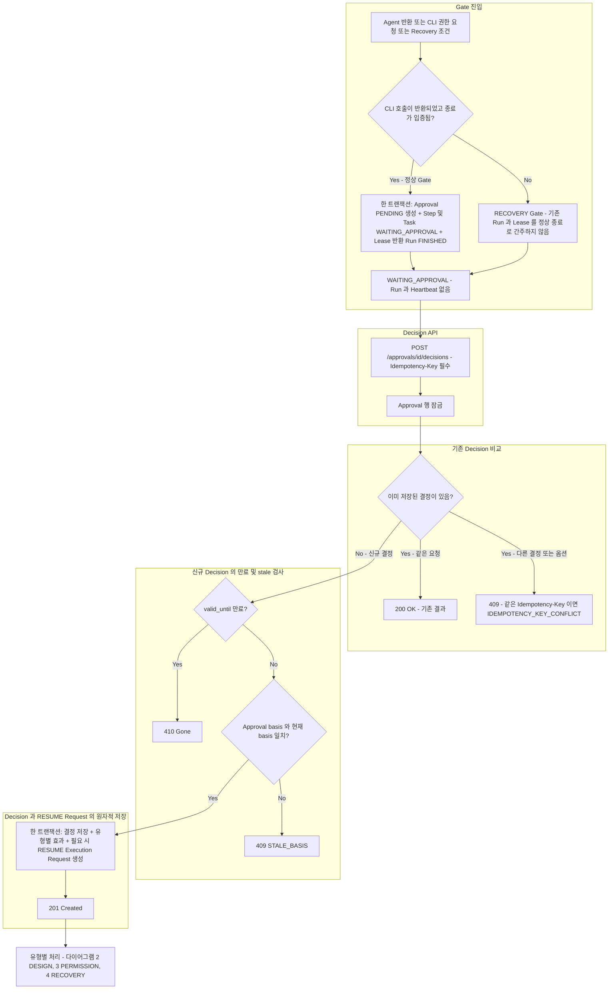
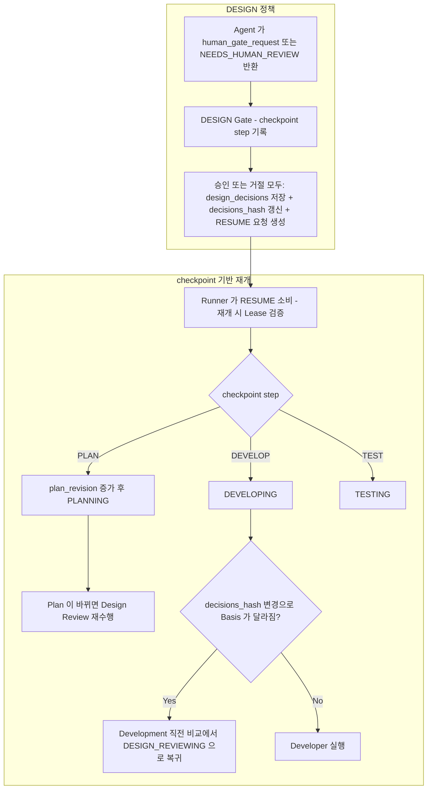
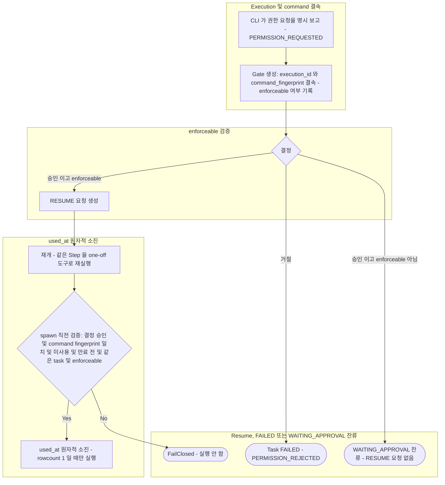
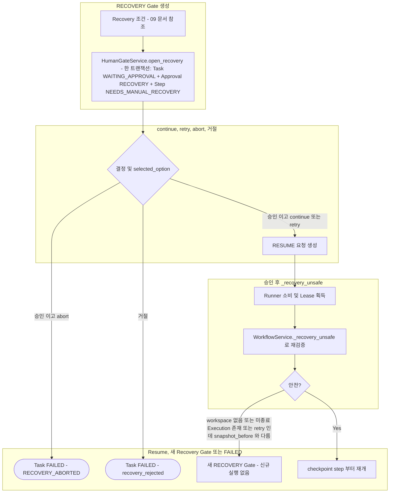
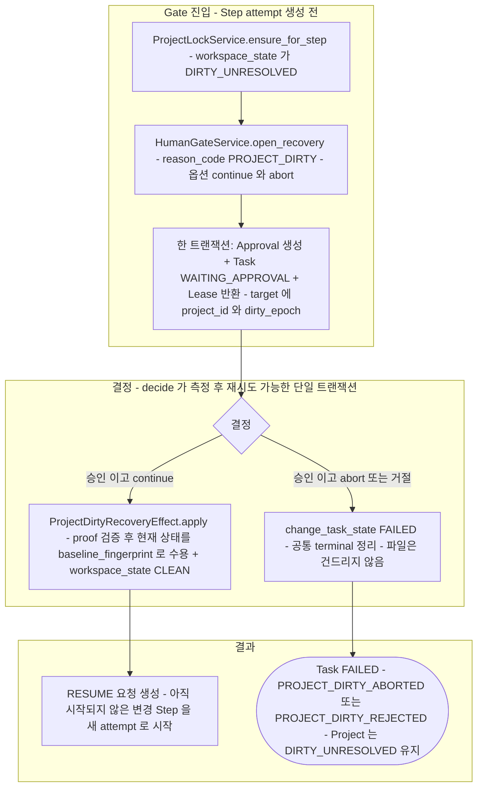

# Human Gate 및 Approval

> English: [08-human-gate.md](08-human-gate_ko.md)

> 현재 구현 코드를 기준으로 정리한 흐름입니다. 코드로 확인되지 않았거나 검증되지 않은 동작은 현재 구현 제한으로 구분합니다.

`approvals.type`은 `DESIGN`, `PERMISSION`, `RECOVERY` 세 가지이며 서로의 효력을 갖지 않습니다. 특히 DESIGN 승인은 CLI 권한을 확대하지 않습니다.

RECOVERY는 안정적인 `reason_code`(`request_payload`와 `target`에 모두 저장)로 종류를 구분합니다. 메시지 문자열로 판별하지 않습니다.

- `EXECUTION_UNCERTAIN`(기본값, `reason_code`가 없는 기존 Approval 포함): CLI 종료·Workspace 변경 안전성 불확실. 옵션 `continue`/`retry`/`abort`.
- `PROJECT_DIRTY`: 이전 Task가 남긴 미해결 변경이 있는 Project에서 새 Task가 write lock을 요청. 옵션 `continue`/`abort`(`retry` 없음). 아래 5번 절.

이 문서는 다섯 개의 다이어그램으로 구성됩니다. 1번은 세 유형이 공유하는 Gate 진입과 Decision API 처리이고, 2~5번은 공통 Decision API를 통과한 뒤 수행되는 유형별 처리입니다. 중심 클래스는 `HumanGateService`(`open_gate`, `open_recovery`, `decide`, `_apply`)입니다. Recovery 종류별 효과는 `HumanGateService`가 아니라 주입된 `RecoveryEffects`(`reason_code → effect`)가 담당하며, `HumanGateService`는 Project 모듈을 import하지 않습니다.

## 1. 공통: Gate 진입 및 결정 저장

정상 Gate와 RECOVERY Gate의 진입, `POST /approvals/{approval_id}/decisions`의 멱등·만료·stale 검사, 결정과 RESUME 요청의 원자적 저장을 보여줍니다.

정상 Gate는 CLI 호출이 반환된 뒤 Approval 생성, Step/Task 상태 변경, Lease 반환이 한 트랜잭션(`WorkflowService._enter_gate`, `StepRunner.complete`의 mutate)에서 처리됩니다. 결정과 RESUME Execution Request(`approval_id` UNIQUE)도 하나의 PostgreSQL 트랜잭션에서 저장됩니다. 승인 직후 프로세스가 종료되어도 요청이 남아 다음 Runner가 소비합니다.

응답 코드는 다음과 같습니다.

| 상황 | 응답 |
|---|---|
| 신규 Decision 저장 | 201 Created |
| 동일 Decision의 멱등 재요청 | 200 OK |
| 다른 Decision 또는 충돌 | 409 |
| 만료된 신규 Decision | 410 |
| stale basis | 409 (`STALE_BASIS`) |

기존 결정과의 비교가 만료·stale 검사보다 먼저 수행되므로 이미 저장된 결정에 대한 재요청은 만료 뒤에도 200으로 응답합니다.

`HumanGateService.decide`는 Workspace 측정이 필요한 결정(PROJECT_DIRTY `continue`, 그리고 Task를 종료시킬 수 있는 거절·`abort`)에 한해 **트랜잭션 밖에서 먼저 fingerprint proof를 측정**하고 짧은 결정 트랜잭션에서 검증합니다. proof가 오래되었으면(`EffectRetry`) 결정 트랜잭션 전체가 롤백되어 `ApprovalDecision`, Approval `DECIDED`, RESUME 요청이 하나도 커밋되지 않은 채 다시 측정해 재시도합니다(최대 3회, 같은 Idempotency-Key의 하나의 논리 결정). 3회 모두 실패하면 409 `PROJECT_FINGERPRINT_UNSTABLE`이고 아무 것도 기록하지 않습니다.

## 2. DESIGN Gate

공통 Decision API를 통과한 뒤의 DESIGN 전용 처리입니다. 승인과 거절은 효과가 같으며 모두 설계 결정으로 저장되고 checkpoint 단계부터 재개됩니다.

- DESIGN 거절은 현재 구현에서 즉시 FAILED가 아닙니다. 거절도 설계 결정으로 기록되고 RESUME 요청이 생성되어 checkpoint 단계부터 재개됩니다.
- Design Reviewer가 `NEEDS_HUMAN_REVIEW`를 반환한 경우 checkpoint는 `PLAN`이며 PLANNING으로 재개됩니다. Developer·Tester·Code Reviewer가 요청한 Gate는 각각 `DEVELOP`/`TEST`/`DEVELOP` checkpoint를 가집니다.
- Code Reviewer가 `human_gate_request` 없이 `NEEDS_HUMAN_REVIEW`를 반환하면 Orchestrator가 reviewer의 summary와 issues로 요청을 구성합니다 (`accept` / `revise` 옵션).
- 결정이 `decisions_hash`를 바꾸므로 이후 Development 직전 Basis 비교에서 기존 PASS는 무효가 될 수 있습니다 ([04](04-planning-review_ko.md)).

## 3. PERMISSION Gate

공통 Decision API를 통과한 뒤의 PERMISSION 전용 처리입니다. 승인은 해당 Execution과 명령에만 결속되며, `enforceable` 여부에 따라 재개되거나 `WAITING_APPROVAL`에 남습니다.

- TIMEOUT, IDLE, ERROR는 권한 요청으로 추정하지 않습니다. `PERMISSION_REQUESTED`일 때만 이 Gate가 만들어집니다.
- 승인은 해당 Execution과 명령에만 결속되고 한 번만 소진됩니다. 소진 후 CLI가 실패해도 재사용하지 않으며 새 Gate가 필요합니다.
- 설치된 CLI가 해당 명령 1건을 강제할 수 없으면(`enforceable` 거짓, 예: Codex 역할) 승인되어도 권한을 확대하지 않습니다. 이때 실제 상태는 다음과 같습니다.
  - Decision은 저장됩니다.
  - Approval은 `DECIDED`가 됩니다.
  - RESUME Execution Request는 생성되지 않습니다.
  - Task는 `WAITING_APPROVAL`에 남습니다.
  - 현재 이 상태에서 빠져나오는 자동 복구 경로가 없습니다 (현재 구현 제한).

## 4. RECOVERY Gate

공통 Decision API를 통과한 뒤의 RECOVERY 전용 처리입니다. `abort` 승인과 거절은 FAILED로 종료되고, `continue`/`retry`만 RESUME 후 안전성을 다시 검증합니다. Recovery 진입 조건은 [09](09-recovery_ko.md)에 있습니다.

- RECOVERY 승인만으로 기존 Run과 Lease가 정상 종료된 것으로 간주되지 않습니다.
- 재개 시 안전성은 다시 검증됩니다. 미종료 Execution이 남아 있으면 승인 후에도 신규 실행을 차단하고 새 RECOVERY Gate를 만듭니다.
- Recovery 진입 경로별로 Run/Lease 처리가 다릅니다 ([09](09-recovery_ko.md)).

## 5. RECOVERY Gate - PROJECT_DIRTY

프로젝트 Task가 변경 Step을 시작하려는데 `projects.workspace_state`가 `DIRTY_UNRESOLVED`일 때 열립니다. Step attempt가 만들어지기 **전**(`ProjectLockService.ensure_for_step`)에 열리므로 `step_id`는 없고, `checkpoint_step_key`·`resume_step_key`에 시작하려던 Step(예: `DEVELOP`)이 남습니다. Gate 대기는 `step_attempt`, `cli_invocations`, `workflow_iteration`을 소모하지 않습니다.

- 같은 Task에는 PENDING `PROJECT_DIRTY` Approval이 하나만 존재합니다(Task 행 잠금 아래 사전 조회 + 부분 unique index `uq_approvals_project_dirty_pending`).
- `continue`는 현재 Workspace를 새 baseline으로 받아들일 뿐입니다. 이미 다른 결정으로 Project가 `CLEAN`이 되었다면 baseline을 건드리지 않고 재개만 합니다. gate 이후 `dirty_epoch`가 달라졌으면 409 `STALE_PROJECT_GATE`입니다.
- `abort`와 거절은 Project 파일을 `reset`/`clean`/`checkout`/삭제하지 않습니다. 이 Task는 `FAILED`가 되고 Project는 계속 `DIRTY_UNRESOLVED`이므로, 해결 경로는 이 Gate의 `continue`뿐입니다(`PATCH /projects/{id}`로는 해제할 수 없습니다).
- `EXECUTION_UNCERTAIN`과 효과가 다릅니다. 후자의 `retry`는 `_recovery_unsafe`로 Workspace 변화를 재검증하지만, `PROJECT_DIRTY`에는 `retry` 옵션이 없고 `continue`는 baseline 수용만 수행합니다.

## 유형별 결정 결과 비교

| 유형 | 승인 | 거절 | 비고 |
|---|---|---|---|
| DESIGN | 결정 저장 + RESUME | 결정 저장 + RESUME (FAILED 아님) | checkpoint 단계부터 재개 |
| PERMISSION | `enforceable`이면 RESUME, 아니면 결정만 저장하고 `WAITING_APPROVAL` 잔류 | Task FAILED (`PERMISSION_REJECTED`) | 승인은 1회 소진 |
| RECOVERY (`EXECUTION_UNCERTAIN`) | `continue`/`retry`는 RESUME 후 `_recovery_unsafe`, `abort`는 FAILED (`RECOVERY_ABORTED`) | Task FAILED (`recovery_rejected`) | 재개 전 안전성 재검증 |
| RECOVERY (`PROJECT_DIRTY`) | `continue`는 baseline 수용 + RESUME, `abort`는 FAILED (`PROJECT_DIRTY_ABORTED`) | Task FAILED (`PROJECT_DIRTY_REJECTED`) | `retry` 옵션 없음, 파일 무변경 |

## 현재 구현 제한

- PERMISSION의 일회성 권한은 Claude 역할의 `--allowedTools` 정확 패턴으로만 강제됩니다. Codex 역할은 강제 수단이 없어 `enforceable=false`로 기록되며, 승인해도 RESUME이 생성되지 않고 Task가 `WAITING_APPROVAL`에 남습니다. 이 상태에서 자동으로 복구하는 경로는 없습니다.
- Codex 승인 이벤트의 실제 형태는 실측하지 못했습니다. `approval`이 이름에 들어간 이벤트를 권한 요청으로 취급하는 추정 구현입니다.
