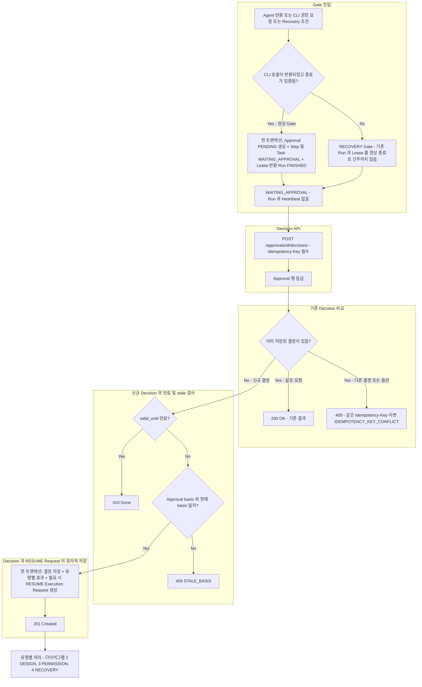
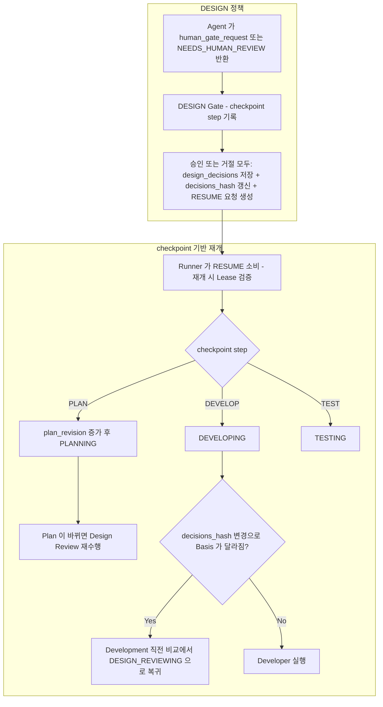
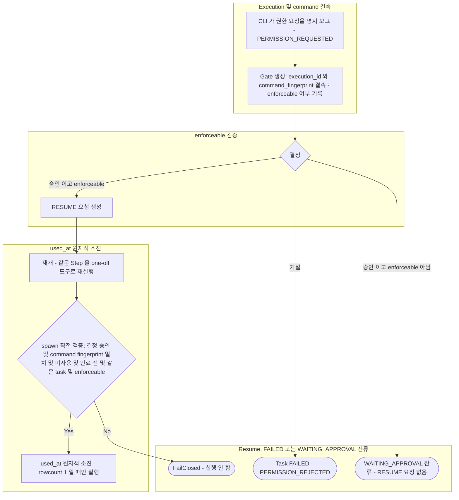
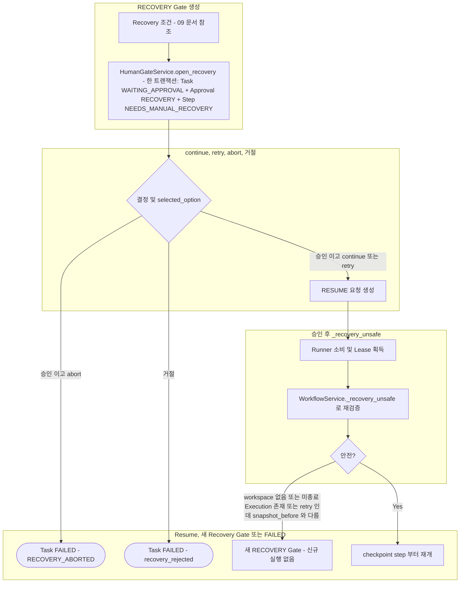
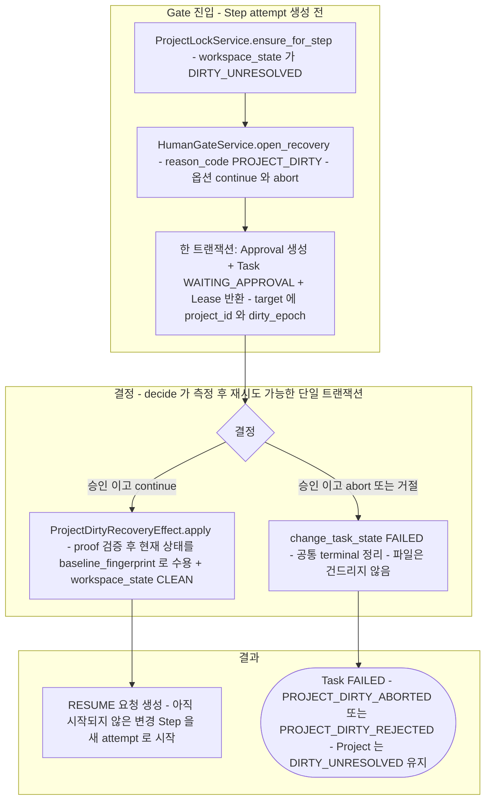

# Human Gate 및 Approval

> English: [08-human-gate.md](08-human-gate.md)

> 현재 구현 코드를 기준으로 정리한 흐름입니다. 코드로 확인되지 않았거나 검증되지 않은 동작은 현재 구현 제한으로 구분합니다.

`approvals.type`은 `DESIGN`, `PERMISSION`, `RECOVERY` 세 가지이며 서로의 효력을 갖지 않습니다. 특히 DESIGN 승인은 CLI 권한을 확대하지 않습니다.

RECOVERY는 안정적인 `reason_code`(`request_payload`와 `target`에 모두 저장)로 종류를 구분합니다. 메시지 문자열로 판별하지 않습니다.

- `EXECUTION_UNCERTAIN`(기본값, `reason_code`가 없는 기존 Approval 포함): CLI 종료·Workspace 변경 안전성 불확실. 옵션 `continue`/`retry`/`abort`.
- `PROJECT_DIRTY`: 이전 Task가 남긴 미해결 변경이 있는 Project에서 새 Task가 write lock을 요청. 저장되는 옵션은 `continue`/`abort`(`retry` 없음)이며, 실제로 제시되는 옵션은 동적으로 계산됩니다(아래 5번 절과 「PROJECT_DIRTY Gate의 동적 옵션」).

이 문서는 다섯 개의 다이어그램으로 구성됩니다. 1번은 세 유형이 공유하는 Gate 진입과 Decision API 처리이고, 2~5번은 공통 Decision API를 통과한 뒤 수행되는 유형별 처리입니다. 중심 클래스는 `HumanGateService`(`open_gate`, `open_recovery`, `decide`, `_apply`)입니다. Recovery 종류별 효과는 `HumanGateService`가 아니라 주입된 `RecoveryEffects`(`reason_code → effect`)가 담당하며, `HumanGateService`는 Project 모듈을 import하지 않습니다.

## 1. 공통: Gate 진입 및 결정 저장

정상 Gate와 RECOVERY Gate의 진입, `POST /approvals/{approval_id}/decisions`의 멱등·만료·stale 검사, 결정과 RESUME 요청의 원자적 저장을 보여줍니다.

정상 Gate는 CLI 호출이 반환된 뒤 Approval 생성, Step/Task 상태 변경, Lease 반환이 한 트랜잭션(`WorkflowService._enter_gate`, `StepRunner.complete`의 mutate)에서 처리됩니다. 결정과 RESUME Execution Request(`approval_id` UNIQUE)도 하나의 PostgreSQL 트랜잭션에서 저장됩니다. 승인 직후 프로세스가 종료되어도 요청이 남아 다음 Runner가 소비합니다.

응답 코드는 다음과 같습니다.

| 상황 | 응답 |
|---|---|
| 신규 Decision 저장 | 201 Created |
| 동일 Decision의 멱등 재요청 | 200 OK |
| 다른 Decision 또는 충돌 | 409 |
| 만료된 신규 Decision | 410 |
| stale basis | 409 (`STALE_BASIS`) |

기존 결정과의 비교가 만료·stale 검사보다 먼저 수행되므로 이미 저장된 결정에 대한 재요청은 만료 뒤에도 200으로 응답합니다.

`HumanGateService.decide`는 Workspace 측정이 필요한 결정(PROJECT_DIRTY `continue`, 그리고 Task를 종료시킬 수 있는 거절·`abort`)에 한해 **트랜잭션 밖에서 먼저 fingerprint proof를 측정**하고 짧은 결정 트랜잭션에서 검증합니다. proof가 오래되었으면(`EffectRetry`) 결정 트랜잭션 전체가 롤백되어 `ApprovalDecision`, Approval `DECIDED`, RESUME 요청이 하나도 커밋되지 않은 채 다시 측정해 재시도합니다(최대 3회, 같은 Idempotency-Key의 하나의 논리 결정). 3회 모두 실패하면 409 `PROJECT_FINGERPRINT_UNSTABLE`이고 아무 것도 기록하지 않습니다.

## 2. DESIGN Gate

공통 Decision API를 통과한 뒤의 DESIGN 전용 처리입니다. 승인과 거절은 효과가 같으며 모두 설계 결정으로 저장되고 checkpoint 단계부터 재개됩니다.

- DESIGN 거절은 현재 구현에서 즉시 FAILED가 아닙니다. 거절도 설계 결정으로 기록되고 RESUME 요청이 생성되어 checkpoint 단계부터 재개됩니다.
- Design Reviewer가 `NEEDS_HUMAN_REVIEW`를 반환한 경우 checkpoint는 `PLAN`이며 PLANNING으로 재개됩니다. Developer·Tester·Code Reviewer가 요청한 Gate는 각각 `DEVELOP`/`TEST`/`DEVELOP` checkpoint를 가집니다.
- Code Reviewer가 `human_gate_request` 없이 `NEEDS_HUMAN_REVIEW`를 반환하면 Orchestrator가 reviewer의 summary와 issues로 요청을 구성합니다 (`accept` / `revise` 옵션).
- 결정이 `decisions_hash`를 바꾸므로 이후 Development 직전 Basis 비교에서 기존 PASS는 무효가 될 수 있습니다 ([04](04-planning-review_ko.md)).

## 3. PERMISSION Gate

공통 Decision API를 통과한 뒤의 PERMISSION 전용 처리입니다. 승인은 해당 Execution과 명령에만 결속되며, `enforceable` 여부에 따라 재개되거나 `WAITING_APPROVAL`에 남습니다.

- TIMEOUT, IDLE, ERROR는 권한 요청으로 추정하지 않습니다. `PERMISSION_REQUESTED`일 때만 이 Gate가 만들어집니다.
- 승인은 해당 Execution과 명령에만 결속되고 한 번만 소진됩니다. 소진 후 CLI가 실패해도 재사용하지 않으며 새 Gate가 필요합니다.
- 설치된 CLI가 해당 명령 1건을 강제할 수 없으면(`enforceable` 거짓, 예: Codex 역할) 승인되어도 권한을 확대하지 않습니다. 이때 실제 상태는 다음과 같습니다.
  - Decision은 저장됩니다.
  - Approval은 `DECIDED`가 됩니다.
  - RESUME Execution Request는 생성되지 않습니다.
  - Task는 `WAITING_APPROVAL`에 남습니다.
  - 현재 이 상태에서 빠져나오는 자동 복구 경로가 없습니다 (현재 구현 제한).

## 4. RECOVERY Gate

공통 Decision API를 통과한 뒤의 RECOVERY 전용 처리입니다. `abort` 승인과 거절은 FAILED로 종료되고, `continue`/`retry`만 RESUME 후 안전성을 다시 검증합니다. Recovery 진입 조건은 [09](09-recovery_ko.md)에 있습니다.

- RECOVERY 승인만으로 기존 Run과 Lease가 정상 종료된 것으로 간주되지 않습니다.
- 재개 시 안전성은 다시 검증됩니다. 미종료 Execution이 남아 있으면 승인 후에도 신규 실행을 차단하고 새 RECOVERY Gate를 만듭니다.
- Recovery 진입 경로별로 Run/Lease 처리가 다릅니다 ([09](09-recovery_ko.md)).

## 5. RECOVERY Gate - PROJECT_DIRTY

프로젝트 Task가 변경 Step을 시작하려는데 `projects.workspace_state`가 `DIRTY_UNRESOLVED`일 때 열립니다. Step attempt가 만들어지기 **전**(`ProjectLockService.ensure_for_step`)에 열리므로 `step_id`는 없고, `checkpoint_step_key`·`resume_step_key`에 시작하려던 Step(예: `DEVELOP`)이 남습니다. Gate 대기는 `step_attempt`, `cli_invocations`, `workflow_iteration`을 소모하지 않습니다.

- 같은 Task에는 PENDING `PROJECT_DIRTY` Approval이 하나만 존재합니다(Task 행 잠금 아래 사전 조회 + 부분 unique index `uq_approvals_project_dirty_pending`).
- `continue`는 현재 Workspace를 새 baseline으로 받아들일 뿐이며, Project에 미해결 또는 이상(anomaly) tracked execution이 없을 때만 제시됩니다(그렇지 않으면 baseline guard에서 409 `PROJECT_UNRESOLVED_TRACKED_EXECUTION` 또는 `PROJECT_TRACKED_EXECUTION_ANOMALY`). 이미 다른 결정으로 Project가 `CLEAN`이 되었다면 baseline을 건드리지 않고 재개만 합니다. gate 이후 `dirty_epoch`가 달라졌으면 `continue`는 더 이상 제시되지 않으며(`refresh_gate`와 `abort`가 제시됨), 그래도 epoch 검사에 도달한 결정은 409 `STALE_PROJECT_GATE`입니다.
- `abort`와 거절은 Project 파일을 `reset`/`clean`/`checkout`/삭제하지 않습니다. 이 Task는 `FAILED`가 되고 Project는 계속 `DIRTY_UNRESOLVED`이므로, `CLEAN`으로 돌아가는 유일한 경로는, 미해결 또는 이상 tracked execution이 남아 있지 않을 때 이 Gate의 `continue`뿐입니다(`PATCH /projects/{id}`로는 해제할 수 없습니다).
- `EXECUTION_UNCERTAIN`과 효과가 다릅니다. 후자의 `retry`는 `_recovery_unsafe`로 Workspace 변화를 재검증하지만, `PROJECT_DIRTY`에는 `retry` 옵션이 없고 `continue`는 baseline 수용만 수행합니다.

## PROJECT_DIRTY Gate의 동적 옵션

PROJECT_DIRTY gate에서 제시되는 옵션은 고정이 아니라 계산됩니다. `dirty_gate_options.compute_gate_options`가 결정(제출된 옵션 검증)과 조회(승인의 `GET`이 `options`와 `options_hidden`을 반환하며 숨긴 옵션마다 reason code 하나)의 공통 계산이므로 둘이 어긋날 수 없습니다. 제시되는 위험 옵션에는 `risk: HIGH`가 붙습니다.

| 상황 | 제시 | 숨긴 옵션의 reason (예) |
|---|---|---|
| Task와 Project 연결이 깨짐 | 없음 | `TASK_PROJECT_LINK_BROKEN` |
| Project `CLEAN` | `continue`, `abort` | |
| Project `DIRTY_UNRESOLVED`, gate의 `dirty_epoch`가 오래됨 | `refresh_gate`, `abort` | |
| `DIRTY_UNRESOLVED`, 현재 epoch | `abort`는 항상, `continue`는 미해결(U)·이상(A) tracked execution이 모두 없을 때만, `accept_unproven_risk`는 U가 비어 있지 않고 살아 있는 프로세스가 관찰되지 않았으며 제한된 scan이 대상 행을 찾고 그중 `pid`가 없는 행이 없을 때, `recheck_processes`는 alive-blocked일 때만 | `TRACKED_ANOMALY_PRESENT`, `UNRESOLVED_ROWS_PRESENT`, `NO_UNRESOLVED_ROWS`, `ALIVE_BLOCKED`, `NO_ELIGIBLE_TARGETS`, `TARGET_WITHOUT_PID`, `ACTIVE_RECHECK`, `COOLDOWN`, `RATE_LIMIT_WINDOW`, `TARGET_SCAN_ROW_LIMIT_REACHED`, `TARGET_SCAN_TIME_LIMIT_REACHED`, `TARGET_PAGE_TIMEOUT`, `TARGET_QUERY_FAILED`, `TARGET_CLASSIFICATION_ERROR` |

- **Alive-blocked**: 미해결 행과 겹치는 가장 최근 process-risk 관찰이 `REFUSED_ALIVE`(살아 있는 프로세스 발견)로 끝난 상태입니다. 이때 `accept_unproven_risk`는 숨겨지고(`ALIVE_BLOCKED`) `recheck_processes`가 한도 안에서 가능해집니다. recheck가 끝난 뒤 다음 recheck는 `min(900, 60*2^(streak-1))`초를 기다리며(`COOLDOWN`, `next_available_at` 반환), `streak`은 현재 epoch의 연속 `REFUSED_ALIVE` recheck 횟수입니다. 3600초 안에 최대 4회까지만 가능하고(`RATE_LIMIT_WINDOW`), 프로젝트·epoch당 활성 recheck는 하나뿐입니다(`ACTIVE_RECHECK`).
- **결정**: 현재 제시되지 않은 옵션은 409 `OPTION_NOT_AVAILABLE`(`reason_code`, `retryable` 포함)입니다. 두 위험 옵션은 `rationale`이 필요하고(공백만이 아니며, trim과 NFC 정규화 뒤 2000자 이하, 개행과 탭을 제외한 제어 문자 없음. 아니면 422), 선택적 `requested_by`(주장된 식별, `[A-Za-z0-9._@:+-]` 1~128자, 위험 옵션과 함께만 허용, idempotency fingerprint에 포함)를 받습니다. `accept_unproven_risk`의 결정 트랜잭션은 현재 대상을 다시 읽어 options 조회와 같은 적격성을 재평가하며, 유효한 `pid`가 없는 대상은 409 `OPTION_NOT_AVAILABLE`(`TARGET_WITHOUT_PID`)이고 아무것도 기록되지 않습니다. 결정 트랜잭션은 `process_risk_requests` 행 하나(요청 id = approval id, kind `ACCEPT` 또는 `RECHECK`, 잠근 대상 행 스냅샷, 현재 dirty epoch)를 삽입합니다. RESUME 요청을 만들지 않고 OS 호출도 하지 않으며 Task는 `WAITING_APPROVAL`에 머뭅니다. `refresh_gate`는 현재 epoch의 새 gate를 엽니다(RESUME 없음).
- **검증**(`ProcessRiskWorker`, 백그라운드 unit `risk-worker`, [03](03-task-runner_ko.md)): 요청을 claim(`REQUESTED`에서 `VERIFYING`)하고, 트랜잭션 밖에서 대상을 검증한 뒤 fenced 결과를 한 번 기록합니다. 사라졌음이 입증된 행은 다른 행이 살아 있어도 실제 proof를 받습니다. 살아 있는 프로세스가 있으면 `REFUSED_ALIVE`(`LIVE_PROCESS_PRESENT`)이며 아무것도 수용하지 않습니다. 살아 있는 프로세스가 없는 `ACCEPT`에서는 입증 불가로 남은 행에 `risk_acceptance` 기록(approval id, execution id, `pid`, `create_time`, rationale, `reverify_result`, 시각, 주어졌다면 `requested_by`)과 함께 disposition `OPERATOR_RISK_ACCEPTED`를 기록합니다. `RECHECK`에서 입증 불가로 남은 행이 있으면 `NEEDS_REDECISION`(`NO_LIVE_PROCESS_UNPROVEN`)입니다. 검증 오류는 상한 있는 backoff와 함께 `RETRYABLE`이고, 최대 시도 후에는 `NEEDS_REDECISION`(`PROCESS_RECHECK_INCONCLUSIVE`)입니다. 이상(anomaly) 행은 위험 대상이 되지 않습니다. 요청이 적용되어도 Project가 `CLEAN`이 되지는 않으며 `continue`만 그렇게 합니다.
- **RESUME 생성 규칙**: `APPLIED`로 끝난 요청만 RESUME 요청을 만듭니다(`add_resume_if_absent`, approval당 unique). `REFUSED_ALIVE`와 `NEEDS_REDECISION`은 대신 후속 gate(현재 epoch의 새 PROJECT_DIRTY gate, 연결 불일치 code `APPROVAL_NOT_APPLICABLE`·`TASK_PROJECT_MISMATCH`이면 `EXECUTION_UNCERTAIN` gate)를 열며, Task가 아직 `WAITING_APPROVAL`이고, 어떤 유형의 PENDING approval도 없으며, 해당 approval에 lineage successor가 없을 때만 그렇습니다.
- **RESUME 소비**(`WorkflowService._resume_from_approval`, 하나의 트랜잭션. `ResumeOutcome`의 action은 `RESUME`, `PARKED`, `IDEMPOTENT_DONE`, `FAIL_CLOSED`이며 `run_task`가 커밋 뒤에 처리): approval이나 decision이 없음, 위험 approval의 Task·Project 불일치, 이 approval의 것이 아닌 RESUME(`RESUME_REQUEST_MISMATCH`), 대응하는 요청 없음(`RISK_REQUEST_NOT_APPLICABLE`)은 `FAIL_CLOSED`이며 `run_task`가 `FailClosed`를 발생시켜 Task는 `FAILED`(`FAIL_CLOSED`)가 됩니다. 더 이상 대기 중이 아닌 Task는 `IDEMPOTENT_DONE`입니다. 이미 있는 PENDING gate, 실패한 `_recovery_unsafe` 재검증, `APPLIED`가 아닌 요청(`RISK_REQUEST_NOT_APPLIED`), 바뀐 dirty epoch(`DIRTY_EPOCH_CHANGED`), 바뀐 execution 식별(`EXECUTION_IDENTITY_CHANGED`), `REFUSED_ALIVE`(`LIVE_PROCESS_PRESENT`), `NEEDS_REDECISION`은 Task를 gate에 park하고 Lease를 반납합니다. 같은 epoch에서 식별이 바뀌지 않은 `APPLIED` 요청만 Task를 재개합니다.
- **Approval lineage**(`approval_lineage.py`): 후속 gate는 `supersedes_approval_id`, `lineage_root_id`, `lineage_dirty_epoch`, `lineage_origin`(`HANDLER`, `WORKER`, `REFRESH_GATE`, `ENSURE_FOR_STEP`, `LINEAGE_CONFLICT`)을 가지며, gate를 삽입할 때 한 번 기록하고 이후 갱신하지 않습니다. approval당 직접 successor는 최대 하나이고(`uq_approvals_lineage_successor`), successor는 그 링크로만 찾습니다. successor가 이미 있으면 반복 소비는 `IDEMPOTENT_DONE`(`IDEMPOTENT_SUCCESSOR`)이며, 여러 개이면 하나를 고르지 않고 root gate 하나(`APPROVAL_LINEAGE_CONFLICT`)를 엽니다.

## 유형별 결정 결과 비교

| 유형 | 승인 | 거절 | 비고 |
|---|---|---|---|
| DESIGN | 결정 저장 + RESUME | 결정 저장 + RESUME (FAILED 아님) | checkpoint 단계부터 재개 |
| PERMISSION | `enforceable`이면 RESUME, 아니면 결정만 저장하고 `WAITING_APPROVAL` 잔류 | Task FAILED (`PERMISSION_REJECTED`) | 승인은 1회 소진 |
| RECOVERY (`EXECUTION_UNCERTAIN`) | `continue`/`retry`는 RESUME 후 `_recovery_unsafe`, `abort`는 FAILED (`RECOVERY_ABORTED`) | Task FAILED (`recovery_rejected`) | 재개 전 안전성 재검증 |
| RECOVERY (`PROJECT_DIRTY`) | `continue`는 baseline 수용 + RESUME, `abort`는 FAILED (`PROJECT_DIRTY_ABORTED`) | Task FAILED (`PROJECT_DIRTY_REJECTED`) | `retry` 옵션 없음, 파일 무변경 |
| RECOVERY (`PROJECT_DIRTY`, `accept_unproven_risk` / `recheck_processes`) | `process_risk_requests` 행 하나, 아직 RESUME 없음. 요청이 `APPLIED`로 끝날 때만 RESUME | Task FAILED (`PROJECT_DIRTY_REJECTED`) | `ProcessRiskWorker`가 검증하며, 거부되거나 재결정이 필요한 요청은 후속 gate를 엽니다 |

## 현재 구현 제한

- 위험 수용 흐름의 검증 범위: 내장 PostgreSQL 통합 테스트로 **검증됨**(프로세스 판정은 Windows의 실제 단명 프로세스로). POSIX 정책은 코드에만 존재하며(POSIX에서는 tracked 행이 기록되지 않음) POSIX 런타임 동작은 **검증하지 않았습니다**. **검증하지 않은 것**: POSIX 런타임, 실제 Gradle/Maven 빌드, 실제 CLI E2E, 무작위 race stress, EXPLAIN/generic plan, 실제 deadlock 테스트(Task, Project, 요청 행, 대상 행 순서의 잠금은 설계 규칙입니다).
- `SPAWNED_PROCESS_UNPROVEN`으로 판정된 행(`pid`는 없지만 사라졌음이 입증되지 않은 spawn 프로세스를 행이 기록했거나 executor가 그 Job을 아직 보유한 행, [07](07-lease_ko.md))은 **재시작으로 해소되지 않으며 현재 지원되는 해소 경로가 없습니다**. 미해결 행이므로 대상이 되어 `continue`는 숨겨집니다. 유효한 `risk_acceptance` 기록은 행의 `pid`를 명시하므로, 한 accept 요청의 대상 중 유효한 `pid`가 없는 행이 하나라도 있으면 gate는 대상 집합 전체에 대해 `accept_unproven_risk`를 숨깁니다(`options_hidden` 사유 `TARGET_WITHOUT_PID`, 재시도 불가). 혼합 집합은 일부만 수용되지 않습니다. 결정은 자신의 트랜잭션에서 현재 대상을 다시 읽으므로, 직접 제출(예: 이전 options 응답을 가진 클라이언트)은 409 `OPTION_NOT_AVAILABLE`(`reason_code` `TARGET_WITHOUT_PID`)로 거부되고 아무것도 기록되지 않습니다. `process_risk_requests` 행, 닫힌 대상 행, `risk_acceptance` 기록, RESUME 요청이 모두 없고 approval은 pending으로 남으며 Project 상태는 바뀌지 않습니다. 이 하나의 적격성 규칙은 classifier와 공유합니다(`risk_acceptance_pid_valid`). `abort`만 남는데, 이는 Project를 정리하는 것과 구별해야 합니다. `abort`는 Task를 종료하지만(`FAILED`, `PROJECT_DIRTY_ABORTED`) `DIRTY_UNRESOLVED`를 해소하지 **않습니다**. DIRTY Project에는 write owner가 없어 terminal release가 아무것도 바꾸지 않기 때문입니다. Project는 `continue`(baseline 수용)로만 `DIRTY_UNRESOLVED`를 벗어나며, 이는 Project에 미해결·이상 tracked execution이 없어야 합니다. pid 없는 행에서는 gate를 통해 그 조건에 도달할 수 없고 sweeper와 takeover가 행을 열어 두므로, 프로세스를 수동으로 정리한 뒤 데이터베이스를 직접 수리해야만 행을 정리할 수 있습니다(`tests/integration_pg/test_pidless_unproven_resolution.py`). 검증하지 않음, 별도 후속 항목: Runner 재시작 뒤 pid 없는 행의 Windows 통합 테스트(`KILL_ON_JOB_CLOSE` 가정). 미결정 사항(의미는 바뀌지 않음): `pid` 없는 수용 기록을 허용할지.
- 이상(anomaly) tracked 행(`TRACKED_EXECUTION_ANOMALY`)에는 운영자 옵션이 전혀 없으며, 하나라도 있으면 `continue`가 숨겨진 채 유지됩니다.
- PERMISSION의 일회성 권한은 Claude 역할의 `--allowedTools` 정확 패턴으로만 강제됩니다. Codex 역할은 강제 수단이 없어 `enforceable=false`로 기록되며, 승인해도 RESUME이 생성되지 않고 Task가 `WAITING_APPROVAL`에 남습니다. 이 상태에서 자동으로 복구하는 경로는 없습니다.
- Codex 승인 이벤트의 실제 형태는 실측하지 못했습니다. `approval`이 이름에 들어간 이벤트를 권한 요청으로 취급하는 추정 구현입니다.
