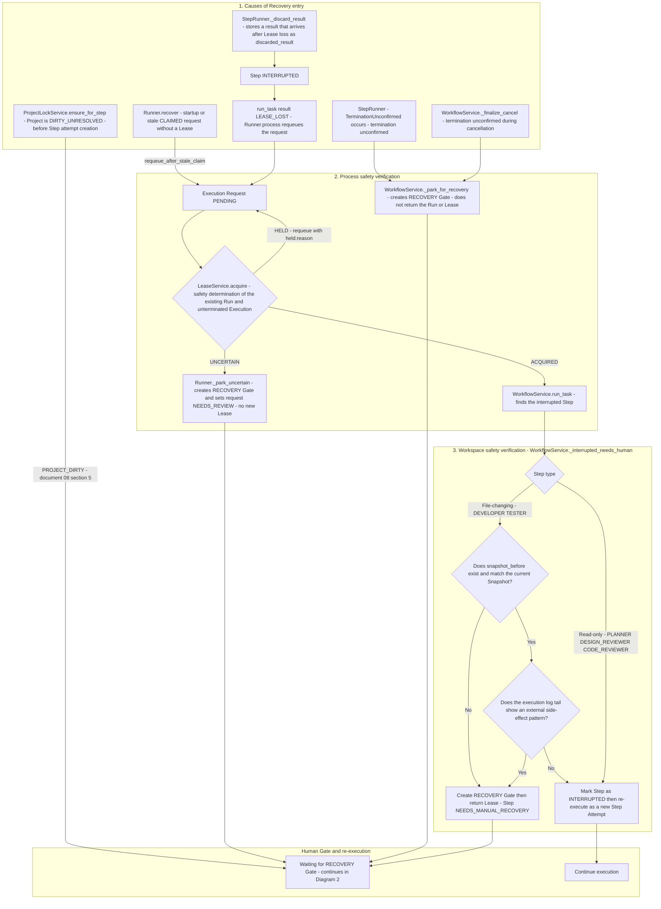
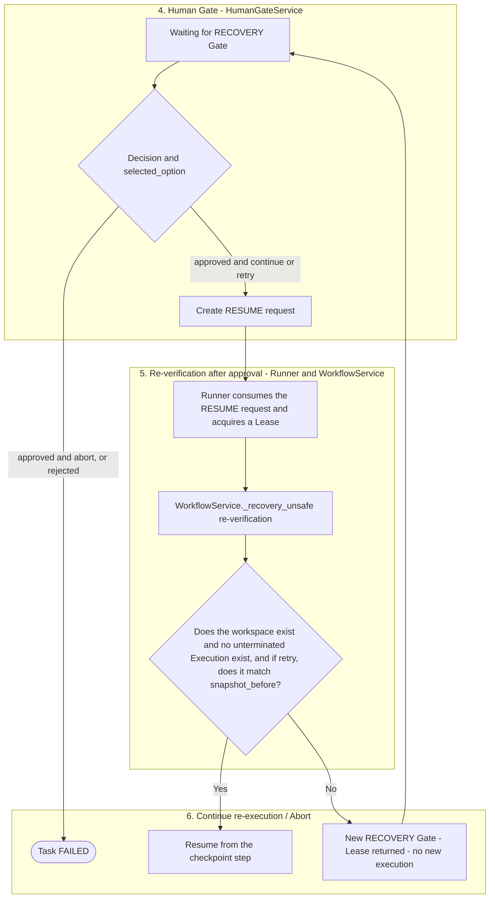

# Recovery and Checkpoint

> 한국어: [09-recovery_ko.md](09-recovery_ko.md).

> This flow is organized based on the current implementation code. Behavior that is not confirmed by code or not verified is marked as a current implementation limitation.

There is no separate Recovery Service. The entry points below are distributed across each module. This document is divided into two exception-flow diagrams.

- Diagram 1: The process by which the cause of Recovery entry and the safety determination (process / Workspace) lead to RECOVERY Gate creation or automatic re-execution.
- Diagram 2: Re-verification and resume/abort after a user decision. This continues from the `Waiting for RECOVERY Gate` node in Diagram 1.

The central classes are `Runner`, `LeaseService`, `WorkflowService`, `StepRunner`, and `HumanGateService`.

## 1. Recovery entry and safety determination

- On Recovery entry, Task=`WAITING_APPROVAL`, Approval type=`RECOVERY`, and Step=`NEEDS_MANUAL_RECOVERY` are transitioned/created in a single transaction (`HumanGateService.open_recovery`). There is no separate state machine.
- The main responsibilities of `Runner.recover` are requeueing stale `CLAIMED` requests, handling idle cancellations, and cleaning up Project write locks left behind by terminated Tasks. It does not directly create all Recovery Gates; a requeued request is judged at the next `LeaseService.acquire`. The stale determination only applies when no live Lease exists (the claim-to-Lease normal window is protected by a grace period), and since requeueing clears `claim_token`, the previous coroutine is blocked via fencing. The request mutation itself is a conditional UPDATE keyed on the `claim_token` at the time of the read; if the condition doesn't match (i.e., another owner took it after the read), the current state is not overwritten ([03](03-task-runner.md)).
- The DB operations for request recovery run outside the `_lifecycle_lock` with a bounded timeout. A recovery where nothing was applied ends safely with no DB change, and if the commit result is unclear, it is confirmed via a read-only query. If the confirmation itself fails, the existing evidence is preserved and the flow proceeds to `STOP_INCOMPLETE` or the next attempt, and the advisory lock is held as long as unconfirmed evidence remains. A timeout does not confirm the commit result as a rollback.
- Lease loss is not directly connected to the Recovery Gate. The result is kept only as `discarded_result`, the Step becomes `INTERRUPTED`, and after the request is requeued, the next `acquire` determines whether termination of the existing Run and unterminated Execution has been proven. If it cannot be proven, it becomes `UNCERTAIN` and `Runner._park_uncertain` opens a RECOVERY Gate. If it is proven, after handoff `run_task` finds the interrupted Step and proceeds to zone 3 ([07](07-lease.md)).
- If CLI termination is not confirmed during cancellation, the flow moves to the Recovery Gate instead of CANCELLED ([11](11-task-lifecycle.md)).
- Lease handling differs by entry path.
  - `_park_for_recovery` (termination unconfirmed): The Run/Lease is not returned. The existing Run is not treated as having terminated normally.
  - `_interrupted_needs_human` and `_recovery_unsafe` failure: The Lease is returned (`FINISHED`), then the Gate is awaited.
  - `Runner._park_uncertain`: Since no new Lease was obtained, there is no new Run.
- A read-only Step does not reuse automatic recovery results and may be re-executed as a new Step Attempt (new row). Reuse of a completed (SUCCEEDED) Step is determined solely by `input_hash`/`output_hash` ([10](10-invalidation.md)).
- For a file-changing Step, `snapshot_before` is compared against the current Snapshot. If it has changed, `snapshot_before` is missing, or a possible external side effect is found, a Recovery Gate is opened.

## 2. Re-verification and resume after user decision

This is the flow after a decision has been saved at the RECOVERY Gate. The common handling of the decision API is in [08](08-human-gate.md); this section shows how `Runner` and `WorkflowService` consume the RESUME request created by `HumanGateService`.

- `continue` and `retry` create a RESUME request, while `abort` (approved) and rejection terminate the Task as FAILED ([08](08-human-gate.md)).
- `_recovery_unsafe` applies only to RECOVERY approvals, and approval does not exempt it from this check. If it fails, a new RECOVERY Gate is created, the Lease is returned, and the flow waits.

## 3. Recovery of the Project write lock and Workspace baseline

Since Project Tasks share a Workspace, Project state is added to the safety determination above. The principle is the same for every item. **If something cannot be measured or proven, it is not treated as `CLEAN` but handled as `DIRTY_UNRESOLVED`, and files are never restored or deleted.**

| Interruption/failure point | State left behind | Result |
|---|---|---|
| Immediately after claim, before Lease | `CLAIMED`, no Lease | After a grace period, stale → requeued to `PENDING` (nothing has executed yet). Not touched within the grace period |
| Previous coroutine proceeds after requeue | `claim_token` mismatch | Blocked at every fence, no record |
| After write lock acquisition, before CLI | owner=Task, Lease expired | owner retained (only the same Task can re-enter). The next `acquire` cleans up the Lease |
| Runner terminates during CLI execution | Lease expired, unterminated Execution | Existing path (process termination proven or RECOVERY). owner retained |
| `WAITING_APPROVAL` | Lease returned, owner retained | Verified on resume; immediate terminal cleanup on cancellation ([11](11-task-lifecycle.md)) |
| owner/`write_epoch` changes between fingerprint measurement and the terminal transaction | proof mismatch | Rollback, re-measure (up to 3 times). If still mismatched, end as `UNMEASURED` → `DIRTY_UNRESOLVED` |
| Terminated during the terminal transaction | Rollback | Task not terminal; normal termination path on re-execution |
| Abnormal state where the lock remains after terminal processing (owner is a terminal Task) | owner remains | `ProjectLockService.reconcile` compares the current fingerprint with the write baseline and releases it. If unmeasurable or version mismatch, `DIRTY_UNRESOLVED` |
| Project changes during a read-only Step | `write_epoch` changes | That Step attempt is not reused (`CANCELLED`, `PROJECT_CHANGED`) → deferred requeue. If the limit (`PROJECT_EPOCH_RETRIES`=2) is exceeded, `FAILED` `PROJECT_WORKSPACE_UNSTABLE` |
| Terminated during `git clone` | Unregistered directory under `project-clones` | Not exposed since there is no Project row. If termination cannot be proven, it is not deleted — `CLONE_TERMINATION_UNCONFIRMED` |
| Request in backoff during Runner restart | `not_before`, `defer_count` preserved | Backoff is preserved even after restart |

The basis for the table above and the meaning of `write_epoch` are in [10](10-invalidation.md). Operating rule (threat model): **external modification while an active Project Task exists is not supported.** If detected, the read phase retries by epoch, and the write phase is subject to Recovery. User modifications between Tasks (while the Project is idle) are permitted and are accepted as the baseline the next time a Task first acquires the write lock. Since the filesystem and the DB cannot be made into a single atomic transaction, external changes between measurement and commit may not be fully detected.

## Current implementation limitations

- Modification by an external process during an active Project Task is not supported, and fingerprint comparison does not guarantee complete detection (changes may occur between measurement and commit). `write_epoch` is a generation number for the lock and change Step controlled by the Orchestrator, and it does not detect external changes.
- The only resolution path for `DIRTY_UNRESOLVED` is `continue` on the PROJECT_DIRTY Gate. If there is no approver, the change Task for that Project remains in a waiting state.
- External side-effect determination relies on a regex check (`curl`, `wget`, `git push`, `npm publish`, `twine`, `ssh`, `scp`, `http(s)://`) against the stdout/stderr tail of that Step Execution. The absence of a pattern does not prove the absence of side effects.
- The Step execution order is CLI return → Execution result recorded → `snapshot_after`. If the Snapshot fails (`SnapshotError`) after the result has been normally recorded, the Step/Task fail-closes to `SNAPSHOT_FAILED`, and a terminated CLI is not classified as unterminated. Since `TerminationUnconfirmed`/`LeaseLost` are handled first, a Snapshot failure does not override them. Current implementation limitation: on Windows, even a single file locked by another process can cause a Task to become `SNAPSHOT_FAILED`.
- The Task terminal transaction (Task state, Project cleanup, Lease/Session/Step cleanup) and the ExecutionRequest's `DONE` processing are **separate transactions**. If the Runner dies after the terminal commit but before the request completes, the startup recovery of the next start-up cleans up the terminal Task's `CLAIMED` request to `DONE`.
- WorkspaceSnapshot is for change detection only. It cannot restore file contents, and there is no automatic restoration feature.
- Exactly-once execution is not guaranteed (at-least-once + change detection).
- Windows process termination failure (`ACCESS_DENIED`, etc.) has only been verified via simulation and has not actually been reproduced.
- The recovery path after a Session `SessionConflict` has not been verified by tests ([06](06-session.md)).
