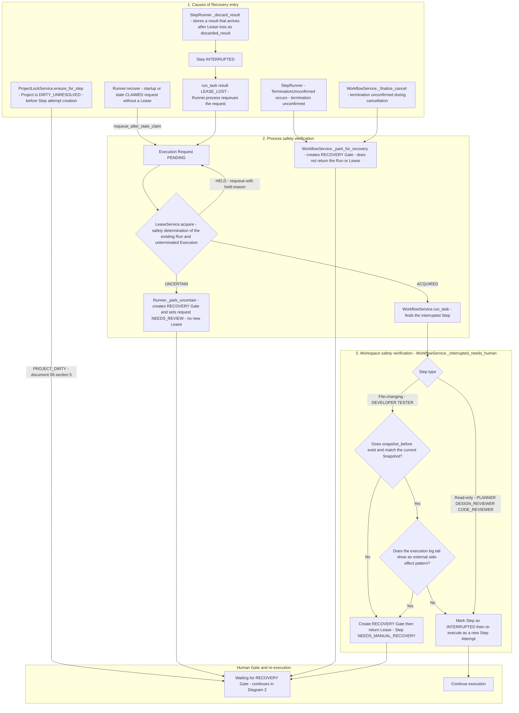
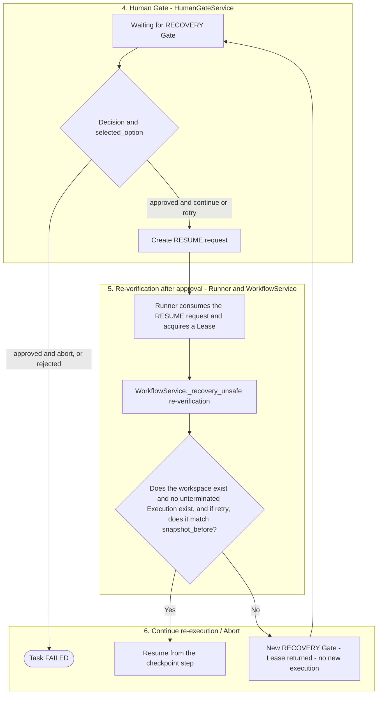

# Recovery and Checkpoint

> 한국어: [09-recovery_ko.md](09-recovery_ko.md).

> This flow is organized based on the current implementation code. Behavior that is not confirmed by code or not verified is marked as a current implementation limitation.

There is no separate Recovery Service. The entry points below are distributed across each module. This document is divided into two exception-flow diagrams.

- Diagram 1: The process by which the cause of Recovery entry and the safety determination (process / Workspace) lead to RECOVERY Gate creation or automatic re-execution.
- Diagram 2: Re-verification and resume/abort after a user decision. This continues from the `Waiting for RECOVERY Gate` node in Diagram 1.

The central classes are `Runner`, `LeaseService`, `WorkflowService`, `StepRunner`, and `HumanGateService`.

## 1. Recovery entry and safety determination

- On Recovery entry, Task=`WAITING_APPROVAL`, Approval type=`RECOVERY`, and Step=`NEEDS_MANUAL_RECOVERY` are transitioned/created in a single transaction (`HumanGateService.open_recovery`). There is no separate state machine.
- The main responsibilities of `Runner.recover` are requeueing stale `CLAIMED` requests, handling idle cancellations, and cleaning up Project write locks left behind by terminated Tasks. It does not directly create all Recovery Gates; a requeued request is judged at the next `LeaseService.acquire`. The stale determination only applies when no live Lease exists (the claim-to-Lease normal window is protected by a grace period), and since requeueing clears `claim_token`, the previous coroutine is blocked via fencing. The request mutation itself is a conditional UPDATE keyed on the `claim_token` at the time of the read; if the condition doesn't match (i.e., another owner took it after the read), the current state is not overwritten ([03](03-task-runner.md)).
- The DB operations for request recovery run outside the `_lifecycle_lock` with a bounded timeout. A recovery where nothing was applied ends safely with no DB change, and if the commit result is unclear, it is confirmed via a read-only query. If the confirmation itself fails, the existing evidence is preserved and the flow proceeds to `STOP_INCOMPLETE` or the next attempt, and the advisory lock is held as long as unconfirmed evidence remains. A timeout does not confirm the commit result as a rollback.
- Lease loss is not directly connected to the Recovery Gate. The result is kept only as `discarded_result`, the Step becomes `INTERRUPTED`, and after the request is requeued, the next `acquire` determines whether termination of the existing Run and unterminated Execution has been proven. If it cannot be proven, it becomes `UNCERTAIN` and `Runner._park_uncertain` opens a RECOVERY Gate. If it is proven, after handoff `run_task` finds the interrupted Step and proceeds to zone 3 ([07](07-lease.md)).
- If CLI termination is not confirmed during cancellation, the flow moves to the Recovery Gate instead of CANCELLED ([11](11-task-lifecycle.md)).
- Lease handling differs by entry path.
  - `_park_for_recovery` (termination unconfirmed): The Run/Lease is not returned. The existing Run is not treated as having terminated normally.
  - `_interrupted_needs_human` and `_recovery_unsafe` failure: The Lease is returned (`FINISHED`), then the Gate is awaited.
  - `Runner._park_uncertain`: Since no new Lease was obtained, there is no new Run.
- A read-only Step does not reuse automatic recovery results and may be re-executed as a new Step Attempt (new row). Reuse of a completed (SUCCEEDED) Step is determined solely by `input_hash`/`output_hash` ([10](10-invalidation.md)).
- For a file-changing Step, `snapshot_before` is compared against the current Snapshot. If it has changed, `snapshot_before` is missing, or a possible external side effect is found, a Recovery Gate is opened.

## 2. Re-verification and resume after user decision

This is the flow after a decision has been saved at the RECOVERY Gate. The common handling of the decision API is in [08](08-human-gate.md); this section shows how `Runner` and `WorkflowService` consume the RESUME request created by `HumanGateService`.

- `continue` and `retry` create a RESUME request, while `abort` (approved) and rejection terminate the Task as FAILED ([08](08-human-gate.md)).
- `_recovery_unsafe` applies only to RECOVERY approvals, and approval does not exempt it from this check. If it fails, a new RECOVERY Gate is created, the Lease is returned, and the flow waits.

## 3. Recovery of the Project write lock and Workspace baseline

Since Project Tasks share a Workspace, Project state is added to the safety determination above. The principle is the same for every item. **If something cannot be measured or proven, it is not treated as `CLEAN` but handled as `DIRTY_UNRESOLVED`, and files are never restored or deleted.**

| Interruption/failure point | State left behind | Result |
|---|---|---|
| Immediately after claim, before Lease | `CLAIMED`, no Lease | After a grace period, stale → requeued to `PENDING` (nothing has executed yet). Not touched within the grace period |
| Previous coroutine proceeds after requeue | `claim_token` mismatch | Blocked at every fence, no record |
| After write lock acquisition, before CLI | owner=Task, Lease expired | owner retained (only the same Task can re-enter). The next `acquire` cleans up the Lease |
| Runner terminates during CLI execution | Lease expired, unterminated Execution | Existing path (process termination proven or RECOVERY). owner retained |
| `WAITING_APPROVAL` | Lease returned, owner retained | Verified on resume; immediate terminal cleanup on cancellation ([11](11-task-lifecycle.md)) |
| owner/`write_epoch` changes between fingerprint measurement and the terminal transaction | proof mismatch | Rollback, re-measure (up to 3 times). If still mismatched, end as `UNMEASURED` → `DIRTY_UNRESOLVED` |
| Terminated during the terminal transaction | Rollback | Task not terminal; normal termination path on re-execution |
| Abnormal state where the lock remains after terminal processing (owner is a terminal Task) | owner remains | `ProjectLockService.reconcile` compares the current fingerprint with the write baseline and releases it. If unmeasurable or version mismatch, `DIRTY_UNRESOLVED` |
| Project changes during a read-only Step | `write_epoch` changes | That Step attempt is not reused (`CANCELLED`, `PROJECT_CHANGED`) → deferred requeue. If the limit (`PROJECT_EPOCH_RETRIES`=2) is exceeded, `FAILED` `PROJECT_WORKSPACE_UNSTABLE` |
| Terminated during `git clone` | Unregistered directory under `project-clones` | Not exposed since there is no Project row. If termination cannot be proven, it is not deleted — `CLONE_TERMINATION_UNCONFIRMED` |
| Request in backoff during Runner restart | `not_before`, `defer_count` preserved | Backoff is preserved even after restart |
| Runner dies after a tracked process was spawned (suspended), before its identity was persisted | `executions` row `STARTING`, no `pid`, no unproven-spawn record, no retained Job (a restarted Runner has none) | Closed `NEVER_RAN` by the takeover or the sweeper. The suspended process may survive (CP2, accepted by design) |
| Tracked command ended with the tree not proven empty | Row open (`lifecycle=TERMINATION_UNCONFIRMED`), Job retained in the Runner process | `TerminationUnconfirmed` opens the RECOVERY path; the row stays unresolved (set U) until a verdict proves it, and the Project cannot become `CLEAN` meanwhile |
| Closing write of a tracked row lost | Row open, no proof | The row stays unresolved; the sweeper or the next takeover judges it ([07](07-lease.md)) |

The basis for the table above and the meaning of `write_epoch` are in [10](10-invalidation.md). Operating rule (threat model): **external modification while an active Project Task exists is not supported.** If detected, the read phase retries by epoch, and the write phase is subject to Recovery. User modifications between Tasks (while the Project is idle) are permitted and are accepted as the baseline the next time a Task first acquires the write lock. Since the filesystem and the DB cannot be made into a single atomic transaction, external changes between measurement and commit may not be fully detected.

## 4. Owner without a baseline row (crash gap, or an owner from before the feature)

`_ensure_baseline` runs when the task that already owns the project re-enters the gate: with a row it only checks the epoch (before any mutating step exactly `acquired_epoch`; afterwards at least `acquired_epoch`, because every mutating step begin bumps the epoch; a recovery row without an acquisition epoch is only bounded from below by `recorded_epoch`). Without a row it never returns READY:
- **a mutating step already ran** (DEVELOP/TEST row exists): an explicit `UNAVAILABLE(BASELINE_MISSING_AT_REENTRY)` row with `proof_epoch = acquired_epoch = NULL` and `recorded_epoch` = the current epoch. The first acquisition epoch cannot be proven, so it is not invented from the current one;
- **nothing was changed yet**: the fingerprint and manifest are measured outside any transaction, then in one transaction (task and project rows locked, owner and epoch re-checked) the fresh fingerprint is compared with `write_baseline_fingerprint`. Equal = the workspace is provably unchanged since the acquisition: an AVAILABLE `REENTRY_RECOVERY` row with `proof_epoch = acquired_epoch = recorded_epoch` = the current owner epoch. Different (or unmeasurable) = `UNAVAILABLE(BASELINE_MISSING_AT_REENTRY)`.
A row of a different identity (project, proof epochs, fingerprint) is a conflict: fail closed, nothing is overwritten; the same identity with a different status keeps the existing row (an AVAILABLE row is never replaced, an UNAVAILABLE one never promoted).

## 5. Tracked Executions: Classification, Sweeper and Terminal Rules

Tracked executions ([05](05-development-testing.md)) are judged by their `executions.detail`, not by a separate state machine. `tracked_classifier.classify_row` (the Python mirror of the SQL in `tracked_sql`, which also backs the partial indexes `ix_executions_tracked_unresolved` and `ix_executions_tracked_anomaly` of migration 0005) puts every row of a project into one class:

| Class | Meaning |
|---|---|
| `LEGACY` | No tracked marker and no tracked-only key (or `detail` is not a JSON object): outside every rule below |
| `UNRESOLVED` (set U) | `tracked` is true and the row has neither `proof` nor `disposition` |
| `RESOLVED_PROVEN` | `tracked`, `v=1`, `finished_at` set, and a positive `proof` (`JOB_EMPTY`, `JOB_KILL_ON_CLOSE_ASSUMED` or `NEVER_RAN`) |
| `RESOLVED_RISK` | `tracked`, `v=1`, `finished_at` set, `disposition=OPERATOR_RISK_ACCEPTED` with a valid `risk_acceptance` record that matches the row's id and `pid` ([08](08-human-gate.md)) |
| `ANOMALY` (set A) | Any other tracked-looking row: `UNKNOWN_SCHEMA_VERSION`, `CONTRADICTORY_PROOF_DISPOSITION`, `INVALID_PROOF`, `INVALID_DISPOSITION_KIND`, `INCOMPLETE_RISK_ACCEPTANCE`, `OTHER_SCHEMA_INVALID` (a `detail` that cannot be decoded strictly is `OTHER_SCHEMA_INVALID` with `decode_error`) |

- **Project-wide rule**: `has_unresolved_or_anomalous_for_project` is the one entry point; it always evaluates both sets (bounded by `DIAGNOSTIC_MAX_ANOMALIES`). A member of either set blocks: a terminal Task or `reconcile` releases the Project as `DIRTY_UNRESOLVED` whatever the fingerprint proof says; `ensure_for_step` on an ownerless `CLEAN` Project that still has such a row marks it `DIRTY_UNRESOLVED` and opens the PROJECT_DIRTY gate; `continue` is refused ([08](08-human-gate.md)).
- **Orphan sweeper** (`OrphanSweeper`, background unit `sweeper`, [03](03-task-runner.md)): one pass collects one batch of U and A rows with a keyset scan (bounded rows and time) and settles them one at a time in ascending id, each in its own short guarded transaction; the OS verdict (retained Job first, then the same verdict as the takeover in [07](07-lease.md)) runs in a thread outside any transaction. A confirmed verdict on a U row merges its proof into `detail` (`abandoned_by_sweeper`); an unconfirmed one leaves the row untouched. An A row is settled by `settle_anomaly`, a compare-and-swap on the exact `detail` that was read, on membership of set A and on the recorded identity (`pid`, `process_create_time`), so a `NEVER_RAN` verdict judged on a row without a `pid` cannot close a row whose owner has since committed its identity; the invalid keys are moved into `anomaly_original` beside an `anomaly_settlement` record. `UNKNOWN_SCHEMA_VERSION` rows are never rewritten; `decode_error` rows are skipped and counted, never written. The committed cursor moves only over the decided prefix, and a failed pass keeps it and retries with a capped backoff; the first pass waits for `startup_mutation_done`.
- **Stall and recheck state**: consecutive failed passes make the sweeper `SWEEPER_STALLED` (it still skips no row); a sweeper configuration error shows as `SWEEPER_CONFIG_INVALID` until a later pass has passed the failing position ([11](11-task-lifecycle.md)).
- **After a request is applied** or a verdict proves the rows, the Project is still `DIRTY_UNRESOLVED`; only `continue` on the PROJECT_DIRTY gate returns it to `CLEAN`.

## Current implementation limitations

- Verification scope of the tracked-execution recovery: **verified** on Windows with real Job Objects and real child processes (`tests/unit/test_windows_job.py`, `tests/integration_pg/test_never_ran_crash_points.py`, `tests/integration_pg/test_tracked_services.py`) and on the embedded PostgreSQL for the classifier, sweeper, risk worker and takeover rules. The POSIX policy exists in code only: no tracked rows are written there, `UNSUPPORTED_PLATFORM` degrades to untracked execution and `UNKNOWN`/`UNAVAILABLE` fail closed; POSIX runtime behaviour is **not verified**. **Not verified**: POSIX runtime, real Gradle/Maven builds, real CLI E2E, random race stress, EXPLAIN/generic plan, real deadlock tests.
- CP2 residual: a Job-less suspended process (spawned, not yet assigned to the Job, no identity written) may survive a `NEVER_RAN` close, because such a row is indistinguishable from "nothing was spawned"; user code cannot have run (the process is suspended). Accepted by design (invariant I4, `SUSPENDED_ORPHAN_POSSIBLE`). The acceptance is **not** extended to the retained-Job case below.
- The earlier residual of the `NEVER_RAN` rule (a pid-less row with a retained Job not proven empty and a lost executor write could be closed `NEVER_RAN`) is **closed for Jobs retained in the same Runner process**: the takeover, the `OrphanSweeper` and the `ProcessRiskWorker` all judge such an open row `SPAWNED_PROCESS_UNPROVEN` through `retained_job_verdict` (`CommandExecutor.has_retained`), unless the settler proves the Job empty (`JOB_EMPTY`). The execution order (Job assignment, identity capture, fenced identity write, then resume) means a pid-less row never ran user code. After a Runner restart the in-process registry is empty; the Job carries `JOB_OBJECT_LIMIT_KILL_ON_JOB_CLOSE`, so the OS ends its processes with the owning Runner process (a conditional OS guarantee, see [07](07-lease.md)).
- A pid-less row recorded as `SPAWNED_PROCESS_UNPROVEN` is **not resolved by a restart; there is currently no supported resolution path**. Details ([08](08-human-gate.md)): a valid acceptance record needs a `pid`, so the gate hides `accept_unproven_risk` for a target set with any pid-less row (`TARGET_WITHOUT_PID`) and a direct submit is rejected with 409 `OPTION_NOT_AVAILABLE`, nothing written. `abort` only terminates the Task and does not clear `DIRTY_UNRESOLVED` (only `continue`, with no unresolved or anomalous tracked execution, does); the sweeper and the takeover keep the row open. After the process was cleaned up by hand, the row can only be settled by editing the database manually (`tests/integration_pg/test_pidless_unproven_resolution.py`). Not verified, separate follow-up item: a Windows integration test of a pid-less row after a Runner restart (the `KILL_ON_JOB_CLOSE` assumption).
- An `ANOMALY` row has no automatic or operator exit except the sweeper's settlement of the kinds it settles; a `decode_error` row has none, so the Project stays `DIRTY_UNRESOLVED`.

- Modification by an external process during an active Project Task is not supported, and fingerprint comparison does not guarantee complete detection (changes may occur between measurement and commit). `write_epoch` is a generation number for the lock and change Step controlled by the Orchestrator, and it does not detect external changes.
- The only resolution path for `DIRTY_UNRESOLVED` is `continue` on the PROJECT_DIRTY Gate. If there is no approver, the change Task for that Project remains in a waiting state.
- External side-effect determination relies on a regex check (`curl`, `wget`, `git push`, `npm publish`, `twine`, `ssh`, `scp`, `http(s)://`) against the stdout/stderr tail of that Step Execution. The absence of a pattern does not prove the absence of side effects.
- The Step execution order is CLI return → Execution result recorded → `snapshot_after`. If the Snapshot fails (`SnapshotError`) after the result has been normally recorded, the Step/Task fail-closes to `SNAPSHOT_FAILED`, and a terminated CLI is not classified as unterminated. Since `TerminationUnconfirmed`/`LeaseLost` are handled first, a Snapshot failure does not override them. Current implementation limitation: on Windows, even a single file locked by another process can cause a Task to become `SNAPSHOT_FAILED`.
- The Task terminal transaction (Task state, Project cleanup, Lease/Session/Step cleanup) and the ExecutionRequest's `DONE` processing are **separate transactions**. If the Runner dies after the terminal commit but before the request completes, the startup recovery of the next start-up cleans up the terminal Task's `CLAIMED` request to `DONE`.
- WorkspaceSnapshot is for change detection only. It cannot restore file contents, and there is no automatic restoration feature.
- Exactly-once execution is not guaranteed (at-least-once + change detection).
- Windows process termination failure (`ACCESS_DENIED`, etc.) has only been verified via simulation (including injected `JobError` values for the tracked Job path) and has not actually been reproduced.
- The recovery path after a Session `SessionConflict` has not been verified by tests ([06](06-session.md)).
