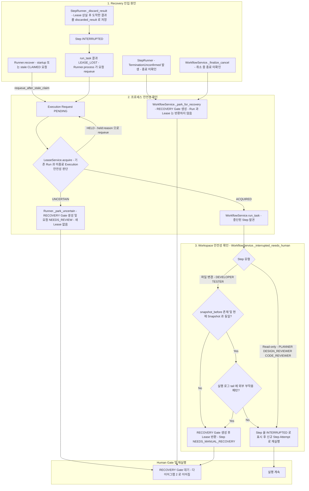
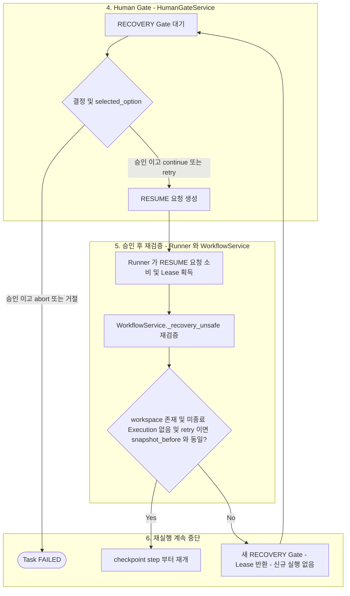

# Recovery 및 Checkpoint

> 현재 구현 코드를 기준으로 정리한 흐름입니다. 코드로 확인되지 않았거나 검증되지 않은 동작은 현재 구현 제한으로 구분합니다.

별도의 Recovery Service는 없습니다. 아래 진입 지점이 각 모듈에 분산되어 있습니다. 이 문서는 두 개의 예외 흐름 다이어그램으로 나뉩니다.

- 다이어그램 1: Recovery 진입 원인과 안전성 판단(프로세스·Workspace)이 RECOVERY Gate 생성 또는 자동 재실행으로 이어지는 과정.
- 다이어그램 2: 사용자 결정 이후의 재검증과 재개·중단. 다이어그램 1의 `RECOVERY Gate 대기` 노드에서 이어집니다.

중심 클래스는 `Runner`, `LeaseService`, `WorkflowService`, `StepRunner`, `HumanGateService`입니다.

## 1. Recovery 진입 및 안전성 판단

- Recovery 진입 시 Task=`WAITING_APPROVAL`, Approval type=`RECOVERY`, Step=`NEEDS_MANUAL_RECOVERY`가 한 트랜잭션에서 전환·생성됩니다 (`HumanGateService.open_recovery`). 별도 상태 머신은 없습니다.
- `Runner.recover`의 주된 책임은 stale `CLAIMED` 요청 requeue와 idle 취소 처리입니다. 모든 Recovery Gate를 직접 만들지 않으며, requeue된 요청이 다음 `LeaseService.acquire`에서 판정됩니다.
- Lease 상실은 Recovery Gate에 직접 연결되지 않습니다. 결과는 `discarded_result`로만 남고 Step은 `INTERRUPTED`가 되며, 요청이 requeue된 뒤 다음 `acquire`가 기존 Run과 미종료 Execution의 종료 입증 여부를 판단합니다. 입증되지 않으면 `UNCERTAIN`이 되어 `Runner._park_uncertain`이 RECOVERY Gate를 엽니다. 입증되면 인계 후 `run_task`가 중단된 Step을 발견해 3번 구역으로 갑니다 ([07](07-lease.md)).
- 취소 중 CLI 종료가 확인되지 않으면 CANCELLED가 아니라 Recovery Gate로 이동합니다 ([11](11-task-lifecycle.md)).
- Lease 처리는 진입 경로에 따라 다릅니다.
  - `_park_for_recovery`(종료 미확인): Run/Lease를 반환하지 않습니다. 기존 Run을 정상 종료된 것으로 간주하지 않습니다.
  - `_interrupted_needs_human`과 `_recovery_unsafe` 실패: Lease를 반환(`FINISHED`)한 뒤 Gate를 대기합니다.
  - `Runner._park_uncertain`: 새 Lease를 얻지 못한 상태이므로 새 Run이 없습니다.
- Read-only Step은 자동 복구 결과를 재사용하지 않고 신규 Step Attempt(새 행)로 재실행할 수 있습니다. 완료된(SUCCEEDED) Step의 재사용은 `input_hash`·`output_hash`로만 판단합니다 ([10](10-invalidation.md)).
- 파일 변경 Step은 `snapshot_before`와 현재 Snapshot을 비교합니다. 변경되었거나 `snapshot_before`가 없거나 외부 부작용 가능성이 발견되면 Recovery Gate를 엽니다.

## 2. 사용자 결정 후 재검증과 재개

RECOVERY Gate에서 결정이 저장된 뒤의 흐름입니다. 결정 API의 공통 처리는 [08](08-human-gate.md)에 있고, 여기서는 `HumanGateService`가 만든 RESUME 요청을 `Runner`와 `WorkflowService`가 소비하는 과정을 보여줍니다.

- `continue`, `retry`는 RESUME 요청을 만들고, `abort`(승인)와 거절은 Task를 FAILED로 종료합니다 ([08](08-human-gate.md)).
- `_recovery_unsafe`는 RECOVERY 승인에만 적용되며, 승인이 이 검증을 면제하지 않습니다. 실패하면 새 RECOVERY Gate를 만들고 Lease를 반환한 뒤 대기합니다.

## 현재 구현 제한

- 외부 부작용 판정은 해당 Step Execution의 stdout/stderr tail에 대한 정규식 검사(`curl`, `wget`, `git push`, `npm publish`, `twine`, `ssh`, `scp`, `http(s)://`)에 의존합니다. 패턴이 없으면 부작용이 없다고 증명된 것이 아닙니다.
- WorkspaceSnapshot은 변경 감지 전용입니다. 파일 내용을 복원하지 못하며 자동 복원 기능은 없습니다.
- 정확히 한 번 실행을 보장하지 않습니다(at-least-once + 변경 감지).
- Windows 프로세스 종료 실패(`ACCESS_DENIED` 등)는 시뮬레이션으로만 검증했고 실제 재현하지 못했습니다.
- Session `SessionConflict` 이후의 복구 경로는 테스트로 검증하지 않았습니다 ([06](06-session.md)).
