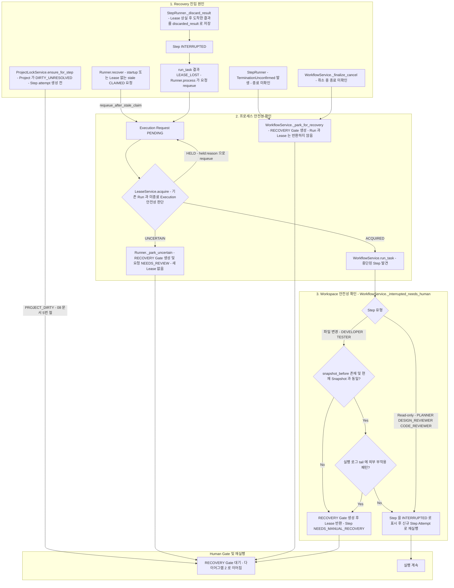
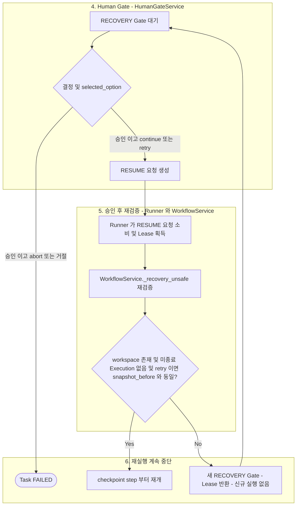

# Recovery 및 Checkpoint

> 현재 구현 코드를 기준으로 정리한 흐름입니다. 코드로 확인되지 않았거나 검증되지 않은 동작은 현재 구현 제한으로 구분합니다.

별도의 Recovery Service는 없습니다. 아래 진입 지점이 각 모듈에 분산되어 있습니다. 이 문서는 두 개의 예외 흐름 다이어그램으로 나뉩니다.

- 다이어그램 1: Recovery 진입 원인과 안전성 판단(프로세스·Workspace)이 RECOVERY Gate 생성 또는 자동 재실행으로 이어지는 과정.
- 다이어그램 2: 사용자 결정 이후의 재검증과 재개·중단. 다이어그램 1의 `RECOVERY Gate 대기` 노드에서 이어집니다.

중심 클래스는 `Runner`, `LeaseService`, `WorkflowService`, `StepRunner`, `HumanGateService`입니다.

## 1. Recovery 진입 및 안전성 판단

- Recovery 진입 시 Task=`WAITING_APPROVAL`, Approval type=`RECOVERY`, Step=`NEEDS_MANUAL_RECOVERY`가 한 트랜잭션에서 전환·생성됩니다 (`HumanGateService.open_recovery`). 별도 상태 머신은 없습니다.
- `Runner.recover`의 주된 책임은 stale `CLAIMED` 요청 requeue, idle 취소 처리, 종료된 Task가 남긴 Project write lock 정리입니다. 모든 Recovery Gate를 직접 만들지 않으며, requeue된 요청이 다음 `LeaseService.acquire`에서 판정됩니다. stale 판정은 살아 있는 Lease가 없을 때만 적용되고(claim~Lease 정상 구간은 유예 시간으로 보호), requeue가 `claim_token`을 지우므로 이전 coroutine은 fencing으로 차단됩니다 ([03](03-task-runner.md)).
- Lease 상실은 Recovery Gate에 직접 연결되지 않습니다. 결과는 `discarded_result`로만 남고 Step은 `INTERRUPTED`가 되며, 요청이 requeue된 뒤 다음 `acquire`가 기존 Run과 미종료 Execution의 종료 입증 여부를 판단합니다. 입증되지 않으면 `UNCERTAIN`이 되어 `Runner._park_uncertain`이 RECOVERY Gate를 엽니다. 입증되면 인계 후 `run_task`가 중단된 Step을 발견해 3번 구역으로 갑니다 ([07](07-lease.md)).
- 취소 중 CLI 종료가 확인되지 않으면 CANCELLED가 아니라 Recovery Gate로 이동합니다 ([11](11-task-lifecycle.md)).
- Lease 처리는 진입 경로에 따라 다릅니다.
  - `_park_for_recovery`(종료 미확인): Run/Lease를 반환하지 않습니다. 기존 Run을 정상 종료된 것으로 간주하지 않습니다.
  - `_interrupted_needs_human`과 `_recovery_unsafe` 실패: Lease를 반환(`FINISHED`)한 뒤 Gate를 대기합니다.
  - `Runner._park_uncertain`: 새 Lease를 얻지 못한 상태이므로 새 Run이 없습니다.
- Read-only Step은 자동 복구 결과를 재사용하지 않고 신규 Step Attempt(새 행)로 재실행할 수 있습니다. 완료된(SUCCEEDED) Step의 재사용은 `input_hash`·`output_hash`로만 판단합니다 ([10](10-invalidation.md)).
- 파일 변경 Step은 `snapshot_before`와 현재 Snapshot을 비교합니다. 변경되었거나 `snapshot_before`가 없거나 외부 부작용 가능성이 발견되면 Recovery Gate를 엽니다.

## 2. 사용자 결정 후 재검증과 재개

RECOVERY Gate에서 결정이 저장된 뒤의 흐름입니다. 결정 API의 공통 처리는 [08](08-human-gate.md)에 있고, 여기서는 `HumanGateService`가 만든 RESUME 요청을 `Runner`와 `WorkflowService`가 소비하는 과정을 보여줍니다.

- `continue`, `retry`는 RESUME 요청을 만들고, `abort`(승인)와 거절은 Task를 FAILED로 종료합니다 ([08](08-human-gate.md)).
- `_recovery_unsafe`는 RECOVERY 승인에만 적용되며, 승인이 이 검증을 면제하지 않습니다. 실패하면 새 RECOVERY Gate를 만들고 Lease를 반환한 뒤 대기합니다.

## 3. Project write lock과 Workspace baseline 복구

프로젝트 Task는 Workspace를 공유하므로, 위 안전성 판단에 Project 상태가 추가됩니다. 모든 항목의 원칙은 같습니다. **측정할 수 없거나 증명할 수 없으면 `CLEAN`으로 간주하지 않고 `DIRTY_UNRESOLVED`로 처리하며, 파일은 절대 복원·삭제하지 않습니다.**

| 중단·실패 지점 | 남는 상태 | 결과 |
|---|---|---|
| claim 직후, Lease 전 | `CLAIMED`, Lease 없음 | 유예 시간 뒤 stale → `PENDING`으로 requeue(아직 실행된 것 없음). 유예 안에서는 건드리지 않음 |
| requeue된 뒤 이전 coroutine이 진행 | `claim_token` 불일치 | 모든 fence에서 중단, 기록 없음 |
| write lock 획득 후 CLI 전 | owner=Task, Lease 만료 | owner 유지(같은 Task만 재진입). 다음 `acquire`가 Lease 정리 |
| CLI 실행 중 Runner 종료 | Lease 만료, 미종료 Execution | 기존 경로(프로세스 종료 입증 또는 RECOVERY). owner 유지 |
| `WAITING_APPROVAL` | Lease 반환, owner 유지 | 재개 시 검증, 취소 시 즉시 terminal 정리([11](11-task-lifecycle.md)) |
| fingerprint 측정 후 terminal 트랜잭션 전 owner·`write_epoch` 변경 | proof 불일치 | 롤백, 재측정(최대 3회). 계속 불일치하면 `UNMEASURED` 종료 → `DIRTY_UNRESOLVED` |
| terminal 트랜잭션 도중 종료 | 롤백 | Task 비종료, 재실행 시 정상 종료 경로 |
| terminal 처리 후 lock이 남은 이상 상태(owner가 terminal Task) | owner 잔류 | `ProjectLockService.reconcile`이 현재 fingerprint와 write baseline을 비교해 해제. 측정 불가·버전 불일치면 `DIRTY_UNRESOLVED` |
| 읽기 전용 Step 중 Project 변경 | `write_epoch` 변경 | 그 Step attempt를 재사용하지 않음(`CANCELLED`, `PROJECT_CHANGED`) → 지연 requeue. 상한(`PROJECT_EPOCH_RETRIES`=2) 초과 시 `FAILED` `PROJECT_WORKSPACE_UNSTABLE` |
| `git clone` 중 종료 | `project-clones` 아래 미등록 디렉터리 | Project 행이 없으므로 노출되지 않음. 종료를 입증하지 못하면 삭제하지 않고 `CLONE_TERMINATION_UNCONFIRMED` |
| Runner 재시작 중 backoff 중인 요청 | `not_before`, `defer_count` 보존 | 재시작 뒤에도 backoff 유지 |

위 표의 근거와 `write_epoch`의 의미는 [10](10-invalidation.md)에 있습니다. 운영 규칙(threat model): **활성 Project Task가 있는 동안의 외부 수정은 지원하지 않습니다.** 감지되면 읽기 단계는 epoch 재시도, 변경 단계는 Recovery 대상입니다. Task 사이(Project 유휴)의 사용자 수정은 허용되며 다음 Task가 처음 write lock을 얻을 때 baseline으로 수용됩니다. 파일시스템과 DB는 하나의 원자 트랜잭션이 될 수 없으므로 측정과 커밋 사이의 외부 변경은 완전히 탐지되지 않을 수 있습니다.

## 현재 구현 제한

- 활성 Project Task 중의 외부 프로세스 수정은 지원하지 않으며, fingerprint 비교로도 완전 탐지가 보장되지 않습니다(측정과 커밋 사이 변경 가능). `write_epoch`는 Orchestrator가 통제하는 lock과 변경 Step의 세대 번호이며 외부 변경을 감지하지 않습니다.
- `DIRTY_UNRESOLVED`의 해결 경로는 PROJECT_DIRTY Gate의 `continue`뿐입니다. 승인자가 없으면 해당 Project의 변경 Task는 대기 상태를 유지합니다.
- 외부 부작용 판정은 해당 Step Execution의 stdout/stderr tail에 대한 정규식 검사(`curl`, `wget`, `git push`, `npm publish`, `twine`, `ssh`, `scp`, `http(s)://`)에 의존합니다. 패턴이 없으면 부작용이 없다고 증명된 것이 아닙니다.
- Step 실행 순서는 CLI 반환 → Execution 결과 기록 → `snapshot_after`입니다. 정상 기록된 결과 뒤 Snapshot이 실패(`SnapshotError`)하면 Step·Task는 `SNAPSHOT_FAILED`로 fail-closed 되며 종료된 CLI가 미종료로 분류되지는 않습니다. `TerminationUnconfirmed`·`LeaseLost`가 먼저 처리되므로 Snapshot 실패가 이를 덮지 않습니다. 현재 구현 제한: Windows에서 다른 프로세스가 잠근 파일 하나로도 Task가 `SNAPSHOT_FAILED`가 될 수 있습니다.
- Task terminal 트랜잭션(Task 상태·Project 정리·Lease/Session/Step 정리)과 ExecutionRequest의 `DONE` 처리는 **별도 트랜잭션**입니다. terminal 커밋 뒤 요청 완료 전에 Runner가 죽으면 다음 시작의 startup recovery가 terminal Task의 `CLAIMED` 요청을 `DONE`으로 정리합니다.
- WorkspaceSnapshot은 변경 감지 전용입니다. 파일 내용을 복원하지 못하며 자동 복원 기능은 없습니다.
- 정확히 한 번 실행을 보장하지 않습니다(at-least-once + 변경 감지).
- Windows 프로세스 종료 실패(`ACCESS_DENIED` 등)는 시뮬레이션으로만 검증했고 실제 재현하지 못했습니다.
- Session `SessionConflict` 이후의 복구 경로는 테스트로 검증하지 않았습니다 ([06](06-session.md)).
