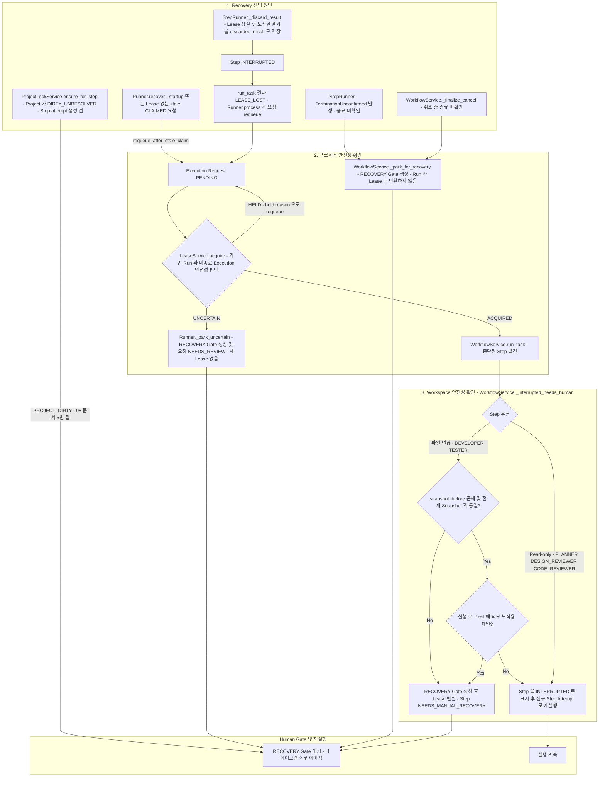
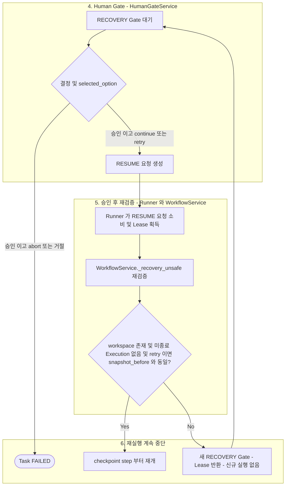

# Recovery 및 Checkpoint

> English: [09-recovery.md](09-recovery.md)

> 현재 구현 코드를 기준으로 정리한 흐름입니다. 코드로 확인되지 않았거나 검증되지 않은 동작은 현재 구현 제한으로 구분합니다.

별도의 Recovery Service는 없습니다. 아래 진입 지점이 각 모듈에 분산되어 있습니다. 이 문서는 두 개의 예외 흐름 다이어그램으로 나뉩니다.

- 다이어그램 1: Recovery 진입 원인과 안전성 판단(프로세스·Workspace)이 RECOVERY Gate 생성 또는 자동 재실행으로 이어지는 과정.
- 다이어그램 2: 사용자 결정 이후의 재검증과 재개·중단. 다이어그램 1의 `RECOVERY Gate 대기` 노드에서 이어집니다.

중심 클래스는 `Runner`, `LeaseService`, `WorkflowService`, `StepRunner`, `HumanGateService`입니다.

## 1. Recovery 진입 및 안전성 판단

- Recovery 진입 시 Task=`WAITING_APPROVAL`, Approval type=`RECOVERY`, Step=`NEEDS_MANUAL_RECOVERY`가 한 트랜잭션에서 전환·생성됩니다 (`HumanGateService.open_recovery`). 별도 상태 머신은 없습니다.
- `Runner.recover`의 주된 책임은 stale `CLAIMED` 요청 requeue, idle 취소 처리, 종료된 Task가 남긴 Project write lock 정리입니다. 모든 Recovery Gate를 직접 만들지 않으며, requeue된 요청이 다음 `LeaseService.acquire`에서 판정됩니다. stale 판정은 살아 있는 Lease가 없을 때만 적용되고(claim~Lease 정상 구간은 유예 시간으로 보호), requeue가 `claim_token`을 지우므로 이전 coroutine은 fencing으로 차단됩니다. 요청 변경 자체도 조회 당시 `claim_token`을 조건으로 하는 조건부 UPDATE이며, 조건이 맞지 않으면(조회 뒤 다른 소유자가 가져감) 현재 상태를 덮어쓰지 않습니다 ([03](03-task-runner_ko.md)).
- 요청 recovery의 DB 작업은 `_lifecycle_lock` 밖에서 bounded timeout으로 실행됩니다. 하나도 적용되지 않은 recovery는 DB 변경 없음으로 안전하게 끝나고, commit 결과가 불명확하면 read-only 조회로 확인합니다. 확인 자체가 실패하면 기존 증거를 보존한 채 `STOP_INCOMPLETE` 또는 다음 시도로 이어지며, 확정되지 않은 증거가 있는 동안 advisory lock은 유지됩니다. timeout이 commit 결과를 rollback으로 확정하지는 않습니다.
- Lease 상실은 Recovery Gate에 직접 연결되지 않습니다. 결과는 `discarded_result`로만 남고 Step은 `INTERRUPTED`가 되며, 요청이 requeue된 뒤 다음 `acquire`가 기존 Run과 미종료 Execution의 종료 입증 여부를 판단합니다. 입증되지 않으면 `UNCERTAIN`이 되어 `Runner._park_uncertain`이 RECOVERY Gate를 엽니다. 입증되면 인계 후 `run_task`가 중단된 Step을 발견해 3번 구역으로 갑니다 ([07](07-lease_ko.md)).
- 취소 중 CLI 종료가 확인되지 않으면 CANCELLED가 아니라 Recovery Gate로 이동합니다 ([11](11-task-lifecycle_ko.md)).
- Lease 처리는 진입 경로에 따라 다릅니다.
  - `_park_for_recovery`(종료 미확인): Run/Lease를 반환하지 않습니다. 기존 Run을 정상 종료된 것으로 간주하지 않습니다.
  - `_interrupted_needs_human`과 `_recovery_unsafe` 실패: Lease를 반환(`FINISHED`)한 뒤 Gate를 대기합니다.
  - `Runner._park_uncertain`: 새 Lease를 얻지 못한 상태이므로 새 Run이 없습니다.
- Read-only Step은 자동 복구 결과를 재사용하지 않고 신규 Step Attempt(새 행)로 재실행할 수 있습니다. 완료된(SUCCEEDED) Step의 재사용은 `input_hash`·`output_hash`로만 판단합니다 ([10](10-invalidation_ko.md)).
- 파일 변경 Step은 `snapshot_before`와 현재 Snapshot을 비교합니다. 변경되었거나 `snapshot_before`가 없거나 외부 부작용 가능성이 발견되면 Recovery Gate를 엽니다.

## 2. 사용자 결정 후 재검증과 재개

RECOVERY Gate에서 결정이 저장된 뒤의 흐름입니다. 결정 API의 공통 처리는 [08](08-human-gate_ko.md)에 있고, 여기서는 `HumanGateService`가 만든 RESUME 요청을 `Runner`와 `WorkflowService`가 소비하는 과정을 보여줍니다.

- `continue`, `retry`는 RESUME 요청을 만들고, `abort`(승인)와 거절은 Task를 FAILED로 종료합니다 ([08](08-human-gate_ko.md)).
- `_recovery_unsafe`는 RECOVERY 승인에만 적용되며, 승인이 이 검증을 면제하지 않습니다. 실패하면 새 RECOVERY Gate를 만들고 Lease를 반환한 뒤 대기합니다.

## 3. Project write lock과 Workspace baseline 복구

프로젝트 Task는 Workspace를 공유하므로, 위 안전성 판단에 Project 상태가 추가됩니다. 모든 항목의 원칙은 같습니다. **측정할 수 없거나 증명할 수 없으면 `CLEAN`으로 간주하지 않고 `DIRTY_UNRESOLVED`로 처리하며, 파일은 절대 복원·삭제하지 않습니다.**

| 중단·실패 지점 | 남는 상태 | 결과 |
|---|---|---|
| claim 직후, Lease 전 | `CLAIMED`, Lease 없음 | 유예 시간 뒤 stale → `PENDING`으로 requeue(아직 실행된 것 없음). 유예 안에서는 건드리지 않음 |
| requeue된 뒤 이전 coroutine이 진행 | `claim_token` 불일치 | 모든 fence에서 중단, 기록 없음 |
| write lock 획득 후 CLI 전 | owner=Task, Lease 만료 | owner 유지(같은 Task만 재진입). 다음 `acquire`가 Lease 정리 |
| CLI 실행 중 Runner 종료 | Lease 만료, 미종료 Execution | 기존 경로(프로세스 종료 입증 또는 RECOVERY). owner 유지 |
| `WAITING_APPROVAL` | Lease 반환, owner 유지 | 재개 시 검증, 취소 시 즉시 terminal 정리([11](11-task-lifecycle_ko.md)) |
| fingerprint 측정 후 terminal 트랜잭션 전 owner·`write_epoch` 변경 | proof 불일치 | 롤백, 재측정(최대 3회). 계속 불일치하면 `UNMEASURED` 종료 → `DIRTY_UNRESOLVED` |
| terminal 트랜잭션 도중 종료 | 롤백 | Task 비종료, 재실행 시 정상 종료 경로 |
| terminal 처리 후 lock이 남은 이상 상태(owner가 terminal Task) | owner 잔류 | `ProjectLockService.reconcile`이 현재 fingerprint와 write baseline을 비교해 해제. 측정 불가·버전 불일치면 `DIRTY_UNRESOLVED` |
| 읽기 전용 Step 중 Project 변경 | `write_epoch` 변경 | 그 Step attempt를 재사용하지 않음(`CANCELLED`, `PROJECT_CHANGED`) → 지연 requeue. 상한(`PROJECT_EPOCH_RETRIES`=2) 초과 시 `FAILED` `PROJECT_WORKSPACE_UNSTABLE` |
| `git clone` 중 종료 | `project-clones` 아래 미등록 디렉터리 | Project 행이 없으므로 노출되지 않음. 종료를 입증하지 못하면 삭제하지 않고 `CLONE_TERMINATION_UNCONFIRMED` |
| Runner 재시작 중 backoff 중인 요청 | `not_before`, `defer_count` 보존 | 재시작 뒤에도 backoff 유지 |
| tracked 프로세스가 (suspended로) spawn된 뒤 식별이 저장되기 전에 Runner가 죽음 | `executions` 행 `STARTING`, `pid` 없음, 입증되지 않은 spawn 기록 없음, 보유 중인 Job 없음(재시작한 Runner에는 없음) | takeover 또는 sweeper가 `NEVER_RAN`으로 닫음. suspended 프로세스는 살아남을 수 있음(CP2, 설계상 수용) |
| tracked 명령이 트리가 비었다고 입증되지 않은 채 끝남 | 행이 열려 있음(`lifecycle=TERMINATION_UNCONFIRMED`), Job은 Runner 프로세스에 유지 | `TerminationUnconfirmed`가 RECOVERY 경로를 열고, 판정이 입증할 때까지 행은 미해결(U 집합)로 남으며 그동안 Project는 `CLEAN`이 될 수 없음 |
| tracked 행의 닫는 쓰기가 유실됨 | 행이 열려 있음, proof 없음 | 행은 미해결로 남고, sweeper 또는 다음 takeover가 판정함([07](07-lease_ko.md)) |

위 표의 근거와 `write_epoch`의 의미는 [10](10-invalidation_ko.md)에 있습니다. 운영 규칙(threat model): **활성 Project Task가 있는 동안의 외부 수정은 지원하지 않습니다.** 감지되면 읽기 단계는 epoch 재시도, 변경 단계는 Recovery 대상입니다. Task 사이(Project 유휴)의 사용자 수정은 허용되며 다음 Task가 처음 write lock을 얻을 때 baseline으로 수용됩니다. 파일시스템과 DB는 하나의 원자 트랜잭션이 될 수 없으므로 측정과 커밋 사이의 외부 변경은 완전히 탐지되지 않을 수 있습니다.

## 4. baseline 행이 없는 owner (crash gap, 또는 이 기능 이전의 owner)

`_ensure_baseline`은 이미 Project를 소유한 Task가 gate에 다시 들어올 때 실행됩니다. 행이 있으면 epoch만 검사합니다(mutating step 전에는 정확히 `acquired_epoch`, 이후에는 최소 `acquired_epoch`. mutating step 시작마다 epoch가 증가하기 때문이며, acquisition epoch가 없는 복구 행은 `recorded_epoch`가 하한일 뿐). 행이 없으면 READY를 반환하지 않습니다.
- **mutating step이 이미 실행됨**(DEVELOP/TEST 행 존재): `proof_epoch = acquired_epoch = NULL`, `recorded_epoch` = 현재 epoch인 명시적 `UNAVAILABLE(BASELINE_MISSING_AT_REENTRY)` 행. 최초 acquisition epoch는 증명할 수 없으므로 현재 epoch로 지어내지 않습니다.
- **아직 아무것도 바꾸지 않음**: fingerprint와 manifest를 트랜잭션 밖에서 측정한 뒤, 한 트랜잭션(task·project 행 lock, owner·epoch 재확인)에서 새 fingerprint를 `write_baseline_fingerprint`와 비교합니다. 같으면 acquisition 이후 workspace가 변하지 않았음이 증명되므로 `proof_epoch = acquired_epoch = recorded_epoch` = 현재 owner epoch인 AVAILABLE `REENTRY_RECOVERY` 행입니다. 다르거나 측정할 수 없으면 `UNAVAILABLE(BASELINE_MISSING_AT_REENTRY)`.
다른 identity(project, proof epoch, fingerprint)의 행은 충돌이며 fail closed하고 아무것도 덮어쓰지 않습니다. identity가 같고 status만 다르면 기존 행을 유지합니다(AVAILABLE을 교체하지 않고 UNAVAILABLE을 승격하지 않음).

## 5. Tracked Execution: 분류, Sweeper, terminal 규칙

tracked execution([05](05-development-testing_ko.md))은 별도 상태 기계가 아니라 `executions.detail`로 판정합니다. `tracked_classifier.classify_row`(`tracked_sql`의 SQL을 그대로 옮긴 Python 쪽이며, 같은 SQL이 migration 0005의 부분 인덱스 `ix_executions_tracked_unresolved`, `ix_executions_tracked_anomaly`의 기반입니다)가 프로젝트의 모든 행을 하나의 class로 분류합니다.

| Class | 의미 |
|---|---|
| `LEGACY` | tracked marker도 tracked 전용 키도 없음(또는 `detail`이 JSON 객체가 아님): 아래 모든 규칙의 바깥 |
| `UNRESOLVED` (U 집합) | `tracked`가 true이고 `proof`도 `disposition`도 없음 |
| `RESOLVED_PROVEN` | `tracked`, `v=1`, `finished_at` 설정, 양성 `proof`(`JOB_EMPTY`, `JOB_KILL_ON_CLOSE_ASSUMED`, `NEVER_RAN`) |
| `RESOLVED_RISK` | `tracked`, `v=1`, `finished_at` 설정, `disposition=OPERATOR_RISK_ACCEPTED`이며 행의 id·`pid`와 일치하는 유효한 `risk_acceptance` 기록([08](08-human-gate_ko.md)) |
| `ANOMALY` (A 집합) | 그 밖의 tracked처럼 보이는 모든 행: `UNKNOWN_SCHEMA_VERSION`, `CONTRADICTORY_PROOF_DISPOSITION`, `INVALID_PROOF`, `INVALID_DISPOSITION_KIND`, `INCOMPLETE_RISK_ACCEPTANCE`, `OTHER_SCHEMA_INVALID`(엄격하게 해석할 수 없는 `detail`은 `decode_error`가 붙은 `OTHER_SCHEMA_INVALID`) |

- **프로젝트 전체 규칙**: `has_unresolved_or_anomalous_for_project`가 유일한 진입점이며 두 집합을 항상 함께 평가합니다(`DIAGNOSTIC_MAX_ANOMALIES`로 제한). 어느 집합이든 구성원이 있으면 막힙니다. terminal Task나 `reconcile`은 fingerprint proof와 무관하게 Project를 `DIRTY_UNRESOLVED`로 해제하고, owner가 없는 `CLEAN` Project에 그런 행이 남아 있으면 `ensure_for_step`이 Project를 `DIRTY_UNRESOLVED`로 표시하고 PROJECT_DIRTY gate를 열며, `continue`는 거부됩니다([08](08-human-gate_ko.md)).
- **Orphan sweeper**(`OrphanSweeper`, 백그라운드 unit `sweeper`, [03](03-task-runner_ko.md)): 한 pass는 keyset scan(행 수·시간 제한)으로 U·A 행 한 batch를 모아 id 오름차순으로 한 행씩, 각각 짧은 guard 트랜잭션에서 정리합니다. OS 판정(보유 Job 먼저, 그다음 [07](07-lease_ko.md)의 takeover와 같은 판정)은 트랜잭션 밖 스레드에서 실행합니다. U 행에 확정 판정이 나면 proof를 `detail`에 merge하고(`abandoned_by_sweeper`), 확정되지 않으면 행을 건드리지 않습니다. A 행은 `settle_anomaly`로 정리하며, 읽은 그대로의 `detail`, A 집합 소속, 기록된 식별(`pid`, `process_create_time`)에 대한 compare-and-swap이므로 `pid` 없는 행에서 내린 `NEVER_RAN` 판정이 그 뒤에 소유자가 식별을 커밋한 행을 닫을 수 없습니다. 잘못된 키는 `anomaly_original`로 옮기고 `anomaly_settlement` 기록을 남깁니다. `UNKNOWN_SCHEMA_VERSION` 행은 다시 쓰지 않으며, `decode_error` 행은 건너뛰고 세기만 할 뿐 쓰지 않습니다. 커밋된 cursor는 결정된 접두부만 넘어가고, 실패한 pass는 cursor를 유지한 채 상한 있는 backoff로 재시도하며, 첫 pass는 `startup_mutation_done`을 기다립니다.
- **정체와 재평가 상태**: 연속 실패 pass는 sweeper를 `SWEEPER_STALLED`로 만들며(여전히 어떤 행도 건너뛰지 않음), sweeper 설정 오류는 이후 pass가 실패 위치를 지날 때까지 `SWEEPER_CONFIG_INVALID`로 표시됩니다([11](11-task-lifecycle_ko.md)).
- 요청이 **적용되거나** 판정이 행을 입증한 뒤에도 Project는 `DIRTY_UNRESOLVED`이며, PROJECT_DIRTY gate의 `continue`만 `CLEAN`으로 되돌립니다.

## 현재 구현 제한

- tracked execution 복구의 검증 범위: Windows에서 실제 Job Object와 실제 자식 프로세스(`tests/unit/test_windows_job.py`, `tests/integration_pg/test_never_ran_crash_points.py`, `tests/integration_pg/test_tracked_services.py`)와, classifier·sweeper·risk worker·takeover 규칙은 내장 PostgreSQL로 **검증됨**. POSIX 정책은 코드에만 존재합니다. POSIX에서는 tracked 행이 기록되지 않고, `UNSUPPORTED_PLATFORM`은 untracked 실행으로 degrade하며, `UNKNOWN`/`UNAVAILABLE`은 fail-closed입니다. POSIX 런타임 동작은 **검증하지 않았습니다**. **검증하지 않은 것**: POSIX 런타임, 실제 Gradle/Maven 빌드, 실제 CLI E2E, 무작위 race stress, EXPLAIN/generic plan, 실제 deadlock 테스트.
- CP2 잔여 위험: Job에 할당되지 않은 suspended 프로세스(spawn됨, 아직 Job 미할당, 식별 미기록)는 그 행이 "아무것도 spawn되지 않음"과 구별되지 않으므로 `NEVER_RAN` 종료 뒤에도 살아남을 수 있습니다. 프로세스가 suspended 상태이므로 사용자 코드는 실행될 수 없었습니다. 설계상 수용된 한계입니다(불변 조건 I4, `SUSPENDED_ORPHAN_POSSIBLE`). 이 수용은 아래의 보유 Job 경우로 **확장되지 않습니다**.
- `NEVER_RAN` 규칙의 이전 잔여 위험(`pid`가 없고 보유 중인 Job이 비어 있다고 입증되지 않았으며 executor 쓰기가 유실된 행이 `NEVER_RAN`으로 닫힐 수 있던 문제)은 **같은 Runner 프로세스에 보유된 Job에 대해서는 해소되었습니다**. takeover, `OrphanSweeper`, `ProcessRiskWorker`가 모두 `retained_job_verdict`(`CommandExecutor.has_retained`)를 통해 그런 열린 행을 `SPAWNED_PROCESS_UNPROVEN`으로 판정합니다. 단 settler가 Job이 비었음을 입증하면(`JOB_EMPTY`) 예외입니다. 실행 순서(Job 할당, 식별 캡처, fence된 식별 쓰기, 그 다음 resume) 때문에 pid가 없는 행은 사용자 코드를 실행한 적이 없습니다. Runner 재시작 뒤에는 프로세스 내부 레지스트리가 비어 있습니다. Job은 `JOB_OBJECT_LIMIT_KILL_ON_JOB_CLOSE`를 가지므로 OS가 소유 Runner 프로세스와 함께 그 프로세스들을 종료합니다(조건부 OS 보장, [07](07-lease_ko.md) 참조).
- `SPAWNED_PROCESS_UNPROVEN`으로 기록된 pid 없는 행은 **재시작으로 해소되지 않으며 현재 지원되는 해소 경로가 없습니다**. 세부 내용([08](08-human-gate_ko.md)): 유효한 수용 기록에는 `pid`가 필요하므로 gate는 pid 없는 행이 하나라도 있는 대상 집합에서 `accept_unproven_risk`를 숨기고(`TARGET_WITHOUT_PID`), 직접 제출은 409 `OPTION_NOT_AVAILABLE`로 거부되며 아무것도 기록되지 않습니다. `abort`는 Task만 종료하며 `DIRTY_UNRESOLVED`를 해소하지 않고(미해결·이상 tracked execution이 없을 때의 `continue`만 해소), sweeper와 takeover는 행을 열어 둡니다. 프로세스를 수동으로 정리한 뒤에도 행은 데이터베이스를 직접 수정해야만 정리할 수 있습니다(`tests/integration_pg/test_pidless_unproven_resolution.py`). 검증하지 않음, 별도 후속 항목: Runner 재시작 뒤 pid 없는 행의 Windows 통합 테스트(`KILL_ON_JOB_CLOSE` 가정).
- `ANOMALY` 행에는 sweeper가 정리하는 종류에 대한 정리를 제외하면 자동 경로도 운영자 경로도 없으며, `decode_error` 행은 아예 없어서 Project는 `DIRTY_UNRESOLVED`로 남습니다.

- 활성 Project Task 중의 외부 프로세스 수정은 지원하지 않으며, fingerprint 비교로도 완전 탐지가 보장되지 않습니다(측정과 커밋 사이 변경 가능). `write_epoch`는 Orchestrator가 통제하는 lock과 변경 Step의 세대 번호이며 외부 변경을 감지하지 않습니다.
- `DIRTY_UNRESOLVED`의 해결 경로는 PROJECT_DIRTY Gate의 `continue`뿐입니다. 승인자가 없으면 해당 Project의 변경 Task는 대기 상태를 유지합니다.
- 외부 부작용 판정은 해당 Step Execution의 stdout/stderr tail에 대한 정규식 검사(`curl`, `wget`, `git push`, `npm publish`, `twine`, `ssh`, `scp`, `http(s)://`)에 의존합니다. 패턴이 없으면 부작용이 없다고 증명된 것이 아닙니다.
- Step 실행 순서는 CLI 반환 → Execution 결과 기록 → `snapshot_after`입니다. 정상 기록된 결과 뒤 Snapshot이 실패(`SnapshotError`)하면 Step·Task는 `SNAPSHOT_FAILED`로 fail-closed 되며 종료된 CLI가 미종료로 분류되지는 않습니다. `TerminationUnconfirmed`·`LeaseLost`가 먼저 처리되므로 Snapshot 실패가 이를 덮지 않습니다. 현재 구현 제한: Windows에서 다른 프로세스가 잠근 파일 하나로도 Task가 `SNAPSHOT_FAILED`가 될 수 있습니다.
- Task terminal 트랜잭션(Task 상태·Project 정리·Lease/Session/Step 정리)과 ExecutionRequest의 `DONE` 처리는 **별도 트랜잭션**입니다. terminal 커밋 뒤 요청 완료 전에 Runner가 죽으면 다음 시작의 startup recovery가 terminal Task의 `CLAIMED` 요청을 `DONE`으로 정리합니다.
- WorkspaceSnapshot은 변경 감지 전용입니다. 파일 내용을 복원하지 못하며 자동 복원 기능은 없습니다.
- 정확히 한 번 실행을 보장하지 않습니다(at-least-once + 변경 감지).
- Windows 프로세스 종료 실패(`ACCESS_DENIED` 등)는 시뮬레이션(tracked Job 경로는 주입한 `JobError` 값 포함)으로만 검증했고 실제 재현하지 못했습니다.
- Session `SessionConflict` 이후의 복구 경로는 테스트로 검증하지 않았습니다 ([06](06-session_ko.md)).
