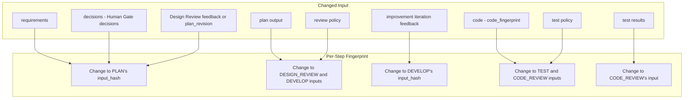
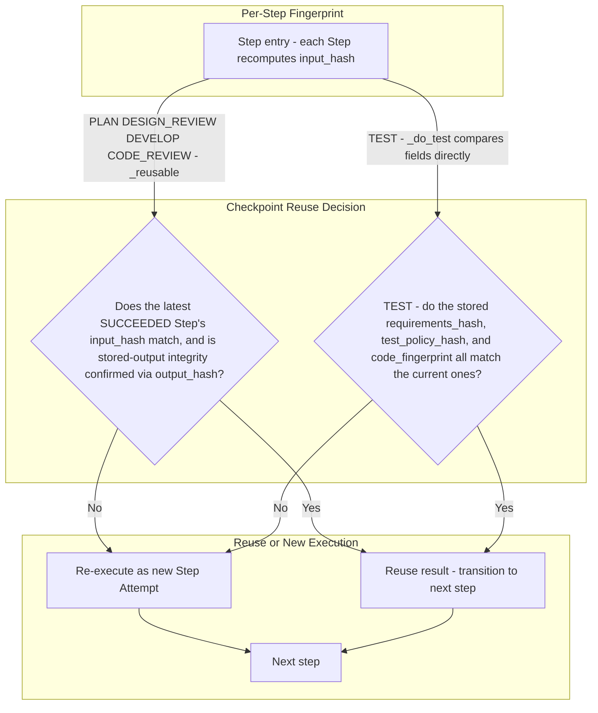

# Context Invalidation

> 한국어: [10-invalidation_ko.md](10-invalidation_ko.md)

> This document reflects the flow as organized based on the current implementation code. Behavior not confirmed or validated in code is distinguished as a current implementation limitation.

There is no separate Invalidation Service or general-purpose rule engine. Each Step computes an `input_hash` from its own dependent inputs, and reuses stored results only when valid (`WorkflowService._reusable` and `_do_*` methods).

This document is divided into two diagrams. The first shows which input changes affect which Step's `input_hash`, and the second shows the reuse decision at Step entry. Both are normal flows, and the central class is `WorkflowService`.

## 1. Input Changes and Per-Step Fingerprints

This shows the correspondence between changed inputs and the Steps whose `input_hash` changes as a result. This does not mean there is a component that detects and pushes input changes — it is a summary of the inputs each `_do_*` computes upon Step entry.

- The diagram above is a summary; the exact composition is defined by the table below. For example, `decisions` is included not only in PLAN's inputs but also in those of DESIGN_REVIEW, DEVELOP, and CODE_REVIEW.
- For how a changed input leads to a reuse decision at each Step, see diagram 2.

## 2. Checkpoint Reuse Decision

This is the flow in which each Step, upon entry, recomputes the `input_hash` and decides whether to reuse the latest SUCCEEDED Step or execute as a new Attempt.

## Per-Step Dependent Inputs in the Current Implementation

| Step | Inputs (input_hash composition) | Code location |
|---|---|---|
| PLAN | requirements, decisions, previous Design Review feedback, plan_revision | `_do_plan` |
| DESIGN_REVIEW | design_review_basis (requirements, plan, decisions, review policy) | `_do_design_review` |
| DEVELOP | plan, decisions, workflow_iteration feedback | `_do_develop` |
| TEST | requirements, code fingerprint, test policy | `_do_test` |
| CODE_REVIEW | requirements, code fingerprint, test result, decisions | `_do_code_review` |

- TEST does not use `_reusable`; it reuses the previous SUCCEEDED result only when the `requirements_hash`, `test_policy_hash`, and `code_fingerprint` stored in its `output` all match the current ones and the `output_hash` is valid.
- CODE_REVIEW reverts to TESTING if there is no TEST result made with the current `code_fingerprint` (`test_result_stale_for_current_code`).
- DEVELOP first checks, immediately before Development, whether the PASS's basis matches the current basis ([04](04-planning-review.md)).
- `code_fingerprint` is in the `STEP_SNAPSHOT_V1:<sha256>` format (`workspace_snapshot.py`, computed in a single walk, ignore rules not applied); if the stored value is not the current version (no prefix, `WORKSPACE_FINGERPRINT_V1`, etc.), it satisfies neither reuse nor Completion. It is computed by WorkspaceSnapshot, which excludes volatile paths such as JUnit, reports, and caches. Normal outputs of a subsequent Step do not cause a preceding Step to re-execute.
- The reuse decision is made solely from each Step's own `input_hash` and `output_hash`. WorkspaceSnapshot is used only to confirm re-execution safety for an interrupted Step ([09](09-recovery.md)).
- Requirement edits (`PATCH /tasks/{id}`) are possible only for a PENDING Task (`TaskService.update_task`). Once execution has started, requirements cannot change.
- A Human Gate decision changes `decisions_hash`, so the Steps that use it as input (PLAN, DESIGN_REVIEW, DEVELOP, CODE_REVIEW) become subject to re-execution.

## 3. Project Workspace fingerprint (`WORKSPACE_FINGERPRINT_V1`)

Separately from the `code_fingerprint` above (`STEP_SNAPSHOT_V1`, used for Step reuse decisions) — the two modules do not import each other and share only the common `workspace_policy`/`workspace_digest` modules, with prefixes not cross-permitted — the project-level baseline and proof use `compute_fingerprint` from `app/infra/workspace_fingerprint.py`. The two values are never compared against each other, and boundaries that require accuracy (DIRTY determination, write baseline comparison) use only this fingerprint.

- **Content hashes are always read directly.** It does not reuse a previous hash just because `(size, mtime_ns)` match, nor does it trust git's stat cache. Changing only the content while keeping the same size and mtime still produces a different result.
- **GIT mode**: used when there is an ordinary `.git` directory inside the Workspace and `git` (≥2.32) is available. It includes HEAD (or `UNBORN` if absent), all index entries (stage, mode, blob OID), the **actual content SHA-256** of tracked files and untracked non-ignored files, deletions and type changes, and submodules (gitlink OID + internal content fingerprint). A rename is treated as delete+add, and ignored build outputs have no effect. git is used read-only (`rev-parse`, `ls-files --stage`, `ls-files --others --exclude-standard`, `config --local --get`), without a shell, passing `--no-optional-locks` and `core.fsmonitor=false`, `core.hooksPath=<devnull>`, etc., and runs in a fixed environment with `GIT_CONFIG_GLOBAL`/`GIT_CONFIG_SYSTEM` set to `os.devnull` and all inherited `GIT_*` variables removed.
- **CONTENT mode** (fallback): used when there is no repository, `.git` is a file, or points to a gitdir/`commondir`/`alternates`/`core.worktree` outside the Workspace, or git is unavailable or untrusted (registration is not refused). This is a full content hash walk.
- Links (symlink/junction) are not followed. A link uses only the target *string* as its value and does not read the target's content (even if git lists files under a junction, it is treated as a single link entry).
- Volatile paths such as `reports/`, `__pycache__/`, along with `node_modules`, `.gradle`, `.idea`, and `target`/`build` next to `pom.xml`/Gradle files (sources whose Java package name is `build` are not excluded) are not included.
- **Canonical format**: a schema version precedes the payload; each entry is serialized as a length-prefixed `type tag | path length·path (UTF-8) | mode | value length·value`, and normalized relative paths (`/`-separated, case-preserving) are sorted in UTF-8 byte order. It does not rely on repr, dict ordering, or the OS default encoding, and `('a','bc')` and `('ab','c')` do not collide. The result is `WORKSPACE_FINGERPRINT_V1:<sha256>`.
- **Versioning policy**: if the schema version changes, stored baselines and checkpoints are not reused (differing prefixes are treated as incomparable, and a write baseline for an in-progress Task is conservatively treated as `DIRTY_UNRESOLVED`).
- If measurement fails (`FingerprintError`), it is not used as grounds for `CLEAN`. Unreadable files are not ignored either.

### `write_epoch` and Stability Determination

- `write_epoch` is a generation number for the Project lock (acquisition/release) controlled by the Orchestrator and for the start of a mutating Step. **It does not detect external filesystem changes.** External changes are the responsibility of fingerprint comparison, and these two determinations (`epoch_stable` and `fingerprint_stable`) are distinct.
- A read-only Step (PLAN, DESIGN_REVIEW) records `write_epoch` at start, and defers its start if another Task is making changes under an active Lease. If the epoch has changed by the time it finishes, that attempt and its result are not reused. If the epoch is unchanged, the existing checkpoint-reuse semantics (`_reusable`) apply as-is.
- A proof (`FingerprintProof`) records the owner and `write_epoch` at the time measurement began, together, and when used, verifies they are unchanged under a Project row lock. It does not compute the fingerprint while holding the row lock.

## Current Implementation Limitations

- Invalidation is not a push-based mechanism that detects input changes; it is a mechanism that compares hashes at Step entry. There is no generalized rule table in the code; the table above is a summary of each `_do_*` implementation.
- WorkspaceSnapshot is a change-detection mechanism that cannot restore files.
- `take_snapshot` (for Steps) hashes all files in full. This can be slow for very large repositories. mtime-based hash reuse is not implemented.
- In environments where file symlinks cannot be created due to lack of permission on Windows, file-symlink-related tests are skipped (directory junctions are verified).
