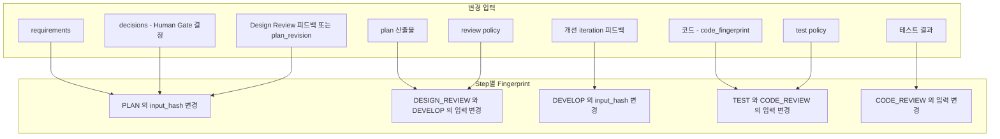
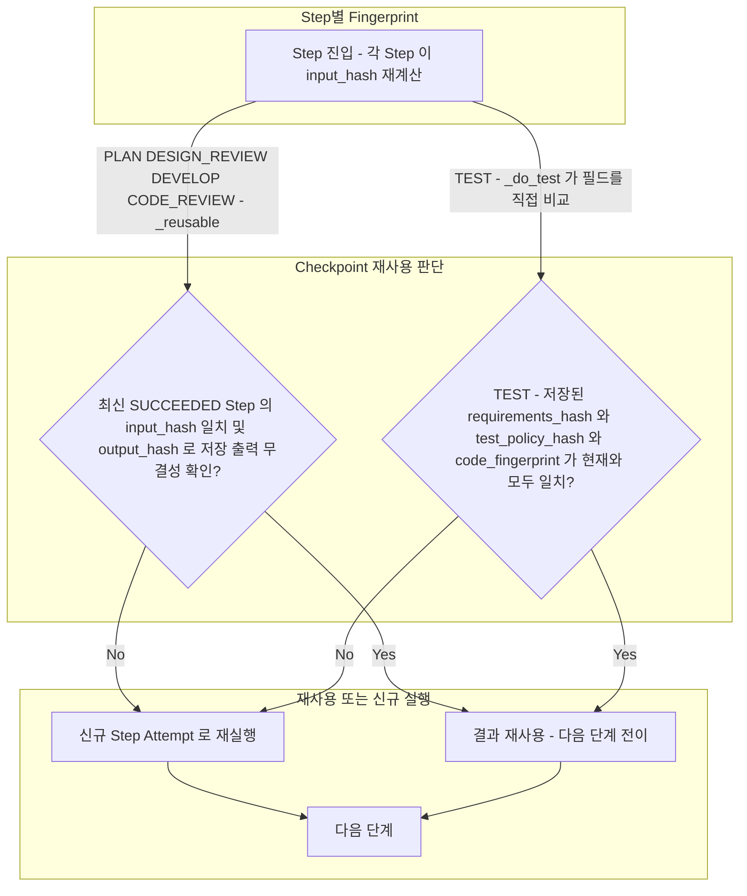

# Context Invalidation

> 현재 구현 코드를 기준으로 정리한 흐름입니다. 코드로 확인되지 않았거나 검증되지 않은 동작은 현재 구현 제한으로 구분합니다.

별도의 Invalidation Service나 범용 규칙 엔진은 없습니다. 각 Step이 자신의 의존 입력으로 `input_hash`를 계산하고, 저장된 결과가 유효할 때만 재사용합니다 (`WorkflowService._reusable` 및 `_do_*` 메서드).

이 문서는 두 개의 다이어그램으로 나뉩니다. 1번은 어떤 입력 변경이 어느 Step의 `input_hash`에 영향을 주는지, 2번은 Step 진입 시점의 재사용 판단입니다. 둘 다 정상 흐름이며 중심 클래스는 `WorkflowService`입니다.

## 1. 입력 변경과 Step별 Fingerprint

변경된 입력과 그로 인해 `input_hash`가 달라지는 Step의 대응 관계입니다. 입력 변경을 감지해 푸시하는 구성 요소가 있다는 뜻이 아니라, 각 `_do_*`가 Step 진입 시 계산하는 입력을 요약한 것입니다.

- 위 다이어그램은 요약이며 정확한 구성은 아래 표가 기준입니다. 예를 들어 `decisions`는 PLAN뿐 아니라 DESIGN_REVIEW, DEVELOP, CODE_REVIEW의 입력에도 포함됩니다.
- 변경된 입력이 각 Step에서 어떻게 재사용 여부로 이어지는지는 다이어그램 2를 참고하십시오.

## 2. Checkpoint 재사용 판단

각 Step이 진입할 때 `input_hash`를 다시 계산하고 최신 SUCCEEDED Step을 재사용할지 새 Attempt로 실행할지 판단하는 흐름입니다.

## 현재 구현의 Step별 의존 입력

| Step | 입력 (input_hash 구성) | 코드 위치 |
|---|---|---|
| PLAN | requirements, decisions, 이전 Design Review 피드백, plan_revision | `_do_plan` |
| DESIGN_REVIEW | design_review_basis (requirements, plan, decisions, review policy) | `_do_design_review` |
| DEVELOP | plan, decisions, workflow_iteration 피드백 | `_do_develop` |
| TEST | requirements, code fingerprint, test policy | `_do_test` |
| CODE_REVIEW | requirements, code fingerprint, test result, decisions | `_do_code_review` |

- TEST는 `_reusable`을 쓰지 않고 이전 SUCCEEDED 결과의 `output`에 저장된 `requirements_hash`, `test_policy_hash`, `code_fingerprint`가 현재와 모두 같고 `output_hash`가 유효할 때만 재사용합니다.
- CODE_REVIEW는 현재 `code_fingerprint`로 만든 TEST 결과가 없으면 TESTING으로 되돌아갑니다 (`test_result_stale_for_current_code`).
- DEVELOP는 Development 직전에 PASS의 basis가 현재 basis와 같은지 먼저 확인합니다 ([04](04-planning-review.md)).
- `code_fingerprint`는 WorkspaceSnapshot에서 계산하며 JUnit, 리포트, 캐시 등 volatile 경로는 제외합니다. 후속 Step의 정상적인 산출물이 선행 Step의 재실행을 유발하지 않습니다.
- 재사용 판단은 각 Step 자신의 `input_hash`와 `output_hash`로만 합니다. WorkspaceSnapshot은 중단된 Step의 재실행 안전성 확인에만 사용합니다 ([09](09-recovery.md)).
- 요구사항 수정(`PATCH /tasks/{id}`)은 PENDING Task에서만 가능합니다 (`TaskService.update_task`). 실행이 시작된 뒤에는 요구사항이 바뀌지 않습니다.
- Human Gate 결정은 `decisions_hash`를 바꾸므로 이를 입력으로 쓰는 Step(PLAN, DESIGN_REVIEW, DEVELOP, CODE_REVIEW)이 재실행 대상이 됩니다.

## 현재 구현 제한

- 무효화는 입력 변경을 감지해 푸시하는 방식이 아니라, Step 진입 시점에 hash를 비교하는 방식입니다. 일반화된 규칙 표는 코드에 없으며 위 표는 각 `_do_*`의 구현을 요약한 것입니다.
- WorkspaceSnapshot은 파일을 복원할 수 없는 변경 감지 수단입니다.
