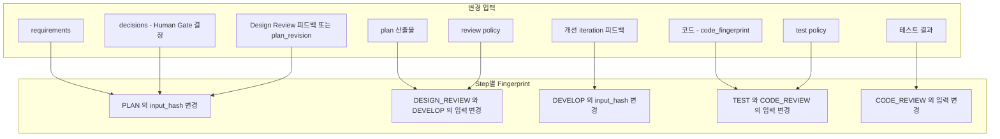
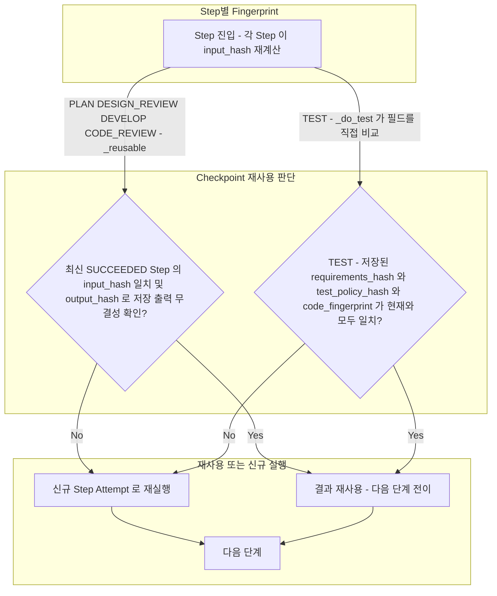

# Context Invalidation

> 현재 구현 코드를 기준으로 정리한 흐름입니다. 코드로 확인되지 않았거나 검증되지 않은 동작은 현재 구현 제한으로 구분합니다.

별도의 Invalidation Service나 범용 규칙 엔진은 없습니다. 각 Step이 자신의 의존 입력으로 `input_hash`를 계산하고, 저장된 결과가 유효할 때만 재사용합니다 (`WorkflowService._reusable` 및 `_do_*` 메서드).

이 문서는 두 개의 다이어그램으로 나뉩니다. 1번은 어떤 입력 변경이 어느 Step의 `input_hash`에 영향을 주는지, 2번은 Step 진입 시점의 재사용 판단입니다. 둘 다 정상 흐름이며 중심 클래스는 `WorkflowService`입니다.

## 1. 입력 변경과 Step별 Fingerprint

변경된 입력과 그로 인해 `input_hash`가 달라지는 Step의 대응 관계입니다. 입력 변경을 감지해 푸시하는 구성 요소가 있다는 뜻이 아니라, 각 `_do_*`가 Step 진입 시 계산하는 입력을 요약한 것입니다.

- 위 다이어그램은 요약이며 정확한 구성은 아래 표가 기준입니다. 예를 들어 `decisions`는 PLAN뿐 아니라 DESIGN_REVIEW, DEVELOP, CODE_REVIEW의 입력에도 포함됩니다.
- 변경된 입력이 각 Step에서 어떻게 재사용 여부로 이어지는지는 다이어그램 2를 참고하십시오.

## 2. Checkpoint 재사용 판단

각 Step이 진입할 때 `input_hash`를 다시 계산하고 최신 SUCCEEDED Step을 재사용할지 새 Attempt로 실행할지 판단하는 흐름입니다.

## 현재 구현의 Step별 의존 입력

| Step | 입력 (input_hash 구성) | 코드 위치 |
|---|---|---|
| PLAN | requirements, decisions, 이전 Design Review 피드백, plan_revision | `_do_plan` |
| DESIGN_REVIEW | design_review_basis (requirements, plan, decisions, review policy) | `_do_design_review` |
| DEVELOP | plan, decisions, workflow_iteration 피드백 | `_do_develop` |
| TEST | requirements, code fingerprint, test policy | `_do_test` |
| CODE_REVIEW | requirements, code fingerprint, test result, decisions | `_do_code_review` |

- TEST는 `_reusable`을 쓰지 않고 이전 SUCCEEDED 결과의 `output`에 저장된 `requirements_hash`, `test_policy_hash`, `code_fingerprint`가 현재와 모두 같고 `output_hash`가 유효할 때만 재사용합니다.
- CODE_REVIEW는 현재 `code_fingerprint`로 만든 TEST 결과가 없으면 TESTING으로 되돌아갑니다 (`test_result_stale_for_current_code`).
- DEVELOP는 Development 직전에 PASS의 basis가 현재 basis와 같은지 먼저 확인합니다 ([04](04-planning-review.md)).
- `code_fingerprint`는 `STEP_SNAPSHOT_V1:<sha256>` 형식이며(`workspace_snapshot.py`, 한 번의 walk로 계산, ignore 규칙 미반영) 저장된 값이 현재 버전이 아니면(접두사 없음·`WORKSPACE_FINGERPRINT_V1` 등) 재사용도 Completion 충족도 되지 않습니다. WorkspaceSnapshot에서 계산하며 JUnit, 리포트, 캐시 등 volatile 경로는 제외합니다. 후속 Step의 정상적인 산출물이 선행 Step의 재실행을 유발하지 않습니다.
- 재사용 판단은 각 Step 자신의 `input_hash`와 `output_hash`로만 합니다. WorkspaceSnapshot은 중단된 Step의 재실행 안전성 확인에만 사용합니다 ([09](09-recovery.md)).
- 요구사항 수정(`PATCH /tasks/{id}`)은 PENDING Task에서만 가능합니다 (`TaskService.update_task`). 실행이 시작된 뒤에는 요구사항이 바뀌지 않습니다.
- Human Gate 결정은 `decisions_hash`를 바꾸므로 이를 입력으로 쓰는 Step(PLAN, DESIGN_REVIEW, DEVELOP, CODE_REVIEW)이 재실행 대상이 됩니다.

## 3. Project Workspace fingerprint (`WORKSPACE_FINGERPRINT_V1`)

위의 `code_fingerprint`(`STEP_SNAPSHOT_V1`, Step 재사용 판단)와는 별개로(두 모듈은 서로 import하지 않고 `workspace_policy`·`workspace_digest` 공통 모듈만 공유하며 접두사가 교차 허용되지 않습니다), 프로젝트 단위의 baseline과 proof에는 `app/infra/workspace_fingerprint.py`의 `compute_fingerprint`를 사용합니다. 두 값은 서로 비교하지 않으며, 정확성이 필요한 경계(DIRTY 판정, write baseline 비교)는 이 fingerprint만 씁니다.

- **내용 해시를 항상 직접 읽습니다.** `(size, mtime_ns)`가 같다는 이유로 이전 해시를 재사용하거나 git의 stat cache를 믿지 않습니다. 같은 크기·같은 mtime으로 내용만 바꿔도 달라집니다.
- **GIT 모드**: Workspace 안에 평범한 `.git` 디렉터리가 있고 `git`(≥2.32)을 쓸 수 있을 때. HEAD(없으면 `UNBORN`), 모든 index 항목(stage·mode·blob OID), tracked 파일과 untracked 비ignore 파일의 **실제 내용 SHA-256**, 삭제·type 변경, submodule(gitlink OID + 내부 content fingerprint)을 포함합니다. rename은 delete+add이고 ignore된 산출물은 영향이 없습니다. git은 읽기 전용(`rev-parse`, `ls-files --stage`, `ls-files --others --exclude-standard`, `config --local --get`)으로만 쓰며 shell 없이, `--no-optional-locks`와 `core.fsmonitor=false`·`core.hooksPath=<devnull>` 등을 전달하고, `GIT_CONFIG_GLOBAL`/`GIT_CONFIG_SYSTEM`을 `os.devnull`로, 상속된 `GIT_*` 변수를 모두 제거한 고정 환경에서 실행합니다.
- **CONTENT 모드**(fallback): 저장소가 없거나, `.git`이 파일이거나 Workspace 밖 gitdir·`commondir`·`alternates`·`core.worktree`를 가리키거나, git을 쓸 수 없거나 신뢰할 수 없을 때(등록은 거부하지 않습니다). 전체 내용 해시 walk입니다.
- 링크(symlink·junction)는 따라가지 않습니다. 링크는 대상 *문자열*만 값으로 쓰고 대상 내용은 읽지 않습니다(git이 junction 아래 파일을 나열해도 링크 하나의 항목으로만 취급).
- `reports/`, `__pycache__/` 같은 volatile 경로와 `node_modules`, `.gradle`, `.idea`, 그리고 `pom.xml`/Gradle 파일 옆의 `target`/`build`(자바 패키지 이름이 `build`인 소스는 제외하지 않음)는 포함하지 않습니다.
- **정규 형식**: payload 앞에 schema version, 각 항목을 `type tag | 경로 길이·경로(UTF-8) | mode | 값 길이·값`의 length-prefix로 직렬화하고 정규화된 상대 경로(`/` 구분, 대소문자 보존)를 UTF-8 byte 순서로 정렬합니다. repr, dict 순서, OS 기본 인코딩에 의존하지 않으며 `('a','bc')`와 `('ab','c')`가 충돌하지 않습니다. 결과는 `WORKSPACE_FINGERPRINT_V1:<sha256>`입니다.
- **버전 정책**: schema version이 바뀌면 저장된 baseline과 checkpoint를 재사용하지 않습니다(접두가 다르면 비교 불가로 보고, 진행 중 Task의 write baseline은 보수적으로 `DIRTY_UNRESOLVED`).
- 측정에 실패하면(`FingerprintError`) `CLEAN`의 근거로 쓰지 않습니다. 읽을 수 없는 파일을 무시하지도 않습니다.

### `write_epoch`와 안정성 판정

- `write_epoch`는 Orchestrator가 통제하는 Project lock(획득·해제)과 변경 Step 시작의 세대 번호입니다. **외부 파일시스템 변경을 감지하지 않습니다.** 외부 변경은 fingerprint 비교가 담당하며, 이 둘(`epoch_stable`과 `fingerprint_stable`)은 서로 다른 판정입니다.
- 읽기 전용 Step(PLAN, DESIGN_REVIEW)은 시작 시 `write_epoch`를 기록하고, 다른 Task가 활성 Lease로 변경 중이면 시작을 미룹니다. 끝날 때 epoch가 달라졌으면 그 attempt와 결과를 재사용하지 않습니다. epoch가 같으면 기존 checkpoint 재사용 의미(`_reusable`)가 그대로입니다.
- proof(`FingerprintProof`)는 측정 시작 시점의 owner와 `write_epoch`를 함께 기록하고, 사용 시 Project 행 잠금 아래에서 같은지 확인합니다. 행 잠금을 잡은 채 fingerprint를 계산하지 않습니다.

## 현재 구현 제한

- 무효화는 입력 변경을 감지해 푸시하는 방식이 아니라, Step 진입 시점에 hash를 비교하는 방식입니다. 일반화된 규칙 표는 코드에 없으며 위 표는 각 `_do_*`의 구현을 요약한 것입니다.
- WorkspaceSnapshot은 파일을 복원할 수 없는 변경 감지 수단입니다.
- `take_snapshot`(Step용)은 전체 파일을 해시합니다. 매우 큰 저장소에서는 느릴 수 있습니다. mtime 기반 해시 재사용은 구현하지 않았습니다.
- Windows에서 권한이 없어 파일 symlink를 만들 수 없는 환경에서는 파일 symlink 관련 테스트가 skip됩니다(디렉터리 junction은 검증됨).
