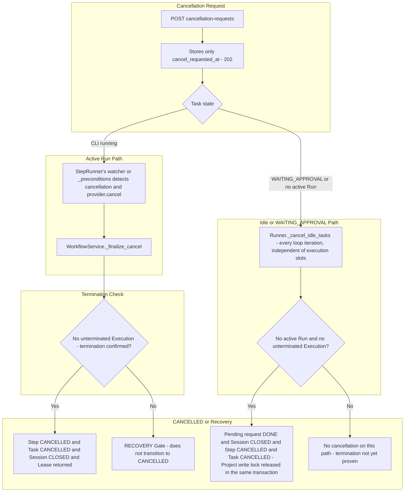
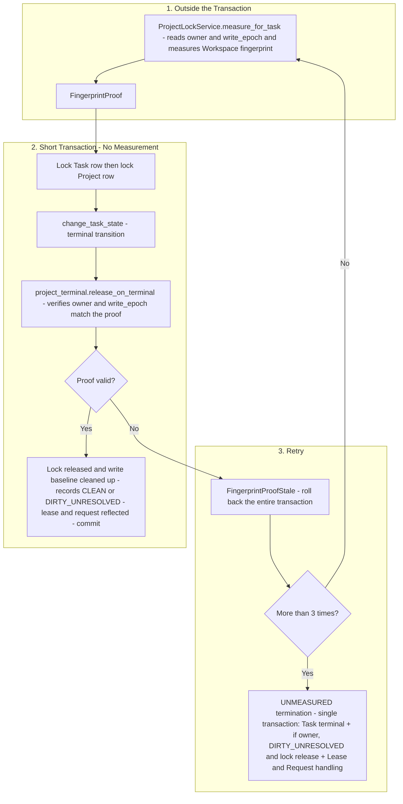
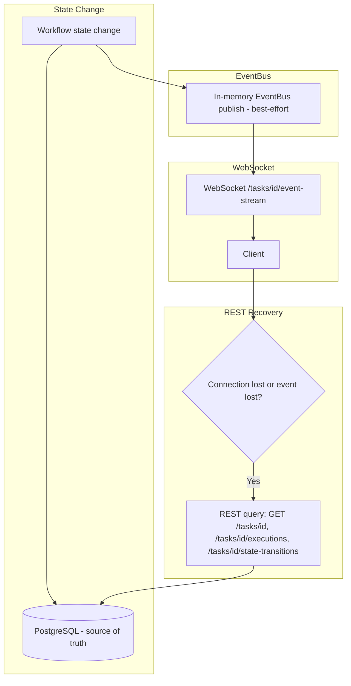
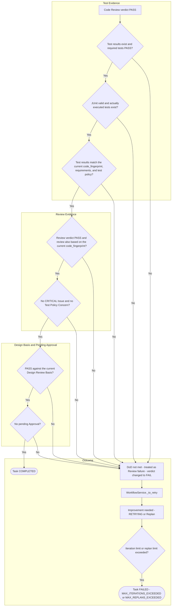

# Cancellation, Streaming and Completion

> 한국어: [11-task-lifecycle_ko.md](11-task-lifecycle_ko.md)

> This flow is organized based on the current implementation code. Behavior that has not been confirmed in code or has not been verified is distinguished as a current implementation limitation.

The three diagrams in this document (Cancellation, Event Streaming, Completion) are independent of each other, with no connecting lines between the diagrams. Each can be read separately.

## Cancellation

`POST /tasks/{id}/cancellation-requests` only records `tasks.cancel_requested_at` and returns 202. It does not directly change the state to CANCELLED. The actual transition is performed after CLI termination is confirmed. The diagram below shows the two paths after a cancellation request (an active Run, no active Run) and the outcome of the termination check; the central classes are `WorkflowService._finalize_cancel` and `Runner._cancel_idle_tasks`.

- If cancellation occurs while waiting for Approval, the transition completes once it is confirmed there is no active Run and no unterminated Execution.
- If termination is uncertain, the flow moves not to CANCELLED but to the RECOVERY Gate ([09](09-recovery.md)).
- `_cancel_idle_tasks` runs inside `Runner.recover` at Runner startup and on every loop iteration. It runs even when execution slots are full, so cancellation of a Task holding the write lock in `WAITING_APPROVAL` is not starved.

## Terminal Transitions and Project Write Lock Cleanup

All terminal transitions of a Task (`COMPLETED`, `FAILED`, `CANCELLED`) pass through a single point, `state_service.change_task_state`, and for project Tasks, `project_terminal.release_on_terminal` performs Project cleanup within the same transaction (lock release + write baseline cleanup + `write_epoch` increment + `workspace_state` recording). This transaction does not include `DONE` processing of the ExecutionRequest (`Runner.process` handles it in a separate transaction, and any omission is cleaned up by startup recovery). This function is the sole owner of terminal cleanup, and `ProjectLockService` has no general release (only `reconcile`, which is reconcile-only).

Project Task terminal call sites (failure termination `_fail`, cancellation `_finalize_cancel`, `max_replans`/iteration limits, COMPLETED, RECOVERY abort/rejection, idle/parked cancellation) all pass through `TaskFinalizer.finalize_task_with_proof` or a step-completion wrapper that uses the same retry rules (`WorkflowService._complete_succeeded`, `HumanGateService.decide`).

- `CLEAN` determination: if the measurement is valid and the outcome is `COMPLETED`, the final fingerprint becomes the new `baseline_fingerprint`. For `FAILED`/`CANCELLED`, it is `CLEAN` only when the current fingerprint matches the `write_baseline_fingerprint` (recorded at lock acquisition); otherwise it is `DIRTY_UNRESOLVED`. If there is no proof or it is `UNMEASURED`, even `COMPLETED` does not end as `CLEAN`, and if the fingerprint version of the write baseline differs from the current one, comparison is not possible for `FAILED`/`CANCELLED`, so it becomes `DIRTY_UNRESOLVED`.
- A Task that is not the owner (a legacy Task, a project Task that never acquired the lock) passes through the same path without a proof and makes no changes to the Project.
- In an `UNMEASURED` termination, if the owner has already changed to a different Task, that Project lock is not released; only the current Task is terminal-processed. Re-execution on an already-terminal Task does nothing.
- Task terminal processing and Project cleanup are not split across different transactions, so no intermediate state in which only one side is visible can be observed by another session (confirmed by integration tests).

## Event Streaming

This is the flow by which Workflow state changes are recorded in PostgreSQL and delivered to WebSocket clients via the in-memory EventBus. The EventBus is best-effort, and loss is recovered via REST queries.

- The Event Bus is best-effort and does not guarantee redelivery. The recovery path is a PostgreSQL REST query.

## Completion (Definition of Done)

The Completion Checker is not a separate Agent or Service. It is the `check_definition_of_done` function that `WorkflowService._review_transition` calls via `_dod_problems` when processing a Code Review `PASS`. The diagram below groups that check into three sections; if even one is not met, the Task does not immediately become FAILED — instead, the Review outcome is treated as `FAIL`, leading to `WorkflowService._to_retry`. The central function is `check_definition_of_done`.

The check conditions are the items actually verified by `check_definition_of_done` in `app/services/completion_checker.py`, divided into three groups.

- Test evidence: test results exist, required tests PASS, JUnit validity and executed tests exist (`executed - skipped >= 1`), match with the current code fingerprint, match with the current requirements / test policy
- Review evidence: Code Review PASS, no CRITICAL Issue, no Test Policy Concern, review also based on the current code fingerprint
- Design Basis and Pending Approval: PASS against the current Design Review Basis, no pending Approval

If anything is unmet, the Review outcome is changed to `FAIL`, moving to an improvement iteration (`RETRYING`); if it is a `plan_defect`, it moves to replanning. The only cases where this check results in FAILED are exceeding the iteration limit (`max_workflow_iterations`) or the replan limit (`max_replans`) ([05](05-development-testing.md)). (A project Task can also become FAILED for other reasons such as `PROJECT_WORKSPACE_UNSTABLE`, `PROJECT_DIRTY_ABORTED`/`PROJECT_DIRTY_REJECTED`, which are unrelated to the Completion check.)
- Project cleanup at the moment of becoming COMPLETED (accepting the final fingerprint as the baseline) follows the "Terminal Transitions and Project Write Lock Cleanup" section above.

## Current Implementation Limitations

- The Completion Checker does not check for unterminated Executions via a separate query. The three groups of checks above are all there is.
- The Event Bus is single-process in-memory. Events published by the Runner or by a different process may not be delivered and must be confirmed via REST query.
