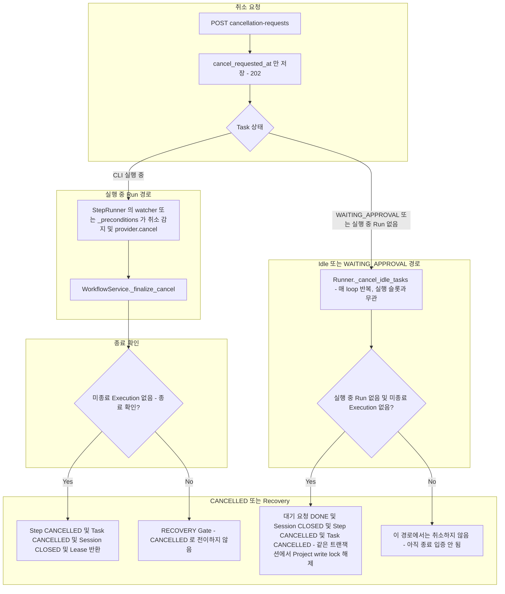
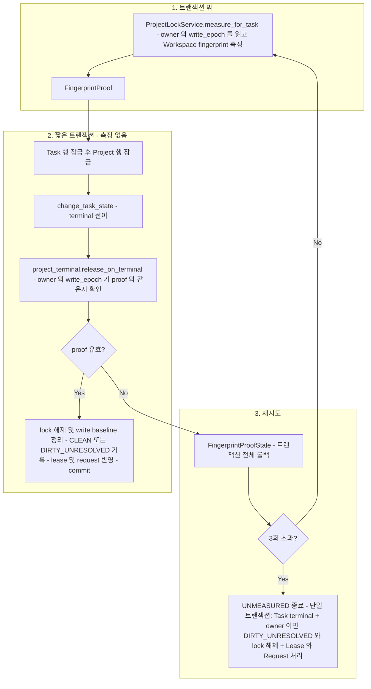
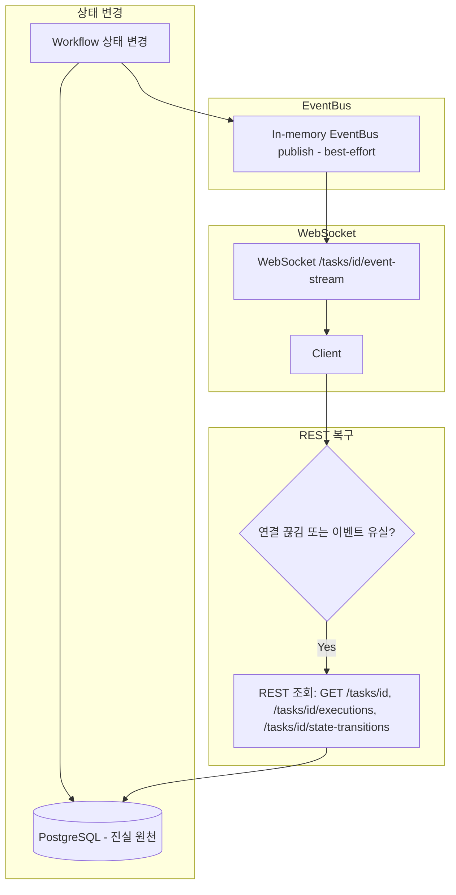
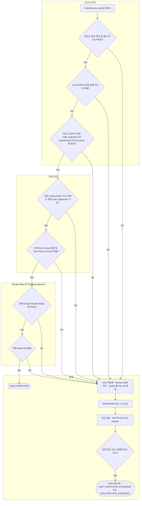

# Cancellation, Streaming 및 Completion

> 현재 구현 코드를 기준으로 정리한 흐름입니다. 코드로 확인되지 않았거나 검증되지 않은 동작은 현재 구현 제한으로 구분합니다.

이 문서의 세 다이어그램(Cancellation, Event Streaming, Completion)은 서로 독립적이며 다이어그램 사이에 연결선이 없습니다. 각각 따로 읽을 수 있습니다.

## Cancellation

`POST /tasks/{id}/cancellation-requests`는 `tasks.cancel_requested_at`만 기록하고 202를 반환합니다. 상태를 직접 CANCELLED로 바꾸지 않습니다. 실제 전이는 CLI 종료가 확인된 뒤에 수행합니다. 아래 다이어그램은 취소 요청 이후의 두 경로(실행 중 Run, 실행 중 Run 없음)와 종료 확인 결과를 보여주며, 중심 클래스는 `WorkflowService._finalize_cancel`과 `Runner._cancel_idle_tasks`입니다.

- 대기 중인 Approval 상태에서 취소하면 실행 중 Run이 없고 미종료 Execution이 없는지 확인한 뒤 종료합니다.
- 종료가 불확실하면 CANCELLED가 아니라 RECOVERY Gate로 이동합니다 ([09](09-recovery.md)).
- `_cancel_idle_tasks`는 `Runner.recover` 안에서 Runner 시작 시와 loop 반복마다 실행됩니다. 실행 슬롯이 가득 차 있어도 실행되므로, `WAITING_APPROVAL`에서 write lock을 쥔 Task의 취소가 굶지 않습니다.

## Terminal 전이와 Project write lock 정리

Task의 모든 terminal 전이(`COMPLETED`, `FAILED`, `CANCELLED`)는 `state_service.change_task_state` 한 곳을 지나며, 프로젝트 Task에서는 같은 트랜잭션 안에서 `project_terminal.release_on_terminal`이 Project 정리를 수행합니다(lock 해제 + write baseline 정리 + `write_epoch` 증가 + `workspace_state` 기록). 이 트랜잭션에 ExecutionRequest의 `DONE` 처리는 포함되지 않습니다(`Runner.process`가 별도 트랜잭션으로 처리하고, 누락은 startup recovery가 정리). 이 함수가 terminal 정리의 유일한 소유자이며, `ProjectLockService`에는 일반 release가 없습니다(reconcile 전용 `reconcile`뿐).

프로젝트 Task의 terminal 호출 지점(실패 마감 `_fail`, 취소 `_finalize_cancel`, `max_replans`·반복 한도, COMPLETED, RECOVERY abort·거절, idle/parked 취소)은 `TaskFinalizer.finalize_task_with_proof` 또는 같은 재시도 규칙을 쓰는 단계 완료 래퍼(`WorkflowService._complete_succeeded`, `HumanGateService.decide`)를 통과합니다.

- `CLEAN` 판정: 측정이 유효하고 `COMPLETED`이면 최종 fingerprint가 새 `baseline_fingerprint`가 됩니다. `FAILED`/`CANCELLED`는 현재 fingerprint가 `write_baseline_fingerprint`(lock 획득 시 기록)와 같을 때만 `CLEAN`이고, 다르면 `DIRTY_UNRESOLVED`입니다. proof가 없거나 `UNMEASURED`이면 `COMPLETED`라도 `CLEAN`으로 끝나지 않고, write baseline의 fingerprint 버전이 현재와 다르면 `FAILED`/`CANCELLED`에서 비교할 수 없으므로 `DIRTY_UNRESOLVED`입니다.
- 소유자가 아닌 Task(legacy Task, lock을 얻은 적 없는 Project Task)는 proof 없이 같은 경로를 지나며 Project에는 아무 변경도 하지 않습니다.
- `UNMEASURED` 종료에서 owner가 이미 다른 Task로 바뀌었다면 그 Project lock은 해제하지 않고 현재 Task만 terminal 처리합니다. 이미 terminal인 Task에 대한 재실행은 아무 것도 하지 않습니다.
- Task terminal과 Project 정리는 서로 다른 트랜잭션으로 나뉘지 않으므로, 한 쪽만 보이는 중간 상태가 다른 세션에 관찰되지 않습니다(통합 테스트로 확인).

## Event Streaming

Workflow 상태 변경이 PostgreSQL에 기록되고 in-memory EventBus를 통해 WebSocket 클라이언트로 전달되는 흐름입니다. EventBus는 best-effort이며 유실 시 REST 조회로 복구합니다.

- Event Bus는 best-effort이며 재전송을 보장하지 않습니다. 복구 경로는 PostgreSQL REST 조회입니다.

## Completion (Definition of Done)

Completion Checker는 별도 Agent나 Service가 아닙니다. `WorkflowService._review_transition`이 Code Review `PASS`를 처리할 때 `_dod_problems`를 통해 호출하는 `check_definition_of_done` 함수입니다. 아래 다이어그램은 그 검사를 세 구역으로 묶어 보여주며, 하나라도 어긋나면 Task가 곧바로 FAILED가 되는 것이 아니라 Review 결과가 `FAIL`로 처리되어 `WorkflowService._to_retry`로 이어집니다. 중심 함수는 `check_definition_of_done`입니다.

검사 조건은 `app/services/completion_checker.py`의 `check_definition_of_done`이 실제로 확인하는 항목이며 세 묶음으로 나뉩니다.

- 테스트 증거: 테스트 결과 존재, 필수 테스트 PASS, JUnit 유효성 및 실행된 테스트 존재 (`executed - skipped >= 1`), 현재 코드 fingerprint와의 일치, 현재 requirements / test policy와의 일치
- 리뷰 증거: Code Review PASS, CRITICAL Issue 없음, Test Policy Concern 없음, 리뷰도 현재 코드 fingerprint 기준
- Design Basis 및 Pending Approval: 현재 Design Review Basis에 대한 PASS, 미결 Approval 없음

미충족이 있으면 Review 결과가 `FAIL`로 바뀌어 개선 반복(`RETRYING`)으로 이동하고, `plan_defect`면 재계획으로 이동합니다. 이 검사에서 FAILED가 되는 경우는 반복 한도(`max_workflow_iterations`) 또는 재계획 한도(`max_replans`) 초과뿐입니다 ([05](05-development-testing.md)). (프로젝트 Task는 이 밖에 `PROJECT_WORKSPACE_UNSTABLE`, `PROJECT_DIRTY_ABORTED`/`PROJECT_DIRTY_REJECTED` 등으로도 FAILED가 될 수 있으며 Completion 검사와는 무관합니다.)
- COMPLETED가 되는 순간의 Project 정리(최종 fingerprint를 baseline으로 수용)는 위 「Terminal 전이와 Project write lock 정리」를 따릅니다.

## 현재 구현 제한

- Completion Checker는 미종료 Execution을 별도 쿼리로 검사하지 않습니다. 위 세 묶음의 검사가 전부입니다.
- Event Bus는 단일 프로세스 in-memory입니다. Runner와 다른 프로세스에서 발행된 이벤트는 전달되지 않을 수 있으며 REST 조회로 확인해야 합니다.
