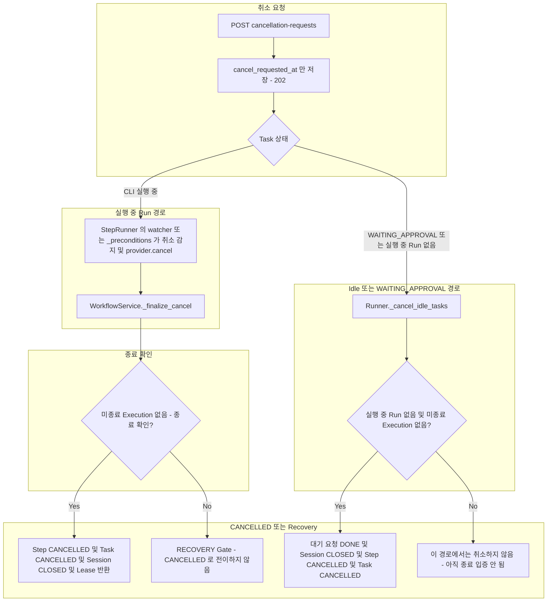
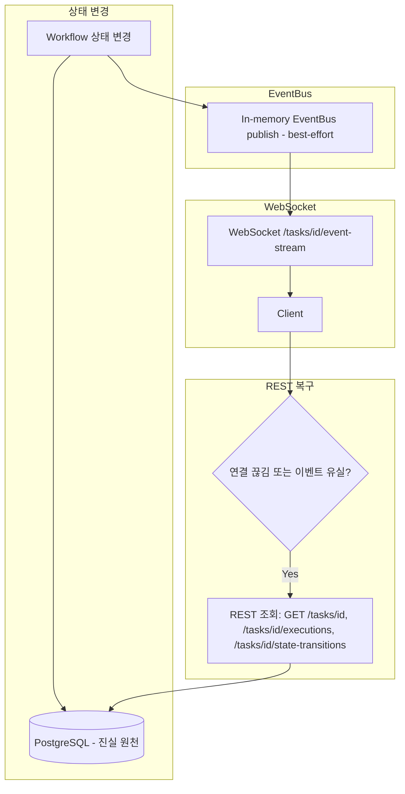
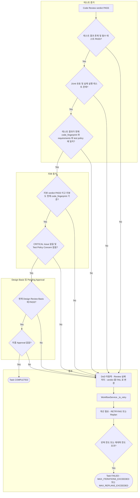

# Cancellation, Streaming 및 Completion

> 현재 구현 코드를 기준으로 정리한 흐름입니다. 코드로 확인되지 않았거나 검증되지 않은 동작은 현재 구현 제한으로 구분합니다.

이 문서의 세 다이어그램(Cancellation, Event Streaming, Completion)은 서로 독립적이며 다이어그램 사이에 연결선이 없습니다. 각각 따로 읽을 수 있습니다.

## Cancellation

`POST /tasks/{id}/cancellation-requests`는 `tasks.cancel_requested_at`만 기록하고 202를 반환합니다. 상태를 직접 CANCELLED로 바꾸지 않습니다. 실제 전이는 CLI 종료가 확인된 뒤에 수행합니다. 아래 다이어그램은 취소 요청 이후의 두 경로(실행 중 Run, 실행 중 Run 없음)와 종료 확인 결과를 보여주며, 중심 클래스는 `WorkflowService._finalize_cancel`과 `Runner._cancel_idle_tasks`입니다.

- 대기 중인 Approval 상태에서 취소하면 실행 중 Run이 없고 미종료 Execution이 없는지 확인한 뒤 종료합니다.
- 종료가 불확실하면 CANCELLED가 아니라 RECOVERY Gate로 이동합니다 ([09](09-recovery.md)).
- `_cancel_idle_tasks`는 Runner 시작 시와 요청 대기 중 주기적으로 실행됩니다.

## Event Streaming

Workflow 상태 변경이 PostgreSQL에 기록되고 in-memory EventBus를 통해 WebSocket 클라이언트로 전달되는 흐름입니다. EventBus는 best-effort이며 유실 시 REST 조회로 복구합니다.

- Event Bus는 best-effort이며 재전송을 보장하지 않습니다. 복구 경로는 PostgreSQL REST 조회입니다.

## Completion (Definition of Done)

Completion Checker는 별도 Agent나 Service가 아닙니다. `WorkflowService._review_transition`이 Code Review `PASS`를 처리할 때 `_dod_problems`를 통해 호출하는 `check_definition_of_done` 함수입니다. 아래 다이어그램은 그 검사를 세 구역으로 묶어 보여주며, 하나라도 어긋나면 Task가 곧바로 FAILED가 되는 것이 아니라 Review 결과가 `FAIL`로 처리되어 `WorkflowService._to_retry`로 이어집니다. 중심 함수는 `check_definition_of_done`입니다.

검사 조건은 `app/services/completion_checker.py`의 `check_definition_of_done`이 실제로 확인하는 항목이며 세 묶음으로 나뉩니다.

- 테스트 증거: 테스트 결과 존재, 필수 테스트 PASS, JUnit 유효성 및 실행된 테스트 존재 (`executed - skipped >= 1`), 현재 코드 fingerprint와의 일치, 현재 requirements / test policy와의 일치
- 리뷰 증거: Code Review PASS, CRITICAL Issue 없음, Test Policy Concern 없음, 리뷰도 현재 코드 fingerprint 기준
- Design Basis 및 Pending Approval: 현재 Design Review Basis에 대한 PASS, 미결 Approval 없음

미충족이 있으면 Review 결과가 `FAIL`로 바뀌어 개선 반복(`RETRYING`)으로 이동하고, `plan_defect`면 재계획으로 이동합니다. FAILED가 되는 경우는 반복 한도(`max_workflow_iterations`) 또는 재계획 한도(`max_replans`) 초과뿐입니다 ([05](05-development-testing.md)).

## 현재 구현 제한

- Completion Checker는 미종료 Execution을 별도 쿼리로 검사하지 않습니다. 위 세 묶음의 검사가 전부입니다.
- Event Bus는 단일 프로세스 in-memory입니다. Runner와 다른 프로세스에서 발행된 이벤트는 전달되지 않을 수 있으며 REST 조회로 확인해야 합니다.
