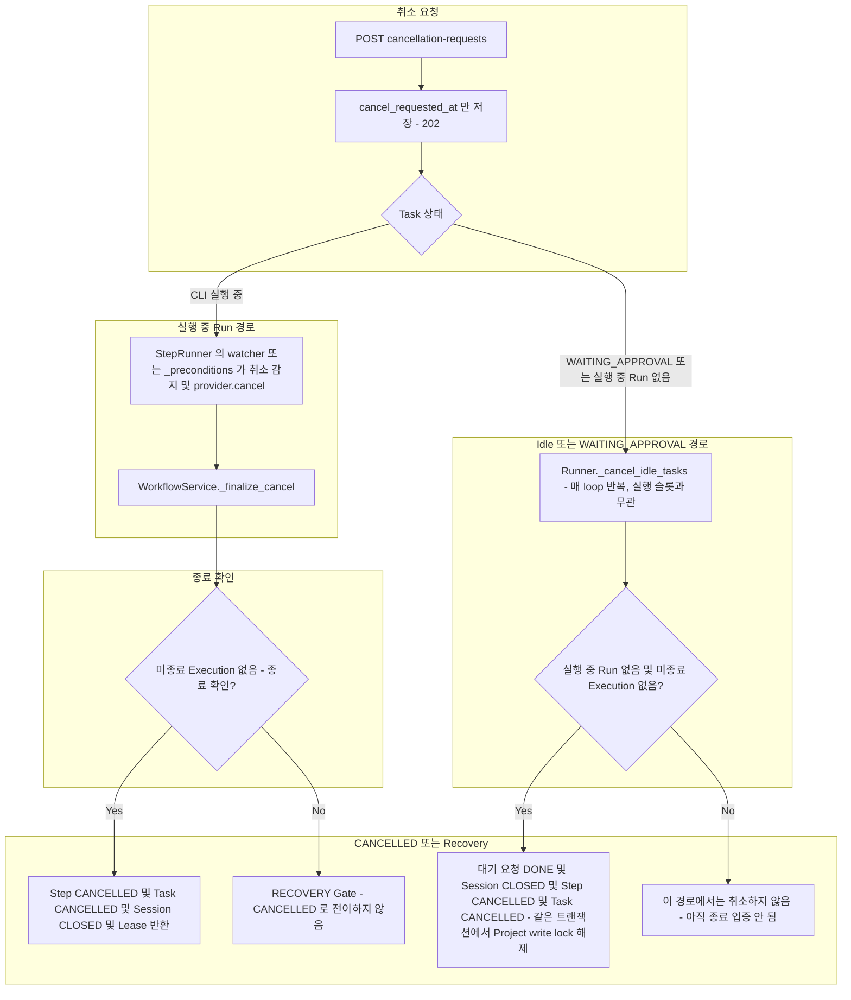
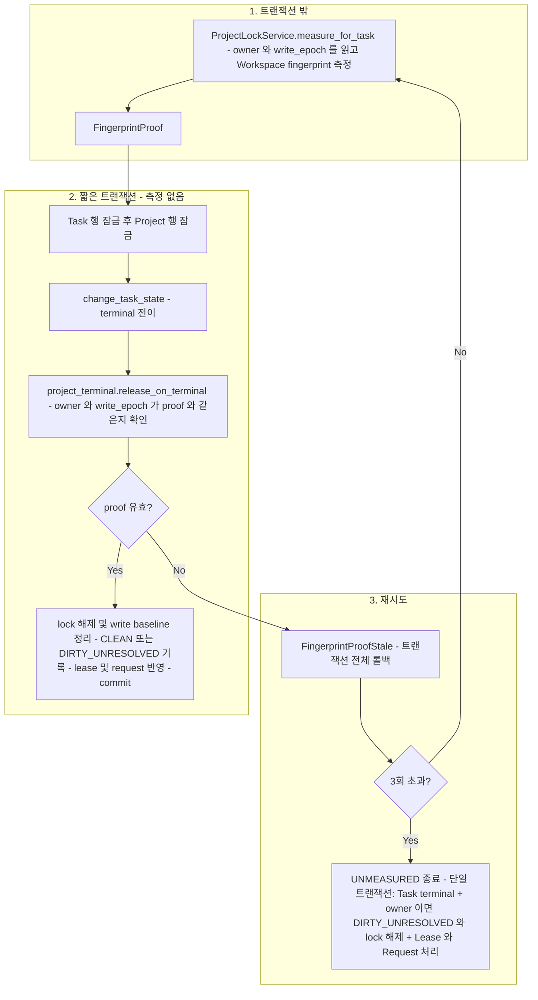
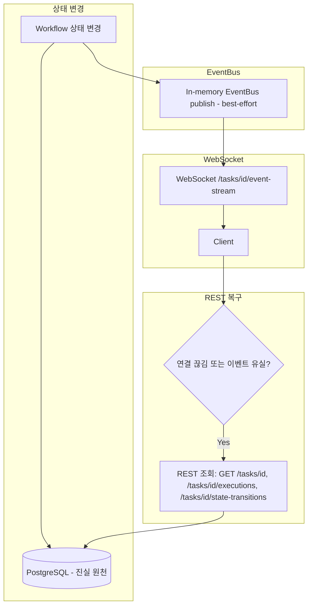
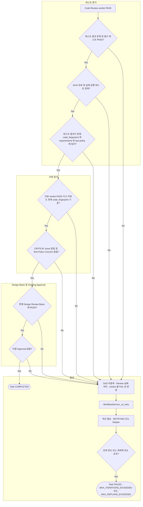
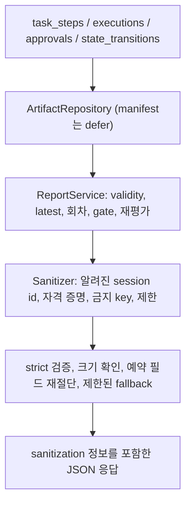
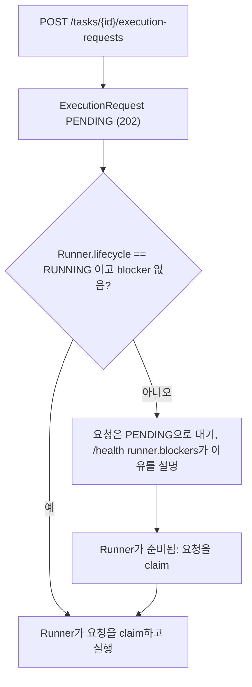

# Cancellation, Streaming 및 Completion

> English: [11-task-lifecycle.md](11-task-lifecycle.md)

> 현재 구현 코드를 기준으로 정리한 흐름입니다. 코드로 확인되지 않았거나 검증되지 않은 동작은 현재 구현 제한으로 구분합니다.

이 문서의 세 다이어그램(Cancellation, Event Streaming, Completion)은 서로 독립적이며 다이어그램 사이에 연결선이 없습니다. 각각 따로 읽을 수 있습니다.

## Cancellation

`POST /tasks/{id}/cancellation-requests`는 `tasks.cancel_requested_at`만 기록하고 202를 반환합니다. 상태를 직접 CANCELLED로 바꾸지 않습니다. 실제 전이는 CLI 종료가 확인된 뒤에 수행합니다. 아래 다이어그램은 취소 요청 이후의 두 경로(실행 중 Run, 실행 중 Run 없음)와 종료 확인 결과를 보여주며, 중심 클래스는 `WorkflowService._finalize_cancel`과 `Runner._cancel_idle_tasks`입니다.

- 대기 중인 Approval 상태에서 취소하면 실행 중 Run이 없고 미종료 Execution이 없는지 확인한 뒤 종료합니다.
- 종료가 불확실하면 CANCELLED가 아니라 RECOVERY Gate로 이동합니다 ([09](09-recovery_ko.md)).
- `_cancel_idle_tasks`는 `Runner.recover` 안에서 Runner 시작 시와 loop 반복마다 실행됩니다. 실행 슬롯이 가득 차 있어도 실행되므로, `WAITING_APPROVAL`에서 write lock을 쥔 Task의 취소가 굶지 않습니다.

## Terminal 전이와 Project write lock 정리

Task의 모든 terminal 전이(`COMPLETED`, `FAILED`, `CANCELLED`)는 `state_service.change_task_state` 한 곳을 지나며, 프로젝트 Task에서는 같은 트랜잭션 안에서 `project_terminal.release_on_terminal`이 Project 정리를 수행합니다(lock 해제 + write baseline 정리 + `write_epoch` 증가 + `workspace_state` 기록). 이 트랜잭션에 ExecutionRequest의 `DONE` 처리는 포함되지 않습니다(`Runner.process`가 별도 트랜잭션으로 처리하고, 누락은 startup recovery가 정리). 이 함수가 terminal 정리의 유일한 소유자이며, `ProjectLockService`에는 일반 release가 없습니다(reconcile 전용 `reconcile`뿐).

프로젝트 Task의 terminal 호출 지점(실패 마감 `_fail`, 취소 `_finalize_cancel`, `max_replans`·반복 한도, COMPLETED, RECOVERY abort·거절, idle/parked 취소)은 `TaskFinalizer.finalize_task_with_proof` 또는 같은 재시도 규칙을 쓰는 단계 완료 래퍼(`WorkflowService._complete_succeeded`, `HumanGateService.decide`)를 통과합니다.

- `CLEAN` 판정: 측정이 유효하고 `COMPLETED`이면 최종 fingerprint가 새 `baseline_fingerprint`가 됩니다. `FAILED`/`CANCELLED`는 현재 fingerprint가 `write_baseline_fingerprint`(lock 획득 시 기록)와 같을 때만 `CLEAN`이고, 다르면 `DIRTY_UNRESOLVED`입니다. proof가 없거나 `UNMEASURED`이면 `COMPLETED`라도 `CLEAN`으로 끝나지 않고, write baseline의 fingerprint 버전이 현재와 다르면 `FAILED`/`CANCELLED`에서 비교할 수 없으므로 `DIRTY_UNRESOLVED`입니다.
- `TEST_ONLY` Task(Project Test Run)는 terminal 상태와 관계없이 accepted baseline을 옮기지 않습니다. 유효한 proof가 있어도 현재 fingerprint가 `write_baseline_fingerprint`와 같을 때만 `CLEAN`이고, 추적 파일 변경, 추적되지 않는 부산물, proof 없음, `UNMEASURED`는 Task가 `COMPLETED`여도 `DIRTY_UNRESOLVED`입니다. 따라서 테스트 실행은 빌드 부산물을 조용히 채택하지 않으며, 다음 Task가 `PROJECT_DIRTY` Gate를 만납니다.
- 소유자가 아닌 Task(legacy Task, lock을 얻은 적 없는 Project Task)는 proof 없이 같은 경로를 지나며 Project에는 아무 변경도 하지 않습니다.
- `UNMEASURED` 종료에서 owner가 이미 다른 Task로 바뀌었다면 그 Project lock은 해제하지 않고 현재 Task만 terminal 처리합니다. 이미 terminal인 Task에 대한 재실행은 아무 것도 하지 않습니다.
- Task terminal과 Project 정리는 서로 다른 트랜잭션으로 나뉘지 않으므로, 한 쪽만 보이는 중간 상태가 다른 세션에 관찰되지 않습니다(통합 테스트로 확인).

## Event Streaming

Workflow 상태 변경이 PostgreSQL에 기록되고 in-memory EventBus를 통해 WebSocket 클라이언트로 전달되는 흐름입니다. EventBus는 best-effort이며 유실 시 REST 조회로 복구합니다.

- Event Bus는 best-effort이며 재전송을 보장하지 않습니다. 복구 경로는 PostgreSQL REST 조회입니다.

## Completion (Definition of Done)

Completion Checker는 별도 Agent나 Service가 아닙니다. `WorkflowService._review_transition`이 Code Review `PASS`를 처리할 때 `_dod_problems`를 통해 호출하는 `check_definition_of_done` 함수입니다. 아래 다이어그램은 그 검사를 세 구역으로 묶어 보여주며, 하나라도 어긋나면 Task가 곧바로 FAILED가 되는 것이 아니라 Review 결과가 `FAIL`로 처리되어 `WorkflowService._to_retry`로 이어집니다. 중심 함수는 `check_definition_of_done`입니다.

검사 조건은 `app/services/completion_checker.py`의 `check_definition_of_done`이 실제로 확인하는 항목이며 세 묶음으로 나뉩니다.

- 테스트 증거: 테스트 결과 존재, 필수 테스트 PASS, JUnit 유효성 및 실행된 테스트 존재 (`executed - skipped >= 1`), 현재 코드 fingerprint와의 일치, 현재 requirements / test policy와의 일치
- 리뷰 증거: Code Review PASS, CRITICAL Issue 없음, Test Policy Concern 없음, 리뷰도 현재 코드 fingerprint 기준
- Design Basis 및 Pending Approval: 현재 Design Review Basis에 대한 PASS, 미결 Approval 없음

미충족이 있으면 Review 결과가 `FAIL`로 바뀌어 개선 반복(`RETRYING`)으로 이동하고, `plan_defect`면 재계획으로 이동합니다. 이 검사에서 FAILED가 되는 경우는 반복 한도(`max_workflow_iterations`) 또는 재계획 한도(`max_replans`) 초과뿐입니다 ([05](05-development-testing_ko.md)). (프로젝트 Task는 이 밖에 `PROJECT_WORKSPACE_UNSTABLE`, `PROJECT_DIRTY_ABORTED`/`PROJECT_DIRTY_REJECTED` 등으로도 FAILED가 될 수 있으며 Completion 검사와는 무관합니다.)
- COMPLETED가 되는 순간의 Project 정리(최종 fingerprint를 baseline으로 수용)는 위 「Terminal 전이와 Project write lock 정리」를 따릅니다.

### Test-only Task (Project Test Run)

`mode = TEST_ONLY`인 Task는 위의 Definition of Done을 쓰지 않습니다. Plan, Design Review, Code Review, profile 기준은 적용되지 않습니다. `completion_checker.evaluate_test_only_completion`이 테스트 step을 완료하는 트랜잭션 안에서 조건을 평가합니다(Task 행이 잠기고 Lease가 검증되므로 취소 요청과 tracked 실행이 결과를 정하는 같은 트랜잭션에서 읽힙니다).

- 테스트 정책 hash가 Task 생성 때의 값이고 취소 요청이 없음
- 시간 초과된 테스트 명령이 없고 모든 명령이 성공함
- 사용 가능한 JUnit 결과가 있고, 실패한 테스트가 없으며, 실제로 실행된 테스트가 `min_tests_executed` 이상임
- Orchestrator 자신의 판정이 `passed`이고, Task의 tracked 실행 중 입증되지 않은 것이 없음

모두 충족하면 `COMPLETED`입니다. 아니면 Task는 `FAILED`이고 `failure_reason`은 처음 충족하지 못한 조건이며 순서는 `TEST_POLICY_CHANGED`, `CANCEL_REQUESTED`, `TESTS_TIMEOUT`, `TESTS_FAILED`(성공하지 못한 명령 또는 실패한 테스트), `NO_JUNIT`, `TOO_FEW_TESTS`입니다. 바쁜 project를 너무 오래 기다린 run은 `PROJECT_BUSY`로 `FAILED`가 됩니다([03](03-task-runner_ko.md)). 입증되지 않은 프로세스 트리는 실패 사유가 아니라 fail-closed입니다. 실패한 테스트 실행은 개선 루프로 재시도되지 않습니다. 개선할 것이 없으므로 `RETRYING`에 들어가지 않습니다.

## 결과 읽기: 산출물과 보고서

`GET /tasks/{id}/artifacts`, `GET /tasks/{id}/artifacts/{artifact_id}`, `GET /tasks/{id}/report`는 이미 저장된 데이터를 읽을 뿐이며 에이전트, 명령, LLM을 실행하지 않고 아무것도 쓰지 않습니다. `COMPLETED`는 오케스트레이터의 완료 조건을 충족했다는 뜻이지 결과가 인수·merge·배포되었다는 뜻이 아닙니다. 저장된 COMPLETED 전이는 `historical_completion`으로 보이며(그 시점의 Definition-of-Done 상세는 저장된 적이 없어 `UNKNOWN`), `current_re_evaluation`은 같은 조건을 지금 평가하고(`check_definition_of_done`의 근거 함수인 `evaluate_definition_of_done`) 과거 완료를 확인하거나 취소하지 않습니다. 모든 산출물에서 세 카운터(`plan_revision`, `workflow_iteration`, `step_attempt`)는 분리되어 있습니다.

산출물과 별개로 `GET /tasks/{id}/changes`는 Task가 write lock을 잡은 이후 workspace에서 무엇을 바꾸었는지 보여 줍니다. live workspace를 저장된 baseline과 비교하며(경로와 hash, 본문은 git이 옛 내용을 줄 수 있는 경우만), snapshot이 아니라 live 비교입니다. `lock_consistency`(DB)와 `workspace_consistency`(파일, 측정 두 번, `verify_workspace=true`)는 따로 보고하고, 더 이상 Project를 소유하지 않는 Task는 확정된 diff를 받지 못합니다. baseline이 없는 Task(`NO_BASELINE`), Project가 없는 Task(`NO_PROJECT`), baseline이 `UNAVAILABLE`인 Task는 이유와 함께 그렇게 알려 줍니다.

## Runner 준비 상태와 진단

`POST /tasks/{id}/execution-requests`는 `PENDING` 요청을 저장할 뿐이며, Runner가 가져가는지와 무관하게 202로 응답합니다. 가져갈 수 있는지는 읽기 전용인 `GET /health`(`ready`, `runner.blockers`)와 `GET /projects/{id}/diagnostics`(`RUNNER_STATE`)가 알려 줍니다. `runner_active`와 `ready`는 `Runner.lifecycle`에서 계산하고, Runner가 시작되지 않은 이유(`PREFLIGHT_FAILED`, `ADVISORY_LOCK_HELD`)는 lifespan이 기록한 `StartupOutcome`에서 옵니다. 대기 중인 요청은 사라지지 않으며 다음에 시작하는 Runner가 가져갑니다. `START_FAILED`는 `Runner.start`의 일반 실패가 API lifespan을 중단시키지 않게 될 때까지 예약 상태입니다.

### 프로세스 추적, 백그라운드, tracked execution 진단

아래는 모두 읽기 전용이며, 조회는 아무것도 시작하거나 재시작하거나 쓰지 않습니다.

- **`/health` 본문**: `status`, `runner_active`, `ready`, `warnings`, `runner`(`lifecycle`, `startup_outcome`, `blockers`, `background_degraded`, `sweeper`). `warnings`에는 고정 code(`SWEEPER_STALLED`, `SWEEPER_CONFIG_INVALID`, `BACKGROUND_COMPONENT_DEGRADED`, 정렬됨)만 들어갑니다. `runner.sweeper`는 `stalled`, `consecutive_failures`, `last_failure_code`, `last_failure_at`, `next_retry_at`, `config_invalid_active`, `clearance_pending`을 가집니다. supervisor가 degraded이면 blocker `SUPERVISOR_DEGRADED`가 추가되어 `ready=false`가 되고, sweeper·risk worker·capability unit이 degraded이면 `background_degraded`와 warning만 설정됩니다. [03](03-task-runner_ko.md)의 파생 표시 상태는 `/health`에 나타나지 않습니다.
- **보고서**: `GET /tasks/{id}/report`는 `state`(`KNOWN` 또는 `UNKNOWN`), `ready`, `blockers`, `warnings`, `sweeper`, `background_degraded`(같은 고정 값)를 가진 `runtime` 객체를 포함합니다.
- `GET /projects/{id}/diagnostics`의 **`PROCESS_TRACKING` 항목**: Runner의 추적 capability입니다. 이 프로세스에서 `RUNNING`인 Runner는 자신의 메모리를 보고하고, 지원되지 않는 플랫폼은 로컬에서 결정하며, 그 밖에는 저장된 `runtime_capabilities` 행을 상태가 `UNKNOWN`이 아니고, 최신(`CAPABILITY_TTL_SECONDS`)이며, Runner advisory lock을 행이 지목한 backend가 잡고 있을 때만 신뢰합니다. 그 외, 읽기 실패 포함, 는 fail-closed unknown입니다. `SUPPORTED`는 `PASS`, `UNSUPPORTED_PLATFORM`은 `WARN`(`PROCESS_TRACKING_UNSUPPORTED_PLATFORM`: Task는 계속 실행되며 untracked), `UNAVAILABLE`은 `FAIL`(`PROCESS_TRACKING_UNAVAILABLE`: self-test 실패, tracked 테스트 명령은 fail-closed), 읽을 수 없으면 `UNKNOWN`(`PROCESS_TRACKING_STATUS_UNKNOWN`)입니다. `SUPPORTED`를 제외한 모든 상태에 `blocks_features: ["TEST_RUN"]`가 붙으며, `SUPPORTED`에서는 이 키가 없습니다.
- **`TRACKED_EXECUTIONS` 항목**: `causes` 목록(각각 `reason_code`, `severity`, `blocks_execution`, `cause`, `recommendation`, 제한된 관련 execution·request id)이며, 항목 상태는 가장 높은 severity이고 정상 진행은 본문의 정보일 뿐입니다. 행 원인은 프로젝트의 U·A 행([09](09-recovery_ko.md))에서 옵니다. `TRACKED_EXECUTION_ANOMALY`(`FAIL`), `TASK_TERMINAL_WITH_UNRESOLVED`, `NO_OWNING_RUN`, `TASK_NOT_EXECUTING`, `LEASE_EXPIRED`, `RUNNER_MISMATCH`, `EXECUTION_TOO_OLD`, `CLOSED_UNPROVEN`(`WARN`). 요청 원인은 열려 있는 `process_risk_requests`와 capability에서 옵니다. `REQUEST_WITHOUT_WORKER`, `REQUEST_CLAIM_TIMEOUT`, `REQUEST_RETRY_STUCK`, `CAPABILITY_MISMATCH`(`WARN`).
- **`RUNNER_STATE` 원인**: `BACKGROUND_COMPONENT_DEGRADED`(supervisor일 때만 `FAIL`이며 차단, 그 외 `WARN`), `BACKGROUND_COMPONENT_DERIVED`(`WARN`, 표시 전용, lifecycle이 `RUNNING`일 때만), `SWEEPER_STALLED`와 `SWEEPER_CONFIG_INVALID`(`WARN`). 항목은 기본 상태와 원인 중 가장 높은 severity를 유지합니다.
- `DIAGNOSTICS_POLICY_VERSION`은 2이며 진단 cache key에 포함되므로, 검사 집합이 바뀌어도 이전 cache 응답이 제공되지 않습니다.

## 현재 구현 제한

- 프로세스 추적 진단의 검증 범위: reader는 단위 테스트와 내장 PostgreSQL 테스트(`tests/unit/test_tracked_causes.py`, `tests/integration_pg/test_tracked_diagnostics.py`)로 **검증됨**이며, capability 자체는 Windows에서만 실제 Job Object self-test에서 옵니다. POSIX 정책은 코드에만 존재하고(`UNSUPPORTED_PLATFORM`, `WARN`, untracked) POSIX 런타임 동작은 **검증하지 않았습니다**. **검증하지 않은 것**: POSIX 런타임, 실제 Gradle/Maven 빌드, 실제 CLI E2E, 무작위 race stress, EXPLAIN/generic plan, 실제 deadlock 테스트.
- `COMPONENT_EXCEPTION`과 `EXTERNAL_OR_UNKNOWN`은 내부 `last_failure` code(와 로그 문구)이며 API code가 아닙니다. 진단의 unit reason code는 [03](03-task-runner_ko.md)의 `DEGRADED` 값입니다.

- Completion Checker는 미종료 Execution을 별도 쿼리로 검사하지 않습니다. 위 세 묶음의 검사가 전부입니다.
- Event Bus는 단일 프로세스 in-memory입니다. Runner와 다른 프로세스에서 발행된 이벤트는 전달되지 않을 수 있으며 REST 조회로 확인해야 합니다.
- `TEST_ONLY` Task(Project Test Run)는 내부 서비스 경로(`TaskService.create_test_run`)로만 존재합니다. 공개 endpoint는 아직 없고, 보고서와 artifact 목록은 이 Task에서 plan, review, profile 항목을 아직 `해당 없음`으로 표시하지 않습니다. Windows에서만 검증했으며 tracked 명령의 POSIX 런타임과 실제 Maven/Gradle 빌드는 실행하지 않았습니다.
